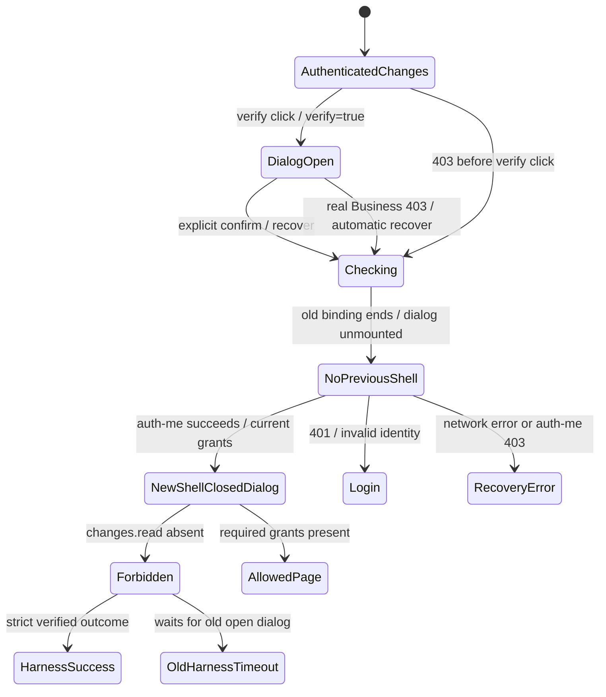

# ChangeFlow Governance — A5-T4 / T4-A

> أحدث حالة: **T4-C2A ACCEPTED FOR DEVELOPMENT CHECKPOINT — SAVE AUTHORIZED** في §29. وافق المالك على Commit واحدة وPush للفرع المعتمد بعد بوابة الحفظ. نماذج الكتابة الجديدة تبقى مغلقة تشغيليًا؛لاC2B أوBatch B/C/D أوProduction Approval.

**Goal:** جرد الوظائف القائمة وعقودها، وتحديد نقل تدريجي قابل للمراجعة دون فقد سلوك أوتوسيع صلاحيات.

**Architecture:** React Router Data Mode و AuthRoot و Application Shell المعتمدة؛ Feature-owned APIs/Decoders/Hooks/View Models فوق ApiClient و Workspace Gateway الحاليين. فصل النقل والتحقق والعرض، دون Cache عامة أو State framework جديدة.

**Tech Stack:** React 19 / TypeScript 6 / Vite 8 ، React Router ، i18next/react-i18next ، CSS tokens و Motion القائمة؛ FastAPI/Pydantic/SQLAlchemy/PostgreSQL الحالية. لا Dependency جديدة في T4-A.

**Spec / Authorization:** طلب المالك «A5-T4 — Enterprise Feature Pages Integration & Frontend Architecture»، قسم 12: **Initial Execution — T4-A Only**. تاريخ التحقق 2026-11-02 Asia/Riyadh. التنفيذ الحالي Audit/Contracts/Architecture/Migration Plan/Verification/Documentation فقط. لا T4-B/C/D/E قبل اعتماد منفصل لكل دفعة، ولا Batch B/C/D الأوسع أو Gemini أو Git writes أو Deployment أو Models/Migrations أوتغيير سياسة JWT/Permissions.

**Review Focus:** اختلاف المؤسسة أثناء الطلب، سباق مرشحات داخل الجلسة نفسها، Runtime Validation ، حدود Risk/CAB ، Pagination صحيحة، الحفاظ على جميع وظائف Legacy حتى النقل واختبار البديل أوتقاعد معتمد صراحة.

## 1. Baseline and scope

| Item | Evidence |
|---|---|
| Repository / origin | `bigest11/ChangeFlow-Governance` / `https://github.com/bigest11/ChangeFlow-Governance.git` fetch+push |
| Branch | `feature/phase2-batch-a-tenant-security` |
| HEAD | `48c1e8ef46d60c1ed85ebc7c59ed3dfbcde8fded`، Checkpoint T3 المحفوظة |
| master local/remote عند البدء | `10faab20b1c61b5476165bbc1f5d28a2a85e2652`، لم يتغير |
| Working Tree / staging عند البدء | نظيفتان، لا Modified أو Untracked أو Staged |
| Current changes | وثيقتان فقط؛ لا Application/Test/Dependency/Backend code changes |
| Reviewed | master و T1/T2/T3 ، Router/Shell/Auth/Client/Gateway و App.tsx كله، Routers/Schemas/Permissions/Tenant resource selectors والخدمات اللازمة |

نتائج T1/T2/T3 محفوظة تاريخيًا؛ لا نعيد تفسير موافقة حفظ T3 على أنها تفويض Git لهذه المهمة. لم تُشغّل Setup أو Bootstrap ، ولم تُفتح قاعدة قديمة أوتُقرأ Password Hashes أو.env تشغيلية. ملفات الاختبار المؤقتة والأدلة البصرية خارج المستودع.

### 1.1 Source evidence index

- [Legacy App](../../frontend/src/App.tsx)، [Router](../../frontend/src/app/router.tsx)، [Route policy](../../frontend/src/app/routePolicy.ts)، [Legacy Adapter](../../frontend/src/app/LegacyWorkspaceAdapter.tsx).
- [ApiClient](../../frontend/src/services/api/client.ts)، [ApiSession](../../frontend/src/services/api/session.ts)، [Workspace Gateway](../../frontend/src/features/auth/workspaceGateway.ts)، [Auth Store](../../frontend/src/features/auth/authStore.ts).
- [Permissions](../app/services/permissions.py)، [Tenant Resources](../app/services/tenant_resources.py)؛ راجع أسماءالملفاتالفعليةفيالفهرس أدناه عنداختلافnamespace.
- Backend routers: [Auth](../app/routes/auth.py)، [Foundation](../app/routes/foundation.py)، [Changes](../app/routes/change_management.py)، [Execution](../app/routes/change_execution.py)، [Notifications](../app/routes/notifications.py)، [Invitations](../app/routes/invitations.py). Schemas في`backend/app/schemas/`؛ services للدعواتوالتقييم وسياساتTenant قُرئت معالـrouters.
- [Isolated Runner](../tests/a5_isolated_runner.py)، [Isolation Guard](../tests/a5_isolation.py)، [Auth Browser Harness](../tests/test_a5_t2_browser.py)، [Presentation Harness](../tests/test_a5_t3_browser.py).

## 2. Inventory method and classification

`frontend/src/App.tsx`: **5227 سطرًا، 54 function declaration ، 84 useState ، 8 useEffect و 8 useEffectEvent**. الجرد التالي يغطي الدوال والـ Renderers والأحداث؛ لا يساوي عدد الدوال عدد المنتجات أوالصفحات.

- **S — Implemented and Safe to Extract:** العقد والعزل موجودان؛ قابل للنقل بعد اختبارات الصفحة، وليس ضمان Production readiness.
- **L — Implemented but Security-Limited:** موجود لكن قيد Risk/CAB/D أوعقد عرض مضلل يمنع الترويج له كميزة مؤسسية مؤمنة.
- **M — Backend Contract Missing:** لا Endpoint مسجلة للعملية؛ لا Dummy button ولا API جديدة تلقائيًا.
- **D — Deferred to Batch B/C/D or Advanced Features:** سياسة أووظيفة متقدمة خارج A5-T4 الحالية. قد تكون L/D معًا.

كل صف وظيفة أدناه يرث Tenant Scope و DTO من مجموعة API المرتبطة، وحالات Loading/Error من القسم 7. كل mutation بلا Automatic Retry. أرقام السطور مرجعية لـ HEAD أعلاه.

### 2.1 Function-level coverage

| Functions / line | Current page and behavior | API group / permission / state | Owner → migration target | Class and constraints |
|---|---|---|---|---|
| App354 ؛ notify516 ؛ handleLogout520 ؛ apiFetch525 ؛ readResponse534 | composition ، Toast ، خروج محلي، نقل وتحويل TypeScript | Gateway binding ؛ لا Endpoint جديدة؛ logout محلي وليس Revocation | auth/application → الصفحات و Toast الحالية | S ؛ readResponse cast فقط، لا Runtime Validation للأعمال |
| loadData536 | تحميل 10 موارد متوازية للواجهة القديمة | F1+F2+C1+C4+A2 ؛ بحسب grants ؛ Promise.all يجمع الفشل | كل feature يحمل موارده فقط | S/L ؛ لا تحميل Risk العالمية تلقائيًا في الصفحات الجديدة |
| loadChangeRecordsPage603 ؛ loadChangesForEffect | Dashboard/Changes: search/filter/page | C1 ؛ changes.read ؛ Requester own-only | changes → ChangesPage | S ؛ debounce لا يمنع استجابة query قديمة داخل الجلسة |
| loadNotificationUnreadCount683 ؛ loadNotificationsPage699 ؛ loadCountForEffect ؛ loadNotificationsForEffect | العدد والقائمة والبحث/النوع/unread/page | N1 ؛ notifications.own ؛ current readable resources | notifications → NotificationsPage/Badge | S |
| openNotificationCenter749 ؛ markNotificationAsRead755 ؛ openNotificationItem781 ؛ markAllNotificationsAsRead804 | فتح، تعليم واحد/الكل، رابط للمورد | N1+C1 ؛ notification recipient+readable linked change | notifications → NotificationsPage | S ؛ لا اختلاق read_at من ساعة المتصفح في البديل |
| loadUserManagementData839 ؛ loadManagedUsersPage892 ؛ loadUserAdministrationAuditPage954 ؛ refreshUserManagement1001 ؛ loadUsersForEffect ؛ loadAuditForEffect | users/roles/counts/filters/audit | A2/A3 ؛ users.read/audit.read ؛ same organization | users/audit → UsersPage/UserAudit | S ؛ ثلاث قراءات counts ليست Snapshot ذرية |
| loadWorkspaceData ؛ recoverRouteRecord ؛ prepareRevision | effect ownership ، Deep Link ، تحضير تعديل | مجموعات الصفحة/C1/C2 ؛ route permission+binding | pages/hooks → مالك تحميل واحد لكل Route | S ؛ منع الطلبات المكررة وتغير id أثناء التحميل |
| openChangeDetails1131 | details+history+audit+approvals+implementation | C1+C3+E1 ؛ changes.read ؛ 5 طلبات AbortSignal | changes → ChangeDetailsPage | S/L ؛ القراءة موجودة، لا تعني صلاحية CAB/Risk |
| toDateTimeLocalValue1202 ؛ startRevision1209 ؛ toggleAffectedSystem1560 | تحضير النموذج والأنظمة | C2/F2 ؛ changes.revise ؛ NeedsMoreInformation و Requester نفسه | changes → ChangeEditorPage | L ؛ timezone محلية، لا تغيير wall time عشوائيًا |
| createManagedChange1245 ؛ reviseManagedChange1308 | إنشاء/إعادة إرسال مع Assessment وحفظ Audit | C2 ؛ changes.create/revise | changes → ChangeEditorPage | L ؛ Risk B مفتوحة، Synthetic development فقط حتى الإغلاق |
| submitApproval1380 | قرار Approved/Rejected/NeedsMoreInformation | C3 ؛ changes.approve ؛ PendingApproval | approvals → readonly ApprovalHistory | L/D ؛ لا نقل controls مفعلة قبل C |
| submitImplementationAction1442 ؛ startImplementation1483 ؛ completeImplementation1489 ؛ failImplementation1503 ؛ recordImplementationRollback1514 ؛ completePostImplementationReview1525 | Start/Complete/Fail/Rollback/PIR | E1/E2 ؛ changes.implement ؛ state machine | implementation → readonly ImplementationPage | L/D ؛ لا Actions جديدة قبل C |
| getRiskClass1538 ؛ getDecisionLabel1543 | ألوان وحالة توصية | latest assessment / risk engine | assessments → RiskBadge/AssessmentView | L ؛ تحويل Proceed إلى Authorized to Proceed مضلل؛ البديل provisional فقط |
| createConfigurationItem1577 ؛ createDependency1675 ؛ createHistoricalIncident1729 | Foundation create forms | F3 ؛ foundation.write ؛ local FK validation | systems → catalog forms بعد اعتماد نقلها | S ؛ System update/delete غير موجودتين |
| getSystemName1631 ؛ formatDateTime1636 ؛ formatUtcDateTime1649 | أسماء/تاريخ | lookup/local formatting | shared display adapters | S/L ؛ naive UTC فقط للحقول المثبتة، لا append Z عام |
| createRiskRule1794 ؛ toggleRiskRuleStatus1844 | إنشاء/تفعيل Rule | F4 ؛ risk_rules.write ؛ GLOBAL | risk rules → Batch B | L/D ؛ لا editor مؤسسية جديدة |
| openUserManagement1867 ؛ updateUserEdit1879 ؛ saveManagedUser1899 | user role/activation inline edits | A2 ؛ users.update ؛ self/last-admin guards | users → UsersPage | L ؛ D race/hardening باقية، لا Password reset |
| getVisiblePageNumbers1972 ؛ getUserAuditActionLabel1989 ؛ renderAccessDenied1996 | pagination/audit labels/403 | envelope+known action codes | ui/audit → DS primitives+i18n | S ؛ unknown codes لا تتحول إلى صلاحية/قرار معروف |
| openChangeQueue2008 ؛ renderNotificationButton2033 | queue filters + delayed smooth scroll ؛ badge | C4/N1 ؛ current grants | dashboard/notifications → URLs/navigation | S ؛ timer80ms و smooth legacy يستبدلان بـ Router/reduced-motion |
| renderDashboard2077 | admin counts ، status/risk metrics ، review/delivery queues ، change list | A2/C1/C4/E1/F1 | dashboard+changes → DashboardPage/ChangesPage | S/L ؛ status factual ، risk aggregation غير معتمدة |
| renderNotificationCenter2704 | list/filter/read/open | N1 | notifications → NotificationsPage | S |
| renderNewChange3010 | create/revise form ، planned dates ، affected systems | C2/F2 | changes → ChangeEditorPage | L ؛ لا enums مترجمة في payload |
| renderUserManagement3290 | paged users ، edits ، audit | A2/A3 | users/audit → UsersPage | S/L حسب read/write |
| renderFoundationManagement3749 | systems/dependencies/incidents/departments/rules lists ، 3 create forms+rules | F1–F4 | systems+legacy Foundation | S/L ؛ لا إسقاط forms أثناء نقل catalog |
| renderDetails4544 | summary/assessment/actors ، decisions/implementation ، approvals/history/audit ، window.print | C1/C3/E1/E2 | changes/assessments/audit/implementation | S/L/D ؛ Print محلي وليس report-download API |

الـ 8 useEffectEvent هي loadWorkspaceData/loadChangesForEffect/loadUsersForEffect/loadAuditForEffect/loadCountForEffect/loadNotificationsForEffect/recoverRouteRecord/prepareRevision. لا وظيفة خارج الجدول اكتُشفت داخل App.tsx. عناصر Tables/Filters/Forms/Dialogs كلها جزء من Renderers المذكورة، ولا توجد صفحات Business مستقلة مكتملة بعد.

### 2.2 Feature gaps and safe boundaries

| Feature | Actual evidence | Disposition |
|---|---|---|
| Systems details / direct dependencies / incidents / impact-profile | F2 Backend موجود، غير مستهلك حاليًا في App | S ؛ مرشح T4-B ، one-hop فقط، لا graph متقدمة |
| Department creation | POST موجود، لا form قديمة | S contract ؛ توسعة واجهة تحتاج اعتماد دفعة، ليست وظيفة مفقودة من Legacy |
| System update/delete ، services CRUD ، role designer ، profile write ، projects | لا registered API | M ؛ لا Actions وهمية ولا Backend تلقائية |
| Assessment history/version/provenance/recompute | latest_assessment فقط؛ لا API للميزات المطلوبة | M/D ؛ قراءة أحدث تخزين مع تحذير، Risk B لاحقًا |
| Advanced dependency graph/AI/Gemini/interactive export | لا contract مسجلة في main لهذه الميزات | M/D ؛ files قديمة report_generator/ai_engine ليست دليل API عامة |
| Invitations administration | A3 APIs موجودة؛ T2 public acceptance فقط في الواجهة الحالية | S/L ؛ list/revoke حقيقيان؛ delivery غير مهيأة، لا Sent كاذبة |
| Download PDF/report endpoint | window.print فقط | M لعقد server report ؛ يمكن حفظ Browser Print/Save PDF الحالية دون ادعاء مولّد تقارير |
| CAB quorum/SoD / true session revocation | غير مكتملة، Permission وحدها لا تكفي | D ؛ لا إغلاق بـ UI |

## 3. Route/API/Permission/Tenant contracts

### 3.1 Current and proposed routes

| Current route | Guard / actual content | Migration proposal, NOT implemented |
|---|---|---|
| / و/workspace | redirect identity home / identity.read ، بلا Business fetch | تبقيان؛ لا إخفاء home خلف changes.read |
| /login ؛ /invitations/accept | public T2 ، token fragment للاعتماد ثم إزالة مبكرة | تحفظان حرفيًا؛ /accept-invitation ليست route فعلية |
| /changes | changes.read ؛ legacy Dashboard+list | ChangesPage ؛ Dashboard إلى/dashboard بنفس grant |
| /changes/new ؛ /changes/:id ؛ /changes/:id/revise | changes.create/read/revise ؛ id positive safe integer | نفس الروابط، نفس guards ، صفحة Editor/Details مستقلة |
| /foundation | foundation.write ؛ legacy management | تبقى إلى نقل forms ؛ /systems و/systems/:id foundation.read مستقبلاً |
| /users | users.read ؛ admin+audit القديم | UsersPage ؛ /users/invitations invitations.manage ؛ /users/audit audit.read |
| /notifications | notifications.own | NotificationsPage |
| /forbidden و catch-all | protected403 و 404 | تبقيان، لا تحويل foreign404 إلى كشف Tenant |
| future detail subroutes | غير موجودة حاليًا | /changes/:id/assessment\|history\|audit\|approvals\|implementation للقراءة changes.read ؛ قرار tabs/routes مع دفعتها |

لا إضافة /preferences وهمية؛ اللغة والثيم موجودان في Shell. Nested Root→AuthRoot→AppLayout ؛ Adapter يتحقق من grant قبل lazy App ، ومحتوى Legacy business معزول lang=en/dir=ltr مؤقتًا. المسؤول System Administrator لا يملك changes.read ؛ لا نفتح Dashboard التغييرات له، ويمكن عرض ملخص إدارته داخل Users. لا aliases للـ Legacy Admin/Approver/SystemOwner/Viewer.

### 3.2 Authorization and scope invariant

قاعدة القراءة المشتركة للأدوار الثمانية المعروفة: identity.read ، foundation.read ، notifications.own ، risk_rules.read. الإضافات: Requester changes.read/create/revise ؛ ChangeManager changes.read/approve/implement ؛ CMDBManager foundation.write+changes.read+risk_rules.write ؛ System Administrator users.read/update+audit.read+invitations.manage. الأدوار الأخرى المذكورة لا تحصل على تلك الإضافات؛ unknown role deny. JWT v2 والـ Permission Matrix دون تعديل.

Backend يقرأ العضوية النشطة والدور من Database ، ويتحقق من توافق role.organization_id مع user.organization_id ؛ Tenant context ليس query/header يفرضه Client. Systems تتطلب organization والـ FK المحلية، Dependencies كلا طرفيها، Incidents نظامًا محليًا. Changes مؤسسة محلية وكل actor/system/coordinator محلي؛ Requester يرى طلباته فقط. Notifications recipient+organization+actor+linked readable resource ؛ legacy unclassified غير المكشوفة مستبعدة قبل count/page/read. Admin Audit actor/target محليان. **Risk Rules وحدها GLOBAL** ولا تصير Tenant-scoped بمجرد permission.

### 3.3 Registered endpoints (56 handlers across six routers)

الأقواس{id} أدناه تختصر اسم path parameter الفعلي فقط، ولا تغيّر URLs. Paged contracts: items/total/page/page_size/total_pages ؛ page>=1 و page_size 1..100 ؛ total_pages>=1 حتى empty. قد يرد requested page أكبر من آخر صفحة؛ لا اختلاق items. Foundation lists ليست Server pagination. Error baseline في القسم 7 ، إضافة 400/422 للمدخلات.

| Group | Methods / endpoint suffixes (prefix explicit) | Permission / tenant | Contract, state, notable errors |
|---|---|---|---|
| A1 | POST /auth/register ؛ POST /auth/login ؛ GET /auth/me (3) | register403 دائمًا؛ login public workspace-scoped ؛ me identity.read | login form tenant_slug/email/password ؛ TokenOutput ؛ CurrentUserOutput permissions/workspace_slug ؛ لا Public Signup |
| A2 | GET /auth/admin/roles ؛ GET /auth/admin/users ؛ GET /auth/admin/users/paged ؛ PATCH /auth/admin/users/{id} (4) | users.read أو users.update لل PATCH ؛ current org | RoleOption[]، AdminUser[]/Page ؛ page/search/role_name/is_active ؛ update role_name?/is_active?؛ self-demotion/deactivation+last-admin checks ، raceD باقية |
| A3 | GET /auth/admin/audit-logs ؛ GET /auth/admin/audit-logs/paged (2) | audit.read ؛ actor+target current org | AdminAudit[]/Page ؛ page/page_size/search/action ؛ readonly |
| F1 | GET /foundation/overview (1) | foundation.read | counts org=1/local departments/users/roles/services/systems/deps/incidents ؛ **risk_rules count GLOBAL**، mixed contract |
| F2 | GET /foundation/organizations\|roles\|departments\|users\|services\|systems ؛ GET /foundation/systems/{id}؛ GET /foundation/systems/{id}/dependencies\|incidents\|impact-profile ؛ GET /foundation/incidents ؛ GET /foundation/dependencies (12) | foundation.read ؛ scope أعلاه؛ parent foreign404 | ORM DTO arrays أو single ؛ impact-profile structured names+one-hop arrays+English narrative ؛ لا search/paging server لهذه القوائم |
| F3 | POST /foundation/departments ؛ POST /foundation/systems ؛ POST /foundation/incidents ؛ POST /foundation/dependencies (4) | foundation.write ؛ local foreign keys | 201 DTO ؛ systems org field اختياري compatibility guard ، new UI omits organization_id ؛ duplicate409 ، foreign404 ، invalid400/422 ؛ no self dependency |
| F4 | GET /foundation/risk-rules ؛ POST same ؛ PATCH /foundation/risk-rules/{id} (3) | risk_rules.read/write ؛ **GLOBAL** | RiskRuleOutput[]/single ، create201 ؛ منع إعادة تقديمها كـ Tenant policy قبل B |
| C1 | GET /change-management/requests ؛ GET /change-management/requests/paged ؛ GET /change-management/requests/{id} (3) | changes.read ؛ Requester own ،غيره tenant | ManagedChange[]/Page/single+latest_assessment nullable ؛ filters search/status/risk_level/change_type/requester_id/date range ؛ foreign requester403/date order400 |
| C2 | POST /change-management/requests ؛ PUT /change-management/requests/{id}/revise (2) | changes.create/revise ؛ revision own Requester+NeedsMoreInformation | typed create/revision ، persist assessment/history/audit/notify ؛ PendingApproval ؛ 400/404/422 ؛ RiskB limit |
| C3 | GET /change-management/requests/{id}/history\|audit-logs\|approvals ؛ POST /change-management/requests/{id}/approvals (4) | GET changes.read (change audit ليس global audit.read)؛ POST changes.approve | arrays ؛ POST decision record ؛ PendingApproval فقط 409 ؛ rejected/NMI comments422 ؛ approval_level label لا CAB enforcement |
| C4 | GET /change-management/dashboard/work-queues ؛ GET /change-management/dashboard/overview (2) | changes.read ؛ scoped requests | pending_review/critical_pending/high_pending/awaiting_requester ؛ status counts ؛ risk average/counts من**كل stored assessments** لا latest per change |
| E1 | GET /change-management/dashboard/delivery-queues ؛ GET /change-management/requests/{id}/implementation (2) | changes.read ؛ scoped request | approved_ready/in_progress/pending_pir/failed factual counts ؛ implementation DTO أو null |
| E2 | POST /change-management/requests/{id}/implementation/start\|complete\|fail\|rollback\|post-implementation-review (5) | changes.implement ؛ local resources+state | typed bodies و state checks ؛ sensitive writes مؤجلة C ،لا new enabled actions |
| N1 | GET /notifications/unread-count ؛ GET /notifications/paged ؛ PATCH /notifications/{id}/read ؛ PATCH /notifications/read-all (4) | notifications.own ؛ recipient/current readable changes | count ؛ Page query page/page_size/unread_only/notification_type/search ؛ actual Notification DTO أو updated_count ؛ stable created_at/id sort |
| I1 | POST /auth/invitations ؛ GET same ؛ POST /auth/invitations/{id}/revoke ؛ POST /auth/invitations/{id}/resend ؛ POST /auth/invitations/accept (5) | invitations.manage للأربع؛ accept public | Output بلا raw token ؛ listing limit1..100default 50/offset لا total ؛ revoke pending only409 ، resend pending/expired ، accept consume once ؛ department/role/target local |

مجموع handlers: Auth9+Foundation20+Changes11+Execution7+Notifications4+Invitations5=56 ، root/health في main خارج business. جميع routers مسجلة فعليًا؛ لا استيراد main لتدقيق كود أو اتصال قاعدة.

## 4. Data contracts and business truth

| Contract | Confirmed validation / display boundary |
|---|---|
| Managed Change | extra forbid ؛ title trim3..255 ، description trim>=10 ؛ change_type database/application/network/security/documentation ؛ change_mode Standard/Normal/Emergency ؛ priority Low/Medium/High/Critical ؛ affected_system_ids موجبة وفريدة وغير فارغة؛ downtime0..43200 ؛ rollback_complexity/security_sensitivity Low/Medium/High ؛ justification nullable<=8000 ؛ planned_end>=planned_start ؛ revision comment3..4000 |
| Foundation | System: id/org/local department/service/owner nullable ، name/description/type/environment/criticality/status ؛ create name2..255 و FK موجبة محلية. Dependency طرفان مختلفان موجبان و type2..100 و impact enum. Incident title3..255 ، parent محلي، severity enum و resolved>=occurred. Foundation User DTO مختلفة عن AdminUserOutput |
| Admin | role_name/status/created_at و department/job names ؛ Audit actor/target و old/new role/status و details nullable. لا Password/Token writes. حفظ dirty edits أثناء refetch ، لكن انتهاء الجلسة لا ينتظر confirmation |
| Implementation | start notes nullable<=4000 ؛ complete summary+validation3..8000 ؛ fail summary3..8000 ؛ rollback reason3..8000 ؛ PIR result: Successful / Successful with Issues / Unsuccessful ، summary3..8000 و followup nullable<=8000. لا ترجمة enums في payload |
| Pagination | items/total/page/page_size/total_pages ، IDs/counts آمنة؛ null ليست صفرًا. Unknown enum للقراءة يعرض حالة محايدة بلا Action ؛ الكتابة تقتصر على enum الفعلية |

**State machine الحالية:** PendingApproval→Approved/Rejected/NeedsMoreInformation ؛ NeedsMoreInformation→PendingApproval ؛ Approved→InProgress→Implemented/Failed ؛ Implemented→Closed ؛ Failed→RolledBack ؛ Rejected/RolledBack/Closed terminal. لا generic status PATCH. حالة Approved المخزنة لا تثبت اكتمال CAB Enforcement.

**Risk integrity:** get_rule_score يقرأ أول GLOBAL active match ، و missing rule→0 ؛ لا provenance/availability flag. latest_assessment nullable. لا يعرض غياب Assessment أوخطأ تحميل كصفر/Low. Dashboard risk average تشمل جميع stored assessments وليست latest per change ؛ يلزم label دقيق أوإخفاء metric غير الموثوقة، دون حساب مؤسسي منصفحة paged جزئية. ai_explanation حتمية بالإنجليزية وليست Gemini. صياغة Authorized to Proceed الحالية لا تُنقل كسلطة اعتماد.

**Invitations:** purpose membership/directory_activation و target_user_id محلي موثوق؛ لا global email lookup. Output metadata بلا token ، فلايمكن اختلاق رابطدعوة. Default UnconfiguredInvitationMailer ينتج delivery failure ؛ إنشاء record ليس Sent. العرض يذكر delivery_status الصادقة؛ provider إلى D. Existing acceptance و login الصريح بعده محفوظان.

**Dates:** UTC naive مثبتة لحقول managed change/notification التي تستخدم utc_now ؛ adapter انتقائي لهذه الحقول فقط. Planned wall time لا تتحول بصمت. Intl(ar-SA/en) للعرض، والوقت غير الصالح/المجهول em-dash. English server narratives تحدد لغتها، ولا تترجم بيانات المستخدم أو Identifiers أو Enums.

## 5. Architecture decisions — T4-A implementation result

**إعادة استخدام Shared Data Layer القائمة، دون إضافة abstraction غير مستهلكة في T4-A.** ApiClient+ApiSession+createWorkspaceGateway تؤمن trusted origin و Bearer و session generation و cancel و binding قبل/بعد الطلب. لا صفحة منقولة في هذه الدفعة؛ إضافة Hook عامة بلا consumer لا تثبت الحاجة. لا TanStack/Zustand/Zod ولا Dependency جديدة. Feature decoders التالية تصميم مطلوب لأول نقل، ولم تُنفذ بعد.

| Existing guarantee | Confirmed gap / next requirement |
|---|---|
| Trusted origin ؛ redirect:error ؛ credentials:omit ؛ no-store/no-referrer ؛ منع caller Auth header ؛ timeout يشمل JSON ؛ لا retry | لا absolute URL مشتقة من record ؛ لا تخفيفسياسةالأصل أثناء نقل UI |
| ApiSession generation و Gateway binding ؛ old success/401 لا تؤثر علىجلسةجديدة | داخل binding نفسها، queryA قد ترجع بعد queryB وتكتب فوقها؛ debounce timer cleanup لا يكفي |
| Safe ApiError code/status بلا raw body/cause | readResponse<T> مجرد cast ؛ يلزم Runtime decoder للأعمال |
| Auth decoders موجودة في features/auth/authApi.ts | لا services/api/validators.ts موجودة ولا business decoders حالية |
| Details تمرر AbortSignal وتحجب id غيرالمطابقة | click-initiated completion قد تنقل إلى id قديمة؛ resource key/epoch لازمان |
| AuthRoot unmount عند تغير binding و RouteSurface تعرض DOM الحالية فقط | عدمإضافة cache عامة أو exit snapshot لبيانات Tenant |

**Offline probe:** باستخدام fake fetch فقط، `/foundation/systems?search=service+one` مقبول و fake transportCalls=1 ؛ query تحتوي encoded slash مرفوضة configuration قبل transport. فحص Client يشمل path+query. لا Backend search لل Systems حاليًا؛ عندنقل Change search يجب اختبار هذاالقيد واعتمادحل ضيق دونإضعاف Trusted Origin أو silent replacement للمدخل. لم تتغيرالسياسة.

### 5.1 Target modules — planned, not created

```text
pages/{Dashboard,Systems,SystemDetails,Changes,ChangeDetails,ChangeEditor,
       Notifications,Users,Invitations}Page.tsx
features/{systems,changes,assessments,notifications,users,invitations,audit,implementation}/
    api.ts        # injected binding-bound gateway
    types.ts      # DTO separate from view model
    decode.ts     # unknown -> contract or safe invalid_response
    query.ts      # known URL filters and serializers
    hooks/        # resource lifecycle and mutation state
    components/   # feature presentation and i18n
    *.test.*
features/shared/useSessionResource.ts # only with first proven T4-B consumer
```

إعادةاستخدام Button/TextField/SelectField/RiskBadge/Skeleton/TableFrame/Notice/StateCard و Dialog/Toast الحالية؛ لا Generic Form/Table framework. Router و Shell و AuthProvider و ApiClient و JWT و Permission Matrix حدودثابتة، ولا Storage جديدةلل Token.

### 5.2 Resource / decoder contract for first extraction

1. Resource key = verified session binding + feature + positive id + normalized filters. اللغةوالثيم ليستاسببًا لإعادة fetch. عند تغير key تُزال بيانات السابقة فورًا، يُزاد request epoch وتُلغىالسابقة؛ commit فقط إذا key/epoch/binding ما تزال الحالية حتى لو transport تجاهلت abort. لا old success/toast/navigation.
2. State union: idle/loading/ready/error ؛ empty هي ready items=[]، وليست network failure. Refetch لنفس key يمكنه حفظ بيانات موسومة refresh ؛ key مختلفة لا ترث old data. Mutation state مستقلة تمنع double-submit دون automatic retry.
3. Decoders تتحقق من safe IDs/counts و nullability و array types و envelopes ؛ unknown read enums محايدة بلا Actions ، write enums مغلقة. يمكن تجاهل extra fields ؛ organization_id عند وجودها تطابق current me كدفاع إضافي، ولا تتحول إلى client-authoritative filtering.
4. Validation exceptions تصبح ApiError invalid_response دون record/raw JSON في Logs. Negative cases: HTML/truncated JSON/wrong items/unsafe IDs/null assessment/foreign tenant fields حيثالعقدتحملها.
5. URLSearchParams للمرشحات المعتمدة، page موجبة و reset عند تغير filter ؛ Back/Forward/Refresh يعيد query الصحيحة. Foundation pagination إن أضيفت محلية ومعلنة بعد تحميل scoped list كاملة؛ Invitations تستخدم offset+Load More دون total مختلقة.

## 6. Incremental migration plan and quality gates

### T4-A — current batch

- [x] A1: baseline والحالة النظيفة والتقارير والكود.
- [x] A2: جرد 54 function و 56 handler ، والـ routes والصلاحيات والنطاق والعقود.
- [x] A3: تصنيف S/L/M/D وتوثيق truth boundaries للقراءةوالكتابة.
- [x] A4: اعتماد طبقة النقل والجلسة الحالية، وتصميم decoder/resource مع أول consumer ؛ دون unused runtime code.
- [x] A5: الاختبارات والتوثيق والـ Manifest ؛ الفشل الحالي محفوظ بالقسم 8.
- [ ] اعتماد المالك قبل T4-B ؛ لا تفويض تنفيذها حاليًا.

**Gate A:** شمول الجرد، لا Backend policy أو runtime changes ، وتوثيقنتائج التحقق صراحة. مخرج Architecture جاهز للمراجعة، لكن Browser Regression Gate غير ناجحة؛ لا تجاوز إلى الدفعة التالية باعتبار retry إثبات إصلاح.

### T4-B — Dashboard & Systems ؛ approval required

1. RED لعقود catalog/detail/one-hop و query/id/binding races ، ثم decoder وأول resource hook إذااحتاجها consumer ؛ loading/error/empty حقيقية.
2. /systems و/systems/:id للـ foundation.read: catalog/details/dependencies/incidents/impact profile للقراءة؛ لا update/delete API. ترجمة structured labels معتحديدلغة server narrative.
3. Dashboard للـ changes.read: status/queues فعلية، label/omit للمقاييس Risk غيرالموثوقة. Admin summary داخل Users حيثتسمح grants. لا global risk count كـ Tenant policy.
4. فصلتحميلالصفحات؛ Legacy Foundation forms والـ routes غير المنقولة تبقى. نقل create system/dependency/incident فقط إذاشملهااعتمادالدفعةوبـ F3 validation و local FK tests.

**Gate B:** أولًا حسم فشل Browser المسجل في T4-A. ثم Backend/PostgreSQL synthetic للأدوار و foreign FK/Requester ؛ Runtime invalid payload ؛ stale queryA/B و switchTenant/user ؛ deep links/back/refresh ؛ AR/EN و RTL/LTR و themes ؛ 360/390/768/1366/1440 ؛ Keyboard/axe/reduced motion ؛ Frontend checks+Gitleaks. حل encoded slash يحتاج تصميمًا معتمدًا قبل ادعاء بحث مكتمل. تقرير وتوقف قبل T4-C.

### T4-C — Changes & Assessments ؛ approval required

1. Paged list/filter ثم details/latest assessment ؛ null/missing/unknown risk و Requester ownership و foreign404 و query consistency.
2. Create/revision incremental ضمنحدود Risk B والتطوير الاصطناعي فقطوباعتمادالدفعة؛ الحفاظعلى planned wall time/comment/affected FK.
3. لا new Approval/Implementation controls ولا Authorized to Proceed claim ؛ provisional deterministic assessment واضحة، لا Gemini.

**Gate C:** لا خسارة forms/filters/links ؛ validation و errors آمنة؛ no stale navigation إلى id سابقة؛ auth/tenant/invitation regression ، localization/responsive والـ checks المشتركة. تقرير وتوقف قبل T4-D.

### T4-D — Notifications, Users & Invitations ؛ approval required

1. Counts/list/read one/all/open linked resource مع role-change visibility ؛ actual read_at refetch و 403/404 آمنة.
2. Users read/filters/roles و Audit route. Writes للـ role/activation تظل security-limited بسبب D/last-admin race ؛ لا enabled writes جديدة بلا مراجعة واعتماد محدد، ولا Password reset.
3. Invitations list offset/revoke ؛ create/resend فقط عند اعتماد delivery-limited behavior. لا copy link بلا token ، ولا email Sent كاذبة. Existing public acceptance ثابتة.

**Gate D:** Scope قبل counts/page/read ؛ role change/session generation/pending requests ؛ directory activation محلية؛ expired/revoked/consumed/replay ؛ لا Invitation Token في storage/log/External URL ؛ actual isolated integration والـ checks المشتركة. تقرير وتوقف قبل T4-E.

### T4-E — History, Implementation & Final Extraction ؛ approval required

1. Readonly history/change audit/approval records/implementation/PIR ؛ changes.read تختلف عن global user audit.read. Browser Print الحالية دون إيهام server report.
2. تقليل App/CSS بعد parity matrix: كل function→route→behavior test ، مع negative access/loading/errors/localization/responsive. لا Massive Rewrite.
3. **إزالة Adapter مشروطة بنقل كل وظيفة محتفظ بها واختبارها، أو تقاعد مصرح به صراحة.** Writes الخاصةبـ Risk/CAB/implementation/user administration المؤجلة تمنع حذف Legacy دون قرار؛ لا إسقاط سلوك باسم Final Extraction.

**Gate E:** Function coverage كاملة، regression و security scan و Manifest و bundle comparison ؛ وثيقة وموافقة Development Checkpoint منفصلة. لا Production gate.

## 7. Shared UI/data/error patterns

- Skeleton بأبعاد stable و aria-busy ؛ empty تختلف عن error/forbidden ؛ manual retry. 401 عبر Auth boundary ؛ 403 منع الفعل المحدد؛ 404 generic missing/foreign ؛ 409 conflict مع refresh ؛ 400/422 known localized validation بلا raw server details ؛ network/timeout تعافٍيدوي؛ aborted/session_changed صامتتان دون إحياء بيانات.
- i18n keys لكل labels/validation/errors/ARIA ؛ API enums/IDs دون تغيير؛ user text مع bdi/dir=auto حيث يلزم؛ Intl للأرقام والتاريخ. لا ادعاء ترجمة Business Legacy الإنجليزية قبل نقلها.
- Semantic table/caption/headers و scroll frame ؛ Keyboard/focus/Dialog trap/return focus/Escape ؛ touch44px ؛ risk text+icon لا color وحده؛ mobile forms عمود واحد، ولا horizontal page overflow.
- Obsidian & Sage / Readex Pro / التراخيص والثيمان الحاليان و CSS logical properties ؛ Motion tokens و reduced motion ؛ لا exit DOM snapshot ، وإزالة بيانات الجلسة قبل الحركة. لا Styles موازية أو استبدال Shell.
- Confirmations للـ writes المصرح به فقط، ولا حوار يعرقل logout/session invalidation. Permission-aware UI ليست بديلًا عن Backend checks.

## 8. Verification results — current T4-A

| Check / separate run | Passed | Failed | Skipped / Deselected | Evidence and limits |
|---|---:|---:|---|---|
| Frontend `node scripts/verify.mjs all` | 46 | 0 | 0 skipped ؛ deselected لا ينطبق | unit/contract/security/routing/presentation tests ؛ app/test/node TypeScript ناجحة؛ Production Build98 modules ؛ Lint0 warnings/0 errors |
| Relevant Backend isolated run | 21 | 0 | 0 /0 | 19 PostgreSQL +2 unit ؛ 95.18s ؛ ليست Full Backend Regression |
| Browser joint round1 | 1 pytest | 1 pytest | 0 /0 | Auth metadata4 passed ثم 1 failed في pending-response-tenant-switch ؛ Presentation62 passed/0 failed ؛ 87.63s |
| Auth-only artifact round | 13 browser scenarios | 0 browser scenarios | ليست pytest summary موثوقة فيالسجل المستعاد | `auth/measurements.json` يثبت 13/0 ؛ لا نختلق exit code لمخرجات العملية المفقودة |
| Browser joint round2 | 1 pytest | 1 pytest | 0 /0 | Auth metadata13/0 لكن Node process returncode غيرصفر و assertion عند test_a5_t2_browser.py:107 ؛ Presentation62/0 و pytest pass ؛ 119.57s |
| Owned diagnostic PostgreSQL run | 1 pytest | 0 | 0 /0 | نفس Auth E2E عبر subprocess observer مؤقت خارج كود المشروع؛ runner exit0 ؛ لا يفسر الفشلين السابقين ولا يثبت إصلاحهما |
| Diagnostic harness preparation | لا pytest | لا pytest | لم يبدأ collection | أول observer حاول install guard مرتين وخرج قبل الاختبارات؛ صححت طريقة الاستدعاء في الأمر المؤقت فقط؛ لا تغيير للمشروع |
| Gitleaks final / diff check | 2 files / valid diff | 0 findings | n/a | v8.30.1؛ binary integrity وsynthetic detection/redaction/template verified؛ historical literal matches=0 |

**لا تجمع الجولات المتداخلة.** Browser Regression Gate **غير ناجحة/سبب غير محسوم** رغم نجاح جولة التشخيص. الكود التشغيلي والاختبارات مطابقة لـ HEAD48c1 ؛ لذلك لا يوجد تغيير T4-A runtime يمكن نسب Regression إليه، لكن لا يثبت ذلك غياب عيب قديم أوعدم اتساق harness. لم نسم الفشل Flaky أو Windows issue أو Security leak مؤكدة بلا Evidence. لم نغير Auth/Client/اختبارالأمان لإخفائه. الفشلالأوللايكشفأي assertion داخلال phase ؛ والثانييثبت process-exit mismatch فقط. يحتاجتشخيصًا محددًا قبل Gate T4-B ، دونتجاوزالـ assertion.

### 8.1 Exact scope and isolation evidence

- Frontend: الأمر المذكور أعلاه في`frontend`، دون install أو.env ؛ temporary build directory منظفة بواسطة verifier.
- Backend: `a5_isolated_runner.py` مع PostgreSQL18bin الصريحة؛ `test_a5_identity.py` و`test_a5_isolation_gate.py`، وأربع حالات A4 للـ dependencies/impact-profile و Requester filters و Dashboard isolation و Foundation catalogs ؛ وحالتي Notifications لخفض الدور وثبات query count.
- Browser: `test_a5_t2_browser.py` و`test_a5_t3_browser.py`؛ Microsoft Edge من`C:/Program Files (x86)/Microsoft/Edge/Application/msedge.exe`، Node من`C:/Program Files/nodejs/node.exe`. production Vite build→real HTTP FastAPI→owned PostgreSQL ، لا Mock responses ؛ CDP يعلّق HTTP responses فعليةلاستقصاء session race. لااختبارمتصفحآخرولا Screen Reader يدوي.
- Presentation62 scenarios تشمل Routing/Deep Links/History ، RTL/LTR والثيمين، 360/390/768/1366/1440 ، keyboard/focus و reduced motion و Auth/Invitation boundaries. الاختبارات نفسها من T3 وليست جودة Business pages جديدة؛ صفحات T4-B لم تنفذ. الأدلة البصرية الاصطناعية خارج Git ؛ ليست live data ولادليل Production.
- Runner ينشئ child env من OS allowlist فقط؛ JWT اصطناعيةعشوائية، ENVIRONMENT=test و dotenv discovery/loading معطلتان قبل settings. Audit hook يمنع فتح.env ؛ guard يرفض PG غير مسجلة بهوية مجلد data/port/user/password/dbname الخاصةبالـ cluster المملوكة. وجود ENVIRONMENT=test وحده ليس الحماية.
- parent DATABASE_URL لا تورث؛ placeholder SQLite memory في settings فقط، بينما 19 Backend tests وكل Browser test المصنفة PostgreSQL تستخدم fresh native PostgreSQL clusters مع existing migration fixtures ؛ لا SQLite كبديل لتلك الاختبارات، ولا Migration file/operational schema change.
- Fixtures تكتب Synthetic Users/records داخل قاعدتها فقط؛لا استيراد أوتشغيل Legacy Setup/Bootstrap. Cleanup يقتصر على processes/roots المملوكة؛ لا shutdown لخدمة قديمة. Root existence check موثق عند الإغلاق.

### 8.2 Secret scan evidence and cleanup

Gitleaks v8.30.1 الموجودة سابقًا فقط: SHA-256 للـWindows x64 ZIP مطابق للـChecksums المعتمدة، وexecutable مطابقة لعضوZIP byte-for-byte؛ لم يحدث تنزيل أوتثبيت. اختبارsynthetic كشف القيمة الاصطناعية، معredact=100 وReport Template يكتبRule ID/Line فقط، وstdout/stderr محتجزة بلاعرض. القواعدالافتراضية مفعلة، لاinline ignore أوignore file عامة. فُحصت محتوياتالوثيقتين محليًا، دونإرسال أوعرضSecrets؛0 Findings. قورنت كلماتSetup التاريخية privately معالملفاتالمرشحة:0 literal matches؛ ليسذلكإثباتًا لتقاعدالحسابات.

الفحص scoped للملفينالمتغيرين، وليسإعادةمسحالتاريخ أوالأرشيفات. تقاريرMetadata والأداةخارجالمستودع. جذورالاختباراتالمملوكة fveizk2k/ugmw_r2p/7l9n8oud/wn3yk46w/e72kfqyv غيرموجودةعندالفحصالنهائي؛ لاحذفأوإيقافخدمةأخرى. Artifact root الاصطناعية jib8ft6o بقيتخارجGit للمراجعة، دونSecrets أوraw matches.

### 8.3 Acceptance test plan for future consumers — not executed in T4-A

RED→GREEN إلزامي لـ Feature decoders و request epochs قبل production code: queryA ثم B مع عودة A متأخرة داخل نفس binding ؛ switchuser/tenant قبل response success/401/mutation toast ؛ detailsid يتغير؛ forbiddenrole/demotion ؛ invalidDTO/nullassessment/unsafeIDs ؛ pagination/filterURL ؛ noauto retry للـ writes. Browser actualHTTP/PG لكل صفحة منقولة، والـ viewport/i18n/a11y matrix المذكورة في Gate B. لاادعاء Passed لهذه الاختبارات المستقبلية.

## 9. Security disposition and remaining blockers

- Legacy Setup معطلة واختبارات عزلها محفوظة؛ تقاعد Credentials التاريخية لحسابات Demo **Unresolved**. لا تجربة لكلمات قديمة أوفحص Hashes أو Rotation ؛ لا ادعاء تقاعدها.
- JWT/Database Secrets محلية، ولا تعرض مثبت في Git المفحوص سابقًا؛ Exposure غير محسوم. لا تغيير.env ولا إعادة تصنيف 21 موضعًا دون دليل جديد.
- Risk Rules العالمية و missing rules→0 و provenance إلى B ؛ CAB authority إلى C ؛ Session revocation و last-admin race و mail provider و F2 وبقية Hardening إلى D. استخدام Production أوبيانات مؤسسات حقيقية محظور ضمن هذا الاعتماد.
- فجوات النقل المثبتة: business runtime validation ، سباق query داخل binding ، فشل aggregate fetch وتكرار التحميل، UTC adapter ، صياغة Proceed غير المخولة، و encoded slash في query. وثقت ولم تُعالج بتغيير سياسة أوسلوك خارج T4-A.
- Browser Regression الحالية غير ناجحة؛ فشل pending response في الجولة الأولى وفشل process exit مع metadata ناجحة في الثانية محفوظان بالقسم 8. لا سبب جذري مثبت ولا ادعاء إصلاح؛ يلزم حسمها قبل نقل Business pages.

## 10. Checkpoint manifest / migration progress

| Status | Exact path | Scope |
|---|---|---|
| Modified (1) | backend/docs/development_master_plan.md | baseline/authorization/T4-A result و gate الدفعة التالية، مع حفظ السجل التاريخي |
| New (1) | backend/docs/phase2_a5_t4.md | inventory/contracts/architecture/migration plan/results/security/manifest |

لا Application/Backend/Test/Dependency files متغيرة. لا.env أو Backups أو ZIP أو Build أو node_modules أو Scanner binary/reports أو PG cluster أو Browser artifacts داخل Manifest. لا Temporary files تحتاج Git. Staging فارغة، لا Commit/Push ، HEAD48c1 ثابتة.

**Progress:** T4-A Audit/Architecture مكتملتان؛ T4-B/C/D/E لم تبدأ. **Next Approved Batch: none.** T4-B مرشحة فقط بعد اعتماد المالك الصريح وحسم Browser Regression. لا Production readiness claim.

## 11. Browser Regression Investigation — 2026-11-02

**Goal:** إثبات سبب فشل Auth أثناء تبديل Tenant مع طلب معلّق، وإصلاح السبب المؤكد فقط ضمن Authentication أو Browser Test Infrastructure.

**Architecture / Tech Stack:** نفس Auth contracts و Edge/CDP و Vite و HTTP FastAPI و PostgreSQL المعزولة. لا Dependencies أو JWT/Permissions/Models/Migrations جديدة.

**Spec / Authorization:** طلب المالك «T4-A Browser Regression Investigation». التحقيق والاختبارات والتوثيق مع إصلاح محدد فقط إذا ثبت السبب؛ لا T4-B أو Git writes أوبيانات قديمة أو.env تشغيلية أو Legacy/Bootstrap أو Rotation.

**Review Focus:** طلب معلّق عند تبديل Tenant ؛ document/context أثناء Navigation ؛ CDP pending promises وقت Close ؛ اختلاف process exit عن scenario metadata ؛ ملكية profiles/storage/server/schema وتنظيفها.

### 11.1 Execution plan and outcome

- [x] I1: Baseline والوثيقتان محفوظتان، ومراجعة اختبارات T2/T3 وحواجز العزل قبل التعديل.
- [x] I2: أربع جولات محدودة: Auth منفردة، Presentation منفردة، Auth→Presentation ، Presentation→Auth ؛ actual Backend/PG دون Mock responses.
- [x] I3: جولة مشتركة خامسة مع observer مؤقت يجمع عدادات وتصنيفات ثابتة فقط، دون رسائل Console/URLs/headers/payloads/credential values.
- [x] I4: التمييزبين سبب التطبيق والعزل و Fixture/Server و Process/Environment ؛ النتيجة **Unresolved**. لا patch تخمينية، ولا تعديل Assertions أوإضافة Sleep لإخفاء Race.
- [ ] Root-cause regression RED→GREEN: **لم ينفذ**؛ لم نعد إنتاج المشكلة ولم يثبت سبب يسمح باختبار RED خاصبإصلاح. لاادعاء Fix.
- [x] I5: Regression ذات الصلة و Frontend checks والتوثيق والفحص الأمني؛ النتائج أدناه. توقف لمراجعة المالك.

### 11.2 Reproduction commands and bounded runs

من`backend` استخدم الأمر التالي مع قائمة الاختبارات المبينة في الجدول. لا env file ولا URL لقاعدة قائمة؛ runner يبني process environment اصطناعية ويثبت الحواجز قبل settings.

```powershell
.\venv\Scripts\python.exe -B tests/a5_isolated_runner.py `
  --postgres-bin 'C:\Program Files\PostgreSQL\18\bin' `
  --browser-bin 'C:\Program Files (x86)\Microsoft\Edge\Application\msedge.exe' `
  --node-bin 'C:\Program Files\nodejs\node.exe' `
  tests/test_a5_t2_browser.py tests/test_a5_t3_browser.py
```

| Run | Test arguments / order | pytest Passed | Failed | Skipped / Deselected | Browser evidence | Duration |
|---|---|---:|---:|---|---|---|
| I1 | test_a5_t2_browser.py | 1 | 0 | 0 /0 | Auth13/0 ؛ Node exit0 ؛ stderr0 bytes | 46.27s |
| I2 | test_a5_t3_browser.py | 1 | 0 | 0 /0 | Presentation62/0 ؛ Node exit0 ؛ stderr0 bytes | 65.24s |
| I3 | T2 ثم T3 | 2 | 0 | 0 /0 | Auth13/0 و Presentation62/0 ؛ exit0 لكل Node ولـ runner | 107.84s |
| I4 | T3 ثم T2 | 2 | 0 | 0 /0 | Presentation62/0 ثم Auth13/0 ؛ exit0 لكل Node ولـ runner | 105.38s |
| I5 | T2 ثم T3 مع observer | 2 | 0 | 0 /0 | Auth13/0 و Presentation62/0 ؛ exit0 ؛ تفاصيل الرصد في 11.3 | 72.15s |
| Observer preparation — separate harness attempt | Node preload بمسار Windows قبل تصحيحه إلى file URI | 0 | 2 | 0 /0 | فشل قبل أي A5_BROWSER_METADATA عند assertion line98 ؛ **ليس إعادة إنتاج للفشل الأصلي** | 32.84s |

الجولات I1–I4 استعملت subprocess observer في Python فقط لالتقاط returncode و metadata وعدد stderr bytes وتصنيفات ثابتة؛ Node scripts الأصليةوال Assertions بلا تعديل. I5 أضافت Node preload مؤقتة تراقب WebSocket/CDP و uncaughtExceptionMonitor دون منع الأخطاء أوتغيير exit code أو responses. أولتحميلللـ observer لم يبدأ السيناريوهات؛ صححت طريقة تحميل الأداة المؤقتة إلى`Path.as_uri()`، دونتغيير ملف بالمشروع.

لا تُجمع 13/62 أوأعداد pytest المتداخلة كاختباراتجديدةمستقلة. الفشلانالتاريخيانفيالقسم 8 محفوظان؛ نجاحالجولاتالحالية لايعطيهماسببًا رجعيًا، ولايثبتاستحالةحدوث Race تحتتوقيتآخر.

### 11.3 Safe runtime evidence

| Observation in I5 | Auth | Presentation | Interpretation / limit |
|---|---:|---:|---|
| Node exit code | 0 | 0 | لا process-exit mismatch بهذه الجولة |
| CDP protocol errors | 0 | 0 | لا context/target error مُشاهدة |
| Runtime exception events/evaluation exceptions | 0 | 0 | ضمن نافذة الرصد فقط، ليست إثباتًا عامًا |
| Console error events | 0 | 1 | القيمة/الرسالة لم تُحفظ؛ السبب غير مصنف، ولم يفشل السيناريو |
| Node uncaught exception monitor events | 0 | 0 | لا استثناء غير معالج مسجل |
| Network loadingFailed — cancelled | 11 | 0 | عدادات فقط؛ ليستكل cancel تسريبًا أوعيبًا |
| Network loadingFailed — other | 1 | 3 | Suite تتعمد block URLs لاختبار Network Recovery و Chunk Error ؛ لا request attribution محفوظةللأحداثالفردية |
| executionContextsCleared | 22 | 28 | navigation/reload قائمةبالفعل؛ لا أخطاء CDP مصاحبة |
| Node stderr | 0 bytes | 0 bytes | لاطباعة raw stderr أو Stack/Console values |

Presentation تتضمن فشل تحميل Chunk متعمدًا لاختبار Error Boundary ؛ قد يشرح Console event الوحيدة، **وهذا استدلال من الكود وليس نسبة سبب مثبتة للحدث**. لا يجوز تحويل هذا العداد إلى تفسير لفشل Auth السابق. راصد I5 نفسه قد يؤثر في التوقيت؛ لذلكلاتستخدمالجولةكإثبات لغياب Race.

### 11.4 Isolation and lifecycle review

| Area reviewed | Evidence | Conclusion |
|---|---|---|
| Browser process/context | كل run_browser_flow ينشئ Node و Edge مستقلتين؛ `--user-data-dir=tmp_path/edge`؛ remote debugging port عشوائية؛ لااتصالبـ profile المطور | لامشاركة Browser Context بين T2/T3 في المسار المفحوص |
| Cookies / SessionStorage / globals | profile و preview origin مستقلتان؛ API transport credentials:omit و Bearer ؛ Storage prototype injections داخل document الاختباروتختفيمعإغلاقالمتصفح | لا shared cookie/session storage channel مثبت؛ لم تُقرأ قيم Storage/Token فيالرصد |
| Backend server | local bound socket لكل flow ؛ Uvicorn thread مع lifespan off ؛ should_exit ثم join وتحققإغلاق thread | لا startup Bootstrap ؛ كل server مملوكة ولا مساس بخدمة قديمة |
| PostgreSQL | fresh native cluster لكل جولة؛ function-scoped random schema لكل test ؛ engine identity/search_path موثقانوالـ schema تُزالفي finally | قد تشترك T2/T3 في cluster الجولة؛ **لا schema أو data مشتركة** |
| FastAPI globals / fixtures | app مشتركةداخل Python process ، لكن get_db و mailer overrides تُثبتوتزالفي fixture finally ؛ mailbox و workspace function-scoped | ترتيب T3→T2 و T2→T3 نجحبلا state contamination مُشاهدة |
| Pending request | CDP Fetch يوقف HTTP response فعليةعلى requests/paged ؛ assertion الطلب المعلّق موجودة؛ release بعدهوية Tenant البديلة؛ finally disable/unsubscribe | Assertions لم تخفف؛ لابدل response مزيفة |
| Session generation | AuthStore.logout يرفع operation ؛ ApiSession.setToken يزيد generation وي abort pending ؛ Gateway checks binding قبل/بعد؛ AuthRoot يزيل subtree عندفقدالهوية | لا policy change ؛ الاختباراتالحاليةلـ late200/401 وتبديل المستخدم/Tenant محفوظة |
| Logout/Login UI | assert oldShell disconnected بأول rAF ، عدم Local Change بعد logout/في Tenant الأخرى،ثم عودة الهوية الأولى والبيانات | نجحتفي Auth بالجولات I1/I3/I4/I5 ؛ لا Exit DOM snapshot جديدة |
| Async cleanup/process | Protocol pending Map و WebSocketclose ، Browser.close للـ owned instance ، Vite.close ، Uvicorn join و fixture cleanup ؛ processreturncode ملتقط فعليًا | لااختلاف metadata/exit أو cleanup failure مثبت حاليًا؛ cause القديم غير مستعاد |

قراءة dotenv معطلة باكتشافها وتحميلها؛ Audit hook يرفض.env ؛ PostgreSQL guard يرفض dsn غير مملوكة قبل الاتصال. إعداد ENVIRONMENT=test ليس الحاجز الوحيد. لا legacy setup أو bootstrap ، ولا اختبارات تستدعيهما، ولا اتصال لقاعدة قديمة أوتشغيلية.

حدود الإثبات التاريخي: Protocol تختزل CDP errors إلى رسالة عامة، وrunBrowser catch لا يحتفظ بالـassertion/stack. لذلكmetadata قديمةعندphase فقط لاتحددالفعلالفاشل، و13/0 لا تحدد جهة تغييرprocess exit. لا يمكن إعادة بناء تلك الأدلة من عدمها؛ لا ادعاء أنobserver صححت السبب الأصلي.

### 11.5 Root cause disposition

| Candidate | Disposition | Evidence / limit |
|---|---|---|
| Application Race Condition | غير مثبتة وغير مستبعدة | لم تظهر stale DOM/data في الجولات الحالية؛ الفشل القديم داخل phase عامة ولا substep retained |
| Browser Test Isolation Failure | غير مثبتة | fresh profiles و origins ، والترتيبان نجحا؛ لا shared storage مثبت |
| Fixture / Server Lifecycle | غير مثبتة | schemas و servers مستقلة وتنظيفها انتهى؛ لا فشل setup/teardown حالي |
| Test Runner / Process Exit | العارض التاريخي مؤكد؛ السبب غير محسوم | القسم 8 يسجل 13/0 مع exit غيرصفر؛ الآن كل Node exit0 ، ولا raw stderr تاريخية محتفظ بها |
| Environment-specific Failure | غير مثبتة | Windows/Edge الحاليان نجحا؛ لا cross-platform comparison أو دليل كافٍ لنسبة المشكلة للبيئة |
| **Final: Unresolved** | **Root Cause غير مثبتة** | **No application/harness fix. No RED→GREEN claim.** |

### 11.6 Verification and file manifest

| Verification after investigation | Actual result |
|---|---|
| Frontend `node scripts/verify.mjs all` | exit0؛ Typecheck app/test/node ناجحة؛ Build98 modules؛ Lint0 warnings/0 errors |
| Frontend count confirmation `node scripts/verify.mjs test` | 46 Passed /0 Failed /0 Skipped /0 Cancelled /0 Todo؛ لا تجمع مع تشغيل all المتداخل |
| Relevant Backend | **181 Passed /0 Failed /1 Skipped /0 Deselected،197.05s**؛105 PostgreSQL Passed +76 Unit/Memory Passed؛ runner exit0 |
| Backend scope | test_a2_authentication.py وtest_a3_invitations.py وtest_a5_identity.py وtest_a5_isolation_gate.py داخلisolated runner؛ لاSetup/Bootstrap tests |
| Skip reason | test_postgres_email_comparison_uses_database_collation:333، نسخةSQLite فقط لأن السلوك يتطلبPostgreSQL؛ نسخة PostgreSQL نجحت؛ ليسPG skip أولجوءًا إلىSQLite بديلًا عنها |
| Browser | الجولات الخمس الناجحة بالجدول11.2 منفصلة؛ no fix ولاسببجذريمثبت؛ محاولةobserver preparation الفاشلةمسجلةصراحة |
| Gitleaks8.30.1 / diff | الوثيقتان فقط؛0 Findings و0 historical literal matches؛ binary integrity وsynthetic detection/redaction/template ناجحة؛ git diff --check ناجحة |

تحقق التنظيف النهائي: جذور الجولات السبع المملوكة للمهمة غير موجودة، بما فيها محاولة تهيئةobserver وBackend Regression. لم توقف أوتحذف خدمة أوCluster أخرى. لاraw matches محفوظة؛ تقاريرGitleaks Metadata فقط وخارج المستودع؛ لا.env أوarchive أوbuild أوdependency أوscanner ضمنManifest.

**Runtime/Test code changes=0.** لم تتغيرAssertions، ولم تضفSleep أوprocess.exit(0) أوتجاهلprocess failure. لا اختبارRED→GREEN لأن لا سبب مثبت ولا إصلاح منفذ.

| Status | Path | Current investigation scope |
|---|---|---|
| Modified | backend/docs/development_master_plan.md | latest authorization/actual results/gate status مع حفظ السجل |
| New, preserved from T4-A | backend/docs/phase2_a5_t4.md | التقرير الحالي+قسم التحقيق، دون استبدال الجرد والعقود والخطة |

Observers والـ Metadata المؤقتة خارج المستودع وتزال ضمنroot المملوكة؛ ليست ملفات Checkpoint. لا app/test/dependency/Backend source file متغيرة؛ لا Git stage/commit/push/PR/merge أو master change.

### 11.7 Gate / remaining risk / next action

**T4-A Architecture complete ؛ Browser incident remains Unresolved ؛ الانتقال إلى T4-B يبقى محظورًا في هذه المهمة.** مرور الجولات الحالية دليل Regression إيجابي، وليس إغلاقًا لسبب فشل لم يثبت أويصلح.

الخطوة المقترحة قبل إغلاق البوابة: التقاط metadata آمنة عند أول reproduction فعلية، تشمل substep ثابتة في pending-response ، safe CDP error category ، Node returncode و phase وقت الخروج وموضع cleanup ، دون raw values. المقارنة المطلوبة: هل أخفق assertion oldDOM أو انتظار identity/empty ، أم فشلت process بعد metadata ؟ لا إصلاح Auth أو Infrastructure تخميني، ولا تكرارات مفتوحة دون إشارة جديدة.

Legacy Demo retirementUnresolved ، Risk B/CAB C و Session Revocation/F2/mail delivery/Hardening D باقية؛ لا Production readiness ولا استخدام بيانات مؤسسات حقيقية. **توقف للمراجعة والاعتماد؛ لم تبدأ T4-B.**

## 12. Conditional Gate & Browser Diagnostics — 2026-11-02

**Goal:** رصد محدود داخل Test Infrastructure فقط، مع إبقاء Historical Browser Failure بحالة**Open/Unresolved**. اعتمادالمالك المعماري والتوثيقي مبدئي؛ حفظ Checkpoint وبدء T4-B يحتاجان موافقةصريحة منفصلة.

**Architecture / Tech Stack:** schema مشتركة ذاتقوائمثابتة، Node checkpoint emitter و CDP categorization ، Python validator و actual process exit ؛ نفس Edge/CDP و FastAPI/PostgreSQL المعزولة. لا Dependencies جديدة ولا Frontend/Backend application changes.

**Spec:** طلبالمالك «T4-A Conditional Gate & Browser Diagnostics». لا Auth/JWT/Permission Matrix/Models/Migrations/Credentials changes ؛ لا T4-B أو B/C/D أو Git writes أو Deployment أو.env/DB قديمة أو Legacy/Bootstrap.

**Review Focus:** sensitive-string injection ؛ Assertion مقابل Runner failure ؛ condition/suite/process/cleanup timeout ؛ CDP context loss ؛ cleanup failure بعد scenario success ؛ الفارق بين metadata والـ actual exit code.

### 12.1 Implementation and RED → GREEN evidence

- [x] D1: Node tests بدأت 3 Failed قبلوجودالرصد؛ Python collection error قبلوجود helper. بعدالإضافةثبت RED لتمريرالسجلاتعبر runner ، ولـ mutated error injection و unsafe legacy summary و Windows unsigned exit codes و missing summary و cleanup timeout. كلحالةتحولت GREEN بإصلاحداخل Instrumentation فقط.
- [x] D2: schema+Node emitter+Python validator ، مع checkpoints لسيناريو AuthA05 دونتغيير Assertions أو poll timing. Scenario IDs هي A01..A13 و P01..P62 ؛ لا Caller-provided scenario labels في Logs.
- [x] D3: Node→Python→isolated runner propagation ؛ actualNode exit من subprocess ، والـ runner exit منفصلة؛ lifecycle/timeout/cleanup categories. لا account pixels/DOM snapshots/network traces/raw body أو Headers أو URL محفوظة.
- [ ] D4: Browser Gate **لم تجتز**. سُجلStartup Runner Failure وP02 Test Assertion، ثمCombined1 Passed/1 Failed عندA06/evaluation_error. الجولاتالمنفردةنجحتلاحقًا؛ لا يلغيذلكالفشل. النتائج الكاملة في12.3–12.4.
- [x] D5: التقاريروالـ Manifest وتوصية T4-B محدثة؛ التوقفلمراجعةالمالك، دون Checkpoint أوبدء T4-B.

هذه RED/GREEN تخصميزة Instrumentation ، **وليستإصلاحًا للحادثةالتاريخية** أوتخفيفًا لاختباراتالأمان.

### 12.2 Metadata contract and safe retention

| Field / boundary | Implementation |
|---|---|
| Scenario / Substep | IDs ثابتة بقوائم schema ؛ unknown input يصبح unknown دوننسخالنص. A05=pending-response-tenant-switch ؛ P02=entry-motion-progresses-without-delaying-content |
| Phase | setup/build/preview/browser startup/connect/fixture/scenario/cleanup/exit/process بقيممسموحة فقط |
| Failure kind | test_assertion للـ known static assertions ، runner_failure للأخطاءالتقنية؛ unknown errors لا تسربرسالتها وتبقىمحافظةالتصنيف |
| CDP category | context_destroyed/target_closed/protocol_error/evaluation_error/disconnected ؛ فحصرسالةالبروتوكولداخليًاللتصنيففقط، دونعرضها أو params أو expression |
| Timeout / Cleanup | condition/suite/process/cleanup ؛ browser/vite/fastapi/resources ؛ passed/failed/timeout/unconfirmed. المواردتُنسبللمهمةفقط |
| Process exit | Node exit event ثم actualsubprocess returncode من Python ، لايستبدلادعاء exit0 داخل stdout كودالخروجالحقيقي؛ دعم Windows unsigned32-bit. Missing summary أو hard process timeout تصنف Runner Failure |
| Sanitization | omission بقوائمثابتة، لا partial masking ؛ extraneous fields و URLs/headers/body/tokens/secret-like IDs تُرفض؛ Python تعيد canonical fields فقط؛ لا stdout/stderr خامفي ProcessResult |
| Artifacts | capture مازالتتفحص Fragment و filled password fields وتفشلبنفس Assertions ؛ مسارالرصدلايستدعي Page.captureScreenshot ولايحفظ measurements/DOM/traces. فقط diagnostics.json ذات records canonical إذاطُلب artifacts root |
| Error propagation | غيرصفرأو Timeout أو cleanup failure لاتتحولنجاحًا؛ لا process.exit(0)، ولا ignore assertion ولا Sleep/Retry جديدلإخفاء Race |

auth.mjs مازالتتوقف HTTP response فعليةبعد Backend/PG وتحررهافقطبعدهوية Workspace البديلة. أضيف catch يعيدرميالخطأبعدرصد substep الأصليةقبل finally ؛ لااستبداللـ assertion ولا Mock response.

**A05 substeps التيظهرتفيالتشغيلالناجح:** begin → hold-response → logout-first-frame → logged-out-clean → login-replacement → release-old-response → replacement-empty → replacement-clean → restore-original → release-interception.

Assertions و throw expressions و await pause expressions في Auth/Presentation قورنتبـ HEAD وحُفظت؛ لمتتغير AuthStore أو ApiClient أو JWT/Permission Matrix أو application files. Python حافظتعلى assertions وجودالملخصومجموعةحقولهورمزالخروجوسلامةإيقاف FastAPI ، معمصدر Metadata أشدتحققًا.

### 12.3 Browser verification and observed failures

استُخدمisolated runner معPostgreSQL18 native وEdge وNode وFastAPI فعلية. dotenv محظورة قبلsettings، والاتصالات محصورةبالـclusters/Schemas المملوكة للاختبار. لا.env أوDATABASE_URL أوJWT فعلية موروثة. لاFake HTTP responses؛ CDP يوقفresponse فعلية فيA05 ويحررها بعدهويةWorkspace البديلة.

| Separate run | pytest Passed | Failed | Skipped / Deselected | Actual evidence |
|---|---:|---:|---|---|
| Initial Auth | 0 | 1 | 0 /0 | 31.70s؛0 scenarios؛browser-start / runner_failure / unknown؛Node exit1؛Browser Cleanup Timeout؛Vite/FastAPI/resources cleanup passed |
| Auth with finer startup checkpoints | 1 | 0 | 0 /0 | 48.34s؛13/13 scenarios وA05 كاملة؛0 CDP errors؛Node/runner exit0؛جميعcleanup passed |
| Initial Presentation | 0 | 1 | 0 /0 | 29.56s؛P01 passed ثمP02 failed؛test_assertion / assertion / begin؛0 CDP errors؛Node exit1؛جميعcleanup passed |
| Presentation predicate confirmation | 1 | 0 | 0 /0 | 79.77s؛62/62؛P02: begin→entry-criteria-met؛Node/runner exit0؛جميعcleanup passed |
| Combined final: Auth ثمPresentation | 1 | 1 | 0 /0 | 103.12s؛Auth5 scenarios passed ثمA06 failed؛Presentation62/62؛NodeAuth exit1 وNodePresentation exit0؛runner exit1؛جميعcleanup passed |

لا تجمعنتائجالجولات المتداخلة أوتعدنجاحretry إصلاحًا. Combined أُجلت بعدالفشل الأول، ثمشُغلت مرةنهائية للتحقق المطلوب بعدالرصدالأدق؛ pytest أكملتPresentation ضمننفسالجولة. لمتُشغل جولاتبعدCombined ولمتبدأT4-B.

**DIAG-START-01 — Open:** السبب المباشر المرصود فشلRunner فيbrowser-start قبلأيScenario، ثمعدم انتهاءBrowser ضمننافذةcleanup. التصنيفالأعمقunknown فينسخةالرصدالأولى؛ ليسدليلًا علىAuth regression. أضيفتlaunch/wait-debug-port/read-debug-port وfilesystem/access/address categories فقط، دونزيادةTimeout أوRetry. نجاحStartup لاحقًا لايغلقالمشكلة ولايبرهنأنهاكانتملفًا مفقودًا أوخللWindows.

**DIAG-PRES-02 — Open:** فيP02 رفضتAssertion نتيجةEntry Motion التيتفحصpresence/animation/progress/duration/opacity/form. لمتُحفظالقيمالفردية لتلكالجولة؛ لذلكالشرطالفاشل والسببالأعمقغيرمثبتين. أضيفfirst-failed-predicate checkpoint دونتغييرالـAssertion أوتوقيتها؛الجولةاللاحقةسجلتentry-criteria-met. لايغلقهذاالنجاحالفشل السابق.

**DIAG-AUTH-06 — Open:** Combined اجتازتA05، ثمرصدت**A06=role-change / substep=wait / runner_failure / evaluation_error**. السبب المباشرهووجودexceptionDetails فينتيجةRuntime.evaluate داخلBrowser؛ ليستCDP protocol error وليستTest Assertion مسجلة. النص/stack/expression/result لمتُحفظ، ولذلكسببJavaScript الأعمقوموضعهالدقيقداخلverify()/انتظارالحالةغيرمحسومين. لايمكننسبذلكلـAuthPolicy أوتسريبTenant أوتحديدDOM target مفقود بلاEvidence. يلزمتحقيقمحدد لاحق، دونتجاوزAssertions أوإضافةSleep.

**HIST-AUTH-01 — Open/Unresolved:** فشلpending-response-tenant-switch التاريخي وحالة13/0 معNode exit غيرصفرفيالقسم8 باقياندونحل. نجاحA05 مرتينفيالرصدالحالي ليسClosure Evidence لهما. الفشلA06 الجديدمنفصلحتىيثبتارتباطه.

**Metadata retention:** فُحصتخمسةمجلداتartifacts لهذهالمهمة، بها6 ملفاتdiagnostics.json فقط و834 canonical records؛0 صورأوHTML/DOM/network traces أوraw errors. السجلات8/115/18/317/376 تخصالجولاتعلىالتوالي؛ليستأعدادtests. Artifact الأخيرةتضمAuth وPresentation؛المجلداتخارجGit، ولمتمسمخرجاتT3 القديمة.

### 12.4 Other verification and limits

| Check | Result |
|---|---|
| Frontend final verification | **53 Passed /0 Failed /0 Skipped /0 Cancelled /0 Todo**؛ 46 سابقة+7 Node instrumentation tests. Typecheck app/test/node و Production Build و Lint0 warnings/0 errors ناجحة |
| Python instrumentation unit tests | **8 Passed /0 Failed /0 Skipped** فيالجولةالمركزة؛ ضمن Backend regression التالية، فلا تجمعالأعدادالمتداخلة |
| Relevant Backend/PostgreSQL | **189 Passed /0 Failed /1 Skipped /0 Deselected،288.41s**؛105 PostgreSQL +84 Unit/Memory؛ منها8 tests للرصد،فلاتجمعالأعدادالمتداخلة. Skip نسخةSQLite منcollation:333 فقط؛PG counterpart ناجحة |
| Gitleaks8.30.1 / diff / cleanup | 13 files،0 Findings و0 historical literal matches؛integrity وsynthetic detection/redaction/template ناجحة؛diff check ناجحة؛جميعowned run roots أزيلت بواسطةالـfixtures؛لاخدماتأوقواعدأخرىتوقفت |
| T4-B / Authentication changes | Not started /0 application source changes |

حدودالرصد: finite known assertion messages للتصنيف؛ IDs مرتبطةبترتيب check callbacks الحالي، وتحتاجتحديث schema عندإضافةسيناريو. unknown errors لاتعطي rawstack/رسالة. Node parent hard timeout يسجل cleanup unconfirmed ولاضمانإغلاق Browser بالقوةفيكلظرف؛ يجبالتوقفللتحقيقعندحدوثه. اختبار unit timeout استخدم process اصطناعيةفقط. Inline metadata قدتؤثرفيالتوقيت؛ لايمكننفيذلككسببلفشلحساسللحركة، ولاتغييرللـ policy بسببذلك.

### 12.5 Checkpoint manifest — no staging or Git approval

| Status | Exact file | Purpose |
|---|---|---|
| Modified | backend/docs/development_master_plan.md | أحدثتفويضونتائجوبوابة؛السجلالتاريخيمحفوظ |
| Modified | backend/tests/a5_isolated_runner.py | validated metadata forwarding و fixture teardown records |
| Modified | backend/tests/test_a5_t2_browser.py | actual process exit/timeout و FastAPI cleanup ؛ metadata-only artifacts |
| Modified | frontend/e2e/auth.mjs | A05 checkpoints و preserve failure beforefinally ؛ auth suite ID |
| Modified | frontend/e2e/browser.mjs | lifecycle/CDP/timeout/cleanup/exit instrumentation ؛ no retained pixels/traces |
| Modified | frontend/e2e/presentation.mjs | presentation suite ID وfirst-failed-predicate checkpoint لـP02؛ Assertions دونتغيير |
| Modified | frontend/scripts/verify.mjs | إدراج Node instrumentation tests ضمنالفحصالقائم |
| New, existing T4-A report preserved | backend/docs/phase2_a5_t4.md | التقريروالجردوالتحقيقمحفوظة؛إضافةقسمالرصد |
| New | backend/tests/a5_browser_diagnostics.py | strict canonical validator و safe subprocess result |
| New | backend/tests/test_a5_browser_diagnostics.py |8 isolated subprocess/metadata tests |
| New | frontend/e2e/diagnostic-schema.json | approved finite fields/IDs/assertion classifications |
| New | frontend/e2e/diagnostics.mjs | safe emitter و error categorization |
| New | frontend/tests/browser-diagnostics.test.mjs |7 behavior/security tests |

**7 Modified +6 New =13 files**. لا.env أوSecrets أوBackups أوArtifacts أوDependencies أوScanner Tools أوTest DB/Python caches داخلManifest. Staging فارغة؛ HEAD48c1 والفرع المعتمد وmaster دون تغيير. لاCommit/Push/PR/Deployment.

### 12.6 Conditional gate / read-only T4-B

اعتمادArchitecture والتوثيق مبدئي ومحفوظ. Instrumentation منفذة ومختبرة، لكن **Browser Gate الحاليةBlocked**: DIAG-START-01 وDIAG-PRES-02 وDIAG-AUTH-06 بقيتOpen، وCombined النهائية1 Passed/1 Failed. Historical Browser Failure تبقى**Open/Unresolved**؛ لا يغلقهاالرصد أونجاحإعادةالتشغيل.

T4-B للقراءة فقط ممكنة علىمستوىالعقود والخطة، لكن لا يُوصى ببدئها حاليًا. يلزم تحقيقمحدد فيA06/role-change/evaluation_error، ومراجعةDisposition لفشلStartup وP02، ثمAuth/Presentation/Combined ناجحة علىبنيةالرصدالمعتمدة، وموافقةصريحةمنالمالك علىبدءالدفعة. لاRisk مؤسسيةمعتمدة أوApproval/Implementation writes جديدة؛ B/C/D وF2 وLegacy Demo retirement ومخاطرProduction باقية.

**Instrumentation جاهزة للمراجعة؛ الانتقال إلىT4-B ما زالBlocked.** حفظCheckpoint وبدءT4-B قرارانمنفصلان يحتاجان اعتمادالمالك. توقفبعدالتقرير؛ لاCommit/Push أوتطويرلاحق.

## 13. Targeted Browser Failure Investigation — 2026-11-02

**Goal:** التحقيق في A06 أولًا، ثم P02 و Startup بصورة مستقلة؛ لا T4-B.

**Architecture / Stack:** توسيع Test Diagnostics فقط بأسماء استثناءات وحالات document/context/target/browser من Allowlist ؛ نفس Node/Edge/CDP و FastAPI/PostgreSQL المعزولة. لا raw JavaScript expressions أو stack traces أو DOM snapshots أو URLs/headers/tokens/bodies فيالتقارير.

**Spec / authorization:** طلب المالك «T4-A Targeted Browser Failure Investigation». تحقق baseline48c1 والفرع و origin ، ووجود 7 Modified+6 New عند البداية؛ حُفظت كل التعديلات. Fix فقطبعد Root Cause مثبتة و RED→GREEN ؛ لا JWT/Permission Matrix/Models/Migrations/Legacy/Bootstrap/Git writes/Deployment.

**Review Focus:** موضع Runtime.evaluate الفعلي، selector lifetime أثناء Recovery ، Promise rejection مقابل context invalidation ، motion/locale scheduling ، browser process/debug-port lifetime و cleanup. لا Sleep كحل، ولاحذف Assertion أوتجاهل Exit Code أوتخطيالفشل.

### 13.1 Execution and scope

- [x] Baseline وحفظالعمل؛ ملفات التطبيق والسياسات دون تغيير.
- [x] أضيفت A06 checkpoints: role-update → verify-open → verify-dialog-ready → verify-confirm → verify-forbidden-ready. markers فقط؛العبارات وال Assertions الأصلية محفوظة.
- [x] RED→GREEN لامتداد الرصد:9 Node tests ثم 10 بعد bounded DOM-state sampler ؛ Safe TypeError/name/category و document/default-context/target lifecycle ، دون retaining exceptionDetails أو stack. فشلتاختباراتالميزةالجديدةقبل تنفيذها ثم PASS ؛هذهليست RED→GREEN لإصلاح A06.
- [x] سجل Node child browser state/exit مستقلةعن Node process exit ؛ Runtime lifecycle مفعلةدونتسجيل context IDs أو target IDs أو port numbers.
- [x] Python canonicalizer يقبلالسجلات القديمةبـ unknown defaults للحقول غير المسجلة؛اختبار Backward compatibility جديد. 9 Python instrumentation tests ضمن Regression النهائية.
- [x] أربعجولات تشخيص وإعادةموجهةواحدة عند مؤشر جديد؛لا open/random loop.
- [ ] Root-cause Fix: **لم ينفذ**؛لاسبب مثبتيسمحبإصلاحآمن. الـ changes تخص الرصد والاختبارات والتوثيق فقط.

### 13.2 Bounded reproduction strategy and results

A06 منفردة غير مدعومة بالـ runner الحالي دون تغيير setup ؛ تعتمد على تسجيل الدخول واستعادة الجلسةفي A05. لم أضف filter يحذف خطوات أو Assertions. لذلكبدأت الخطةبـ Auth كاملة.

الجولات استخدمت CLI نفسهافي 11.2 مع PostgreSQL18 و Edge و Node الصريحة،وتغير قائمة ملفات pytest فقط. لا dotenv أوقاعدةقديمة أو mail/provider حقيقي؛ Fixtures تكتب synthetic data في Schemas مملوكة فقط.

| Round | Ordered test files | pytest Passed | Failed | Skipped / Deselected | Browser / exit evidence | Duration |
|---|---|---:|---:|---|---|---|
| T1 | Auth كاملة | 1 | 0 | 0 /0 | Auth13/13 ؛ Node/runner exit0 ؛ A05 كاملة؛ cleanup passed | 45.45s |
| T2 | Presentation كاملة | 1 | 0 | 0 /0 | Presentation62/62 ؛ Node/runner exit0 ؛ cleanup passed | 61.11s |
| T3 | Auth ثم Presentation | 1 | 1 | 0 /0 | Auth5 passed ثم A06 failed ؛ Presentation62/62 ؛ AuthNode exit1 ، PresentationNode exit0 ، runner exit1 | 111.47s |
| T4 | Presentation ثم Auth | 2 | 0 | 0 /0 | Presentation62/62 ثم Auth13/13 ؛ Node/runner exit0 ؛ cleanup passed | 103.68s |
| T5 — الإعادةالموجهةالواحدة | Auth ثم Presentation مع bounded state sampler | 2 | 0 | 0 /0 | Auth13/13 و Presentation62/62 ؛ Node/runner exit0 ؛ cleanup passed | 71.16s |

لا تجمع نتائج الجولات المتداخلة. نجاح T4/T5 ليس إثبات إصلاح T3. T3 فشلتكماهي؛لم تتحول إلى Skipped ولم يتجاهل Exit Code.

### 13.3 A06: exact operation and evidence

**الفشل المعاد إنتاجه:** A06 / role-change / **verify-dialog-ready** / runner_failure / **condition timeout**. لم تصل الخطوات في هذه الجولة إلى verify-confirm أو verify-forbidden-ready. العملية التي ظلت Runtime.evaluate تنفذها هي **اختباروجودزرالتأكيدداخلحوارالتحققالمفتوح**؛رابطالمصدر[verify helper](../../frontend/e2e/auth.mjs). لا raw JS expression محفوظةفيالتقرير.

عندأول failure record وقبله:

| Observation | Actual value |
|---|---|
| Test phase | scenario ؛ A06 |
| Substep | verify-dialog-ready |
| Category / timeout | unknown / condition |
| error_name | none ؛لم تُرجعRuntime.evaluate exceptionDetails فيالمحاولةالفاشلة الحالية |
| document_state | complete |
| context_state | available |
| target_state | attached |
| browser_state | running |
| CDP protocol errors | 0 |
| dom_state | unknown ؛هذهالجولةسبقتإضافة sampler |
| Node exit / Browser child exit عندالتنظيف | 1 /0 |
| Browser/Vite/FastAPI/fixture cleanup | passed |

عزلت أحداث close/destroyed التي جاءت بعد failure أثناء Cleanup باستخدامترتيبالسجلات؛لا تعد سببًا سابقًا للفشل. لا context invalidation أو target detachment مرصودان قبل أول failure ؛لا Browser crash مثبت. Node exit1 يعكسفشل Runner فيالانتظار،وليس خروج Browser غيرصفري.

**علاقتهبـ evaluation_error السابقة:** السجلات القديمةلاتحددأي Runtime.evaluate داخلمرحلة wait فشلت؛لا يمكن إعادة بنائها بأثر رجعي. التشغيلالحاليلم يعد ذلك الاستثناء؛ أعاد مهلة انتظار في عملية محددة. أضيفت Allowlist لأسماء Error/TypeError/ReferenceError/DOMException وغيرها،وتصنيف dom_target_missing و promise_rejection دوننصوصخام،لكنلا حدث حالي يثبت أيًا منهمافي A06.

**Role/Permission sequence review:** test control تغيّر role في PG اصطناعية،ثمتحاولالواجهةإعادةالتحقق. Backend يقرأ grants من Database. فيالكودالقائم، App.apiFetch قد ينادي recover عند 403 ، و AuthStore تنشر checking وتغير generation ، و AuthRoot يزيل Shell أثناءالتحقق. يمكنلهذا المسار تغيير عمر الحوار،لكنه**فرضية مستندة للكود،وليست Root Cause مثبتة لهذه المحاولة**. لا يوجد دليل حالي أن Forbidden كانت قد تحققت أوأن selector اختفت لهذا السبب.

**التشخيصالموجّه:** أضيف sampler بعد فشل check فقط،بميزانية 1s ،يعيد رمزًا واحدًا مثل forbidden/checking/login/dialog-ready/shell/unknown. لا DOM snapshot أو text أو URL. يعيد رمي الخطأ الأصلي،ولا Retry ولا يحول النتيجة إلى نجاح. اختباراتالتسريبوالرفضتغطيه. لم تفشل T5 ،لذلك**لم تجمع DOM-state جديدة لفشل A06 حقيقي**؛لا نخترع قيمة من الـ default. كماأنالعينة بعد الفشل قد تلاحظ حالة أحدث؛هذا حد للدليل.

**Disposition A06:** Unresolved. ثبتأنالمحاولةالحاليةفشلتفيانتظارحوارضمن test runner مع document/context/target متاحة؛لم يثبت السبب الأعمق في الاختبار أوالتطبيق،ولم أغير الحارس أوأضف Sleep/Retry أوأعدل سياسة Auth.

### 13.4 P02 and Startup: separate dispositions

| Finding | Evidence in this task | Root cause disposition |
|---|---|---|
| P02 Entry Motion | نجحت Presentation62/62 في T2 و T3 و T4 و T5 ؛ first-predicate instrumentation موجودة؛لم يتكرر الفشل | **Unresolved / not reproduced**؛لا يجوز اعتبار نجاح retry إصلاحًا،ولاتوجد RED→GREEN لسبب Motion |
| Startup Runner Failure / Cleanup Timeout | جميع Browser launches الحالية نجحت؛ Browser state و child exit و default-context/target events محفوظةكقيممسموحة؛كل cleanup passed | **Unresolved / not reproduced**؛لا دليل يربطها بـ P02 أو A06 ،ولا Port ownership/server readiness failure جديد |
| Historical A05 / metadata13/0+nonzero exit | A05 guards نجحتبكلجولات Auth الحالية؛ old evidence محفوظةبالأقسام 8/11/12 | **Open/Unresolved**؛لا retrospective closure |

راجع التحقيق استقلالية profiles و origins و SessionStorage ،و function-scoped schemas و FastAPI overrides و teardown. لا state contamination مثبتة؛ الترتيبالعكسينجح،لكنه لا يثبت أن الترتيب هو السبب. مواردالاختبارمملوكة؛لااتصالأوإيقافلقاعدة أوخدمة قديمة.

### 13.5 Verification after diagnostic changes

| Check | Actual result |
|---|---|
| Browser Auth / Presentation / both orders / directed repeat | جدول 13.2 ؛ T3 مازالت Failed ؛لاجمع للجولات |
| Frontend tests | **56 Passed /0 Failed /0 Skipped /0 Cancelled /0 Todo**؛ 46 baseline +10 instrumentation tests |
| Typecheck / Production Build / Lint | app/test/node Typecheck ناجحة؛ Production Build ناجحة؛ Lint0 warnings/0 errors |
| Relevant Backend/PostgreSQL | **190 Passed /0 Failed /1 Skipped /0 Deselected ، 292.95s**؛ 105 PostgreSQL +85 Unit/Memory ؛منها 9 instrumentation tests ،فلا تجمعها كمجموعة إضافية |
| Skip reason | نسخة SQLite من test_postgres_email_comparison_uses_database_collation:333 ؛السلوك يتطلب PG ؛نسخة PostgreSQL نجحت؛لا SQLite بديللاختبارات PG |
| Gitleaks8.30.1 / diff / cleanup | 13 files،0 Findings و0 historical literal matches؛binary integrity وsynthetic detection/redaction/template ناجحة؛diff check وUTF-8/AST/JSON/Node syntax/Markdown tables ناجحة؛0 owned test-run roots متبقية |

نطاق Backend: test_a2_authentication.py و test_a3_invitations.py و test_a5_identity.py و test_a5_isolation_gate.py و test_a5_browser_diagnostics.py. لا Legacy أو Bootstrap execution ،ولا Migration file/model أوقاعدةتشغيليةمتغيرة. ال fixtures تستخدم migrations القائمةللقواعدالاصطناعيةفقط.

حدود الامتداد: lifecycle labels هيأحداث CDP ،لا account content ؛ target attached يعنيوصلةالتشخيصمتاحةوليسضمانًا عامًا لكل frame. default context IDs لا تُسجل. old records تطبع unknown للحقولالتيليستبها؛لا تضيف قيمة تاريخية مزيفة. بيانات exceptionDetails تُفحصفيالذاكرةللاسم/التصنيففقط،ولاتُحفظ class description أو stack أو expression. لا Promise rejection مثبتفيالجولةالفاشلةالحالية.

**Artifacts audit:** خمسةمجلداتلهذهالمهمةخارجالمستودع،8 ملفاتdiagnostics.json و2290 canonical metadata records،0 صور/HTML/DOM/network trace files. السجلاتالحاليةوالتاريخيةباقيةمحلية؛لاSecret values فيها،ولاإرساللمحتوىالمشروعإلىخدمةخارجية. كلtest-run root المؤقتةأزيلتبواسطةfixtures المملوكة؛لاخدماتأوClusters أخرىتوقفت.

**حدودException coverage:** التصنيفالحالييعالجexceptionDetails العائدةمنRuntime.evaluate وCDP errors وNode uncaught monitor؛ليسجامعًا عامًا لكلConsole/Page Exception فيالتطبيق. لذلكغيابexceptionDetails فيT3 لايثبتغيابخطأتطبيقيآخر. لاstatement/stack/URL provenance محفوظةلمحاولاتقديمة،ولايمكننسبالسببإلىapp أوtest بمجردevaluation_error.

### 13.6 Files changed and preservation

Manifest الحاليةتبقى**7 Modified +6 New =13 files** بالقسم 12.5 ،دونملفجديدإضافي. مقارنةبحالةبدايةهذهالمهمة،تغيرتداخلها:

- frontend/e2e/diagnostics.mjs و diagnostic-schema.json: allowlisted exception/lifecycle/browser/DOM-state metadata.
- frontend/e2e/browser.mjs: Runtime lifecycle monitoring و typed exceptionDetails و bounded failure-only sampler.
- frontend/e2e/auth.mjs: site-specific verify/role-update checkpoints فقط؛ conditions و Assertions و poll timing محفوظة.
- frontend/tests/browser-diagnostics.test.mjs:3 tests إضافيةللتصنيف/lifecycle/sampling ،معتوسيعاختبار mutated error ؛الإجمالي 10.
- backend/tests/a5_browser_diagnostics.py و test_a5_browser_diagnostics.py: backward-compatible canonical defaults و numeric browser exit و injection/compatibility tests ؛الإجمالي 9. توحيد initial record canonical ordering أصلحفشلاختبارتسلسلالسجلاتأثناءإضافةالحقول؛ليسسبب A06.
- الوثيقتانالمعتمدتان: هذاالقسموأحدثبوابةفي master ؛كلالجردوالتقاريرالتاريخيةمحفوظة.

التعديلاتالسابقةعلى a5_isolated_runner.py و test_a5_t2_browser.py و presentation.mjs و verify.mjs محفوظة؛لا تغييرإضافيلهذهالملفاتفيهذهالمهمة. لا Application source/JWT/Permission Matrix/Models/Migrations/Dependencies changes. لا.env/backups/build/scanner/tools/artifacts/DB أو cache ضمن Checkpoint Manifest. Staging فارغة؛ HEAD/branch/master محفوظة،لا Commit/Push/PR/Merge/Deployment.

### 13.7 Single decision gate and recommendation

**C — Unresolved / Blocked.** سبب A06 غير مثبتو T3 Combined فشلت؛ P02 و Startup لم تعاد إنتاجهماوسبباهما Unresolved. لا Root Cause Fix مؤكدة ولا ادعاء A أو B ،ولا Ready تلقائية. نجاح T4/T5 لا ينقض ذلك.

- **Security/Tenant Isolation:** لا Production/Auth changes ؛ A05 stale-response/first-frame/tenant-data assertions محفوظةوناجحةفيالجولاتالحالية؛ 105 PG tests تشملالهويةوالعضويةوالعزل. لادليلجديدعلىتسريب Tenant أوتوسعة permissions ،لكن A06 النهائيةلمتكتملفي T3 ،ولايُستنتج Production readiness منالنتائج.
- **Development Checkpoint:** لا يوصى باعتماد T4-A كمرحلة اجتازت Browser Gate حاليًا. Architecture المبدئية المعتمدة تبقى محفوظة؛يمكن للمالك مراجعة حفظ حالة التحقيق الحاليةبقرار Git منفصل،دوناعتبارها gate closure.
- **T4-B:** لم تبدأ ولا يوصى ببدئهاحتى Root Cause/Disposition معتمدةللفشلثم Regression متفقعليهاناجحة. أي خطوة تشخيص إضافية بعد الحد المحدد تحتاج مراجعة المالك؛لا open loop.
- **Remaining risks:** HIST-AUTH-01 و DIAG-AUTH-06 و DIAG-PRES-02 و DIAG-START-01 Open ؛ Legacy Demo retirement و Risk B و CAB C و F2/Session Revocation/Hardening D باقية؛لا Credentials فعليةتغيرتأواختُبرت.

**توقف بعد التقرير النهائي؛انتظار موافقة المالك،دون Checkpoint أو T4-B.**

## 14. A06 State Transition & 403 Recovery — 2026-11-02

**Goal:** إثباتأونفي403→Recovery→dialog lifecycle،ومراجعةعقدA06 دونسياسةجديدة؛لاT4-B/Checkpoint.
**Architecture:** opt-in test-build probes فقط (handler/state/AuthStore publish و403 callsite)،MutationObserver بأحداثثابتة،controlled actualHTTP403 باستخدامCDP request interception،control/exposure بقاعدةاصطناعية. ملفاتProduction دونتغيير.
**Spec:** طلبالمالك «A06 State Transition &403 Recovery Investigation». baseline48c1 و7M+6N محفوظة؛أيملفاختباريجديديُفسربالـManifest. لاRaw session/DOM/text/URLs/tokens/stack؛لاassertion weakening أوfixed sleeps.
**Review Focus:** handler→verify state→native modal؛automatic versus explicitRecovery؛role refresh→currentpermission route؛unmount/remount versus missingcontrol؛causality لاcorrelation فقط.

- [x] S1: source/contracts/state diagram؛ safe event-probe RED→GREEN.
- [x] S2: focused control/exposure regression: real request held while role changes،ثمrelease403 بعدopen. Oldverify helper كماهوفيRED؛لاresponse mocks.
- [x] S3: ثبت سباق في Test Harness؛ أصلح انتظار الحوار فقط مع إبقاء النتيجة الأمنية الصارمة وAssertions الأصلية.
- [x] S4: verification والتوثيق مكتملتان بالأرقام والحدود أدناه؛نجاح الجولات الأخيرة لا يغلق Cleanup المستقلة.

### 14.1 Baseline and preservation

التحقق الأولي: repository `bigest11/ChangeFlow-Governance`، origin الرسمي، branch `feature/phase2-batch-a-tenant-security`، HEAD `48c1e8ef46d60c1ed85ebc7c59ed3dfbcde8fded`؛ **7 Modified +6 New** وStaging فارغة. حُفظت كل تعديلات T4-A/Diagnostics ووثائقها. لم تستخدم Reset/Clean/Stash/Checkout أو أي Git write. الحالة النهائية المقصودة **7 Modified +9 New =16 files**؛ الزيادة ثلاثة ملفات اختبار موضحة في 14.8. لم تتغير ملفات التطبيق أو Models/Migrations/JWT/Permission Matrix/Dependencies.

### 14.2 A06 end-to-end and contract

| Step | Actual implementation / required behavior |
|---|---|
| قبل الفتح | `/changes` داخل AppLayout بعد هوية Requester موثقة، وبيانات اصطناعية. fixture تحوّل المستخدم نفسه إلى Viewer في PostgreSQL المملوكة؛ نسخة العميل القديمة قد تبقى حتى `/auth/me` |
| الحدث | `[data-action=verify]` ينادي `setVerify(true)` في AppLayout. الدور لا يشترط إظهار زر تحديث الهوية |
| الحوار | Dialog component موجود تحت Shell حتى وهو مغلق؛ useEffect ينادي native showModal عند `open=true`. فتح الحوار ليس تقديم عملية Business |
| التأكيد | Button `confirm-verify` ابن غير مشروط للحوار؛ لا permission branch تخفيه. selector الاختبار يشترط **dialog[open]**؛ وجود control في حوار مغلق لا يحقق الشرط |
| Manual refresh | التأكيد ينادي setVerify(false) ثم store.recover؛ طلب الهوية فقط، لا كتابة Business |
| HTTP 403 | App.apiFetch ينادي recover فقط عند forbidden مع binding ما زالت الحالية. 403 هنا من Business API؛ لا نخلطه مع 403 من `/auth/me` التي تؤدي إلى AuthStore forbidden state |
| Recovery | AuthStore تنشر checking، وتغير generation/binding وتلغي الطلبات القديمة، ثم تتحقق عبر `/auth/me`. AuthRoot تخفي Outlet/Shell عند checking |
| Unmount/remount | الحوار القديم يزول مع Shell؛ binding الجديدة تعيد تركيب subtree حتى لو لم تُرسم checking كإطار مرئي. AppLayout الجديدة تبدأ verify=false؛ control موجود داخل حوار **مغلق** |
| Identity result | grants الحالية من Backend: Viewer لا تملك changes.read؛ حارس `/changes` يعرض Forbidden ولا يعرض بيانات Changes القديمة |
| 401 / invalid membership | تنتهي الجلسة ويظهر Login ويزال token؛ سيناريو A07 يحتفظ بالتحقق الأصلي من غياب token |
| شرط النجاح القديم | انتظار control داخل حوار مفتوح، ثم الضغط، ثم Forbidden. افترض بقاء الحوار رغم Recovery تلقائية سبقته |
| شرط النجاح الأمني | عند اكتمال التحقق: Shell موثقة +Forbidden لصفحة changes؛ أو Login وغياب token في A07. غياب الزر وحده ليس نجاحًا |

المصادر: [AppLayout](../../frontend/src/layouts/AppLayout.tsx)، [Dialog](../../frontend/src/components/ui/Dialog.tsx)، [AuthRoot](../../frontend/src/features/auth/AuthRoot.tsx)، [AuthStore](../../frontend/src/features/auth/authStore.ts)، [apiFetch](../../frontend/src/App.tsx). العقد المعتمد في [A5-T2، الأقسام الخاصة بدورة الجلسة والعزل](phase2_a5_t2.md): checking تخفي Workspace؛ تبدل binding يعيد تهيئة Shell؛ Backend تتحقق من المنح عند كل طلب؛ تحديث الهوية الصريح يمسح حالة Workspace غير المحفوظة. لا تعهد ببقاء dialog أثناء التحقق ولا حاجة لسياسة جديدة هنا.

**Security interpretation:** سحب grants لا يلزم إبقاء حوار التحقق أو تعطيله؛ هو تحديث هوية وليس موافقة privileged. السلوك الحالي يزيله عند حد الجلسة، ويمنع البيانات القديمة. أي فعل Business بعد سحب الصلاحية يجب أن يرفضه Backend بالمنح الحالية، بغض النظر عن UI. لم نضف سياسة إغلاق عامة لكل Business dialog، ولم نسمح بتنفيذ بعد السحب.



### 14.3 Deterministic, metadata-only diagnostics

Opt-in Vite test-build plugin يضيف probes إلى نسخة الاختبار في الذاكرة فقط؛ لا يكتب `frontend/src`. تفعيله محصور في Browser runner بـ`--trace-a06` أو `--a06-mode`. Normal build لا يحمل plugin. Exact replacement وfour-target coverage يفشلان مغلقًا عند تغير عقد المصدر؛ لا تعديل لدوال الإنتاج أو شروط 403.

يسجل queue محدودة بحد256 من Event IDs ثابتة، عبر Allowlist مشتركة Node/Python: verify-click/handler/state، dialog-mounted/unmounted/opened/closed، confirm-present/without-confirm، business-403، recovery-requested/started/completed، permissions-changed، forbidden-view، selector-mismatch، component-error/page-error، dialog-never-mounted/handler-not-observed. لا DOM snapshot أو JS expression أو text/stack/URL/headers/bodies/session IDs/role IDs/permissions values محفوظة. المقارنة الخاصة لقائمة permissions داخل الذاكرة فقط ولا تُعاد للـrunner. لا صور أو Traces؛ test artifacts تحتوي canonical diagnostics.json فقط.

MutationObserver يميز عقدة الحوار القديمة عن الجديدة، وليس مجرد الحالة النهائية. click capture وprobe داخل handler يميزان وصول الحدث عن تنفيذ React handler؛ effect يميز committed state؛ نقاط AuthStore و403 تثبت ترتيب التعافي. زمن probes قد يؤثر في توقيت السباق؛ لذلك Control وExposure تستخدمان نفس build والـviewport والـfixtures وتختلفان فقط في توقيت تحرير HTTP requests. هذا حد معلن، وليس تطابقًا زمنيًا مع تسجيلات قديمة غير متاحة.

### 14.4 Causal experiment: RED and actual state

متصفح Edge headless فعلي على Windows، frontend build/preview محلي، HTTP FastAPI حقيقية، PostgreSQL18 جديدة مملوكة للاختبار. لا response mocks. CDP يحجز `/change-management/*` في request stage، ثم تتغير role في fixture. نفتح الحوار ونثبت وجود confirm في **كلتا الحالتين** قبل التفريق:

- **Control:** تبقى Business requests محجوزة؛ helper القديمة تؤكد يدويًا؛ `/auth/me` تعيد grants الحالية؛ Forbidden؛ نجاح.
- **Exposure:** تحرر الطلبات بعد إثبات dialog-open؛ Backend ترفضها HTTP403 بالمنح المسحوبة؛ automatic recovery تزيل الحوار وتصل Forbidden؛ helper القديمة تفشل في verify-dialog-ready. نفس الشرط الأمني النهائي محقق.

**RED artifact:** `changeflow-a5-t3-visual-guc25aup` خارج المستودع. Control exit0؛ Exposure exit1 وcondition timeout في verify-dialog-ready، document=complete/context=available/target=attached/dom=forbidden. هذا RED سلوك الاختبار، لا Backend authorization failure.

**Ordered exposure trace:**

`role-updated → verify-click → verify-handler-ran → verify-state-open → dialog-opened → held-request-released → business-403 → recovery-requested → recovery-started → dialog-unmounted → permissions-changed → recovery-completed → verify-state-closed → dialog-mounted → confirm-present → dialog-closed → forbidden-view`.

`held-request-released` علامة إصدار أمر التحرير، وليست إثبات إكمال كل response؛ business-403 بعدها تثبت استلام التطبيق رفض Backend الفعلي. لا confirm-handler-ran في Exposure. Control تتضمن confirm-handler-ran ولا business-403. لم ترصد selector-mismatch أو dialog-without-confirm أو component-error/page-error في التجربة. لم يكن الحدث مفقودًا؛ الحوار فُتح ثم زال، والحوار الجديد مغلق مع control موجودة.

**Expected vs Actual:** الحالة الأمنية المتوقعة هي هوية حالية وForbidden وإزالة بيانات Changes السابقة؛ وهي الحالة الفعلية. الحالة الوسيطة التي افترضها الاختبار، بقاء dialog مفتوح حتى polling التالي، غير مضمونة بالعقد. لذلك ثبت سبب **verify-dialog-ready** في Harness، وعلاقة 403→Recovery→Unmount سببية في الحالة المضبوطة. لا يمكن نسبة كل evaluation_error تاريخية لهذا السبب بأثر رجعي؛ التسجيل القديم لم يحفظ العملية/التسلسل الكافيين.

### 14.5 Minimal fix and RED→GREEN

التعديل في test infrastructure فقط: helper `verifyIdentity` مشتركة بين A06 والتجربة؛ تنتظر strict terminal outcome أوcontrol متاحة. تعيد فحص terminal state والعنصر داخل نفس Runtime.evaluate قبل الضغط، ولا dereference لعنصر زال. تضغط التأكيد مرة واحدة كحد أقصى إذا بقيت الحاجة له، ثم تنتظر النتيجة الأمنية. لا Missing selector success، ولا Retry لإعادة Recovery، ولا poll أسرع/Sleep أطول، ولا تجاهل failure أوExit Code.

بقيت final assertions في A06 Forbidden وA07 Login/token absent وA05 first-frame/old-response/data isolation كما هي. أضيفت اختبارات تثبت automatic completion بعد الفتح، completion قبل trigger، الرفض عند غياب control دون completion، والمسار اليدوي مرة واحدة. **Unit RED:12 Passed/2 Failed؛ GREEN:14 Passed/0 Failed.** Probe privacy/removal test خضع أيضًا RED→GREEN. اختبار Exposure الحقيقي عاد GREEN بعد إصلاح helper؛ لا تغيير Application/Auth/JWT/Matrix.

### 14.6 Verification ledger and independent failures

لا تجمع أعداد الجولات المتداخلة ولا تعتبر إعادة ناجحة إصلاحًا لفشل مختلف.

| Run | Actual result | Meaning |
|---|---|---|
| تجهيز التجربة الأولي | 2 Failed،38.03s | قبل إثبات السببية: Changes nav مخفية في viewport الافتراضية، ثم تعارض artifact directory بين modes. صُحح viewport إلى1366 لكليهما وأسماء artifacts مستقلة؛ helper/Assertions لم تتغير |
| Causal RED، helper القديمة | Control Passed /Exposure Failed | verify-dialog-ready timeout مع forbidden؛ control/403 sequence أعلاه |
| أول محاولة GREEN داخل Sandbox | 1 setup Error،69.23s،pytest exit3 | لم تبدأ تجربة المتصفح؛ قيود ملفات/تشغيل fixture وتنظيف temp path. ليست A06 assertion failure. استُخدمت بعد ذلك صلاحية تشغيل خارج Sandbox مع نفس حواجز العزل |
| أول GREEN خارج Sandbox | 1 Passed /1 Failed،0 Skipped | Exposure نجحت وظيفيًا وexit0؛ Control أكملت إلى Forbidden لكن browser cleanup timeout جعل Node exit1. لم يُخف الفشل؛ Root Cause التنظيف مستقلة وغير مثبتة |
| Final focused Control +Exposure | **2 Passed /0 Failed /0 Skipped /0 Deselected،36.44s** | كل mode1/1؛ actual HTTP403 ordering،permission update،old dialog unmount،لا confirm بعد التعافي في Exposure،ولا بيانات Tenant قديمة؛ Node/runner exit0 وcleanup passed |
| Auth منفردة | **1 Passed؛13/13 scenarios،35.18s** |0 Failed/Skipped/Deselected؛ A05 وA06 وA07 محفوظة؛exit0 وcleanup passed |
| Combined Auth→Presentation | **2 Passed؛13/13 ثم62/62،101.53s** |0 Failed/Skipped/Deselected؛exit0 وcleanup passed؛لا جولة عكسية غير لازمة ولا تكرار مفتوح |
| Frontend | **60 Passed /0 Failed /0 Skipped /0 Cancelled /0 Todo** |46 baseline +14 diagnostics/helper tests؛ app/test/config Typecheck وProduction Build ناجحة؛Lint0 warnings/0 errors |
| Python instrumentation النهائي | **9 Passed،0.73s** |تنقيح transition_id وhistorical default مغطى؛subset متداخل مع Backend،لا يضاف إلى مجموعها |
| Relevant Backend/PostgreSQL | **190 Passed /0 Failed /1 Skipped /0 Deselected،314.99s** |105 PostgreSQL +85 Unit/Memory؛الـ9 instrumentation ضمنها لا تضاف إليها. Skip الوحيدة نسخة SQLite من collation في test_a2_authentication.py:333؛نسخة PostgreSQL ناجحة |
| Gitleaks8.30.1 /diff /Git | **16 files،0 Findings،0 historical literal matches** |binary integrity verified؛synthetic detection/redaction/template passed؛تقارير Rule/Line فقط. diff --check ناجحة؛7M+9N،Staging فارغة،HEAD/branch/master محفوظة |

Artifacts النهائية خارج المستودع: focused `changeflow-a5-t3-visual-pmxlb6zs`؛Auth `changeflow-a5-t3-visual-126564qt`؛Combined `changeflow-a5-t3-visual-yaslhqvs`. الفشل المستقل للتنظيف في `changeflow-a5-t3-visual-ymhw7w69`. لا تعتبر files النهائية بديلًا عن سجل المحاولات السابقة.

Backend subset الفعلية: `test_a2_authentication.py` و`test_a3_invitations.py` و`test_a5_identity.py` و`test_a5_isolation_gate.py` و`test_a5_browser_diagnostics.py`. ليست Full Repository Regression؛لا تشغيل Legacy/Bootstrap. wrapper عرض counts/metadata فقط. إعادة Frontend all بسبب خطأ ترميز Unicode في طباعة ملخص wrapper الأولى؛الأولى exit0 أيضًا،والثانية أنتجت60/0 كاملة. لا جمع بينهما.

### 14.7 Isolation and security boundaries

Runner جديدة تبني بيئة child من allowlist نظامية؛ لا ترث DATABASE_URL/JWT/PG*/provider credentials. dotenv discovery/loading معطلة؛ audit يمنع فتح .env وأخواتها؛ SQLAlchemy/psycopg2 guard ترفض أي cluster غير مسجلة تحت private run root وبـprocess/data/port identity المطابقة،وقبل الاتصال. كل connection متغيرة عبر fixture-owned schema/engine check. إعداد SQLite memory الخاص بالاستيراد/Unit لا يحل محل PostgreSQL integration. جلسات/كلمات مرور/JWT الاختبار مولدة وقتيًا،لم تُطبع. FastAPI loopback وtest controls اصطناعية؛ lifespan off يمنع Startup/Bootstrap. لا اتصال DB قديمة أوMigration files جديدة أوتغيير بيانات حساب حقيقي.

Sandbox attempt تركت control.log داخل مجلد fixture مؤقت في backend بسبب fallback temp؛فُحصت الملكية والمحتويات وحُذف الملف والمجلد الفارغ فقط. مسار run الفارغ لم يعد موجودًا عند المراجعة؛لا حذف recursive أوإيقاف service/cluster أخرى. الملفات المؤقتة العابرة الأخرى أزالتها العملية. هذا تفسير لاختلاف git status أثناء التشغيل،وليست ملفات Checkpoint.

**Final cleanup audit:** صفر عمليات PostgreSQL/Edge مرتبطة بجذور هذه المهمة،وصفر owned run roots متبقية؛Read-Only process audit أعاد أعدادًا فقط دونCommand Lines. سبعة artifact directories حالية خارج المستودع،10 diagnostics.json و1245 canonical records؛0 صور/HTML/network traces/raw DOM. Gitleaks scan directory منفصل خارج checkout؛لا تنزيل أوتثبيت أوإرسال ملفات. نتيجة0 Findings تخص الملفات16 فقط،ولا تنفي المخاطر التاريخية أوتثبت تقاعدDemo.

### 14.8 Current manifest and decision

Manifest الموروثة7 Modified:

1. `backend/docs/development_master_plan.md`
2. `backend/tests/a5_isolated_runner.py`
3. `backend/tests/test_a5_t2_browser.py`
4. `frontend/e2e/auth.mjs`
5. `frontend/e2e/browser.mjs`
6. `frontend/e2e/presentation.mjs`
7. `frontend/scripts/verify.mjs`

New9:

1. `backend/docs/phase2_a5_t4.md`
2. `backend/tests/a5_browser_diagnostics.py`
3. `backend/tests/test_a5_browser_diagnostics.py`
4. `frontend/e2e/diagnostic-schema.json`
5. `frontend/e2e/diagnostics.mjs`
6. `frontend/tests/browser-diagnostics.test.mjs`
7. `frontend/e2e/a06Probe.mjs` — جديد بهذه المهمة،رصد اختباري opt-in فقط.
8. `frontend/e2e/a06Recovery.mjs` — جديد بهذه المهمة،Control/real403 regression.
9. `backend/tests/test_a5_a06_recovery.py` — جديد بهذه المهمة،fixture-backed parametrization.

ضمن الملفات الموجودة: runner يسجل cleanup للمجموعة الجديدة؛test_a5_t2_browser يدعم driver/modes وأسماء artifacts مستقلة؛auth تستخدم helper وتبدأ/تنهي trace فيA06؛schema/diagnostics تحمل fixed events؛اختبارات Node/Python ترفض القيم غير المسموحة. presentation.mjs وverify.mjs وتعديلات diagnostics الأقدم محفوظة؛لم تحتج إصلاحًا وظيفيًا إضافيًا في هذه المهمة. لا `.env`/Backups/ZIP/Build/Dependencies/fonts/Scanner/Images/Traces/Temporary DB ضمن القائمة. لا Staging أوCommit/Push.

**A06 disposition: B — Test Infrastructure Issue Isolated & Fixed** في نطاق verify-dialog-ready؛Control/Exposure RED→GREEN وCombined ناجحة،دون تغيير التطبيق أوإضعاف Assertions. لا Contract Gap لهذا الحوار؛Security وTenant Isolation محفوظتان ضمن الاختبارات المذكورة.

**Overall Browser Gate:** تبقى **C — Unresolved / Blocked** للمراجعة الشاملة؛Browser cleanup timeout أُعيد إنتاجها مستقلة ولم يثبت سببها. P02/Startup والعلامات التاريخية الأخرى تبقى Open/Unresolved؛نجاح Combined الأخيرة لا يغلقها. عدم العثور على تسريب أوفشل grants حالي ليس Production readiness.

**Development Checkpoint:** لا أوصي برفع T4-A كاملة إلى Ready أوحفظ Checkpoint تلقائيًا. إصلاح A06 جاهز للمراجعة محليًا،والقرار الشامل ينتظر disposition صريحة لمهلة التنظيف وبقية historical findings.

**T4-B:** لم تبدأ؛لا أوصي ببدئها تحت البوابة الشاملة الحالية. يمكن للمالك لاحقًا اعتماد نطاق قراءة فقط بقرار منفصل بعد مراجعة الأدلة والمخاطر؛هذه ليست موافقة نيابة عنه. Legacy Demo retirement وF2 وRisk B وCAB C وHardening/Revocation D باقية؛لا Credentials فعلية تغيرت. توقف للمراجعة دون Git writes أوDeployment.


## 15. Browser Cleanup Finalization — 2026-11-02

**Goal:** حسم ما تثبته أدلة Cleanup وStartup وP02، مع إبقاء A06 المثبتة وحدودها؛ لا T4-B أوGit writes.
**Architecture:** رصد موارد بقوائم ثابتة داخل Test Infrastructure فقط، وإصلاح المسار المثبت بعد RED→GREEN. لا تغيير التطبيق أوJWT أوPermission Matrix أوSecurity Assertions أوTimeout budgets.
**Spec:** طلب المالك «T4-A Browser Cleanup Finalization». البداية مطابقة: repository/origin المعتمدان، branch `feature/phase2-batch-a-tenant-security`، HEAD `48c1e8ef46d60c1ed85ebc7c59ed3dfbcde8fded`، و7 Modified+9 New وStaging فارغة.
**Review Focus:** إقرار Browser.close مقابل disconnect؛ pending CDP promises؛ exit مقابل kill request؛ default context مقابل explicit context؛ assertions الناجحة مع cleanup failure؛ Node/Python/FastAPI/PG teardown ordering.

- [x] L1: مراجعة المصادر والأدلة؛ instrumentation RED→GREEN مع عدم تسجيل محتوى حساس.
- [x] L2: الجولات الأربع المحددة، دون Retry تلقائية أوSleep جديد.
- [x] L3: إشارة Startup جديدة بررت إصلاح تنظيفها المثبت وجولة خامسة أخيرة؛ لا جولة سادسة.
- [x] L4: التحقق والتوثيق والقرارات المنفصلة أدناه. لا Checkpoint فعلي أوT4-B أوGit writes.

### 15.1 Lifecycle and isolation review

كل Browser driver ينشئ Edge process وuser-data-dir جديدتين؛ لا اتصال بمتصفح شخصي. لا CDP BrowserContext منفصلة؛ الصفحة في **default context** التابعة لعملية الاختبار المعزولة. لذلك لا Target.disposeBrowserContext لهذا السياق، ونهاية العملية المملوكة تنهي سياقها. Reload ينشئ execution context جديدة داخل نفس العملية، وليس مشاركة بين suites.

التسلسل القائم: build/preview → spawn Edge → DevToolsActivePort → CDP page socket → Page/Runtime enable → scenarios → clear suite deadline → Browser.close request → socket.close → انتظار child exit ضمن نافذة5s → إنهاء child عند المهلة مع Failed → Vite.close → Node actual exit →Python subprocess returncode →FastAPI shutdown/join →schema/engine teardown →native PostgreSQL stop →private root removal →Python runner exit.

Auth وPresentation تستخدمان Node processes/profiles/ports مستقلة وfunction-scoped migrated schemas. في Combined تتشاركان cluster اصطناعية مملوكة داخل pytest process فقط، دون SessionStorage/Cookies أوschema أوMailbox مشتركة. لا state contamination مثبتة. fixtures القائمة تهيئ schema الاختبار الاصطناعية؛ لا قاعدة قائمة أوملف Models/Migrations تغير.

حواجز A5 محفوظة: child environment من allowlist نظامية، مفاتيح الاختبار مولدة وقتيًا، dotenv discovery/loading معطلة، audit يمنع فتح .env، وDB connections ترفض قبل الاتصال أي cluster غير مسجلة تحت run root وبالهوية والمنفذ المطابقين. FastAPI loopback/lifespan off؛ لا Legacy/Bootstrap أوDB قديمة أوSecrets فعلية.

**حدود المصدر:** Browser.close لا تملك deadline مستقلة؛ parent process timeout حد خارجي. kill request ليست دليل انتهاء descendants. لم تُصلح هذه الاحتمالات تخمينيًا. استُخدمت نفس نافذة الانتظار ومعدل polling الموجودين؛ لا Sleep أوRetry جديدة لإخفاء فشل.

### 15.2 Safe instrumentation and RED→GREEN

أضيفت حقول lifecycle_phase/resource_type/ownership_status/completion_state إلى Allowlist المشتركة، مع defaults للسجلات القديمة. تسجل إقرار Browser.close أوdisconnect، وpending CDP promises وتصفيتها، وخروج child طبيعيًا أوبـsignal دون نص signal، وVite close وNode beforeExit وFastAPI join وPG registry cleanup. لا raw errors/paths/PIDs/URLs/Headers/Bodies/DOM/screenshots/traces أوبيانات جلسة.

Node resource test بدأ **14 Passed/1 Failed** ثم **15 Passed/0 Failed** بعد الإضافة. يغطي الحقول المسموحة ورفض marker اصطناعية. Python injection/backward-compatibility tests تغطي الحقول الجديدة ضمن Backend suite. هذا RED→GREEN للرصد، وليس دليل إصلاح سبب Cleanup.

PG resource event تعكس خلو registry بعد pytest teardown؛ ليست بديلًا عن فحص owned roots/processes. Node beforeExit يثبت عدم بقاء عمل يمنع حلقة Node من الخروج حينها، ولا يمثل جردًا كاملًا لكل Windows handle. تقرأ أحداث resource فقط لتفسير completion؛ الحقول المحمولة في أحداث أخرى ليست اكتمالًا جديدًا.

محاولة instrumentation داخل Sandbox توقفت قبل collection: pytest exit3 و0 tests، وwrapper exit1 أثناء temp cleanup، وraw stderr محجوبة. ليست Browser reproduction ولا نتيجة Suite. شُغلت الاختبارات المعتمدة خارج Sandbox مع نفس حواجز العزل؛ لا تغيير ACL أوصلاحيات الجهاز.

### 15.3 Bounded browser matrix

Edge headless وNode/Vite وHTTP FastAPI وPostgreSQL18 native فعلية اصطناعية؛ لا response mocks أوتغيير Assertions. Backend subset كانت تعمل في عملية مستقلة أثناء بعض الجولات؛ الحمل المشترك قد يؤثر في التوقيت ولا يثبت سبب Race. لا تجمع نتائج الجولات المتداخلة ولا تعتبر نجاح L5 إلغاء لفشل L1/L3/L4.

| Run | pytest Passed /Failed | Browser result | Exit and cleanup | Skipped /Deselected |
|---|---|---|---|---|
| L1 Auth | **0 /1،32.78s** |A01–A04 passed؛ A05 failed في replacement-empty /runner_failure /dom_target_missing؛ A06–A13 لم تنفذ، وليست Skipped |Node/runner1؛ Browser exit0؛ CDP promises cleared؛ Vite/FastAPI/PG completed |0 /0 |
| L2 Presentation | **1 /0،47.80s** |62/62؛ P02 entry-criteria-met |Node/runner0؛ cleanup completed |0 /0 |
| L3 Auth→Presentation | **1 /1،59.65s** |Auth13/13؛ Presentation0 scenarios؛ Startup عند read-debug-port /Error /unknown؛ context/target unknown |Auth0؛ Presentation1؛ لاCDP أوBrowser.close request؛ wait timed-out ثم force-stop ثم signaled exit؛ بقية cleanup completed |0 /0 |
| L4 Presentation→Auth | **1 /1،55.95s** |Presentation P01 passed ثمP02 failed عند entry-no-progress /test_assertion؛ Auth13/13 |Presentation1 وAuth0؛ cleanup completed دون مهلة |0 /0 |
| L5 directed after fix | **2 /0،73.68s** |Auth13/13 ثمPresentation62/62؛ الإعادة الوحيدة بسبب L3 وبعد cleanup RED→GREEN |Node/runner0؛ cleanup completed؛ لم تتكرر Startup في هذه الجولة |0 /0 |

Artifacts metadata خارجGit: L1 `changeflow-a5-t3-visual-pari75dp`؛ L2 `changeflow-a5-t3-visual-jb0mttrc`؛ L3 `changeflow-a5-t3-visual-91c919af`؛ L4 `changeflow-a5-t3-visual-t8c5wtqa`؛ L5 `changeflow-a5-t3-visual-p_596qu8`. صفوف pytest المكررة عند Failed لا تعد تشغيلات جديدة؛ المصدر الفريد لكل Node في diagnostics.json. لا عملية خروج غير صفرية أُخفيت.

### 15.4 Proven startup-cleanup defect and minimal fix

**السبب المثبت في L3:** spawn نجحت، ثم فشل read-debug-port قبل إنشاء protocol. cleanup القديمة ترسل Browser.close فقط عند وجود protocol؛ وعند غيابه تنتظر5s خروجًا لم تطلبه، ثم تسجل timeout وتطلب kill. الرصد سجل running →wait pending →timed-out →force-stop requested →signaled exit، دون CDP connection/close request. هذا يثبت تفسير مهلة هذه المحاولة، ولا يفسر كل مهلة تاريخية بعد functional success.

**RED:** استخراج المنطق نفسه إلى `cleanupOwnedBrowser` دون تغيير سلوكه، ثم اختبار Node child حقيقية مملوكة تعلن الجاهزية عبر IPC دون Sleep. بدونCDP ظلت حية حتى مهلة المنطق القديم؛ expected cleanup success أعادfalse. اختبار ثانٍ بـchild تنتهي exit7 أثبت أن المنطق القديم كان يسجل cleanup passed لمجرد exitCode غيرnull. **15 Passed/2 Failed** ضمن المجموعة17، دون Browser round إضافية.

**GREEN:** عند غياب protocol ووجود child مملوكة حية، يُطلب إنهاؤها فورًا، ثم يُنتظر انتهاءها ضمن النافذة القائمة. أصبح الفحص يميز exitCode وsignalCode بدل انتظار exitCode بعد خروج signal. الخروج غير الصفري غير المتوقع يفشل cleanup. إنهاء Startup المطلوب صراحة لا يمحو failed++ الأصلي ولا يجعل Node exit0. بقي graceful CDP path وtimeout failure كما هما. لا process.exit(0) أوتجاهل Assertions أوزيادة مهلة أوpoll rate. **17 Passed/0 Failed**؛ أُغلقت children الاختبار في finally.

**حدود الإصلاح:** سبب خطأ قراءة DevTools port ما زال غير مثبت؛ Error/unknown لا تحدد filesystem/Windows cause. لم تُقرأ raw stack/message ولم تُغير startup أوتُضف إعادة قراءة لتمريرها. L5 لم تختبر Edge startup-failure path ثانية؛ ذلك المسار مغطى باختبار child الحقيقي، بينما L5 تثبت عدم كسر graceful path وCombined. لا ينسب إصلاح Startup إلى مهلة Control السابقة بعد functional completion؛ تلك حالة مستقلة كان CDP فيها متاحًا.

### 15.5 Finding dispositions

| Finding | Evidence / disposition | Remaining requirement |
|---|---|---|
| A06 verify-dialog-ready |الإصلاح السابق معتمد مبدئيًا؛ لا تغيير فيه؛ Auth13/13 في L3/L4/L5؛ عقد الحوار والعزل محفوظان |لا إعادة تحقيق دون دليل جديد؛ لا نسبة كل evaluation_error تاريخية إليه |
| Cleanup without CDP after failed startup |Root cause في L3؛ اختباران RED→GREEN؛ **fixed locally**؛ graceful Combined L5 ناجحة |إصلاح محدود، لا إغلاق لكل historical cleanup |
| Cleanup after functional success |المهلة السابقة بعد Control محفوظة؛ لم تتكرر بنفس المسار هنا؛ **Unresolved** |مراجعة مالك؛ لا فرض سبب Startup عليها ولا تشغيل مفتوح |
| Startup read-debug-port |أعيدت في L3 قبل scenarios؛ Error/unknown، Browser running، لاCDP؛ **Unresolved** |السبب الأعمق غير متاح؛ لا Fix تخمينية |
| P02 |أعيدت في L4 عند **entry-no-progress**؛ Assertion قبل cleanup، وكل cleanup ناجحة؛ **Unresolved** |currentTime لم تتقدم بين عينتي الإطار؛ لا دليل يميز app defect عن timing/harness؛ لاMotion/Assertion changes |
| A05 replacement-empty |L1 dom_target_missing قبل replacement-clean؛ لم تسجل Security Assertion failure؛ **Unresolved** |التصنيف لا يحدد العنصر/السبب؛ لم تُصلح خارج نطاق Cleanup؛ نجاح Auth اللاحق لا يغلقها |

P02 ليست مهلة Cleanup فيL4، وA05 ليست shutdown failure فيL1. الارتباط السببي بين Startup وCleanup مثبت فيL3 تحديدًا لغياب وسيلة CDP للإغلاق؛ أصلح مسار teardown فقط، لا سبب Startup الأصلي.

### 15.6 Verification, security and manifest

| Check | Actual result / scope |
|---|---|
| Final Frontend suite |**63 Passed /0 Failed /0 Skipped /0 Cancelled /0 Todo**؛46 baseline +17 diagnostics/helper tests؛ نتيجة61 السابقة قبل cleanup fix تاريخية ولا تضاف |
| Typecheck /Production Build /Lint |app/test/config Typecheck وBuild ناجحة؛ Lint0 warnings/0 errors |
| Relevant Backend/PostgreSQL |**190 Passed /0 Failed /1 Skipped /0 Deselected،238.11s**؛105 PostgreSQL +85 Unit/Memory؛9 Python diagnostics ضمنها لا تضاف |
| Backend subset |test_a2_authentication.py،test_a3_invitations.py،test_a5_identity.py،test_a5_isolation_gate.py،test_a5_browser_diagnostics.py؛ليست Full Repository suite؛لاLegacy/Bootstrap |
| Skip |نسخةSQLite من collation في test_a2_authentication.py:333؛نسخةPostgreSQL نجحت؛ليست بديلًا عنPG |
| Backend timing |بعد الرصد وقبل آخر JS cleanup fix؛لم تتغير ملفات Python/schema بعد هذه النتيجة؛L5 بعدالإصلاح تتحقق من Browser→HTTP→PG فعليًا |
| Gitleaks8.30.1 |**16 files،0 Findings،0 historical literal matches**؛binary integrity verified؛synthetic detection/redaction/template passed؛Rule/Line metadata فقط،ولاraw values |
| Owned resources audit |0 Edge/PostgreSQL processes مرصودة تطابق run roots المملوكة،و0 run roots متبقية؛Sandbox root أيضًا غير موجودة؛لا إيقاف موارد أخرى |
| Artifact audit |5 directories خارجGit؛8 diagnostics.json و1773 canonical records،0 صور/HTML/network traces/raw DOM |
| Git /diff /syntax |**7 Modified+9 New،Staging فارغة**؛diff --check وUTF-8/AST/JSON/Node syntax ناجحة؛HEAD/branch/master وcached origin/master محفوظة؛لاGit writes |

نتيجة Gitleaks تخص نطاق الملفات16 الحالية،ولا تنفي تعرضًا تاريخيًا أوتثبت تقاعد Demo. تحديث صف النتيجة هذا Metadata فقط؛لاSecret أضيفت إلى الوثائق.

فحص العمليات يطابق owned run paths ولا يدعي جردًا كاملًا لكل Windows handle أوdescendant فقد كل مرجع إلى المسار. تدعم exit events وfixture teardown وغياب run roots اكتمال التنظيف الحالي؛تظل حدود الجرد معلنة. لم يُرفع محتوى لخدمة خارجية، ولم تتغير Secrets أوحسابات حقيقية.

**Manifest النهائية:7 Modified +9 New =16**،بلا إضافة ملف جديد لهذه المهمة. القائمة الكاملة نفسها في14.8؛ لا.env/Backups/ZIP/Build/Dependencies/Scanner/Temporary DB/screenshots/traces ضمنها.

التغييرات الإضافية في هذا التشغيل:

- `frontend/e2e/browser.mjs`: resource lifecycle records وhelper cleanup المثبتة؛لاApplication changes.
- `frontend/e2e/diagnostics.mjs` و`diagnostic-schema.json`: حقول resource ثابتة وتنقيح.
- `frontend/tests/browser-diagnostics.test.mjs`:3 اختبارات إضافية؛17 إجمالًا،منها عمليتا child حقيقيتان مع cleanup.
- `backend/tests/test_a5_t2_browser.py`:تمرير resource records وFastAPI join completion فقط.
- `backend/tests/a5_isolated_runner.py`:PG registry cleanup metadata بعد teardown فقط.
- `backend/tests/test_a5_browser_diagnostics.py`:رفض حقول resource غير المسموحة وhistorical defaults.
- الوثيقتان:النتائج والحدود والقرارات الحالية؛كل الأقسام1–14 والتعديلات السابقة محفوظة.

auth.mjs وpresentation.mjs وverify.mjs وa06Probe/a06Recovery وPython A06 regression وdiagnostic canonical boundary السابقة محفوظة؛لم تحتج تغييرًا وظيفيًا جديدًا هنا. لاJWT/Matrix/App/Models/Migrations/Dependencies changes. لاReset/Clean/Stash/Checkout أوStaging/Commit/Push/PR/Merge/Deployment/master changes.

### 15.7 Final decision — three separate gates

**التصنيف الشامل: C — Unresolved.** إصلاح cleanup محدد مثبت محليًا بـRED→GREEN،لكن Startup وP02 أعيدتا دون سبب نهائي،وA05 ظهرت،ومهلة post-functional السابقة غير مغلقة. نجاح L5 ليس closure لهذه findings. لا A شامل أوB شامل ولاProduction readiness.

| Decision | Recommendation for human review |
|---|---|
| Development Checkpoint |**نعم،أوصي بحفظ حالة التحقيق والتوثيق والاختبارات وإصلاحيA06/Startup-cleanup كـInvestigation Development Checkpoint** بعد موافقة Git صريحة منفصلة،مع تسمية Browser Gate بأنهاC/Open وتوثيق failures. ليس اعتماد T4-A كمرحلة اجتازت الجودة؛لم يُحفظ شيء الآن |
| Browser Quality Gate |**Open /Not passed**؛لاتحول failures إلىSkipped ولا تعتبر L5 إصلاحًا للأسباب الأخرى |
| T4-B Read-Only |**غير مؤهلة للبدء حاليًا؛لم تبدأ.** يلزم disposition واعتماد مستقل من المالك؛حفظ التحقيق لا يفتحها تلقائيًا |

Security Assertions محفوظة؛لم تسجل الجولات فشلًا في first-frame أوold-tenant-data assertion،لكنL1 لم تكملreplacement-clean،ولايجوزالادعاءبتغطيتهافيتلكالمحاولة. Auth13/13 فيL3/L4/L5 تغطي الحدود الصارمة نفسها دون تعديل. لا دليل حالي على تغير Security Policy أوتوسعة grants،ولا إثبات Production readiness من النجاح.

**Next steps:** مراجعة هذا disposition وحفظ Investigation Checkpoint إن اعتمد المالك. إذا أجيز عمل لاحق،يحدد فرضية واحدة بشأن Startup filesystem-read أوP02 animation timeline أوA05 selector/lifecycle،لا جولة Browser جديدة في هذا التشغيل. Legacy Demo retirement وF2 وRisk B وCAB C وHardening/Revocation D باقية. توقف للمراجعة؛لاT4-B أوB/C/D أوGit writes.


## 16. Investigation Development Checkpoint authorization — 2026-11-03

وافق المالك صراحة على Commit واحدة وPush إلى `origin/feature/phase2-batch-a-tenant-security` فقط، بالرسالة `test(a5): document t4 architecture and harden browser diagnostics`. هذا يحفظ التحقيق والتخطيط والاختبارات والإصلاحات المثبتة، ولا يعتمد اكتمال T4-A أوProduction readiness أوالمرحلة التالية. الأقسام السابقة سجلات تاريخية؛ هذا التفويض يستبدل حظر Git فقط لهذا Checkpoint المحدد.

تحقق ما قبل الحفظ: repository/origin مطابقان، HEAD المحلي وRemote HEAD للفرع كلاهما `48c1e8ef46d60c1ed85ebc7c59ed3dfbcde8fded`، وmaster المحلي والبعيد `10faab20b1c61b5476165bbc1f5d28a2a85e2652`. Working Tree7 Modified+9 New وStaging فارغة. Manifest المعتمدة هي الملفات16 في14.8 و15.6؛ لا ملف خارجها، ولاProduction Application/Auth Policy/JWT/Permission Matrix/Models/Migrations changes.

| Checkpoint disposition | Status preserved |
|---|---|
| A06 Test Harness Issue |ثبتت وصُححت؛ لا تغيير للسياسة الأمنية |
| Startup Cleanup Defect without CDP |الخلل المحدد مثبت ومصحح؛ لا يعمم على بقية Cleanup |
| A05 |UNRESOLVED |
| P02 |UNRESOLVED |
| Startup DevTools Port Failure |UNRESOLVED |
| Historical Cleanup Failure after functional success |UNRESOLVED |
| Overall investigation classification |C — UNRESOLVED |
| Browser Quality Gate |**OPEN / NOT PASSED** |
| T4-B |**NOT AUTHORIZED** |

تبقى مخاطر Legacy Demo Credentials وBatch B Risk Isolation وBatch C CAB Enforcement وBatch D/F2/Session Revocation مفتوحة. نجاح آخر جولة ليس Closure لنتيجة قديمة. لا إعادة تشغيل Browser في مهمة حفظ Checkpoint، ولا.env/Secrets/Raw Traces/Sensitive Screenshots/Dumps/Build/Test Artifacts أوScanner Tools ضمن Index.

Gate الحفظ: staging صريحة بأسماء Manifest فقط؛ مطابقة Index وقائمة الملفات، وdiff --cached --check، وفحص Gitleaks محلي على **كامل blobs المفهرسة للملفات16** مع Redaction/Metadata فقط قبل Commit. نتيجة Git الفعلية وSHA وRemote verification تسجل في التقرير النهائي وسجل Git؛ لاSHA ذاتية داخلCommit. لاAmend/Rebase/Merge/ForcePush/PR/Deployment أوتغيير master.

التوصية الهندسية التالية للمراجعة فقط: تحقيق واحد محدد في Startup DevTools port read، بتمييز حالات وجود واكتمال قراءة الملف وأكوادOS المسموحة دون قيم خام، وقبل أيRetry أوتعديل Timeout. لا يبدأ هذا التحقيق ولاT4-B في هذه المهمة.


## 17. Browser Startup / DevTools Port investigation — 2026-11-03

**Goal:** إثبات سبب startup port-read failure أوتحديد حدود الإثبات، وإصلاح Test Infrastructure فقط بعد Root Cause مثبتة وRED→GREEN؛ لاT4-B أوGit writes.
**Architecture:** رصد منقح حول owned child/file، وcontrolled missing/empty/partial/invalid/locked-file faults. القراءة والانتظار وآلية الاتصال القائمة محفوظة؛ لازيادةTimeout أوSleep/Blind Retry.
**Spec:** طلب المالك «Browser Startup /DevTools Port Root Cause Investigation». Baseline المحلي وRemote HEAD مطابقان `0ada30aba8d50b94180b305edcbc0c35fea4634e`؛Working Tree وStaging نظيفتان عند البدء؛master المحلي والبعيد `10faab20b1c61b5476165bbc1f5d28a2a85e2652` محفوظة.
**Review Focus:** spawn errors وchild exit؛وجود الملف مقابل صحة محتواه؛OS read codes؛profile ownership/reuse؛CDP failure بعدvalid port؛original failure وcleanup strictness.

- [x] S1: مصدر startup وPython guards قُرئا؛ safe instrumentation RED→GREEN.
- [x] S2: faults اصطناعية وجولتاAuth/Presentation محددتان،دونتكرارمفتوح.
- [x] S3: القرار **Unresolved**؛لم تثبت Root Cause للفشل الحقيقي،ولم يطبق إصلاح وظيفي تخميني.
- [x] S4: اختبارات Frontend/Python وTypecheck/Build/Lint وGitleaks/diff وManifest وقرارالبوابة أدناه؛التوقف للمراجعة.

### 17.1 Actual startup sequence and ownership

1. Python runner تنشئ private `changeflow-a5-run-*` جديدة،وتبني child environment من allowlist نظامية؛لاDATABASE_URL/JWT/PG/provider secrets موروثة. audit تمنع.env،وconnections غيرالمملوكة مرفوضة قبل الاتصال.
2. executable تأتي من `--browser-bin` صريحة وتتحقق Python أنها file. executable الحالية Edge **156.0.4314.58**،مقاسة منFileVersion/ProductVersion،لا تحديث أوتثبيت.
3. لكلtest `tmp_path` مملوكة،وNode تنشئ profile جديدة عبرmkdirSync دونrecursive؛وجودالمجلد مسبقًا يفشل بدل إعادةاستخدامه. لاProfile شخصية أومتصفح قائم.
4. spawn تستخدم flags الحالية headless/disable-background-networking/component-update/sync وremote-debugging-port=0. لا تغيرArguments؛الأرقام0 تعني اختيارمنفذ ديناميكي،ولاport ثابتةأوتعارض مثبت. القيم الفعلية للـArguments والمسارلا تسجل.
5. ChildProcess/PID تبقى داخلprivate process reference؛الرصد يعيد **presence فقط**. Nodeobserved state running/exited تعتمد exitCode/signalCode والأحداث؛ليست فحصًا مستقلاً لكلOS handle.
6. المسار القديم ينتظروجودDevToolsActivePort حتى300×100ms أوchild exitCode غيرnull. نافذة30s ومعدلpoll لم يتغيرا. أضيفت observation لنهايةالانتظار تميز missing-at-deadline عنchild-exit،دونتغييرتدفقه.
7. `readDevToolsPort` تستدعيreadFileSync مرةواحدة؛تسجل Missing/Unreadable وOS code عندالخطأ،أوتصنفEmpty/Partial/Invalid/Valid داخل الذاكرة. مازالالـconsumer يعيدNumber لأولسطر كماكان؛لاvalidation enforcement أوإعادةقراءة جديدة.
8. بعدالقراءة،JSON page discovery وWebSocket CDP كماكانا. لاRaw URL أوbrowser identifier محفوظة؛validity التشخيصية ليست إثباتًا مستقلاً لملكيةendpoint،بلowned process/profile وloopback controls هيحدودالبنيةالقائمة.
9. بعدالاتصال تعملscenarios الحالية دونتغييرAssertions أوAuth/JWT/Matrix.
10. cleanup المعتمدة منCheckpoint السابقة محفوظة: Browser.close عندوجودCDP،وإنهاءchild المملوكة عندفشلStartup قبلCDP،معnonzero strictness؛ثمVite/Node/Python/FastAPI/PG cleanup. لا توقفProcess غيرمملوكة.

fixtures القائمة تهيئschema الاختبار الاصطناعية فقط؛لم تمسقاعدة قائمة أوModels/Migrations files،ولم يُشغّلLegacy/Bootstrap. startup investigations لا تقرأCredentials فعلية أو.env.

### 17.2 Failure location and Windows evidence

**الدليل التاريخي المحفوظ:** failure في`browser-start/read-debug-port`،Error/unknown،Browser running،ولاCDP context/target. لاOS code أومحتوىملفمنالمحاولةالقديمة؛لايمكن إعادةبناءهذهالمعلومات بأثررجعي. وجودفشل بعدexists-loop لايثبتأنالملف كانValid؛قدتكوننهايةالانتظارأوقراءةغيرمتاحةأوسببآخر. لاRoot Cause عميقةمثبتةمنالسجل القديم.

**الدليل الحالي الحقيقي:** جولتان فقط،كلتاهما fresh process/profile. pid present وprocess running عندread؛الملفValid وOS code none؛CDP نجحت؛لمتخرجBrowser قبلقراءةالمنفذ. لاread failure أوspawn error أوport conflict أعيدتفيEdge الحالية. لادليل علىAntivirus أوWindows interference أوprofile reuse أوتداخلBrowser processes؛لاSecurity Policy أوسلوكOS تغير.

| Real run | File read observation | CDP connected observation | Test result | Exit /cleanup |
|---|---|---|---|---|
| Auth |Valid؛read attempt618ms بعدspawn start؛pid present/running |1118ms |**1 pytest Passed؛13/13 scenarios؛38.73s** |Node/runner0؛Browser/Vite/FastAPI/PG cleanup completed |
| Presentation |Valid؛read attempt372ms؛pid present/running |755ms |**1 pytest Passed؛62/62 scenarios؛47.00s** |Node/runner0؛cleanup completed |

كلجولة0 Failed/0 Skipped/0 Deselected. لاجمع للأعدادالمتداخلة معCheckpoint أوأيtests أخرى. مددms أعلاه elapsed cumulative observations منspawn start،وليستbenchmark أورفعًا لميزانيةTimeout. أضيفتحسيندقةtimestamp عندنتيجةالقراءة وwait-end metadata وspawn-errorMonitor بعدالجولتين؛اختُبرتفياختباراتالرصد النهائية،ولم يعدBrowser لمجردتغييرtelemetry.

**Combined الحالية: NOT RUN**. الطلبيربطها بإصلاح Root Cause مثبت؛لاRoot Fix وظيفية هنا،فلا تُنسبCombined القديمة لهذهالمهمة ولاتنفذجولةإضافيةبلافرضية. نجاحالجولتينلايغلقفشلStartup التاريخي.

### 17.3 Safe instrumentation and OS categories

Schema مشتركةNode/Python أضيفلها startup phase وpid presence وobserved process state وOS error code وfile state وread-attempt category. elapsed duration رقمصحيح0..300000 أوnull؛bool/negative/out-of-range/strings مرفوضة. historical records تستخدمnone/null؛لا تُخترعمدةأوكودقديم.

OS Allowlist: none/ENOENT/EACCES/EPERM/EBUSY/EIO/EINVAL/UNKNOWN/EISDIR/EMFILE/ENFILE/EADDRINUSE/OTHER. OTHER يستبدلأيcode غيرمسموح،ولاينسخالنصالخام. `errorMonitor` ترصدspawn-error دوناستهلاكerror event أوتبديلexit semantics. فشلspawn الاصطناعي سجلENOENT معpid absent/spawn-failed؛الرصدلايسجلactualPID.

لاabsolute profile paths أوURLs/tokens/headers/cookies/bodies/rawstacks/environment values/browser argv/screenshots/traces تُحفظ. private file content تستخدم للتصنيف فقط،ثملا تدخلdiagnostic record. Python canonical boundary ترفضunknown fields/codes،ومخرجاتsubprocess الخاملا تُعاد. لاsettings/providers أوservices خارجية.

### 17.4 Controlled fault injection and causal limits

| Owned synthetic experiment | Actual observation | Causal meaning |
|---|---|---|
| Missing file |ENOENT؛Missing؛child مرصودةrunning |يثبتتصنيفread failure،لايثبتأنملفEdge لمينشأ تاريخيًا |
| Empty file |Empty |يثبتالتصنيف فقط؛لاenforcement أوانتظارجديد |
| Port-only partial file |Partial |snapshot اصطناعية،ليستقياسًا لكتابةEdge متزامنة |
| Invalid content |Invalid |لاRaw content سجلت؛سلوكالـconsumer القديمباقٍ |
| Complete synthetic content |Valid؛port returned12345 داخلfixture |لااختبارمفتاحأوخدمةخارجية |
| Missing executable |عمليةspawn حقيقية فشلتENOENT؛pid absent/spawn-failed |الرصد يميزفشلspawn منfile-read؛لاprocess أخرىأُوقفت |
| Child exits beforeport |child اصطناعيةتنتهيexit7؛fileMissing/ENOENT؛process exited/pid present |تمييزالخروجمبكرًا؛exit7 لمتتحول0 |
| Windows exclusive sharing |PowerShell FileStream علىfile المملوكة بـFileShare.None؛read عاد **EBUSY/Unreadable**،وبعدunlock عبرstdin عادValid |يثبتعلاقةexclusive lock→EBUSY فيالمختبر فقط؛لايثبتأنEdge أوAntivirus أقفلتاالملف التاريخي |

PowerShell المساعدة تستخدمNoProfile/NonInteractive ومجلدًا جديدًا وenv منقحة،وتنتظرhandshake ثمunlock،بلاSleep. finally تنهيchild المملوكة وتنتظرclose قبلحذفroot المؤقتة. لم يضبطExecutionPolicy أوACL أوAntivirus.

محاولةقفلداخلSandbox فشلتفيready handshake (**19 Passed/1 Failed** فيمجموعة20)،قبلفحصlock؛لمتسجلقفلًاكاذبًا. نفسالاختبار دونتغييرنجحخارجSandbox (**20 Passed**) وسجلEBUSY. لايعتبرهذاإصلاحًا أوفشلStartup الحقيقي؛سببقيودالمساعدداخلالـSandboxغيرمحسوموrawstderrلمتُعرض.

### 17.5 RED→GREEN and functional-fix decision

- startup redaction method:17 Passed/1 Failed قبلوجودها،ثم18/0.
- one-shot file observation:18 Passed/1 Failed قبلوجودhelper،ثم19/0؛استخراجالقراءةيحافظعلىنفسقراءةأولسطرمرةواحدة.
- spawn failure observation:21 Passed/1 Failed قبلobserver،ثم22/0 ضمنFinal suite.
- Python canonical injection/backward defaults:9 Passed/0 Failed؛تغطيnumeric duration والحقولالجديدة.

هذهRED→GREEN **للرصد وتصنيفالأعطال**،وليستRED→GREEN لسببEdge التاريخي. لاRoot Cause reproduced فيBrowser؛لذلكلم تُطبقfunctional fix أوزيادةTimeout أوFixedSleep أوBlindRetry أوتغييرbrowser arguments/validation policy.

يبقىقصورقراءةأولسطرقبلenforcement لاكتمالالملفمرئيًاوموثقًا؛لمتثبتعلاقتهبالفشلالتاريخيوعلاجهبالانتظارأوإعادةالقراءةقديخفيسببًا آخر. لايُقدمكإصلاحجاهزدونEvidence إضافية.

### 17.6 Final verification and manifest

| Check | Actual result |
|---|---|
| Final Frontend |**68 Passed /0 Failed /0 Skipped /0 Cancelled /0 Todo**؛46 baseline +22 diagnostics/fault/helper tests؛ليستنتيجة63 السابقةمضافة |
| Typecheck /Build /Lint |app/test/config Typecheck وProduction Build ناجحة؛Lint0 warnings/errors |
| Relevant Backend |**9 Passed /0 Failed /0 Skipped،0.47s**؛test_a5_browser_diagnostics.py عبرisolated runner؛لاDBconnection لهذاsubset |
| Real PostgreSQL/HTTP integration |Auth وPresentation الموثقتانفي17.2؛fresh owned clusters/schemas وFastAPI؛لاclaim بتشغيلFull Backend190 مجددًا |
| Combined |NOT RUN؛لاRoot Fix مثبتةتستوجبها،ولاopen loop |
| Gitleaks8.30.1 |**9 files،0 Findings،0 historical literal matches**؛binary integrity verified؛synthetic detection/redaction/template passed؛Rule/Line metadata فقط |
| Diff /syntax /Git |**diff --check وUTF-8/AST/JSON/Node syntax ناجحة**؛HEAD0ada30a وmaster محفوظة،9 Modified/0 New،Staging فارغة،لاGit writes |
| Resource and artifact audit |0 عملياتEdge/PostgreSQL مرصودة تطابقowned run paths،و0 owned run roots متبقية؛2 artifact directories و2 diagnostics.json و693 canonical records؛0 raw artifacts |

**Final Changed-File Manifest:9 Modified /0 New**؛لاملفحُذفأوstaged:

1. `backend/docs/development_master_plan.md` — أحدثstatus/authorization/gates.
2. `backend/docs/phase2_a5_t4.md` — هذاالتحقيق؛كلالأقسام1–16 محفوظة.
3. `backend/tests/a5_browser_diagnostics.py` — numeric duration boundary.
4. `backend/tests/test_a5_browser_diagnostics.py` — injection/backward-default checks.
5. `backend/tests/test_a5_t2_browser.py` — تمريرstartup metadata فقط.
6. `frontend/e2e/browser.mjs` — one-shot read observer وspawn/wait/CDP telemetry؛سلوكالقراءةوالانتظارمحفوظ.
7. `frontend/e2e/diagnostic-schema.json` — startup allowlist/defaults.
8. `frontend/e2e/diagnostics.mjs` — sanitizedstartup record.
9. `frontend/tests/browser-diagnostics.test.mjs` —5 اختباراتإضافيةضمن22؛owned fault resources وprivacy assertions.

لاApplicationBusiness/Auth/JWT/PermissionMatrix/Models/Migrations/dependencies changes. Auth وPresentation assertions وإصلاحاA06/Startup-cleanup المعتمدانمحفوظان. لاSecrets أو.env/Backups/build/DB dumps/scanner tools/temporary artifacts ضمنManifest. لاCommit/Push/PR/Merge/Deployment أوتغييرmaster.

فحصالعملياتيطابقمساراتالتشغيلالمملوكةولايدعيجردكلWindows handles أوdescendants التيفقدتمرجعالمسار. children الاصطناعيةأُغلقتوانتُظرclose قبلإزالةجذورها. نتيجةGitleaks تخصالملفات9 الحالية،ولاتثبتتقاعدDemo أوعدمExposure تاريخية. لاقيمسريةطُبعتأونُقلت.

### 17.7 Decision and remaining unknowns

**Startup DevTools Port Root Cause: UNRESOLVED /not reproduced in realBrowser runs.** الضبطالاصطناعييثبتقدرةالرصدعلىتمييزMissing/Unreadable/Partial/Invalid/exited/spawnfailed؛لايثبتأيًا منهاكسببالفشلالقديم. لاWindows/Antivirus blame،ولاRootFix claim.

**Browser Quality Gate = OPEN / NOT PASSED؛التصنيف الشاملC. T4-B = NOT AUTHORIZED.** A05 وP02 وHistorical Cleanup afterfunctional success تبقىUnresolved؛A06 وstartup-cleanup المحددةالمثبتتانلا تتغيران. المخاطرLegacy Demo Credentials وB Risk Isolation وC CAB Enforcement وD/F2/Session Revocation محفوظة.

التوصية: مراجعةوحفظهذهالأدلةبتفويضمنفصلإنرغبالمالك؛عندتفويضتحقيقلاحق تُستخدمmetadata الحاليةعندإعادةالفشل،لتحديدOS code/file state/child state قبلقرارcondition-based readiness أوغيره. لااستمرارفيتشغيلCombined بلافرضية،ولارفعTimeout أوRetry احترازي،ولابدءT4-B.

التوقفبعدالتقرير؛انتظارموافقةالمالكقبلأيخطوةأخرى.

## 18. Browser Harness Architecture Decision & Playwright Pilot — 2026-11-03

**القرار: A — Adopt Playwright Incrementally.** اعتماد تدريجي لبنية الاختبارات، مع إبقاء CDP Harness واختباراتها. هذه نتيجة Pilot محدودة، وليست اجتيازًا لبوابة المتصفح القديمة أو تصريحًا ببدء T4-B.

### 18.1 Baseline والحدود

البداية مطابقة للمطلوب: `bigest11/ChangeFlow-Governance`، الفرع `feature/phase2-batch-a-tenant-security`، HEAD `0ada30aba8d50b94180b305edcbc0c35fea4634e`، وتسعة ملفات Modified وStaging فارغة. حُفظت التعديلات التسعة؛ أضيفت نتائج هذه المهمة إلى الوثيقتين، ولم تُحرر ملفات التحقيق السبعة الأخرى. master بقيت `10faab20b1c61b5476165bbc1f5d28a2a85e2652`.

لا تغييرات على التطبيق أو JWT أو Permission Matrix أو Models أو Migration files؛ **لم تُنفذ Alembic upgrades/downgrades**. لا T4-B أو Deployment أو Commit/Push أو Reset/Clean/Stash/Checkout. لم تُقرأ `.env` الفعلية ولم تُستخدم Credentials فعلية.

### 18.2 تقييم البنية الحالية

المصدر: `frontend/e2e/browser.mjs` و`auth.mjs` و`presentation.mjs` و`a06Recovery.mjs`، وPython runner/fixtures في `backend/tests`.

- تشغّل Harness عملية Edge المملوكة مع Profile جديدة و`--remote-debugging-port=0`؛ تقرأ DevToolsActivePort، ثم تتصل بصفحة عبر WebSocket وتدير Page/Runtime/Fetch/Network مباشرة. هذا يتيح اختبار Edge الموجودة دون Dependency خاصة بـBrowser Runner. **هذا تفسير لما يتيحه التصميم من الكود، وليس إثباتًا لمبرر تاريخي موثق بقرار ADR.**
- تنفذ بنفسها اكتشاف Port، اختيار Target، إدارة الرسائل وPromises، تصنيف الأخطاء، tracking للـexecution context، الانتظار على DOM، تعبئة React inputs، السيناريوهات والمهلات والعدادات، وBuild/Preview وAxe وMotion وDiagnostics والتنظيف. `until` تستطلع predicate؛ ليست Locator ذات actionability checks.
- كل suite لها عملية وProfile مستقلتان، لكن تستخدم default Browser Context؛ لا BrowserContext مستقلة لكل سيناريو. سلسلة التنظيف موزعة بين CDP وWebSocket وEdge child وVite وNode وPython وFastAPI وPG. إقرار Browser.close أوdisconnect لا يثبت child exit؛ إرسال kill لا يثبت خروج كل descendants. بعض هذه الحدود موثقة أصلًا في §§15–17.
- PostgreSQL ownership registry وguard ضد `.env` والاتصالات غير المملوكة، وFastAPI dependency override، وبيانات المؤسسات الاصطناعية قابلة لإعادة الاستخدام. ليست مرتبطة بـCDP. السيناريوهات القديمة مرتبطة بـprotocol.evaluate وFetch events، لذلك لا تُنقل حرفيًا كـFixtures جاهزة.
- Playwright لا يستلزم تغيير عقود التطبيق: نفس Login form وJWT v2 و`/auth/me` وBackend authorization. إدارة Browser/Context/Locator/Assertion تنتقل إلى Runner؛ PostgreSQL وحواجزها تبقى في Python. اختلاف المتصفح وطبقة interception يظل حدًا للمقارنة.

### 18.3 تصميم Pilot والعزل

توجد الحزمة المستقلة في `frontend/e2e/playwright/`؛ لم تتغير `frontend/package.json` أوLockfile التطبيق. النسخة الدقيقة **@playwright/test 1.63.0**؛ تعتمد `playwright` و`playwright-core` بالنسخة نفسها، مع Lockfile وintegrity. Node الحالي **24.17.0** يفي بشرط `>=20` في [الحزمة الرسمية](https://github.com/microsoft/playwright/blob/v1.63.0/packages/playwright-test/package.json).

نُزل **Playwright-managed Chromium Headless Shell 153.0.8010.12، revision1243** إلى مجلد `.browsers` المتجاهل محليًا؛ FFmpeg وWinldd أدوات تابعة للتنزيل، دون تشغيل تسجيل. لم يُثبت Edge أو يُحدّث. النسخ مثبتة في [browser manifest الرسمي](https://github.com/microsoft/playwright/blob/v1.63.0/packages/playwright-core/browsers.json).

`test_a5_playwright_pilot.py` يعيد استخدام cluster/schema ownership وحواجز runner وseed الـworkspace، لكنه يستبدل fixture الدعوات بإنشاء **Base.metadata.create_all داخل Schema جديدة مملوكة فقط**، دون استدعاء migrate. لذلك هذه الأدلة تخص عقود التطبيق على ORM schema؛ **لا تثبت Migration parity**. حتى CDP Controls في هذه المهمة استخدمت fixture نفسها دون migrations.

كل pytest item يحصل على seed/schema وFastAPI loopback جديدتين؛ كل Playwright test يحصل على Context/Page جديدة. `workers=1` و`retries=0` و`repeatEach=1`. لا fixed sleeps أوblind retries؛ Locators ذات assertions منتظرة، وinterception barriers، وأحداث Animation. تستخدم worker fixture واجهة launchServer/connect العامة لإتاحة child exitCode، ثم تتحقق من صفر contexts وdisconnection وexit0. يتحقق Python من exit0 للـRunner ومن join لـFastAPI؛ registry teardown وتنظيف private root يغلقان PG.

لا storageState أوCookies/Tokens تُحفظ على القرص. trace/screenshot/video معطلة صراحة وHAR غير مفعلة، وpreserveOutput=never، وReporter يحجب Error messages/call logs/stdout/attachments/URLs. المسموح أسماء حالات ثابتة وحالات وقياسات رقمية فقط. اختبار Reporter رفض canary في عنوان مجهول: **RED1 failed/1 passed ثم GREEN2/2**. سطور `A5_FAILURE_METADATA` الخاصة بالـPilot هي قناة metadata يمررها runner القديم؛ `status=passed` فيها نجاح وليست Failure.

### 18.4 Assertions المنقولة تجريبيًا

| الحالة | الدليل الإيجابي والأمني؛ غياب DOM وحده غير كافٍ |
|---|---|
| Login + Session Recovery | Login حقيقية؛ Local Change ظاهرة؛ إيقاف استجابة `/auth/me` حقيقية ثم checking بلا protected shell؛ تحريرها يعيد الهوية والبيانات؛ session token موجود وlegacy localStorage token غائب؛ me200/org1 وforeign change200 يعيد404 |
| A05 Tenant switch/pending response | route.fetch ينتظر 200 حقيقية من FastAPI/PG وتحتوي Local Change قبل الحجز؛ إزالة shell القديمة في أول frame بعد logout ومسح session token؛ Login tenant2 وempty state وforeign change100=404؛ تحرير الاستجابة القديمة بعد الهوية الجديدة؛ MutationObserver يرفض عودة Local Change/notification؛ العودة للمؤسسة الأولى تعرض بياناتها |
| A06 control | تغيير Role في PG إلى Viewer؛ فتح وتأكيد verify مرة؛ me200 تثبت Viewer وغياب changes.read؛ shell+forbidden وغياب البيانات وNavigation grant؛ الطلب المحمي403 مع بقاء session token |
| A06 race/403 recovery | حجز business requests قبل وصولها للخادم، ثم Role change وفتح الحوار؛ تحريرها يعطي403 حقيقية، ثم me200 بالصلاحيات الجديدة وforbidden وإزالة confirmation dialog دون ضغطه؛ تأكيد403 مباشر وعدم عودة البيانات |
| P02 | Animation موجودة وتقدمت، duration150..250ms، opacity≥.9 وform أثناء الحركة؛ reduced-motion يزيل animations ويجعل transitions<.001s؛ focus مرئي وLogin تظل قابلة للاستخدام |
| Context isolation/cleanup | Cookie اصطناعية وsession للمؤسسة الأولى لا تصلان للسياق الثاني؛ sessionStorage فارغة في Context جديدة؛ tenant2 لا ترى بيانات tenant1، وlogout الأولى لا ينهي الثانية؛ إغلاق السياقات الإضافية ثم إنشاء بديل نظيف؛ صفر contexts قبل browser shutdown وchild exit0 |

في A05 يمكن أن تنتهي الاستجابة القديمة بـdelivery أوabort بسبب AbortSignal التطبيق؛ لا نبتلع أخطاء اعتباطية: مسار abort يتطلب request.failure، مع Assertions الهوية و404 وempty state ومنع stale DOM في الحالتين. `route.fetch/fulfill` يعيد استجابة الخادم الفعلية، لكنه ليس interception عند wire-level مطابقًا لـCDP. لا Mock Auth أوbody مصطنعة.

Pilot لا تنقل بقية Auth13 أوPresentation62؛ الدعوات/expiry/network/storage failure/redirect وجرد layout/axe الكامل ما زالت مملوكة للاختبارات القديمة. لا ادعاء تكافؤ شامل.

### 18.5 التنفيذ والنتائج؛ ثلاث جولات مقارنة فقط

| الجولة | Playwright | CDP Control دون تغيير Assertions |
|---|---|---|
| R1؛ الحالات منفردة | **5 pytest passed،6/6 Playwright cases،100.10s،exit0**؛ Login/A05/A06 بمساريها/P02/isolation، كل مجموعة في Runner جديد | Auth ثم Presentation: **2 failed،75.98s،exit1**؛ Auth13 سيناريوًا نجحت ثم browser cleanup timeout؛ Presentation1 passed ثمP02 entry-no-progress مع cleanup timeout |
| R2؛ مشتركة أماميًا | **1 pytest failed،80.59s،exit1**؛ Login/A05/A06-control/A06-race/isolation نجحت، P02 وحدها فشلت في advanced؛ contexts0 وbrowser exit0 وRunner cleanup passed | لم تُعد controls؛ R1 مرجع أمامي. لا ادعاء نجاح R2 ككل |
| R3؛ بعد تصحيح رصد P02 | **2 pytest passed،128.48s،exit0**؛ أمامي6/6 ثم عكسي6/6؛ لكل item Schema وFastAPI وRunner جديد، وContext جديدة لكل case؛ كلا browser exits0 وcontexts0 وcleanup passed | Presentation ثم Auth: **1 failed/1 passed،53.89s،exit1**؛ Presentation توقفت عندP02 entry-no-progress؛ Auth13/13 وexit0؛ لم تسجل هذه الجولة cleanup timeout |

R3 ترتيبها الأمامي: Login→A05→A06-control→A06-race→P02→isolation؛ العكسي: isolation→P02→A06-race→A06-control→A05→Login. مجموع أزمنة case bodies: **37.186s أمامي و52.790s عكسي**؛128.48s تشمل setup/build/HTTP/teardown. لا تُجمع الجولات كتغطية فريدة أوتُستخدم لحساب معدل Flakiness.

**P02 disposition:** R2 أثبتت أن عينة إطارين أعادت advanced=false؛ لا تثبت تجمد التطبيق. استُبدل أخذ العينتين بانتظار `animation.ready` ثم `animation.finished` مع مقارنة currentTime، دون Sleep/Retry أوتغيير motion التطبيق. أبقيت شروط مدة الحركة ووضوح المحتوى أثناءها وReduced Motion. هذا تصحيح لطريقة الرصد داخل Pilot؛ لا RCA لفشل CDP ولا إغلاق للواقعة التاريخية. عند المراجعة النهائية نُقل قياس opacity/form إلى بداية الحركة بدل نهايتها، وأُجري تحقق P02 موجه إضافي موضح أدناه؛ ليس جولة مقارنة رابعة ولا توسيع تحقيق.

**حدود الزمن والمقارنة:** نطاقا Playwright وCDP مختلفان، وكذلك Chromium153 مقابل Edge156 الموجودة. R2 وControl الأمامي تداخلا زمنيًا؛ ليست النتائج benchmark معزولة. لا نسبة تسريع أوإسناد كل الفرق للـRunner. R3 الناجحة ليست دليلًا على استحالة Flakiness؛R2 الفاشلة محفوظة وليست ممسوحة بنجاح لاحق.

**تجهيز البيئة قبل المقارنة:** فشل npm وChromium DNS داخل Sandbox، فتم التنزيل خارجها. تجربة PG داخله فشلت قبل المتصفح مع صلاحيات temp/cleanup؛ إعادة مماثلة خارجها بدأت قبل اكتمال تنزيل Chromium وفشلت تجهيزًا أيضًا. ليست هذه جولات نجاح أوفشل وظيفي للـPilot. لم تُرفع timeout أوتُضف retries للاختبارات. أزيل control.log اليتيم الخاص بالـfixture الفاشلة فقط بعد التحقق من مساره ومحتواه وغياب عملية تستخدمه.

### 18.6 المقارنة والتكلفة

| البعد | الإبقاء على CDP الحالية | Playwright تدريجيًا |
|---|---|---|
| Reliability | أدلة تاريخية وحالية على P02 وcleanup failures؛ تشخيص مفصل موجود | Pilot أنهت الحالات بالترتيبين بعد تصحيح observer؛ فشلR2 يحذر من افتراض أن Runner وحدها تصلح أي assertion |
| Security coverage | Auth13 وPresentation62 والـA06 directed cases الحالية | الست حالات أعلاه مع positive identity/backend403/404 وstale guards؛ parity شاملة لم تتحقق |
| Lifecycle | ملف Port وTarget وWebSocket/pending promises/child/profile يديرها المشروع | Browser/context fixtures وlaunchServer/close من المكتبة؛exit child مثبت عبر API عامة، دون قراءة DevToolsActivePort في كود المشروع |
| Cleanup | Python/Node/CDP/Edge متداخلة؛timeout أعيدت فيControl الأمامي | Browser exits0 وسياقات0 وتنظيف HTTP/PG ناجح فيPilot؛ ليس ضمانًا لكل OS أوcrash mode |
| Complexity | بروتوكول وانتظار وlifecycle خاص بالمشروع فوق سيناريوهات التطبيق | كود صيانة أقل في تلك الطبقات؛يبقى seed/guard وprivacy reporter وinterception logic محليًا |
| Dependency cost | لا Playwright packages أوbrowser download؛اعتماد على Edge المثبتة | 3 حزم مباشرة/انتقالية مثبتة بالإصدار نفسه؛node_modules≈18.58MB،browser/tools≈286.99MB على القرص؛download shell114.6MiB وFFmpeg1.3MiB وWinldd0.1MiB؛الأحجام تقريبية وقابلة للاختلاف |
| Execution time | الجدول أعلاه،نطاق أوسع | لا حكم speedup؛setup وbuild لكل Runner كلفة ظاهرة،يمكن مشاركتهما مستقبلاً ضمن fixtures بعد إثبات العزل |
| Migration effort | لا نقل فوري،مع بقاء كلفة صيانة البروتوكول | إعادة كتابة scenario actions والتزامن وربط assertion map؛Python PG guards وHTTP contracts قابلة لإعادة الاستخدام |

الحزمة معزولة ولا تُضاف إلى production bundle. صيانة مستقبلية مطلوبة لتحديث Playwright والمتصفح معًا ومراجعة supply-chain وNode compatibility؛ لا version range عائمة داخلPilot. [Playwright configuration](https://playwright.dev/docs/test-use-options) يدعم ضبط التسجيل؛تعطيله هنا مقصود لمنع حفظ معلومات الجلسة.

تقدير هندسي، لا قياس تنفيذي: **4–7 أيام عمل** لبقية Auth/A06 والتكافؤ الأمني، **3–5 أيام** لـPresentation/layout/axe، **1–2 يوم** لتوصيل CI/privacy/lifecycle gates؛المجموع **8–14 يوم عمل** لمهندس ملم بالمشروع، بعد اعتماد مستقل. لا إعادة كتابة Backend أوMigration أوAuth policy ضمن هذا التقدير. لا نقل إضافي نُفذ هنا.

### 18.7 خطة الهجرة المقفلة بمعايير قبول

1. مراجعة واعتماد Test Infrastructure Pilot كحزمة مستقلة؛تبقى CDP default والاختبارات القديمة كاملة. لا Git write ضمن هذه المهمة.
2. نقل Auth/A06 فقط بدفعة مفوضة: mapping لكل assertion قديمة إلى بديلها،بما فيها invitation replay/expiry و401 وnetwork/storage failure وredirect. القبول: كل حالات Auth13 والـ403 race/control مع tenant first-frame وstale-response وbackend denials،دون Skip يخفي غياب المتصفح.
3. نقل Presentation بدفعة منفصلة: 62 حالة وlayout/theme/language/axe/reduced motion/focus؛القبول coverage map ومخرجات نظيفة وexit codes وتنظيف مؤكد. لا اختزالها إلى P02 وحدها.
4. قبل تبديل default Runner: مراجعة equivalence كاملة،ترتيبان مستقلان،failure/timeout cleanup وnonzero propagation،ومراجعة مالك صريحة لحالة البوابة القديمة. إبقاء القديم حتى ثبوت التكافؤ وموثوقية البديل؛لا حذف فيهذا التشغيل. هذه Deliverables محددة،وليست تفويضًا لتحقيق مفتوح النطاق.

### 18.8 نتائج التحقق وManifest

| Check | النتيجة الحالية |
|---|---|
| Frontend suite | **68 passed/0 failed/0 skipped** خارجSandbox؛المحاولةداخله67/1 بسبب Controlled Windows lock fixture readiness،فصُنفت بيئية؛لا تعديل الاختبار القديم |
| Pilot reporter privacy | **2 passed**؛دورةRED→GREEN موثقةأعلاه |
| Typecheck | app/test/config كلها نجحت عبرverify all؛لا تغيير فيTypeScript التطبيق |
| Production build | نجحت؛98 modules،Vite8.1.4؛envDir=false وoutput مؤقت |
| Lint | **0 warnings/0 errors** بعد تسميةcallback fixture بـprovide بدلuse؛الاسمuse التبس علىReact hooks rule.لا تعطيل lint rule |
| Backend relevant subset | **17 passed/1 failed/0 skipped،16.15s**؛runner configuration/isolation gate/diagnostics؛1 PG و17 Unit/Memory إجمالاً.الفشل`test_metadata_filter_does_not_echo_traceback_copies_of_browser_output`:يتوقع phase القديمworkspace-login بينماschema الحاليةتقبلAxx؛لم تُغيّر هذهالملفات فيالمهمة ولم يُخف الفشل |
| Full Backend | لم تُشغل؛تتضمنFixtures بها migrations ومساراتlegacy خارجالتفويض. ليست النتيجة السابقة190 إعادة جديدة |
| Pilot / CDP | النتائج التفصيلية R1–R3 أعلاه؛لا Full Browser Gate pass |
| P02 final directed check | **1 passed/0 failed/0 skipped،32.25s**؛case body2914ms،browser/runner exit0 وcontexts0 وcleanup passed؛سببها المحدد حفظ قياسopacity/form أثناء الحركة،دون مقارنة جديدة |
| Gitleaks8.30.1 | **18 files،0 Findings**؛SHA-256 للحزمةوchecksum manifest مطابقانللإثباتالسابق،exe مطابقةللـZIP،synthetic detection وredaction وmetadata-only template ناجحة؛defaults وignore فارغة وignore-gitleaks-allow وstdin محلي؛لاraw matches أوsource upload. النطاقManifest الحالية،لاGit history scan ولاادعاءفحصhistorical literals جديد |
| Resource audit | **0 matching test processes،0 normal temp run roots،0 known failed Sandbox roots متبقية**؛فحصCIM لأسماءعملياتBrowser/Node/PG ومساراتالاختبارات. حذفجذريSandbox فقطبعدإثباتفراغهما؛هذاحدمطابقةمساراتوليسجردكلWindows handles أوdescendants فاقدةالمسار |

**Manifest:9 Modified محفوظة +9 New؛لا حذف أوStaging.**

- Modified documents: `backend/docs/phase2_a5_t4.md` و`backend/docs/development_master_plan.md` — نتيجةPilot/المقارنة/القرار مع فصل البوابة.
- Modified سابقة فقط،بلا تحرير فيهذه المهمة: `backend/tests/a5_browser_diagnostics.py` و`backend/tests/test_a5_browser_diagnostics.py` و`backend/tests/test_a5_t2_browser.py` و`frontend/e2e/browser.mjs` و`frontend/e2e/diagnostic-schema.json` و`frontend/e2e/diagnostics.mjs` و`frontend/tests/browser-diagnostics.test.mjs`.
- New: `backend/tests/test_a5_playwright_pilot.py` — ORM-only owned seed وHTTP وassertions لـrunner exit/artifact policy،معCDP controls دونmigrations.
- New: `frontend/e2e/playwright/package.json` و`package-lock.json` و`.gitignore` — pinned isolated dependency ومنع إدراجbrowsers/dependencies/results.
- New: `frontend/e2e/playwright/playwright.config.mjs` و`run.mjs` — إعدادات/no-recording وbuild/preview وCLI exit propagation/cleanup.
- New: `frontend/e2e/playwright/pilot.spec.mjs` — الست حالات وترتيباالتشغيل وContext/lifecycle fixtures.
- New: `frontend/e2e/playwright/reporter.mjs` و`reporter.test.mjs` — metadata allowlist واختبار الخصوصية.

إعادة التشغيل،منمجلد`backend` وبمساراتأدواتصريحةفقط؛لاDatabase URL أوcredentials:

```powershell
.\venv\Scripts\python.exe -B tests/a5_isolated_runner.py `
  --postgres-bin '<PG_BIN>' --node-bin '<NODE_BIN>' `
  'tests/test_a5_playwright_pilot.py::test_playwright_pilot[forward]' `
  'tests/test_a5_playwright_pilot.py::test_playwright_pilot[reverse]' -s
```

للحالاتالمنفردةاخترlogin/A05/A06/P02/isolation بدلforward/reverse. Controls مخصصتانباسميtest_cdp_auth_control وtest_cdp_presentation_control وتحتاجانأيضًا`--browser-bin '<EXISTING_EDGE_BIN>'`؛لا تشغلهماكإصلاحللبوابة. تجهيزPilot منمجلد`frontend/e2e/playwright`: `npm ci --ignore-scripts --no-audit --no-fund` ثمضبط`PLAYWRIGHT_BROWSERS_PATH` على`.browsers` فيهذاالمجلدوتشغيل`node node_modules/@playwright/test/cli.js install chromium --only-shell`. فحوصFrontend:`node scripts/verify.mjs all` و`node --test e2e/playwright/reporter.test.mjs`. Gitleaks summary المنقحةمحفوظةخارجالمستودعفي`C:\Users\W10\.codex\visualizations\2026\11\03\01a1a027-2e96-71f0-82ea-b19195fdcb8a\gitleaks-pilot-summary.json`؛لاMedia أوSource أواسرارداخلالتقرير.

### 18.9 القرار والبوابة وT4-B

**A — Adopt Playwright Incrementally**: الـPilot أثبتت إمكانية الحفاظ على assertions الأمنية المطلوبة،وإعادة استخدامPG/FastAPI دون تغييرالتطبيق،وفائدةفيإخراجport/CDP/context/lifecycle منمسؤوليةكودالمشروع. لا claim بتكافؤ75 حالة أوإصلاحكلFlakiness؛اختلافbrowser وinterception وORM/migration schemas وصغرالعينة ومخاطرcrash cleanup باقية.

**Browser Quality Gate القديمة: OPEN / NOT PASSED.** Control الحالية أعادتP02 وcleanup failure؛R3 CDP العكسيةبقيتfailed رغمAuth13/13. فشلconfiguration test أيضًايعنيأنمجموعةBackend ذاتالصلةليستgreen بالكامل. نتائجPilot لا تغلقStartup/A05/HistoricalCleanup السابقةبأثررجعي ولا تمنحProduction readiness.

**هل يوجد مانع فعلي منT4-B؟ نعم فيحالةالبوابةالحالية:** لم تثبتparity كاملة ولم تُعتمد disposition للبوابة،ولا يوجد تفويضبدءT4-B. لا مانع معماري مثبتلاستخدامPlaywright نفسه. القرارالمطلوب هوالموافقةعلىالهجرةالمحدودةالموصوفة،معقرارGate/T4-B منفصل بعدمعاييرالقبول،لااستئنافتحقيقCDP مفتوحالنطاق. تبقىمخاطرDemo/B/C/D/F2/SessionRevocation كماوثقتسابقًا.

التوقف بعد التقرير. لاجولةمقارنةرابعة،ولاT4-B أونقلإضافي أوGit writes.

## 19. Playwright Stabilization & T4-B Readiness Gate — 2026-11-03

**النطاق:** تثبيت بوابة تطوير أمنية صغيرة بعد اعتماد القرار A، وليس هجرة كاملة أو بدء T4-B. هذا القسم يحل محل توصية الاستئناف في §18؛ نتائج CDP التاريخية تبقى محفوظة دون إغلاق بأثر رجعي.

### 19.1 Baseline والحفاظ على العمل

تحققت البداية من origin `https://github.com/bigest11/ChangeFlow-Governance.git`، والفرع `feature/phase2-batch-a-tenant-security`، وHEAD `0ada30aba8d50b94180b305edcbc0c35fea4634e`: **9 Modified +9 New، وStaging فارغة**. لم يُنفذ Reset أوClean أوCheckout أوStash أوأي Git write. حُفظت التعديلات المحلية؛ جرى تعديل ملفات Pilot الموجودة وإضافة بنية اختبار محدودة. لا تغيير في التطبيق أوJWT أوPermission Matrix أوProduction Security/Business Logic أوModels أوMigration files. لا Deployment أوCommit/Push/PR/Merge، ولا بدء T4-B.

### 19.2 Backend failure FIRST — السبب المثبت والإصلاح

الاسم الكامل: **`tests/test_a5_runner_configuration.py::test_metadata_filter_does_not_echo_traceback_copies_of_browser_output`**.

الـAssertion الفاشلة هي `assert metadata in result`، عند السطر71 قبل التعديل. الـfixture كانت ترسل `phase="workspace-login"`؛ `canonical_summary` تقبل فقط phases وscenario IDs المحددة في `diagnostic-schema.json`، ومنها `A02`، ولذلك ترفض تلك القيمة وتعيد `None`. `safe_output` يحذف السجل غير المطابق بصورة صحيحة. لم تكن المشكلة تسريبًا أوفقدان metadata صالحة؛ الاختبار استخدم بيانات خارج عقده.

**التصنيف: Test Fixture.** لا Application/Security failure مثبتة. أُعيد إنتاج الاختبار في working tree: **1 failed،0.44s،exit1**. ثم صُدّرت أربعة blobs من HEAD إلى مجلد مؤقت مستقل باستخدام `git show`، وشُغّل الاختبار نفسه مع نسخ runner/diagnostics/schema من HEAD فقط: **الفشل نفسه وAssertion نفسها،exit1**، دون استيراد التطبيق أوأي ملفات Pilot ودون Checkout. هذا يثبت وجوده في Baseline قبل Pilot، وليس استنتاجًا من عدم وجود diff فقط.

الإصلاح محصور في الاختبار: استبدال قيمة fixture بـ`A02`. بقيت Assertion الاحتفاظ بالسجل الصالح وAssertion عدم إخراج نسخة traceback أوprivate marker. أضيفت ثلاث حالات رفض لقيم phase غير معروفة، تشمل القيمة القديمة؛ لم تُوسع Allowlist ولم يُغيّر `canonical_summary` أو`safe_output`. نتيجة ملف الإعداد بعد الإصلاح **9 passed/0 failed/0 skipped،0.17s**. الحالة لم تُحذف ولم تتحول إلىSkipped.

محاولة تصدير HEAD الأولى داخل Sandbox تعثرت بصلاحيات إنشاء temp قبل تنفيذ الاختبار؛ إعادة العمل نفسه خارجها نجحت وأثبتت RED. هذا عائق بيئي منفصل، وليس سبب فشل الاختبار الأصلي.

### 19.3 P02 Assertion review والدليل السلبي

الرصد في §18 انتقل من مقارنة عينتي frame إلى انتظار `animation.ready` ثم `animation.finished`. المراجعة الحالية نقلت نفس العقد إلى `motion.mjs`: وجود Animation فعلية، تقدم `currentTime`، مدة150..250ms، opacity≥.9 وform موجودة **أثناء الحركة قبل finished**. يرفض الرصد animation paused أوplaybackRate0 بدل انتظارها بلا تقدم. لا seek أوتعديل للساعة أومدة اختبار اعتباطية أوfixed sleep أوblind retry. مهلات Runner العامة تحد الاختبار ولا تُستخدم كدليل نجاح.

- `P02-rtl`: تحريك سطح Login عند الانتقال إلى العربية، مع تأكيد `lang=ar-SA` و`dir=rtl`.
- `P02-ltr`: التحريك عند العودة من العربية إلى الإنجليزية، مع `lang=en` و`dir=ltr`.
- كلا المسارين يتحقق من عرض1440 و390 بلا overflow، وlabels، وAxe على main وفق wcag2a/2aa/21aa/22aa، ثم Reduced Motion يلغي animations ويخفض transitions إلى<.001s مع focus مرئي.
- `P02-disabled`: fault في Browser Context الاختبار فقط تلغي Animation الحقيقية للـRouteSurface؛ يتحقق الاختبار من أن الحقن استُدعي فعليًا، ثم إن **نفس assertion المستخدمة في الاختبار الإيجابي ترمي خطأ لغياب الحركة**.
- `P02-frozen`: fault توقف Animation الحقيقية؛ نفس assertion ترفض عدم تقدمها. لا تعطيل assertion أوقبول عنصر ثابت نجاحًا، ولا تعديل لمصدر التطبيق أوBuild الخاص به.

اختبار Node للعقد خضع **RED Missing expected exception →GREEN**، ويثبت رفض غياب الحركة والتجمد وتأخير المحتوى وغيابform والمدة خارج العقد. الاختبارات السلبية في المتصفح تمر فقط عند كشف الخلل المتوقع؛ ليست Skips أوexpected-pass لحركة متعطلة. تغطية Accessibility الحالية تخص سطح Login وحجمين واتجاهين؛ ليست WCAG audit أوScreen Reader أوكل62 سيناريو Presentation.

**الفرق المثبت بين التطبيق والاختبار:** fixture phase القديمة خالفت عقد diagnostic schema؛ وP02 القديمة اشترطت تقدمًا بين frame samples، بينما العقد الحالي يقيس دورة Animation ويشترط تقدمها ووضوح المحتوى. لا تغيير في سلوك الإنتاج ولا ادعاءRCA لمشكلات CDP التاريخية.

### 19.4 Gate architecture

**Security Gate (`selection=security`)**: سبع حالات ثابتة، بلا Presentation في هذه المجموعة:

| الحالة | شرط النجاح |
|---|---|
| login | Workspace login فعلية؛me200/org1؛Session Recovery محجوبة بـchecking قبلme؛البيانات تظهر بعد التحقق؛session token موجود وlegacy localStorage token غائب؛foreign record404 |
| A05 | حجز200 حقيقية قبل وصولها للتطبيق؛logout يزيل shell القديمة في أولframe ويمسحtoken؛tenant2 هوية مثبتة وempty state وforeign record404؛تحريرold response لا يعيد بياناتtenant1؛العودة إلىtenant1 تعمل |
| A06-control | تبديلRole فيPG،verify يحدّثme إلىViewer بلاchanges.read؛forbidden معshell وغيابgrant/data؛Backend403 مع بقاءsession |
| A06-race | business request محجوزة ثمRole revocation وفتحdialog؛403 حقيقية تشغّلme/recovery؛الصلاحيات الجديدة وforbidden مثبتتان،والحوار يزال دونconfirm |
| isolation | Context/Cookie/SessionStorage لا تتشارك،logout الأولى لا ينهي الثانية،والبديلة نظيفة؛تغطية A13 أيضًا:SessionStorage methods ترمي في Context منفصلة،ومع ذلكme200 وLocal Change وMemory-only session مثبتة،ثمreload يرجعLogin دون استعادةsession |
| routes | anonymous deep link يرجعLogin بلاshell أوbusiness calls؛generic login failures متطابقة؛Requester يصلforbidden عند/users معBackend403 وغيابnavigation grant؛external next لا يغادرorigin ولا/workspace |
| session-boundaries | فشلnetwork فيme يخفيprotected DOM ويبقيtoken ثمretry صريحة؛تعطيلmembership يعطي401 حقيقية لطلبauthenticated ويمسحsession وDOM؛التوكنالقديميرفضهme مباشرةبـ401؛JWT اصطناعيةexpired لا تستعيدالدخول |

المؤسسة والصلاحيات تُثبت من استجابات Backend حقيقية وعزلPG،لا بمجرد اختفاء عنصر. Role/disable controls محلية داخل fixture loopback؛لا Mock Auth أوpermissions. A05 تقبل delivery أوabort المثبتة بـrequest.failure،معنفسشروطهويةtenant2 و404 ومنععودةالبيانات.

**Presentation Gate (`selection=presentation`)**: أربع حالات P02-rtl/ltr/disabled/frozen السابقة. كل دفعة Feature مستقبلية تضيف Responsive/RTL/LTR/Motion/A11y على الوظائف التي تؤثر فيها؛لا ربط تلقائي بترحيل62 حالة الآن. فصلها عن Security ليس حذفًا لفشلP02: لها بديل مشترك العقد،واختبارات سلبية،ويجب نجاحها عندما تتأثر وظيفة عرض.

**Integration محددة:** `forward` يشغّل Security ثمPresentation في worker/browser مشتركتين وسياق جديد لكلcase؛`reverse` يعكس ترتيب المجموعتين والحالات. التشغيلان في pytest items مستقلين،كل منهماSchema/FastAPI/Runner جديدة. يُعاد هذا integration عند تغييرAuth/session/resource lifecycle،وقبل قبول دفعةT4-B أوCheckpoint تطوير؛لا سياسةإعادةواسعة أوتشغيلدوري أوتحقيقمفتوح.

**Strict exit contract:** أسماء الحالات المطلوبة وترتيبها مثبتان في `gate-contract.mjs`. exit0 منPlaywright لا يكفي: يُرفضcase مفقود أوskipped أوfailed أوinterrupted أوglobal error أوغيابlifecycle metadata أوcontexts غيرصفرية أوbrowser exit غيرصفر. Python يتحقق بصورة مستقلة منعدد7/4/11 ومنالتنظيف والـexit. اختيارunknown/empty ثبت فعليًا أنه يعيد **Runner exit1 وcleanup passed** دون تشغيلBrowser. اختبارات العقد تثبت أنfailed/skipped/missing/unclean لا تتحولإلىنجاح حتىلوchild exit0.

لا Traces/Screenshots/Videos/HAR أوstorageState؛Reporter محدودبأسماء ثابتة وحقولرقمية. عزل.env وcredentials الموروثة وownedPG وسلوكenvDir=false محفوظة. لاmigrations؛Backend regression تضيفautouse guard يرفضAlembic upgrade/downgrade قبلتنفيذهما.

**Session boundary fixture correction المحدودة:** أول combined نجحت أماميًا11/11 وفشلت عكسيًا10/11،عندwaitForResponse الخاصةبـme401 فيsession-boundaries. لم يُحسبالتشغيلنجاحًا؛Runner exit1 والتنظيفناجحان. الافتراضفيالاختباركانأنme يجبأنتكونأولمنيرىتعطيلالعضوية،والاشتراكفيانتظارهاكانبعدطلبdisable. كودApiClient القائمينهيالجلسةعندأيauthenticated401؛طلبbusiness pending قديرىالتعطيلأولًا،فتمسحالجلسةولايعودme طلبًاواجبًا. هذاالتداخلليسفقدصلاحياتفيالتطبيق.

أُجريprobe موجهواحدبحجزطلبbusiness ثمrelease بعدdisable؛بقيwait لمصدر401 محددًا،وفشلأيضًا(**1 failed،39.82s**). هذاالـprobeلميثبتوصول401 منpaged تحديدًا،ولاننسبكلتفاصيلفشلreverse إلىسجلشبكةلميُجمع. لكنه كشفأنإلزاممصدرالحدثوالاشتراكبعدسببهشرطtest fixture غيرصالحلإثباتالعقدالأمني. لاادعاءRCA أعمقللـscheduler أوالمتصفح.

التصحيحفيالاختبارفقط: تسجيلwait لرد401 authenticated حقيقيقبلdisable،ثمrelease barrier،ثمفرضLogin وغيابshell ومسحtoken،وreload لايعيدالجلسة،ومطالبةBackend me401 صراحةباستخدامالتوكنالقديمعبرHTTP. لاقبولDOM وحدهاولاresponsemock أوتوسعةtimeout/retry؛لمتُحذفsession-boundaries أوتُستثنَ منالبوابة. التصنيفلهذاالافتراض**Test Fixture**؛سببالترتيبالزمنيالدقيقلفشلreverse الأولغيرمرصودبالكامل. سُمحبتحققنهائيواحدلـSecurity والترتيبينبعدهذاالتصحيح؛إذالمينجحكاملاًتبقىT4-B محظورةدونفتحسلسلةجولاتأخرى.

### 19.5 Coverage Equivalence Matrix — نطاق T4-B Read-Only

| الأصل/الخطر | البديل أوالدليل الحالي | الحكم |
|---|---|---|
| A01 generic credential errors | routes؛Backend/shared client unit tests | منقول فيالمتصفح |
| A02 Workspace login | login +identity/tenant assertions | منقول |
| A03 recovery/checking/no legacytoken | login | منقول |
| A04 network recovery | session-boundaries | منقول |
| A05 tenant switch/pending/firstframe/stale data | A05 وisolation؛Frontend transport tests تشملlate success/401/generation | منقول ضمنالعقد الأصلي،معاختلافinterception الموثق |
| A06 role change و403 dialog race | A06-control/race +currentPG role/grants regressions | منقول وموسع بـBackend403 وmegrants |
| A07 disabled membership/401/token removal | session-boundaries +PG active-session tests | منقول |
| A08 tenant logout | A05/isolation؛Context مستقلة وsecond-session survival | منقول |
| A09/A10 invitation acceptance/replay | لم تُنقلBrowser workflows؛Frontend invitation tests القائمة نجحت | خارجT4-B Read-Only؛تبقىLegacy،وليستparity عامة أواعتمادإصدار |
| A11 expired token | session-boundaries +Frontend expiry/invalid-token tests | منقول |
| A12 safe redirect | routes +safe route unit tests | منقول |
| A13 Storage unavailable | fault حقيقية فيContext ضمنisolation؛memory-only login/me200 ثمreload بدونsession | منقول؛أُضيف بعدمراجعةفجوةالتغطية،لامجرداستبعاد |
| Protected route/Forbidden/Auth claims | routes وA06 +Frontend permission tests؛Backend signedclaim/header/foreignJWT/unknownrole tests | متكافئ لمخاطرحدودالقراءةالمشتركة |
| Systems/Dependencies/Incidents/ImpactProfile/Changes/Notifications foreign data | Assertions Backend الأصلية مستوردةدوننسخ أوتخفيف،علىORM-owned seed | PG regression فعلية،معحدعدمإثباتmigration parity |
| nested foreign actors/counts/search وRequester own-only | Backend isolation/dashboard/notification regressions الأصلية | متحقق ضمنالقراءة |
| Process exit/context/storage/cleanup | launchServer public child.exitCode،contexts0،Context بديلةنظيفة،emptygate exit1،strict result validator وHTTP/PG cleanup | متحقق فيالمساراتالمشغلة؛ليسكلcrash mode أوWindows handles |
| Presentation62 | P02 بديل محدود بأربعحالات؛بقيةresponsive/layout/theme/axe القديمةمحفوظة | لاparity شاملة؛tests علىالوظائفالمتأثرةمطلوبةمعأيFeature |

**حد التكافؤ:** مخاطرهويةالجلسة والصلاحيات والعزل والقراءة المشتركة اللازمةلبدءT4-B،وليستكلسياساتB/C/D أوعملياتالدعوات أوتدفقاتالكتابة. T4-B نفسها ستحتاجاختباراتالـresource/DTO/404/loading/error/same-binding latest-request الخاصةبصفحاتهاقبلقبولها؛لااختباراتلوظيفةلمتُنفذبعدولاادعاءأنالبوابةالحاليةتثبتها.

### 19.6 Bounded verification

| التحقق | النتيجة |
|---|---|
| Backend failure الحالي | RED1 failed/0.44s؛HEAD-only reproduction يفشلAssertion نفسها؛GREENملفconfiguration9/9 |
| Relevant Backend Regression | **63 passed/0 failed/0 skipped،91.11s**:43 PostgreSQL +20 Unit/Memory؛الأصل18 صار21 بعدإضافة3 رفضphase،و42 PG security tests الأصليةمستضافةعلىORMfixture؛لاfullBackend أوmigrations suites |
| Security منفصلة | الأولى7/7 قبلإضافةA13،ثم **النسخةالنهائية7/7** بعدإضافةA13 وتصحيحsession fixture؛exit0 وcontexts0 وbrowser exit0 وcleanup passed؛لاتُضافالجولتانكتغطيةفريدة |
| Presentation منفصلة | **4/4**؛RTL/LTR ومقاسان وAxe وReducedMotion،والـnegative controls كشفتdisabled/frozen كماهوالمتوقع؛exit0 وتنظيفناجح |
| Strict Runner negative | pytestpassed لأنunknown/empty gate أعادتRunner exit1 المتوقع؛cleanup passed،لاBrowser نُشئت |
| مجموعالتشغيلاتالمنفصلة | **3 pytest passed/0 failed/0 skipped،91.87s**؛لا جمع معالجولاتالمتداخلةكتغطيةفريدة |
| Combined الأول قبلتصحيحsession fixture | **1 pytest passed/1 failed،189.17s**؛forward11/11،reverse10/11 وفشلsession-boundaries؛contexts0 وbrowser exits0 وcleanup passed؛لااعتبارهاجولةخضراء |
| Probe موجهواحد | **1 failed،39.82s**؛wait لمصدر401 محددفشل،ولميُعدتصنيفهكانجاحأمناختباري |
| Final Security +Combined forward/reverse | **3 pytest passed/0 failed/0 skipped،173.65s**؛Security7/7،forward11/11 ثمreverse11/11؛كلBrowser/Runner exit0،contexts0 وcleanup passed؛لاCDP comparison جديدةولاstatistical repetitions |
| Frontend suite | **72 passed/0 failed/0 skipped**؛68 القائمة+4 reporter/motion/exit contract tests؛موصولةالآنفيverify.mjs test القياسي |
| Typecheck/Production Build/Lint | app/test/config ناجحة،Build98modules ناجحة،Lint0 warnings/0 errors |
| Gitleaks8.30.1 | **27 files،0 Findings**؛تحققSHA-256 للحزمةوchecksum manifest ومطابقةexe معZIP،وsynthetic detection/redaction/template ناجحة؛defaults وignore فارغة وstdin محلي دونraw matches؛ليستhistory scan |
| diff / syntax / resource audit | `git diff --check` وNode/Python syntax ناجحة؛**0 matching test processes،0 run roots،0 HEAD export roots،0 failed Sandbox export roots**. التدقيقيطابقأسماءومساراتالاختبارولايدعيكلWindows handles أوdescendants فاقدةالمسار |

### 19.7 Manifest وحدودالتغيير

الحالة الفعلية بعد العمل: **11 Modified +16 New**، بلا Deleted أوStaged. الملفات التسعة Modified عند البداية محفوظة. لم تُحرر سبعة ملفات التحقيق القديمة في هذه المهمة:

`backend/tests/a5_browser_diagnostics.py`،`backend/tests/test_a5_browser_diagnostics.py`،`backend/tests/test_a5_t2_browser.py`،`frontend/e2e/browser.mjs`،`frontend/e2e/diagnostic-schema.json`،`frontend/e2e/diagnostics.mjs`،`frontend/tests/browser-diagnostics.test.mjs`.

تعديلاتالجولةعلىملفاتموجودة:

- `backend/docs/phase2_a5_t4.md` و`backend/docs/development_master_plan.md`:الدليلومصفوفةالتكافؤوالقرارومعاييرالبوابتين.
- `backend/tests/test_a5_runner_configuration.py`:إصلاحfixture phase وإضافةرفضunknown phases؛الفلترنفسهلميتغير.
- `frontend/scripts/verify.mjs`:تشغيلاختباراتinfra الجديدةضمنFrontend suite القياسية.
- منملفاتPilot الجديدةالموجودةعندالبداية:`backend/tests/test_a5_playwright_pilot.py` و`frontend/e2e/playwright/{pilot.spec.mjs,run.mjs,reporter.mjs}`:مجموعاتالبوابات،session failure controls،expired JWT اصطناعية،عددالحالاتوالخروجالصارم.

سبعةملفاتأُضيفتفقطفيهذهالجولة:

1. `backend/tests/test_a5_security_gate_backend.py` — استضافة42 اختبارPG أمنيأصليعلىfixture معزولةدونmigrations،وحظرAlembic.
2. `frontend/e2e/playwright/fixtures.mjs` — Browser/context/credentials وlogin helpers المشتركةالمستخرجةمنPilot.
3. `frontend/e2e/playwright/gate-contract.mjs` — قائمةالحالاتوالتحققمننتائجRunner.
4. `frontend/e2e/playwright/gate-contract.test.mjs` — رفضmissing/skipped/failed/unclean/exit1.
5. `frontend/e2e/playwright/motion.mjs` — observation/assertion مشتركةللإيجابي والسلبي.
6. `frontend/e2e/playwright/motion.test.mjs` — negative assertion contract.
7. `frontend/e2e/playwright/presentation.mjs` — Presentation Gate المحدودة.

بقيةالملفاتالجديدةالخمسةمنPilotمحفوظةدونتعديل:`.gitignore` و`package.json` و`package-lock.json` و`playwright.config.mjs` و`reporter.test.mjs` داخلمجلدPilot. النسخة1.63.0 والمتصفحالمُداركماهما؛لامكتبةأومتصفحجديدفيهذهالجولة.

### 19.8 Remaining CDP findings وقرار T4-B

Startup DevToolsActivePort وP02 frame-sampling وA05 التاريخية وpost-functional cleanup findings تبقىبحالتهاالتاريخيةOpen/Unresolved؛إصلاحاA06 وstartup-cleanup المحددانالسابقانمحفوظان. لاRCA جديدة ولاإغلاقبأثررجعي. CDP القديمةتبقىLegacy coverage غيرمعتمدةللإصدار،ولايلزمإبقاؤهاحاجزًاوحيدًالكلتطويربعدقبولبوابةبديلةمتكافئةللنطاق.

**التوصية النهائية: نعم، يمكن اعتماد Playwright Security Gate بوابة تطوير مستقبلية لنطاق T4-B Read-Only.** نجحت Assertions مخاطر الهوية والصلاحيات والعزل والاستجابات القديمة اللازمة لهذا النطاق، بما فيها A13 التي كانت فجوة مؤقتة، مع Backend Regression خضراء وPresentation بديلة لـP02 واختبارات سلبية. لم تُمرر البوابة بإقصاء حالة فاشلة؛ session-boundaries بقيت مطلوبة وصُححت fixture الخاصة بها، ثم نجحت منفردة وداخل الترتيبين.

| سؤال القرار | الجواب |
|---|---|
| هل تغطي Security Gate مخاطر بدء T4-B Read-Only؟ | نعم، ضمن العقود والموارد المقروءة القائمة ومصفوفة19.5؛ ليست موافقة على صفحات كتابة أوRisk/CAB أوصلاحيات جديدة |
| هل توجد Assertions قديمة ذات صلة لم تُنقل؟ | لا فجوة مثبتة في حدودالجلسة والقراءة المشتركة المحددة للبوابة؛A09/A10 invitation workflows لم تُنقلا وهما خارجهذهالدفعة،والتغطيةالبصريةالكاملةليستمنقولة. يلزم اختبار Feature الخاصة بصفحاتT4-B عندتنفيذها |
| هل بقي فشل Backend متعلق بالأمان؟ | لا ضمن63 اختبارًا ذاتصلة؛الفشل الأصلي كانTest Fixture،وثبت فيHEAD،وأُصلح دونتغييرSecurity Logic |
| هل يوجد فرق موثق بين التطبيق والاختبار؟ | phase fixture غيرمطابقةللـschema،وافتراضمصدر401 والاشتراكبعدسببه،ورصدP02؛كلهافيTest Infrastructure. لااختلافمثبتيتطلبProduction Security fix |
| هل يمكن استبدال تعليق التطوير على CDP؟ | نعم،بعداعتمادالمالك لهذهالبوابةكسياسةتطويرمحدودة؛CDP تبقىLegacy غيرمعتمدةللإصدار،والfindings لا تُغلق بأثررجعي |

**الحالة المقترحة:** Security Gate **PASS**، وPresentation Gate علىسطحLogin المتأثر **PASS**، وCombined بالترتيبين **PASS**؛ **T4-B Read-Only: READY FOR OWNER AUTHORIZATION،NOT STARTED**. لا مانع فني مثبت متبقٍ ضمن نطاق البدء المختبر. قبول الصفحة الجديدة لاحقًا يتطلب اختبارات API/DTO/data isolation/loading/error/latest-request الخاصة بها وPresentation على الوظائف المتأثرة؛هذا معيار قبول لتنفيذ جديد،وليس طلب تحقيق مفتوح في CDP.

المخاطر المتبقية: عينة تشغيل محدودة لا تنفيFlakiness؛متصفحChromium المُدار واحد؛ORM schema لا تثبتmigration parity؛فحصAxe ليسWCAG/ScreenReader audit؛ولا إثباتلكلcrash cleanup أوWindows handle. مخاطرRisk/CAB/SessionRevocation/Demo/F2 والتفويضاتالأخرى لا تتغير. لاProduction readiness أوRelease approval.

أوامر إعادة التحقق المحددة منمجلد`backend`،بمساراتأدواتصريحة فقط:

```powershell
.\venv\Scripts\python.exe -B tests/a5_isolated_runner.py `
  --postgres-bin '<PG_BIN>' `
  tests/test_a5_runner_configuration.py tests/test_a5_isolation_gate.py `
  tests/test_a5_browser_diagnostics.py tests/test_a5_security_gate_backend.py

.\venv\Scripts\python.exe -B tests/a5_isolated_runner.py `
  --postgres-bin '<PG_BIN>' --node-bin '<NODE_BIN>' `
  'tests/test_a5_playwright_pilot.py::test_playwright_pilot[security]' `
  'tests/test_a5_playwright_pilot.py::test_playwright_pilot[presentation]' `
  'tests/test_a5_playwright_pilot.py::test_playwright_pilot[forward]' `
  'tests/test_a5_playwright_pilot.py::test_playwright_pilot[reverse]' `
  tests/test_a5_playwright_pilot.py::test_playwright_runner_rejects_empty_gate -s
```

Frontend:`node scripts/verify.mjs all` منمجلدfrontend،و`git diff --check` منالمستودع. لا تشغلmodule الـPilot كاملةلإعادةالمقارنة؛تحتفظبالـCDP controls القديمةتعريفًاولمتُشغّلفيهذهالمهمة. الملخصالمنقحلفحصالأسرارخارجالمستودع:`C:\Users\W10\.codex\visualizations\2026\11\03\01a1a027-2e96-71f0-82ea-b19195fdcb8a\stabilization-scan\gitleaks-stabilization-summary.json`.

HEAD وmaster محفوظتان،وStaging فارغة. **التوقف بعد هذا التقرير؛لا T4-B أوهجرةإضافية أوGit writes أوDeployment.**

## 20. Approved Development Gate & Checkpoint Authorization — 2026-11-03

**Playwright Security Gate = APPROVED for T4-B Read-Only Development.** اعتمد المالك هذه السياسة صراحة بعد مراجعة §19 ومصفوفة التكافؤ في §19.5. هذا اعتماد بوابة تطوير محدودة، وليس Release أوProduction Approval، ولا تفويضًا ببدء T4-B ضمن مهمة الحفظ الحالية. هذا القسم هو أحدث سياسة معتمدة؛ صياغات التوصية أوالحظر السابقة محفوظة كسجل تاريخي.

### 20.1 شروط قبول كل صفحة جديدة

كل صفحة ضمن A5-T4-B Read-Only مطالبة بالأدلة التالية قبل قبولها:

- Real Backend Integration على FastAPI وPostgreSQL اصطناعيتين معزولتين.
- Tenant Isolation، بما فيها الموارد المرتبطة والـcounts/search عند انطباقها.
- Permission Enforcement من Backend وProtected Routes؛ إخفاء عنصر وحده ليس إثباتًا.
- Runtime DTO Validation وفشل آمن للاستجابات غير المطابقة.
- Stale Response Protection عند تبدل الجلسة أوالمؤسسة، وعند سباق طلبات المورد نفسه.
- Loading/Empty/Error States صحيحة دون بيانات قديمة أوصلاحية ضمنية.
- RTL/LTR وResponsive UI على الوظائف المتأثرة.
- Accessibility، بما فيها Labels/Focus/Keyboard والفحوص الآلية ذات الصلة؛ لا ادعاء WCAG شامل دون تدقيقه.
- Relevant Playwright Regression: نجاح Security Gate كاملة، وPresentation على الوظائف المتأثرة، وCombined بالترتيبين عند تغيير Auth/session/resource lifecycle وقبل قبول دفعة أوCheckpoint.

لا يجوز إنجاح بوابة باستبعاد حالة فاشلة دون بديل مكافئ موثق. الحالة الأمنية الجديدة أوفشل مؤثر يمنعان الحفظ والقبول حتى قرار منفصل محدد النطاق. لا تكرار واسع أوBlind Retries، ولا إعادة فتح تحقيقات CDP القديمة دون دليل أمني جديد مؤثر.

### 20.2 أدلة القبول المعتمدة للحفظ

| المعيار | الدليل المقبول |
|---|---|
| Playwright Security Gate | 7/7 Passed؛ النسخة النهائية تشمل A13 و401 fixture correction |
| Presentation Pilot | 4/4 Passed، مع RTL/LTR وReduced Motion وnegative controls |
| Combined Forward / Reverse | 11/11 Passed لكل ترتيب؛ التحقق النهائي3 pytest passed خلال173.65s |
| Relevant Backend | 63 Passed،0 Failed/Skipped؛91.11s،دون migrations |
| Frontend | 72 Passed،0 Failed/Skipped |
| Typecheck /Build /Lint | app/test/config Passed،Build98modules Passed،Lint0 warnings/errors |
| Gitleaks السابق | 27 files،Zero Findings،مع integrity وsynthetic detection/redaction؛يجب إعادة الفحص علىStaged Blobs قبلCommit |
| Cleanup | contexts0 وbrowser/runner exits0؛0 matching test processes/run roots/HEAD export roots في التدقيق النهائي |

رُوجعت صلاحية الأدلة ومحتويات الملفات الـ27 في مهمة الحفظ. لم يتغير سلوك الكود أوالاختبارات أوDependencies منذ التحقق النهائي؛ التعديل الحالي في وثيقتي السياسة، مع إزالة سطر فارغ زائد بنهاية`fixtures.mjs` كشفه`git diff --cached --check` لأول مرة لأن الملف كانNew. ثُبت أن هذا الفرق تنسيقEOF فقط وفُحصNode syntax. لذلك تُعتمد نتائج §19 دون إعادة اختبارات طويلة؛ يُعاد فحص الوثائق والفهرس والأسرار المتأثرة. Package/Lockfile متطابقتان: Playwright1.63.0 وثلاث حزم مثبتة،دون Dependency إنتاجية جديدة. لا Production Auth/JWT/Permissions أوModels/Migrations changes،ولاnode_modules أوBrowser Binaries أوTraces/Screenshots/Videos/HAR/DB dumps ضمنManifest.

### 20.3 حدود Git والتفويض

تحققت البداية المحلية والبعيدة: HEAD `0ada30aba8d50b94180b305edcbc0c35fea4634e`،الفرع `feature/phase2-batch-a-tenant-security`،origin الرسمي،و**11 Modified +16 New =27 files** مطابقة تمامًا لـ§19.7؛Staging فارغة. master المحلية والبعيدة `10faab20b1c61b5476165bbc1f5d28a2a85e2652`.

التفويض: Commit واحدة بالرسالة `test(a5): establish playwright security gate for t4 development` ثمPush عادي إلى `origin/feature/phase2-batch-a-tenant-security` فقط. Stage بأسماءManifest صراحة عبر`git add --`،ثممطابقةالفهرس و`git diff --cached --check` وGitleaks علىكاملStaged Blobs؛أيfinding أوتغيرغيرمتوقع يوقفالحفظ. لاForce Push أوAmend أوRebase أوMerge أوPR،ولا تعديلmaster. SHA الفعلية ونتيجةRemote HEAD ونظافةالشجرة تُسجل في تقريرالتسليم بعدالتنفيذ؛لا SHA متوقعة مُختلقة داخلالمصدر.

### 20.4 حدود الجاهزية

Historical CDP Findings تبقى **Open/Unresolved**؛لمتنجحالبوابةالقديمةبأثررجعي،ولميتحقق **Full Browser Suite Parity** أو **Production Readiness**. تبقىCDP Harness واختباراتها محفوظة كتغطيةLegacy غيرمعتمدةللإصدار. مخاطرRisk/CAB/SessionRevocation/Demo/F2 وحدودChromium-only وORM-vs-migrations وصغرعينةالموثوقية محفوظة.

**T4-B: READY FOR SEPARATE EXECUTION APPROVAL — NOT STARTED.** لاT4-B/C/D/E أوBatch B/C/D الأمنية،ولاDatabase Migrations أوDeployment أوCredential changes فيمهمةالحفظ. التوقفبعدCommit وPush والتحققوالتقرير؛الهدفالتاليبتفويضمنفصل هوتطويرصفحاتChangeFlow وفقهذهالبوابة،دونتحقيقCDP مفتوحالنطاق.

## 21. A5-T4-B1 — Enterprise Systems Catalog & Details — 2026-11-03

### 21.1 التفويض والخطة والنطاق

اعتماد المالك صريح لدفعة **T4-B1 فقط**: Systems Catalog وSystem Details للقراءة. البداية المحلية والبعيدة مطابقة: `3207ded1f95b2ff040f54b823f6d7c86a153a0ce` على `feature/phase2-batch-a-tenant-security`،origin الرسمي،Working Tree وStaging نظيفتان؛master المحلية والبعيدة `10faab20b1c61b5476165bbc1f5d28a2a85e2652`. قُرئت Inventory/Contracts وخطة §5–7 وسياسة §20 قبل التنفيذ. تفويض الحفظ السابق انتهى؛ **لا Commit/Push أوT4-B2** في هذه المهمة.

الخطة نُفذت ضمنFeature واحدة: RED لقراءة DTO/IDs/binding/races،ثمAPI وDecoders وResource مستهلكة فعليًا،ثمRouting وصفحتي العرض والتعريب،ثمHTTP/PostgreSQL وPlaywright/Presentation وFrontend checks،وأخيرًاالتوثيق والتوقف. لا Dashboard migration أوDependencies جديدة أوGlobal Cache/State Framework. لا تعديل`App.tsx` أوLegacy Adapter أوAuth/JWT/Permission Matrix أوModels/Migrations،ولا Mutations أوUpdate/Delete أوRisk/CAB/Gemini/Bootstrap/Deployment.

### 21.2 المعمارية والصفحات المنجزة

- `/systems`: قائمة Backend المصرح بها،اسم ومعرف ونوع وبيئة وحالة وأهمية،ومراجعالإدارةوالمالك عندما تتوفر؛بحث وتصفية محلية على القائمة المحملة فقط. Query فيURL تحفظ حالة البحث عند Back/Forward. لاServer search/pagination أوtotals مخترعة. عرضجدوليعلىالشاشاتالواسعةوبطاقاتمشتقةمننفسالجدولعلىالجوال؛روابطحقيقيةلتفاصيلالأنظمة.
- `/systems/:id`: بياناتالنظام،اعتمادياتصادرةمباشرةبروابطID آمنة،الحوادثالمرتبطة،وملفالتأثيربملخصاتالعلاقاتالواردةوالصادرةوالحوادث. One-hop فقط؛لاgraph traversal أوcontrols كتابة. توجدloading/empty/error/forbidden وmissing404 عامة،وفشلجزئيمنفصللـDependencies/Incidents/Profile.
- Feature modules: `decoders.ts` لعقدRuntime،`api.ts` للـGET الخمس،`resource.ts`/`useSystemsResource.ts` لدورةالمورد،`SystemsState.tsx` للحالاتوالـbadges،و`SystemsPages.tsx` للصفحتين،و`systems.css` باستخدامTokens القائمة.
- نفسApiClient وApiSession وWorkspace Gateway وAuthRoot وShell. كلroute تعتمد **foundation.read**؛`foundation.write` ليست شرطًا. أضيفSidebar/Home/Breadcrumb حقيقي لمساراتمنفذةفقط. `/foundation` والنماذجالقديمةوالدعواتوالدخولكلها محفوظة.

### 21.3 API/DTO contracts الفعلية

| Endpoint | العقد المستخدم |
|---|---|
| GET `/foundation/systems` | Array كاملة،مرتبةBackend بالاسم؛id/organization_id وnullable department_id/service_id/owner_id،name/description/system_type/environment/criticality/status |
| GET `/foundation/systems/{id}` | نفسSystem DTO؛يتطابقid معالمطلوب،وorganization_id معهويةme الموثقة |
| GET `/foundation/systems/{id}/dependencies` | Array id/source_system_id/target_system_id/dependency_type/impact_level/nullable description؛العقد يعيد **الصادرة فقط**؛source يجبأنيطابقالنظامالأب |
| GET `/foundation/systems/{id}/incidents` | Array id/system_id/title/nullable description/severity/status/occurred_at/nullable resolved_at؛system_id يطابقالأب |
| GET `/foundation/systems/{id}/impact-profile` | system_id/system_name/criticality؛nullable department_name/service_name/owner_name؛outgoing_dependencies/incoming_dependencies/previous_incidents هي **string arrays**؛impact_summary نص |

لا توجدأسماءإدارة/مالكفيList DTO؛لذلكالكتالوجيعرضالمراجع#id الصادقةوالتفاصيلتعرضالأسماءالمتاحةمنProfile،بلاN+1 enrichment أواستنتاجحقولغيرمسجلة. Department/Owner null تبقىغيرمسندة،ولا تتحولإلى0. Dependencies endpoint ليستعلاقاتواردة؛الواردةتُعرضكمايوفرهاProfile،دونParsing للسردلاختراعIDs أوURLs. لاRisk Rules عالميةضمنهذاالعرض.

### 21.4 Runtime validation وRace/Binding protection

كلID موجب وsafe integer؛Route IDs أرقامعشريةموجبةدونleading-zero أوscientific/encoded slash. تحققnullable IDs/strings وArrays وduplicate IDs وparent IDs وISO calendar dates؛Unknown read enums تُحفظكقيمقراءةوتُعرضمحايدةمععلامةغيرمعروفة،ولا تمنحActions. Extra fields تُهملببناءDTO allowlist. Invalid JSON يرفضهApiClient،وinvalid/foreign DTO تعطيApiError آمنةدونbody أوserver detail. Base URL منإعدادApiClient الموثوق،وروابطالمواردمنIDs المثبتةفقط.

Resource key تشملbinding+catalog أوbinding+systemId. عندload جديدةيزدادepoch وتُلغىالسابقةوتُزالdata؛النجاحأوالفشلالمتأخرلاينشرإلاإذاطابقepoch ولميُلغ. Hook تعملrender-time masking عنداختلافkey،قبلeffect cleanup،فلايرسمSystem A فيB. Unmount يلغيالموردويمسحبياناته. لاGlobal cache. البحثوالتصفيةمحليانومتزامنان؛لاتوجدquery HTTP قديمةتعيدنتيجةfilter سابقة.

Gateway تتحققمنbinding قبلوبعدكلResponse،وApiClient تحفظgeneration/abort؛اختبارموجهثبتالرفضبعدتغيرUser/Tenant حتىمعtransport تتجاهلالإلغاء. 401 عبرAuth boundary القائمة؛عند403 حقيقيةفيFeature تُستدعىstore.recover الحاليةمرةللبinding الحالية،فتزالDOM قبلتحديثالهوية؛لاAuth fetch إضافيةفيالتنقلالعاديأوالتصفية. أيفشلفيsubsection مننوع401/403/session_changed يمنعنشرprimarydata؛أخطاءnetwork/invalid data الأخرىتسمحبفشلجزئيآمنبعداكتمالالأقسام.

### 21.5 UI/UX والتعريب

Obsidian & Sage وReadex Pro وDark/Light وMotion Tokens القائمةدونألوانموازيةأومكتباتجديدة. كتالوجذوكثافةمقروءة،Search/Filters labeled،badges نصيةودلالية،وأبعادloading محجوزةوaria-busy دونبياناتقديمة. Metadata overview وdirect relationship rows وترتيبIncidents وNarrative واضحة. CSS logical properties،وأهدافلمس44px علىالأقلوKeyboard focus مرئية. أُصلحعرضBreadcrumb العربيةمن38 إلى44px بعداختبارRED فعلي؛لمتُضعفعتبةالاختبار.

أضيفnamespace`systems` بالعربيةوالإنجليزيةكاملًا،وعناوينSidebar/Home/Breadcrumb/Document title. System IDs وأسماءالمستخدمتبقىدونترجمةداخلbdi؛الأعدادبـIntl. التواريخذاتoffset تُعرضكـUTC instants وفقformatter القائم؛naive incident timestamps تُعرضكوقتالحقلالمسجلدونإضافةZ أوافتراضUTC لمدخلاتلميثبتzone لها. Narrative وملخصاتProfile أصلهاEnglish،معتنبيهصريحو`lang=en/dir=ltr`؛لاادعاءترجمتها.

المصفوفةالمستهدفة:Catalog/Details ×360/390/768/1366/1440 ×ar-SA/en ×Dark/Light = **40 layouts**،معAxe علىmain وno horizontal overflow وReadex وtouch44 وReducedMotion وkeyboardTab/ShiftTab. قُصّتلقطاتكتالوجصناعيفقطدونTopbar/حساب/Tokens،خارجالمستودع؛لاScreenshots حساسةأوTraces/HAR/Videos.

### 21.6 نتائج التنفيذ والاختبارات والحدود

| التحقق | الدليل الحالي |
|---|---|
| RED→GREEN |3 اختباراتSystems الأساسيةفشلتقبلالتنفيذ؛أضيفاختبارroute foundation.read وفشلثمGREEN؛المجموعةالنهائية5/5 تشملpost-response binding switch |
| Frontend نهائية |**77 passed/0 failed/0 skipped**؛Typecheck app/test/config وBuild106modules ناجحة،Lint0 warnings/0 errors |
| Backend/PG |**69 passed/0 failed/0 skipped،90.63s**؛49 PostgreSQL+20 Unit/Memory.6 B1 جديدة:DTO contracts وfoundation.read بلاwrite،4 foreign-vs-missing404،وunknown-role403 بنفسJWT؛63 regression القائمةضمنها،لا تُضاف مرةأخرى |
| B1 smoke أولى |2/5 passed،85.41s؛Details/Races نجحت،والبقيةفشلت؛لاGreen claim. جميعBrowser/Runner cleanup انتهت |
| B1 smoke بعدscoped locators |3/5 passed،62.22s؛Boundaries نجحت؛بقيGET count وfocus probe. Locators كانتتشملحوارAccount المخفيفصُححتإلىجدولFeature؛عدOPTIONS صُححإلىGET فقط |
| Combined قبلتصحيحproduction mode وtouch |كلSecurity7 وP024 نجحتفيالترتيبين؛B1 Details/Races/Boundaries نجحت؛Catalog وLayout فشلتا،14/16 لكلترتيب. إجمالي235.58s،معFastAPI teardown timeout واحدة10s فيforward؛لمتُخفولمتُرفعمُهلتها. لاRCA أعمقمثبتةلهذهالمهلة |
| Probe موجهRED |49.76s:identity_calls0 وsystems_calls2،وBreadcrumb لمس38×44. لاPII/DOM أوraw errors؛scalar allowlist فقط |
| السبب والتصحيح |Vite source وresolveConfig أثبتاNODE_ENV=test ⇒isProduction=false؛ورثتHarness قيمةtest،فأعادتStrictMode development الـeffects. ضُبطتعمليةbuild/preview الاختباريةإلىproduction،معإبقاءStrictMode بالتطبيق؛لمتُقبلطلبات2 كنجاح. فحصfocus أصبحkeyboard فعليًا،وBreadcrumb صارتmin-width44 |
| Probe GREEN بعدالتصحيح |**2/2 passed،41.68s**؛identity_calls0 وsystems_calls1؛كل40 layout/Axe/targets/focus/reduced-motion نجحت،contexts0 وbrowser/runner exit0 وcleanup passed |
| Combined النهائيproduction |**2 pytest passed/0 failed/0 skipped،192.58s**؛forward16/16 وreverse16/16. Security7/7+P024/4+B1خمسةفيكلترتيب؛contexts0 وbrowser/runner exits0 وFastAPI/PG cleanup passed؛identity GET0 وcatalog GET1 فيكليهما. لاCDP suite نُفذت |
| Gitleaks8.30.1 |**26 files،0 Findings**؛binary/archive/checksum integrity وsynthetic detection/redaction ناجحة،defaults وignore فارغة وstdin محلي،metadata-only reports؛ليستGit history scan ولافحصبياناتفعلية |
| diff/syntax/cleanup/Git |`git diff --check` وUTF-8/whitespace/Node/Python syntax ناجحة؛**0 matching test processes و0 run roots** فيCIM/temp audit؛HEAD3207ded وmaster10faab2 محفوظتان،Staging فارغة؛لاGit writes |

تصحيحNODE_ENV يخصTest Infrastructure،ويعنيأننتائجPlaywright السابقةبهذاالمسارتخصcompiled preview معReact development mode رغمVite build؛لايُعادوصفهاكـproduction proof. الختاميعيدSecurity/Presentation/B1 بالترتيبينعلىproduction artifact الصحيحة. لاProduction Security Logic changes،ولاادعاءFlakiness immunity أوجردكلWindows handles.

### 21.7 Changed files / Checkpoint Manifest

**16 Modified +10 New =26 files** بعدالتوثيق،بلاDeleted أوStaged:

- Docs(2M): `backend/docs/phase2_a5_t4.md` و`backend/docs/development_master_plan.md`.
- Browser infra(6M): `backend/tests/test_a5_playwright_pilot.py`؛`frontend/e2e/playwright/{gate-contract.mjs,pilot.spec.mjs,playwright.config.mjs,reporter.mjs,run.mjs}` — B1 groups/budgets/fixture controls وsafe diagnostics وproduction build correction؛Security/P02 القديمةمحفوظة.
- Frontend integration(8M): `frontend/scripts/verify.mjs`؛`frontend/src/app/{routePolicy.ts,router.tsx}`؛`frontend/src/components/navigation/Breadcrumbs.tsx`؛`frontend/src/localization/index.ts`؛`frontend/src/localization/locales/{ar-SA.json,en.json}`؛`frontend/src/pages/WorkspaceHomePage.tsx`.
- Systems feature(7N): `frontend/src/features/systems/{api.ts,decoders.ts,resource.ts,useSystemsResource.ts,SystemsState.tsx,SystemsPages.tsx,systems.css}`.
- Tests(3N): `frontend/tests/systems.test.ts`،`frontend/e2e/playwright/systems.mjs`،`backend/tests/test_a5_t4_b1.py`.

لاpackage/lock أوProduction Backend/Models/Migrations/Auth/JWT/Permission Matrix/App.tsx changes؛لاتثبيتDependencies أوEdge،ولاLegacy deletion. الملفاتالمؤقتةوقواعدالبياناتواللقطاتالصناعيةخارجManifest. ميزانيةاختباراتSystems240s global و90s للـ40-layout case و300s للـPython child تخصالعملالأوسعالمحدد؛لازيادةبعدفشللإخفائه،وretries0.

### 21.8 الجاهزية وRemaining findings

**T4-B1 جاهزة للمراجعة والحفظ كـDevelopment Checkpoint بعد إذن صريح منفصل.** الصفحتان فعليتان،والبيانات منالعقودالقائمة،وSecurity Gate المعتمدة معB1 وPresentation نجحتفيالترتيبينعلىproduction artifact. لاCommit أوPush أوStaging فيهذاالتنفيذ. لمتُضَعفAssertions أويُضَفRetry لإخفاءفشل؛نتائجالتطويرالفاشلةوتصحيحاتLocators/keyboard/touch/production environment موثقةأعلاه.

Historical CDP Findings باقيةكمافي§20 ولا تُستخدمحاجزًالقبولB1 دونإشارةأمنيةجديدة. لاFull Browser Suite Parity أوProduction readiness. تتبقىحدودBackend five DTOs وone-hop وowner/department IDs بالقائمةوNarrative English وORM schema parity؛لامحاولةلإصلاحهابتوسعةBackend. مهلةFastAPI10s فيالجولةالفاشلةالسابقةمسجلةكـTest Infrastructure finding لمتُثبتRCA لها؛لمتتكررفيالفحصالموجهالنهائيأوالترتيبينالأخيرين،ولمتمددنافذةالتنظيف. لاادعاءاختفاءFlakiness أوإغلاقfinding تاريخيةبنجاحلاحق.

أوامرإعادةالتحققالمحددةمنbackend:

```powershell
.\venv\Scripts\python.exe -B tests/a5_isolated_runner.py --postgres-bin '<PG_BIN>' `
  tests/test_a5_t4_b1.py tests/test_a5_security_gate_backend.py `
  tests/test_a5_runner_configuration.py tests/test_a5_isolation_gate.py tests/test_a5_browser_diagnostics.py
.\venv\Scripts\python.exe -B tests/a5_isolated_runner.py --postgres-bin '<PG_BIN>' --node-bin '<NODE_BIN>' `
  'tests/test_a5_playwright_pilot.py::test_playwright_pilot[systems-forward]' `
  'tests/test_a5_playwright_pilot.py::test_playwright_pilot[systems-reverse]' -s
```

Frontend:`node scripts/verify.mjs all`؛لاModule browser كاملة أوCDP replay. 40 layout/Axe checks فيكلترتيب،والأرقامالنهائيةلاتُجمعكتغطية80 مختلفة. معاينتاالكتالوجالصناعيتانخارجالمستودعفي`C:\Users\W10\.codex\visualizations\2026\11\03\01a1a027-2e96-71f0-82ea-b19195fdcb8a\changeflow-a5-t3-visual-zgx0e3eu`؛لاTopbar/حسابأوTokens ضمناللقطة،ولاMedia حساسةفيManifest.

ملخصGitleaks المنقحذوManifest الكاملة:`C:\Users\W10\.codex\visualizations\2026\11\03\01a1a027-2e96-71f0-82ea-b19195fdcb8a\t4-b1-scan\gitleaks-t4-b1-summary.json`. لاSources/Secrets أوraw matches فيالمخرجات،ولاArtifacts ضمنالـ26ملفًا. النتيجةتخصهذهالتعديلات،ولا تُغلقمخاطرDemo/Exposure التاريخية.

**T4-B2 Dashboard: NOT AUTHORIZED / NOT STARTED.** حتىعندجاهزيةB1 للحفظ،يلزمإذنCommit/Push مستقل ثمإذنT4-B2 مستقل؛التوقفبعدتقريرB1 فقط. لاT4-C/D/E أوBatch B/C/D أوDeployment.

## 22. T4-B1 Development Checkpoint Approval — 2026-11-03

### 22.1 التفويض والمراجعة النهائية

وافق المالك صراحة على حفظ **T4-B1 — Systems Catalog & System Details** بعد المراجعة الأمنية والوظيفية،بـCommit واحدة عنوانها `feat(a5): add tenant-safe systems catalog and detail pages` ودفع عادي فقط إلى `origin/feature/phase2-batch-a-tenant-security`. البداية المحلية والبعيدة `3207ded1f95b2ff040f54b823f6d7c86a153a0ce`،وmaster المحلية والبعيدة `10faab20b1c61b5476165bbc1f5d28a2a85e2652`؛ **16 Modified +10 New =26 files** وStaging فارغة قبل الحفظ. هذا التفويض يحل محل انتظار إذن الحفظ في §21.8؛لا يغيّر السجل السابق ولا يسمح بتطوير جديد أوProduction Approval.

راجعت مهمة الحفظ الملفات الـ26 في Manifest §21.7: الصفحتان وAPI/Decoders ودورة المورد وBinding/Abort/Epoch،Routing/Breadcrumbs/Navigation والتعريب والتنسيق والاختبارات وتصحيح بيئةProduction build والتوثيق فقط. لم تتغير Production Backend أوAuth/JWT/Permission Matrix أوModels/Migrations أوpackage/lock. بقيت `/foundation` وLegacy Adapter/Create Forms وWorkspace Authentication وPlaywright Security Gate وCDP Harness واختباراتها. رخصةReadex Pro المحلية **SIL OFL1.1** موجودة ومتطابقة مع رخصة الحزمة المثبتة؛لا أصول أوتبعيات جديدة ضمن الحفظ.

### 22.2 أدلة القبول ونطاق إعادة الفحص

| التحقق النهائي المعتمد | النتيجة |
|---|---|
| Frontend |77 passed،0 failed/skipped |
| Relevant Backend |69 passed،49 PostgreSQL+20 Unit/Memory؛تشمل63 regression ولا تُجمع معها |
| Playwright production artifact |Security7/7،Presentation4/4،B1 خمسة/خمسة |
| Combined Forward / Reverse |16/16 لكل ترتيب؛40 layout/Axe لكل ترتيب،وليست80 حالة مستقلة |
| Typecheck / Build / Lint |Passed؛Build106 modules،Lint0 warnings/errors |
| Browser/Context/HTTP/PostgreSQL cleanup |Passed في التحقق النهائي؛contexts0 وbrowser/runner exits0 |
| فحص التعديلات السابق |Gitleaks8.30.1،26 files/0 Findings؛diff/syntax/UTF-8 Passed |

الأدلة النهائية هي تشغيلProduction بعد ضبط `NODE_ENV=production` في `run.mjs` قبلVite build/preview،مع بقاءStrictMode. لا تُعتمد جولاتcompiled preview السابقة فيReact development mode كدليلProduction،ولا تُجمع الجولات المتداخلة كتغطية مستقلة. لم تغيّر مراجعة الحفظ أي كود تنفيذي أواختبار؛تقتصر إضافتها على وثيقتيCheckpoint،وتثبت بصمات الملفات خارج المستودع ذلك. لذلك لم تُكرر الاختبارات الطويلة دون سبب جديد.

الحفظ مشروط بمطابقةIndex مع أسماءManifest الـ26 وبصماتGit blobs المراجعة،ونجاح `git diff --cached --check` وGitleaks على **Staged Blobs الفعلية** معdefaults وignore فارغة وsynthetic detection/redaction control وفحصintegrity. لا.env أوSecrets أوCredentials فعلية أوPostgreSQL files أوnode_modules أوBrowser Binaries أوBuild Outputs أوRaw Logs أوScreenshots/Traces/HAR/Videos ضمنManifest. نتيجةالفحصالمرحلي المنقحة تحفظ خارجالمستودع في `C:\Users\W10\.codex\visualizations\2026\11\03\01a1a027-2e96-71f0-82ea-b19195fdcb8a\b1-checkpoint-staged-scan\gitleaks-staged-summary.json`. أيةFinding أوManifest غيرمتوقعة توقفCommit/Push. SHA وRemote HEAD ونظافةWorking Tree وفراغStaging وثباتmaster يثبتهاGit وتقريرالحفظ النهائي بعدالدفع؛لا ادعاء مسبق بنجاحالدفع.

### 22.3 السياسة والملاحظات المفتوحة

**Playwright Security Gate = APPROVED for T4-B Read-Only Development.** كل صفحة جديدة تتطلب Real Backend Integration،Tenant Isolation،Permission Enforcement،Runtime DTO Validation،Stale Response Protection،Loading/Empty/Error States،RTL/LTR،Responsive UI،Accessibility،Relevant Playwright Regression،معPresentation علىالوظائفالمتأثرة وCombined عندنقاطالتكامل والقبول. لا يُقبل إسقاط اختبار فاشل دون بديل مكافئ.

| الملاحظة | الحالة المحفوظة |
|---|---|
| Historical CDP Findings |Open؛لا إغلاق بأثررجعي،والتغطيةLegacy محفوظة |
| FastAPI Cleanup Timeout |Unresolved؛مهلة10s السابقة لم تُثبتRCA لها،رغم نجاحcleanup النهائي |
| Legacy Demo Credentials |Unresolved؛لا تغييرCredentials أوإعادةنشرقيمها |
| Risk Rules Isolation |Batch B |
| CAB Enforcement |Batch C |
| Session Revocation/F2/Hardening |Batch D |
| Full Browser Suite Parity |لم تتحقق |
| Production Readiness |لم تتحقق |

تبقى حدود القراءةone-hop وDTO القائمة ومرجعالإدارة/المالك فيCatalog وEnglish narrative وORM-vs-migrations وChromium-only وصغرعينةالموثوقية كمافي§21؛نجاحالاختبارات لا يثبت انعدامFlakiness.

**T4-B1: ACCEPTED FOR DEVELOPMENT CHECKPOINT. T4-B2 Dashboard: READY FOR SEPARATE EXECUTION APPROVAL / NOT STARTED.** التوقف بعد Commit وPush والتحقق والتقرير؛لاT4-B2 أوT4-C/D/E أوBatch B/C/D أوGemini أوDatabase Migrations أوDeployment أوPR/Merge أوتغييرmaster فيمهمةالحفظ،ولا استئناف لتحقيقCDP قديم دون دليلأمني جديدمؤثر.

## 23. A5-T4-B2 — Enterprise Dashboard — 2026-11-03

### Dashboard Implementation Plan

> **For Codex:** Implement this authorized plan task-by-task in the current session. No delegation or Git writes are authorized.

**Goal:** `/dashboard` مستقلة للقراءة بصلاحيةchanges.read،بمؤشرات تشغيلية صادقة منBackend القائمة.

**Architecture:** Feature-owned API/Decoders/View Models/Resource/Hook/Page،فوقWorkspace Gateway وAuthRoot/Shell. أربع موارد مستقلة بمفاتيحbinding/filter وAbort/Epoch وrender-time masking؛لاGlobal cache. Queues تفتحDashboard بتصفيةstatus منBackend،والصفوف تفتحLegacy details الحقيقية.

**Tech Stack:** React/TypeScript/Vite القائمة،CSS Tokens/Readex Pro/i18next،Node tests وPlaywright-managed Chromium وFastAPI/PostgreSQL اصطناعيتان.

**Spec:** تفويضالمالكT4-B2 فيالمحادثة؛العقودفي§§3–4 أعلاه وBackend routes/schema الفعلية؛B1 في§21 وSecurity policy في§22.

**Global Constraints:** لاT4-C/D/E أوBatch B/C/D أوJWT/Permission Matrix/Models/Migrations/Production Backend changes أوDependencies جديدة أوGemini/Actions/Deployment/Commit/Push؛Legacy محفوظة،لا.env تشغيلية أوبياناتفعلية.

**Review Focus:** صفرلاتحل محلفشلالتحميل؛paginated items ليستإجماليًا؛Overview أربعحالاتفقط وليستتوزيعًاكاملًا؛Approved حالةمسجلةوليستCAB؛طلباتقديمةبعدtenant/filter/revocation لا تنشرDOM. تُختبرهذهالحدودبعقودliteral وBrowser assertions.

- [x] Task1 RED: `frontend/tests/dashboard.test.ts` لعقود `decodeOverview/decodeWork/decodeDelivery/decodeRecent` و`createDashboardApi` و`DashboardResource` و`statusDistribution` وroute changes.read. Backend tests `backend/tests/test_a5_t4_b2.py` تثبتDTO/tenant/requester/roles/status semantics/404 علىORM-owned PG،لاAlembic.
- [x] Task2 GREEN: إنشاء `frontend/src/features/dashboard/{decoders.ts,api.ts,viewModels.ts,resource.ts,useDashboardResource.ts}`؛allowlist بياناتقراءةفقط،لاRisk fields،count safe integers وصفحةrecent ثابتة1/5 وصلاحيةIDs/dates/requester own-only. اختبارtransport تجاهلabort وStrictMode replay وerror/timeout.
- [x] Task3 UI: `DashboardPage.tsx` و`dashboard.css`؛header و3KPIs و4status bars وعمل/تسليم وrecent table/cards،states مستقلة،refresh وfiltered server queue،روابطحقيقية. تعديلroutePolicy/router/locales/localization/Home/verify فقط،بلاApp.tsx rewrite.
- [x] Task4 Browser: `frontend/e2e/playwright/dashboard.mjs` معregistration/reporter/fixture controls؛بياناتBackend اصطناعية،faults وstale filter وsession/role boundaries و20layout/Axe (صفحة×5widths×لغتين×ثيمين) وkeyboard/reduced motion. الاحتفاظبـSecurity7/Presentation4/B1خمسة؛combined forward/reverse22 cases ناجحة،retries0،ميزانيةصريحةمحدودة.
- [x] Task5 Verification: Frontend all،Backend relevant+B1+B2،combined forward/reverse علىproduction artifact،Gitleaks للـManifest وdiff check وcleanup audit؛توثيقالنتائجوالحدودوالـManifest،التوقفلإذنحفظمنفصل.

**Design:** Obsidian#151a18/Forest#28352f/Sage#b8f28b/Sand#d9c8a9/Ivory#f4f1e8 عبرTokens القائمة فقط؛Readex Pro للعناوينوالنصوtabular figures للأعداد. تخطيطheader ثمشريطKPIs،مقارنةحالاتأفقيةذاتlabels وأعدادمباشرة،ثمطوابيرأعمالوتسليمذاتترتيبتشغيليمفهوم،ثمجدولrecent. يتكدسعلى360/390 دونقصنصوص. لاcharts زخرفية أوpie يوحيباكتمالالتوزيع؛اقتراحالمهارةالأولRadar غيرمناسب،والبحثالمحددCompare Categories دعمbars البسيطة. حركةRouteSurface القائمةفقط،لاstagger يؤخرتنقلًا،والـReducedMotion القائمةمحفوظة.

### 23.1 Baseline والتفويض وLegacy inventory

المحلية وorigin على `6dc069dc739c8822fcceeaeee207d9c459d605a1` في `feature/phase2-batch-a-tenant-security`،وmaster المحليةوالبعيدة `10faab20b1c61b5476165bbc1f5d28a2a85e2652`؛الشجرةوالـIndex نظيفتان عندالبداية. تفويضهذهالمهمة **تنفيذT4-B2 فقط**،دونCommit/Push أوأي دفعةلاحقة. راجعتAuthProvider/AuthRoot وApiClient وWorkspace Gateway وRouter وسياسةالبوابةوقرارB1؛لاReset/Clean/Stash/Checkout.

راجعت `App.tsx::renderDashboard` وloadData/loadChangeRecordsPage/openChangeQueue. نقلتالعرضالتشغيلي:total،pending،awaiting،الحالاتالأربع،قراءةطوابيرالعملوالتسليم،recent والروابط. Legacy تبقىفي`/changes` بكاملقوائمهاوتصفيةالـBackend وPagination وcreate/revise/details/actions القائمةالمقيدةبصلاحياتها،واللوحةالإداريةوالمؤشراتالقديمةغيرالمنقولة. لاادعاءتكافؤكاملأوحذفأيLegacy function؛لميتغيرApp.tsx أوLegacy Adapter أو`/foundation` أوSystems/Login/Invitations. أضيفتNavigation/Breadcrumb/title/Home عبرroutePolicy وlocalization الحالية،دونتعديلالمكوناتالمشتركةأوالـAuthProvider.

### 23.2 KPI provenance وAPI/Permission Matrix

| المصدر | العرض ودلالته الدقيقة | الصلاحية والعزل |
|---|---|---|
| GET `/change-management/dashboard/overview` | `total_changes` جميعالسجلاتالمقروءة،`pending_approval` حالةPending Approval،`needs_more_information` حالةNeeds More Information؛وعرض`approved/rejected` معهاتوزيعًا**لأربعحالاتفقط** |changes.read؛scope_changes/restrict_change_query تطبقالـtenant وRequester own-only وعزلالعلاقاتقبلالعد |
| GET `/change-management/dashboard/work-queues` |`pending_review`=Pending Approval،`awaiting_requester`=Needs More Information؛ترتيبعملمفهومدونحسابأولويةRisk |نفسchanges.read والعزل؛لاFrontend tenant filtering |
| GET `/change-management/dashboard/delivery-queues` |`approved_ready`=Approved المسجلةفقط،`in_progress`=In Progress،`pending_pir`=Implemented،`failed`=Failed؛لااستنتاجنتيجةPIR أواكتمالCAB |نفسchanges.read والعزل؛لاimplementation mutations |
| GET `/change-management/requests/paged?page=1&page_size=5[&status=...]` |حتى5أحدثسجلات،created_at DESC ثمid DESC؛الـtotal الخاصبالقائمةمنBackend،ولا يُستخدمطولitems كإجماليالمؤسسة |نفسchanges.read؛Requester own-only backend معفحصrequester_id دفاعيوقتdecode؛foreign/missing details404متكافئة |

لايُعرضaverage_impact_score أوrisk counts أوcritical/high pending أوglobal Risk Rules Count أوAI/Gemini أومؤشرCAB مكتمل. اختبارPG أثبتأنطلبًاواحدًاقديملكassessmentLow10 وHigh90 فتُرجعOverview average50 وrisk counts2؛هذا **عددassessments تاريخية،لا أحدثتقييمواحدلكلChange**. لاإعادةحسابRisk أوإصلاحBatch B فيالواجهة. `Approved` تُترجم«موافقعليه(مسجل)»ووصفالطابوريوضحأنهلايثبتتطبيقلجنةالاعتماد؛لاعبارةAuthorized to Proceed.

توزيعالحالاتأشرطةمقارنةبأعدادمباشرة،تُقاسبأكبرقيمةمنالأربعوليسكنسبمئويةمنالإجمالي؛لاResidual count مخترعةأوتركيبdistribution كاملةمنDTOs غيرذرية. كلقسممستقلوقديُقرأعندلحظةمختلفة؛لاas-of وهمية. System Administrator وAdmin/System Owner/Approver/Viewer/Unknown Legacy Role لمتُمنحchanges.read؛تُمنعDashboard وHTTP403،بينماهوية`/workspace` تبقىوفقgrants الحالية. CMDB Manager/Change Manager وRequester يستخدمونgrants القائمةفقط.

### 23.3 Runtime validation وTenant/Session safety

Decoders تبنيallowlist لحقولالعرضفقط،وتتجاهلEmail/assessments/Risk والسردغيرالمستخدم. Counts safe nonnegative integers،ومجموعالحالاتالأربعلايتجاوزtotal،وIDs موجبةآمنة،والعناوينوالقيمstrings غيرفارغة،وCalendar timestamps صحيحة،والصفحة1/size5/total_pages مطابقةوالـitems بلاduplicates ولايتجاوزعددهاsize/total. عندفلترstatus يجبأنتطابقالسجلاتالحالةالمطلوبة؛Requester يجبأنيطابقrequester_id الموثق. Unknown read status/priority لايمنحActions ويُعرضبوصفمحايدمترجم. payload/JSON غيرصالحتنتجApiError ثابتةدونrawbody؛لاDOM منDTO غيرمتحقق.

Aggregate وRecent DTO لا تحتويorganization_id؛لااختراعفحصtenant عبرحقلغيرموجود. الإثباتيعتمدعلىHTTP/PG scope وcurrentDB role،وGateway binding قبلوبعدresponse وApiSession generation،ومفاتيحFeature. لكلOverview/Work/Delivery/Recent موردDashboardResource مستقل،epoch وAbortController وcancel عندUnmount،ومسحdata عندrefresh وrender-time key masking. رفضsuccess/error المتأخرتينحتىإذاtransport تجاهلabort؛cancel→load replay مجربيمثلStrictMode effect lifecycle،وStrictMode بالتطبيقباقية. 401 عبرboundary القائمة؛403 تستدعيrecover الحاليةعندماbinding ماأزالتنشطةفتُحجبDOM قبلالتحققمنgrants،دونAuth/JWT changes.

الفشلجزئي: لاOverview⇒لاKPIs مضللة،بينماتبقىDelivery/Recent الناجحتان؛network/invalidpayload/timeout لا تصبح0. Reload/refresh تلغيsnapshot القديمة،وصفحةفارغةحقيقيةتعرض0 وempty state. أحدثrequests ليستpagination بديلة؛للمزيدرابطقائمةLegacy الحقيقية. اختيارQueue يستخدمquery`status` منallowlist ويرسلهاBackend؛لاRequester/Tenant selector. فيالوضعالذاكرييحجزAuthRoot كاملquery لـ`?memory=1`؛اختبارRED أثبتضياعتصفيةLink،فأصبحتQueue buttons واختيارهاFeature-local فيذلكالوضعفقط،معنفسstatus server request وclear ودونتعديلAuthRoot أوسياسةالجلسة. لاcache أوState Library أواعتماداتجديدة.

### 23.4 UI/UX والتعريب والتواريخ

headerثم3KPIs ثمStatus comparison ثمReview/Delivery queues ثمRecent table/cards؛Obsidian&Sage وReadex Pro وTokens القائمة،Dark/Light وnamespace dashboard كاملar-SA/en وroute title/nav/ARIA/header/status/priority/states. Arrays/Enums الأصليةتُرسلBackend دونترجمة. الأرقامIntl؛`created_at` بالتحديد يكتبهManagedChangeRequest.utc_now كـUTC-naive،فتضيفcreationInstant علامةZ عندغيابoffset بناءًعلىهذاالعقدالمثبت،وتعرضهformatter الحاليةبتوقيتAsia/Riyadh. لاplanned_start/end أوWall-Time fields تُحوّل؛ليستهذهقاعدةلجميعnaive dates.

Semantic headings وdt/dd صالحان،عداداتtabular،أهداف44px وKeyboard focus،CSS logical properties وwrapping،والجدوليصبحبطاقاتعلىالجوال. لاnew stagger أوanimation framework؛RouteSurface القائمةوReducedMotion محفوظتان،ولاتبقىبياناتالمؤسسةالسابقةخلالtransition. صورمعاينةCatalog/Dashboard اصطناعيةومقصوصةخارجالمستودع،دونTopbar/حساب/Tokens؛لاTrace/HAR/Video أوMedia حساسة.

### 23.5 Verification ledger — نتائج محددة دون تجميع مضلل

| المرحلة | النتيجة والتصنيف |
|---|---|
| Frontend RED→GREEN |6/6 فشلتقبلAPI/Decoders/Resource/route،ثم6/6 ناجحة؛Backend contracts اختباراتcharacterization للـAPIs القائمةوليستادعاءRED للـBackend |
| Strict combined contract RED→GREEN |اختبارB2 registration/missing-case فشلثمPassed؛لاexit0 معmissing/skipped/failed/unclean |
| Backend B2 موجه |13 passed،17.88s علىPG؛DTO/status semantics/own-only/roles/404/empty/revocation/historical Risk proof |
| Relevant Backend نهائي |82 passed/0 failed/skipped،72.50s؛62 PostgreSQL+20 Unit/Memory،تشملB1 الستةوB2 الثلاثةعشروregression القائمة69 دونإعادةجمع |
| Frontend all قبلإضافةقياسالتباين |84 passed/0 failed/skipped؛Typecheck app/test/config وProduction Build113modules وLint0 warnings/errors ناجحة؛أضيفلاحقًااختبارقياسWCAG مستقل |
| Sandbox attempts |Environment: PostgreSQL setup/temporary-directory permission failure،لمتكتملfunctional assertions؛والـFrontend exclusive Windows lock fixture لمتصلready. نجحتالمجموعتانخارجSandbox بتفويضمحركالأوامر؛لاإصلاحApplication/Security تخميني |
| B2 browser أولى |5/6 passed،23.47s؛فشلتLayout بقاعدةAxe definition-list. Probe14.09s أثبتنفسالقاعدة؛صُححتعناصرp/span غيرالمسموحةبينdt/dd،دونإضعافAxe |
| Layout بعدإصلاحHTML |20layout/Axe اكتملتوالصورتانالصناعيتانتولدتا؛فشلتassertion النهائيةلتوقعالعدد1 بعدالتحويلإلىالعربية؛صُححالتوقعإلى«١»،لا تغييرIntl أوتعريبالتطبيق |
| Memory Queue RED |probe أولى21.36s فشلتfixture لأنهاعملتfull navigation وفقدتجلسةmemory بطبيعتها؛بعدتعديلهاSPA،probe21.45s فشلتفيQueue records فعلًا،ثمFeature-local filtering نجحتفيB2smoke التالية |
| B2smoke بعدالتصحيحات |5/6،28.99s؛البياناتوالأعطالوالسباقاتوالجلسةالذاكريةوالأدوارناجحة؛Axe color-contrast فشلت مرة؛probe موجه14.83s نجح20layouts دونCSS fix. لاإثباتRCA لهذاالتباينالعابر |
| Combined الأولى |forward19/22 وreverse20/22؛2 pytest failed،109.14s. Security7 وP024 وكلB1functional الأربعةنجحتفيكليهما؛B1layout color-contrast،وB2negative contrast لمتكشفهاAxe،وforwardrole انتظرتOverview403 بعينها. لاGreen claim |
| 403 fixture correction |أول403 حقيقيةقدتصدرمنWork/Delivery فتبدأrecover وتلغيOverview قبلردها. الاشتراكيسبقrefresh وينتظر403 منchange-management requests المتوازية،ثمmegrants بلاchanges.read وOverview/Work403 مباشرتان؛لمتُضعفعزلBackend أوتُغيّرApplication |
| صلابةاختبارالعرض |B1/B2 تنتظران اكتمالanimations المرصودة دونsleep،معكلAxe violations،لااستثناءrule. ProbeB1layout نجحت40layout،وفيB2 اكتملت20layout لكنAxe لمتكشفfault علىرقمثمlabel مرئية؛قياسآخرأثبتCSS fg#aaaaaa/bg#ffffff الفعلية. لاRCA داخليةمؤكدةلهذهالحساسيةولااعتمادعلىAxe وحدها |
| بديلnegative contrast المكافئ |`contrast.mjs` Test-only يحسبWCAG sRGB منcomputed colors لعناوينKPIs الطبيعية،ويرفضsamples غيرمدعومة/شفافةجزئيًا؛REDثمGREEN باختبار21:1/1:1 وlow-contrast والـTokens. نفسcriterion>=4.5 تفحصكل20layout،ويجبأنترفضfault المرئيةثمتقبلrestore. Axe كاملةمازالتتعمل،ولا يُقبلفشلهاباستثناءrule |
| Combined النهائيproduction |**forward22/22 وreverse22/22؛2 pytest passed/0 failed/skipped،123.04s**. فيكلترتيبSecurity7/7 وPresentation4/4 وB1خمسة/خمسة وB2ستة/ستة؛contexts0 وbrowser/runner exit0 وHTTP/PG cleanup ناجحة. B1 identity GET0 وcatalog GET1 فيكليهما |
| Responsive/Localization النهائي |B2 **20layout/Axe لكلترتيب** عبر360/390/768/1366/1440 ×en/ar-SA ×dark/light؛no overflow و44px targets وReadex وlocalized h1 وkeyboard/focus وReducedMotion وmeasured contrast/negative fault ناجحة. B1 **40layout/Axe لكلترتيب**؛نفس60تركيبةعبرالترتيبينولا تُجمعإلى120حالةمختلفة |
| Frontend الختامية |**85 passed/0 failed/skipped**،Typecheck app/test/config وProduction Build113modules وLint0 warnings/errors ناجحة؛يشملhelper التباينالجديد |
| Gitleaks الختامية |**28 files،0 Findings**؛8.30.1 وintegrity وsynthetic detection/redaction ناجحة؛Working Copy لاhistory/staged scan. Syntax/UTF-8/whitespace و`git diff --check` ناجحة |
| Cleanup/Git audit |CIM/temp: **0 matching test processes،0 run roots،0 frontend roots** بعدانتهاءالتشغيل؛HTTP/PG cleanup ناجحة. Local/Remote HEAD6dc069d وmaster10faab2 محفوظتان؛Index فارغة،16Modified+12New،لاGit writes |

الجولةالمشتركةالأولىالفاشلةوالنهائيةالناجحةهماجولتاintegration محددتان،لا تكرارإحصائيأوBlind retries. probes الموجهةكانتلتحديدHTML/locale/memory/contrast fixture،وليستتغطيةإضافيةمستقلة. تأكدProduction NODE_ENV المحفوظفيrun.mjs وenvDir:false؛StrictMode بالتطبيقلمتُعطّل،ولمتُقرأ.env التشغيلية. Backend اختبارات82 تعتمدنفسسلوكfixture/Backend؛التغييراتالتاليةلهافيselection/count/metadata والـBrowser audit أثبتهاالتشغيلالمشتركالنهائي،لاProduction logic changes.

### 23.6 Changed files / Checkpoint Manifest

**16 Modified +12 New =28 files** بعدالتوثيق،Staging فارغة،لاDeleted:

- Docs(2M): `backend/docs/phase2_a5_t4.md`؛`backend/docs/development_master_plan.md`.
- Browser infra(7M): `backend/tests/test_a5_playwright_pilot.py`؛`frontend/e2e/playwright/gate-contract.mjs`؛`frontend/e2e/playwright/gate-contract.test.mjs`؛`frontend/e2e/playwright/pilot.spec.mjs`؛`frontend/e2e/playwright/playwright.config.mjs`؛`frontend/e2e/playwright/reporter.mjs`؛`frontend/e2e/playwright/systems.mjs` (انتظارanimations المرصودة وcontrast metadata رقمية فقط،معإبقاءكلB1assertions).
- Integration(7M): `frontend/scripts/verify.mjs`؛`frontend/src/app/routePolicy.ts`؛`frontend/src/app/router.tsx`؛`frontend/src/localization/index.ts`؛`frontend/src/localization/locales/ar-SA.json`؛`frontend/src/localization/locales/en.json`؛`frontend/src/pages/WorkspaceHomePage.tsx`.
- Dashboard feature(7N): `frontend/src/features/dashboard/DashboardPage.tsx`؛`api.ts`؛`decoders.ts`؛`resource.ts`؛`useDashboardResource.ts`؛`viewModels.ts`؛`dashboard.css` فينفسالمجلد.
- Tests(3N): `backend/tests/test_a5_t4_b2.py`؛`frontend/tests/dashboard.test.ts`؛`frontend/e2e/playwright/dashboard.mjs`.
- Contrast test utilities(2N): `frontend/e2e/playwright/contrast.mjs`؛`frontend/e2e/playwright/contrast.test.mjs`؛لاProduction modules أومكتبةإضافية.

لاProductionBackend أوAuthProvider/AuthRoot/App.tsx/PermissionMatrix/JWT/Models/Migrations أوpackage/lock changes. Existing readex OFL وLegacy/CDP محفوظة؛لاArtifacts/BuildOutputs/Binaries/Logs/node_modules ضمنManifest. ميزانيةdashboard-selection300s global و360s Python child،وlayout90s مثلB1،قبلالتشغيللتوسعة22case المعلنة؛retries0 ولمتُرفعtimeouts لمعالجةفشل.

### 23.7 الأمن والمخاطر والجاهزية

Gitleaks8.30.1 تفحص **28ملفًا منWorking Copy الفعلية**،بـdefault rules وignore فارغة وignore-gitleaks-allow،بعدarchive/checksum/binary integrity وsynthetic detection/redaction؛**0 Findings**. الملخصالمنقحمعSHA256 وManifest الدقيقةخارجالمستودع: `C:\Users\W10\.codex\visualizations\2026\11\03\01a1a027-2e96-71f0-82ea-b19195fdcb8a\t4-b2-checkpoint-scan\gitleaks-t4-b2-summary.json`. ليستhistory/staged scan،وليسإذنGit؛يلزمفحصStaged Blobs عندتفويضالحفظلاحقًا. لاSecrets أوCredentials فعلية أوRaw Diagnostic Logs أوDB files أوMedia حساسةضمنManifest؛Syntax/UTF-8/whitespace و`git diff --check` ناجحة. تدقيقCIM/temp النهائي:0عملياتاختبارمطابقةو0مجلداتrun/frontend مؤقتة؛لاادعاءجردكلWindows handles. تُعادفحوصالوثائقالمتأثرةبإضافةنتيجةالحفظالمحليةفقط،دونإعادةالجولاتالطويلة.

المخاطرالمحفوظة:

- **Historical CDP Findings: Open**؛لمتُشغلCDP كبوابةللدفعةولمتُغلقبأثررجعي.
- **FastAPI Cleanup Timeout: Unresolved** تاريخيًا؛نجاحتنظيفهذهالدفعةلايثبتRCA للمهلةالقديمة.
- **Legacy Demo Credentials: Unresolved**؛لاقراءةقيمأوتغييرCredentials فيهذهالمهمة.
- **Risk Rules Isolation: Batch B**؛**CAB Enforcement: Batch C**؛**Session Revocation/F2/Hardening: Batch D**؛لاتنفيذلهذهالأعمال.
- حساسيةAxe السلبيةوالتباينالعابرالمرصودمصنفتانPresentation/Test Infrastructure،دونRCA داخليةمؤكدة؛حُفظتكلAxe rules،وأضيفقياسWCAG فعليواختبارfault مكافئ،ونجحB1/B2 بالترتيبين. لاتعميمبأنAxe وحدهاaudit كاملأوبانعدامFlakiness.
- Aggregate DTO بلاtenant marker وقراءاتالأقسامغيرذرية؛الإثباتBackend scope+binding،لاSnapshot مؤسسيةمتزامنةأوتوزيعكاملللحالات. Recent5 فقطوالتفاصيلوالقائمةLegacy؛لاادعاءFull feature parity.
- Chromium-only وORM-owned schemas لايثبتانMigration parity أوCross-browser support؛**No Full Browser Suite Parity / No Production Readiness**.

**T4-B2: READY FOR DEVELOPMENT CHECKPOINT REVIEW AND EXPLICIT SAVE APPROVAL** بعدنجاحالفحوصالختاميةالمسجلة،دونمانعأمنيجديدمثبتفيالنطاقالمختبر. `/dashboard` منجزةللـchanges.read معTenant/Requester safety،ولاRisk/CAB/AI claims غيرمؤكدة. **لاCommit/Push أوStaging فيمهمةالتنفيذ. T4-C/D/E وBatch B/C/D وGemini وMigrations وDeployment لمتبدأ.** التوقفبعدالتقرير؛الحفظوالانتقالإلىT4-C يتطلبانموافقةصريحةجديدة.

أوامرالتحققالنهائيةالمحددة(بدون.env أوmigrations):

```powershell
# frontend
node scripts/verify.mjs all
# backend
.\venv\Scripts\python.exe -B tests/a5_isolated_runner.py --postgres-bin '<PG_BIN>' `
  tests/test_a5_t4_b2.py tests/test_a5_t4_b1.py tests/test_a5_security_gate_backend.py `
  tests/test_a5_runner_configuration.py tests/test_a5_isolation_gate.py tests/test_a5_browser_diagnostics.py
.\venv\Scripts\python.exe -B tests/a5_isolated_runner.py --postgres-bin '<PG_BIN>' --node-bin '<NODE_BIN>' `
  'tests/test_a5_playwright_pilot.py::test_playwright_pilot[dashboard-forward]' `
  'tests/test_a5_playwright_pilot.py::test_playwright_pilot[dashboard-reverse]' -s
```

## 24. T4-B2 Development Checkpoint Approval — 2026-11-03

### 24.1 التفويض وخط الأساس

وافق المالك صراحة على حفظ **T4-B2 — Enterprise Dashboard** بـCommit واحدة بعنوان `feat(a5): add tenant-safe operational dashboard` ودفع عادي فقط إلى `origin/feature/phase2-batch-a-tenant-security`. لا يسمح التفويض ببدءT4-C/D/E أوBatch B/C/D أوGemini أوMigration أوDeployment أوتغييرCredentials أوPR/Merge أوتغييرmaster. يحل هذا القسم محل انتظار إذن الحفظ في§23.7؛تبقى نتائج التنفيذ السابقة وإخفاقاته سجلًا تاريخيًا كما هي.

قبل أي تعديل في مهمة الحفظ تطابقت Local/Remote HEAD مع `6dc069dc739c8822fcceeaeee207d9c459d605a1`،وmaster المحلية والبعيدة مع `10faab20b1c61b5476165bbc1f5d28a2a85e2652`،وorigin معالمستودع الرسمي. الحالة **16 Modified +12 New =28 files**،Staging فارغة،دون ملفات إضافية أوحذف. قورنت SHA256 لكل ملف معManifest فحصWorking Copy النهائي من تنفيذB2،وتطابقت الملفات الـ28 بالكامل. أي اختلاف غير متوقع يوقف الحفظ دون Reset/Clean/Stash/Checkout.

### 24.2 المراجعة وأدلة القبول

راجعت مهمة الحفظ Manifest§23.6: وحداتDashboard وAPI/Decoders وBinding/Abort/Epoch،المسار والتنقل والتعريب والتنسيق والاختبارات وتحسيناتBrowser Infrastructure المثبتة وContrast Utilities والتوثيق. Systems وLegacy وAuthProvider/AuthRoot وWorkspace Gateway وApiClient وPermission Matrix محفوظة؛لا Production Backend أوJWT أوModels/Migrations أوpackage/lock changes. StrictMode مازالت فيmain.tsx،و`NODE_ENV=production` و`envDir:false` محفوظتان فيمسارPlaywright build/preview. لا يعرضDashboard Risk Average أوGlobal Risk Rules Count أوحوكمةCAB مكتملة؛Approved حالة مسجلة فقط.

| دليل القبول المعتمد من §23.5 | النتيجة |
|---|---|
| Frontend |85 Passed،0 failed/skipped |
| Relevant Backend |82 Passed،62 PostgreSQL+20 Unit/Memory |
| Playwright Security / Presentation / B1 / B2 |7/7 و4/4 و5/5 و6/6 فيكلترتيب نهائي |
| Combined Forward / Reverse |22/22 لكلترتيب؛2 pytest Passed،123.04s |
| Responsive/Localization |20B2 و40B1 layout/Axe لكلترتيب،باللغتين والثيمين والمقاسات الخمسة؛لا جمع للتكرارات كتغطية إضافية |
| Typecheck / Production Build / Lint |Passed؛113 modules و0 warnings/errors |
| Working Copy Gitleaks / Cleanup / diff check |28 files،0 Findings؛Passed |

لم تغيّر مراجعة الحفظ كود التطبيق أوالاختبارات؛أضافت توثيق الموافقة في هاتين الوثيقتين فقط،مع تسجيل البصمات المراجعة خارجالمستودع. لذلك تُعتمد الأدلة الحالية دون إعادة جولات طويلة. لا تتحول إخفاقاتHTML/locale/memory/contrast/403 fixture السابقة إلىنجاح بأثررجعي. حساسيةAxe السلبية والتباين العابر بلاRCA داخلية مؤكدة موثقان؛كل قواعدAxe محفوظة،وقياسWCAG المباشر واختباره السلبي المكافئ نجحا فيالترتيبين.

### 24.3 بوابةالحفظ والمخاطر وحالةالاستئناف

الحفظ مشروط بـ`git add --` لأسماءManifest الـ28 فقط،ومطابقةIndex معالأسماء وبصماتGit blobs المراجعة،وفراغأي تغييرات خارجالنطاق،ونجاح`git diff --cached --check`. يلزم Gitleaks8.30.1 على **Staged Blobs الفعلية** عبر`git show :path`،بـdefault rules وignore فارغة وredaction،بعدفحصintegrity وsynthetic detection/redaction control؛أيةFinding أوخطأScanner يوقفCommit. ملخصالفحص المنقح يُحفظ خارجالمستودع في `C:\Users\W10\.codex\visualizations\2026\11\03\01a1a027-2e96-71f0-82ea-b19195fdcb8a\b2-checkpoint-staged-scan\gitleaks-staged-summary.json`. ليست نتيجةWorking Copy بديلًا عنفحصIndex.

لا.env أوSecrets/Credentials فعلية أوBrowser Binaries أوnode_modules أوBuild Outputs أوDatabase Dumps أوScreenshots/Traces/HAR/Videos أوRaw Logs أوTemporary Test Artifacts ضمنManifest. SHA الجديدة وRemote HEAD وclean Working Tree وفراغStaging وثباتmaster تُثبت بعدCommit وPush فيتقريرالحفظ النهائي؛لا ادعاء مسبق بنجاحالدفع ولاForce/Amend/Rebase/Merge.

| الملاحظة المفتوحة | الحالة المحفوظة |
|---|---|
| Historical CDP Findings |Open؛لا إغلاق بأثررجعي |
| FastAPI Cleanup Timeout |Unresolved |
| Legacy Demo Credentials |Unresolved؛لا تغييرCredentials |
| Risk Rules Isolation |Batch B |
| CAB Enforcement |Batch C |
| Session Revocation/F2/Hardening |Batch D |
| Full Browser Suite Parity |غير مكتملة |
| Production Readiness |غير متحققة |

**T4-B2: ACCEPTED FOR DEVELOPMENT CHECKPOINT. T4-C: READY FOR SEPARATE EXECUTION APPROVAL / NOT STARTED.** صفحاتالأعمال المنجزة حتىهذاالحفظ هيSystems Catalog وSystem Details وEnterprise Dashboard؛تفاصيلالتغييرات وقائمتها تبقيانLegacy دونادعاءاستخراجT4-C. بوابةPlaywright الأمنية معتمدة لنطاقالتطويرRead-Only؛لا توسعة تلقائية إلىصلاحيات أوعملياتكتابة أواعتمادRisk/CAB. التوقف بعدCommit وPush والتحقق والتقرير،وانتظار موافقة صريحة جديدة قبل أي تطوير.

## 25. A5-T4-C1 — Changes & Assessment Read-Only Integration — 2026-11-03

### Change Requests Implementation Plan

> **For Codex:** Implement the authorized read-only scope in this session, subject to the owner's explicit Query/ApiClient security-policy stop condition. No delegation, Git writes, or later batches.

**Goal:** استخراج `/changes` و`/changes/:id` وعرض أحدثAssessment محفوظة بحدود موثوقيتها،مع حفظ وظائفLegacy غير المنقولة.

**Architecture:** Changes Feature مستقلة تضمTyped Models وAPI فوقWorkspace Gateway وRuntime Decoders وQuery Serialization وBinding/Abort/Epoch resources وList/Details/Assessment components،بنمطB1/B2. لاSession Owner أوGlobal Cache جديدة؛لاauth/me إضافية.

**Tech Stack:** React/TypeScript/Vite وObsidian&Sage/Readex/i18next القائمة؛Node contracts وPlaywright-managed Chromium وFastAPI/PostgreSQL اصطناعيتان عند اجتياز بوابةالعقد.

**Spec:** طلبالمالكT4-C1 المرفق بالمحادثة،خاصة§2: «إذا كشف الاختبار تعارضًا حقيقيًا يحتاج تغيير سياسة أمنية، توقف وقدم تصميمًا ضيقًا للمراجعة بدل إضعاف Client»؛Legacy وBackend routes/schema وT4 §§19–24.

**Global Constraints:** T4-C1 Read-Only فقط؛لاC2/D/E أوBatch B/C/D أوProduction Backend/JWT v2/Permission Matrix/Models/Migrations changes أوApproval/Implementation writes أوGemini أوDependencies جديدة أوLegacy deletion أوCommit/Push/PR/Merge/Deployment؛لا.env أوبياناتحقيقية.

**Review Focus:** encoded separators داخلQuery مقابلpathname؛Requester own-only وforeign404؛صفحةجزئيةلاتصبحإجماليًا؛Assessment null/unknown لا تصبحLow/Zero ولاCAB approval؛لاstale DOM بعدfilter/page/session/role changes. بوابةQuery تسبق أي نقلRoutes أوUI.

- [x] Task0 — Query compatibility RED: إنشاء `frontend/tests/change-query-policy.test.ts` وتسجيلهافي `frontend/scripts/verify.mjs`. فحصround-trip للرموزالعربية و`& + # ? = %` وliteral `%2F`،والشرطةالمائلةالمشفرةفيsearch،معثباتpathname وTrusted Origin ورفضencoded path separators/traversal. ثبتالتعارض:88Passed/1Failed،فتوقفاستخراجFeature قبلنقلRoutes أوUI؛لم يُعدّلClient أوتُستثنَالـRED.
- [ ] Task1 — بعداجتيازTask0 فقط: literal contracts وnegative DTO/query/page/race tests ثمAPI/Decoders/Resources. عقودGET القائمة/paged/details وchanges.read الحالية؛لاfetch لكلالمؤسسةلصنعcounts.
- [ ] Task2 — بعدTask1: List/Details/Assessment باللغتينوالثيمين،server filters/pagination وURL/Back/Forward وlatest stored assessment provenance وunknown/null states. إثباتParity للقائمة،وLegacy handoff واضح للـCreate/Revise/Approval/Implementation/History غيرالمنقولة قبلتغييرالـroutes؛لا حذفApp.tsx.
- [ ] Task3 — بعدالتنفيذ: Backend/PostgreSQL isolation وRequester/roles و404،Security/P02/B1/B2/C1 وcombined forward/reverse،Responsive/Axe/keyboard/reduced-motion،Typecheck/Build/Lint/Gitleaks/diff/cleanup،ثمManifest والتوقفلإذنحفظمنفصل. لاتُطلبهذهالجولاتكإثباتلواجهةلمتُنفذبسبببوابةTask0.

### 25.1 Baseline ومراجعةالعقود الأولية

قبلأي تعديل:Local/Remote HEAD `a9483fe5f1527c10ed64891928f6def96d14f6b8`،الفرع `feature/phase2-batch-a-tenant-security`،origin الرسمي،Working Tree وStaging نظيفتان؛master المحليةوالبعيدة `10faab20b1c61b5476165bbc1f5d28a2a85e2652`. لاتغييراتغيرمتوقعةولاإجراءاتتنظيفGit.

Legacy `loadChangeRecordsPage` تستخدمURLSearchParams وBackend search/status/risk_level/change_type/requester_id/created_from/created_to معpage/page_size،وتعرضserver total/total_pages. Backend paged تنفذscope_changes قبلfilter/count/pagination،وRequester own-only،وcreated_at DESC ثمid DESC،وpage>=1 وpage_size1..100. `/requests` و`/requests/{id}` محميتانبـchanges.read. لاPriority filter مسجلة؛Priority حقلعرض،ولااختراعفلترBackend لها.

Legacy Details تعرضlatest_assessment ومايتصلبها،ومساراتHistory/Approvals/Implementation/Revision قائمة. `build_change_response` يختارأكبرassessment.id؛DTO تتضمنrisk_level وimpact_score وdecision_recommendation وarrays للعلاقات/الإدارات/المالكين/الحوادث/العوامل/التوصيات/rollback/testing وai_explanation. عندالاستخراجتُعرضكبياناتتاريخية/أولية؛Risk Rules GLOBAL وBatch B/C غيرمنفذتين،ولاGemini provenance مثبتة. لايوجدAssessment history/recompute GET معتمدلهذاالنطاق. إلىاجتيازبوابةQuery تبقىكلالصفحاتوالـLegacy routes كماهي،دونادعاءParity أوتنفيذC1.

### 25.2 بوابة التوقف — السبب المثبت والتصنيف

الاختبار الفاشل كاملًا: `frontend/tests/change-query-policy.test.ts :: C1 slash in form-encoded search must round-trip without changing the request pathname`.

| الخاصية | الدليل الاصطناعي |
|---|---|
| قيمة البحث المقصودة |`billing/payments` |
| الناتج القياسي منURLSearchParams |`/change-management/requests/paged?page=1&page_size=5&search=billing%2Fpayments` |
| المتوقع من عقدC1 |pathname ثابتة داخلTrusted Origin؛search بعدفكترميزواحد تساويالقيمةالأصلية،transportCalls1 |
| الفعلي |`failureCode: configuration` و`transportCalls: 0` |
| موضع الرفض |`frontend/src/services/api/client.ts`،حارس`/%2f|%5c/i.test(path)` قبلإنشاءURL واستدعاءtransport |
| التصنيف |**Existing Client URL Security Policy / Query Integration Contract Conflict**؛ليسفشلBackend أوTenant Isolation مثبتًا،ولاادعاءثغرةAuth |

اسم`path` هنا يشملQuery كاملة،فيُعامل`%2F` داخلقيمةبحث كفاصلpathname محظور. فشلassertion حرفية`{failureCode:null,transportCalls:1}` بالفعلي`{failureCode:'configuration',transportCalls:0}`. Client وGateway لم تتغيرا عنHEAD؛الفشل قائم فيBaseline ولم ينشأ عنChanges Feature غيرالمنفذة. اختباراتالرموزالأخرىوliteral`%2F` ورفضالمساراتالخطرة نجحت.

الـliteral string `billing%2Fpayments` تُرمَّز`billing%252Fpayments` وتُفك مرةواحدة إلىنصمختلفعن`billing/payments`؛لذلكdouble encoding ليسإصلاحًا يحافظعلىمعنىالبحث. تمرير`/` خامًا بدلترميزهاالقياسي قدتقبلهالطبقةالحالية،لكنهلاتُعتمد كحيلةلتجاوزحارسencoded separators أوكدليلصحةسياسةURI؛المقترحأدناهيحتاجاعتمادحدودpathname/query بوضوح. لاإزالةللحارسولاfallback fetch أوتوسعةTrusted Origins فيهذاالتنفيذ.

مصدرالتوقف هوشرطالمالكالصريح في§2 منطلبC1،لاAGENTS أوطلبموافقةمستنتجمنمهارة. لايمكنإعلانتكافؤقائمةتدعمدخلاتالبحثالمطلوبةبالترميزالقياسيقبلحسمهذاالحد. بقيتالـRED مضافةإلى `verify.mjs test`؛لمتتحولإلىSkipped ولمتُحذفأوتُستثنَلإنتاجبوابةخضراء.

### 25.3 تصميم ضيق للمراجعة — غير منفذ

**اقتراح الاعتماد:** فصل معنىpathname عنQuery لأجل`%2F` فيقيمالاستعلام فقط،دونتغييرAuth/JWT أوBackend أوالـOrigin أوسياساتالتحويل.

1. تقسيمالمرجعالنسبيعندأول`?` قبلحارسencoded slash. إبقاءرفض`%2F` بحالتيالأحرففيpathname؛السماحبهفيQuery بوصفهبياناتمشفرةتُفك مرةواحدة. لاURI decoding أوnormalization يدوي لمحتوياتالبحث.
2. الإبقاءعلىالقيودالحالية:scheme-relative/absolute destinations وraw backslash وraw fragment وcontrol/whitespace،وحظرAuthorization headers،وTrusted Origin وbase-path confinement بعد`new URL`،وredirect:error وcredentials:omit وgeneration/abort/timeout. **حظر`%5C` يبقىفيالمرجعكاملًا فيهذاالتغييرالضيق**؛توسيعتوافقbackslash ليستجزءًامنالمقترح.
3. بعدموافقةصريحة،يُسمحبتعديلClient وحيدالنطاقمعاختباراتالمسار/Query؛لاallowlist تخمينيةبـendpoint أوتعطيلحارسالمساربأكمله. قيمةمثل`https://evil.example/` داخلsearch تبقىبيانات ولايمكنأنتغيّرorigin/pathname.
4. قبولالتصحيحيتطلبتحولRED الحاليةإلىGREEN وإضافةmixed-case/query-injection/double-encoding/traversal controls وحدودbase-path،وفحصHTTP round-trip اصطناعي لاحقًا،وكلFrontend/Security regression المناسبةقبلقبولC1. لايكفيتغييررسالةالخطأأومنعيكتبالمستخدم`/` لتحقيقالمطلب.

نطاقموافقةالإصلاحالمقترحة: `frontend/src/services/api/client.ts` واختباراتURI ذاتالصلةوالتوثيق فقط؛لاProduction Backend أوPermission Matrix أوJWT v2 أوModels/Migrations. هذا **تصميم للمراجعة لاpatch مطبقة**. بعداعتمادالتصحيحواجتيازبوابته يمكنمتابعةتفويضC1 الأصلي،دونإذنC2 أوموافقات/تنفيذكتابية.

### 25.4 الأعمال المؤجلة وحفظLegacy

| الجزء | الحالة الحالية |
|---|---|
| Changes Architecture/API/Decoders/Query/Resource modules |خطة فقط؛لم تُنشأFeature modules |
| `/changes` — GETpaged/list،changes.read |Legacy محفوظة؛Search/status/risk_level/change_type/requester/date وPagination server-side موجودة،لاParity جديدةمثبتة |
| `/changes/:id` — GETdetails،changes.read |Legacy محفوظة؛لاصفحةمستقلةجديدة |
| Latest saved Assessment |تظهرLegacy كماهي؛الاستخراجمعhistorical/provisional warning وunknown/null handling لمينفذ |
| Approval/Implementation/History/Create/Revise Access |كلالوظائفوالمساراتالقائمةمحفوظة؛لاAliases أوHandoff أوWrites جديدة |
| Tenant/Session/Filter/Page races |لم تُنشأResources جديدة؛حمايةApiClient/Gateway القائمةلمتتغير،ولاادعاءاختباراتC1 browser/PG مكتملة |
| Obsidian&Sage/RTL/LTR/Responsive/Axe |لمتنفذواجهةC1؛Systems وDashboard وAuthProvider وغيرها دونتغيير |
| C1 Development Checkpoint |**NOT READY — Query Security Policy Decision Required** |
| تبعياتC2 |اجتيازبوابةQuery ثمإكمالC1 وLegacy parity وDTO/Assessment truthfulness وBackend/Browser/UI gates،ثمموافقةمستقلة؛C2 لمتبدأ |

### 25.5 نتائج التحقق والـManifest والمخاطر

`node scripts/verify.mjs test` شغلت **89 tests:88Passed/1Failed/0Skipped**؛85القائمةنجحت،ومن4اختباراتC1 الجديدةنجحت3 وفشلتslash-query المطلوبة. Exit1 حقيقية؛**Frontend Gate RED** ولاClaim بأنC1 نجحت. التنفيذمحليوعزلالـverification script قائم؛الـtransport double عندحدHTTP فقطمعApiClient/Gateway/Session الفعلية،وبياناتواستضافة`.example.test` صناعية؛لا.env أوCredentials فعلية. لمتُشغلFastAPI/PostgreSQL أوBackend/Browser combined أوBuild جديد بعدبوابةالتوقف،لعدموجودFeature مكتملةولأنشرطالمالكيتطلبالمراجعةقبلتغييرالسياسة. نتائجB1/B2 المعتمدةفي§§21–24 تاريخية،وليستنتائجC1 جديدة.

**Changed-File Manifest:3 Modified+1 New=4 files؛Staging فارغة:**

- M `backend/docs/phase2_a5_t4.md` — الخطة وRCA والدليل والتصميمالضيقوحالةالتوقف.
- M `backend/docs/development_master_plan.md` — أحدثحالةاستئنافC1 والبوابةالمتبقية.
- M `frontend/scripts/verify.mjs` — تسجيلالـRED فيمجموعةFrontend الفعلية.
- N `frontend/tests/change-query-policy.test.ts` — أربعةعقودلهذهالبوابة.

لاClient/Gateway/AuthProvider/Router/Legacy/App.tsx أوSystems/Dashboard أوProduction Backend/JWT/PermissionMatrix/Models/Migrations/package-lock changes. لاCommit/Push/PR/Merge أوDeployment،ولاT4-C2/D/E أوBatch B/C/D أوGemini أوLegacy Setup/Bootstrap.

تضافملاحظةQuery أعلاهإلىالمخاطرالمفتوحة،ولا تُغلقHistorical CDP Findings أوFastAPI Cleanup Timeout أوLegacy Demo Credentials. Risk Rules Isolation مازالتBatch B،وCAB Batch C،وSession Revocation/F2/Hardening Batch D. لاFull Browser Suite Parity أوProduction Readiness. **التوقفللمراجعة؛لاT4-C1 Checkpoint جاهزةللحفظ فيهذهالحالة.** Typecheck للـtest project ناجحة،وLint0 warnings/errors؛هذهلاتحوّلFrontend89 إلىPASS. Gitleaks8.30.1: **4files/0Findings** بعدintegrity وsynthetic detection/redaction؛diff/UTF-8/whitespace ناجحة. ملخصالمسحالنهائيالمنقحخارجالمستودع `C:\Users\W10\.codex\visualizations\2026\11\03\01a1a027-2e96-71f0-82ea-b19195fdcb8a\t4-c1-query-final-scan\gitleaks-summary.json`،معإعادةفحصالوثائقالنهائيةدونإخفاءالفشلالوظيفي؛ليستStaged/history scan.

## 26. T4-C1 — Approved Query Policy & Read-Only Resume — 2026-11-04

المالك اعتمد صراحة فصلencoded slash فيQuery عنpathname ثم استكمالC1 بعدنجاحsecurity tests. البداية مطابقةa9483fe محليًاوعلىorigin،master10faab2،3Modified+1New محفوظةوStaging فارغة. §25 سجل تاريخي للتوقف؛هذاالقسم هوالتفويض والحالة الأحدث. لاGit writes أوC2/D/E أوBatch B/C/D أوBackend/JWT/PermissionMatrix/Models/Migrations changes.

### 26.1 خطة الاستكمال المعتمدة

- [x] Query RED:7tests منها2failed قبلالإصلاح؛حارسClient أصبح يفحص`%2F` في`path.split('?',1)[0]` فقط،ويفحص`%5C` فيالمرجعكاملًا. لاتغييرCanonicalization أوBase Path Prefix Policy. **ApiClient13+Query7=20/20** بعدالتصحيح،بمافيهاUnsafe Headers وcontrol characters وmixed-case وURL-like query values؛كلallowed request تصللـTrusted Origin/pathname المتوقعتينمرةواحدة،والمرفوضة0transport.
- [x] RED→GREEN contracts: `frontend/tests/changes.test.ts`؛`frontend/src/features/changes/{query.ts,decoders.ts,api.ts,resource.ts,useChangesResource.ts}`. Query allowlist للـBackend filters وpage/page_size وdates؛Runtime validation وassessment partial states وepoch/abort،لاGlobal cache أوAuth Owner جديدة. الستة فشلت قبل إنشاء الوحدات،ثم نجحت جميعها.
- [x] UI/Routes: `ChangesPages.tsx` و`AssessmentPanel.tsx` و`changes.css`؛`/changes` و`/changes/:id`،Aliases `/legacy/changes` و`/legacy/changes/:id` تحفظHistory/Approvals/Implementation وغيرها؛`/changes/new` و`/changes/:id/revise` تبقيانLegacy. لاApp.tsx rewrite. إثباتParity وتعديلBrowser locators فقطعندتغيرالوجهةالفعلية،معإبقاءAssertions الأصلية.
- [x] Backend tests: `backend/tests/test_a5_t4_c1.py` علىowned ORM PG،سلوكpaged/unpaged/details وsearch-slash/date/filters/roles/own-only/foreign404 وlatest saved assessment. Browser: `frontend/e2e/playwright/changes.mjs` معSecurity/P02/B1/B2/C1 وcombined forward/reverse،40layout/Axe وkeyboard/reduced-motion؛نتائج البوابات والتدقيق النهائي في §§26.6–26.8.

**Design:** نفسObsidian#151a18/Forest#28352f/Sage#b8f28b/Sand#d9c8a9/Ivory#f4f1e8 عبرTokens وReadex Pro؛header ثمtoolbar بمرشحاتمجموعةومساحةنتائجواضحةوجدوليتحولبطاقات،وتفاصيلبمعلوماتالطلبثمSystem links ثمAssessment بوصفhistorical/provisional. لاCharts زخرفية أوألوانمخاطرمعتمدة. لاصفحاتكتابةجديدة؛الـLegacy handoff واضح.

### 26.2 Query Policy — Root Cause وحدود التصحيح

السبب في §25 مثبت: `path` اسم لمرجع طلب يشمل Query؛الحارس القديم يفحص `%2F` على المرجع كله. لذلك `URLSearchParams({search:'billing/payments'})` ينتج `search=billing%2Fpayments` ويُرفض قبل HTTP رغم ثبات المسار. ليس عيب Backend أوAuth مثبتًا.

التعديل الإنتاجي الأمني الوحيد في هذه الدفعة: استخراج الجزء السابق لأول `?` بـ`path.split('?',1)[0]`،وفحص `%2F` عليه،مع إبقاء `%5C` في المرجع كاملًا. يحتفظ `new URL` بالتفسير الفعلي للمرجع،ولم يُضف decoding أوnormalization يدوي. لا تغيير لسياسة Base Path Prefix أوCanonicalization،ولا Bypass/endpoint fallback/Origin جديدة.

| الضابط | الاختبار والنتيجة |
|---|---|
| search عادية،و`billing/payments` بـURLSearchParams أو`%2f` مباشرة | HTTP واحدة؛origin `https://api.example.test` وpathname `/api/change-management/requests/paged` ثابتتان،وقيمة search مطابقة بعد فك ترميز واحد |
| Query عربية و`& + # ? = %` وURL كاملة كقيمة | تبقى بيانات؛لا تغيير في origin/pathname ولا حقن parameter إضافية |
| literal `billing%2Fpayments` | `%252F` تحافظ على النص الأصلي المختلف؛ليست حيلة بديلة عن إصلاح slash |
| `%2F` داخل pathname،و`%5C` بأي حالة أحرف داخل المسار أوQuery | configuration قبل transport،0 HTTP |
| raw backslash،fragments،C0 وDEL،protocol-relative/absolute/untrusted destinations وtraversal المرفوضة حاليًا | configuration،0 HTTP؛لم تُعدل النتائج المتوقعة القديمة |
| Authorization/Proxy-Authorization أوheader newline مع Query مسموحة | configuration،0 HTTP |
| Trusted origin/base confinement،redirect rejection،generation،401،abort/timeout | اختبارات ApiClient الثلاثة عشر الأصلية بقيت ناجحة دون تعديلها |

تسلسل RED→GREEN: البوابة الأصلية §25 كانت 88/89. بعد إضافة الضوابط الثلاثة أصبحت Query 5Passed/2Failed قبل patch. بعد patch نجحت Query7+ApiClient13=20/20؛لم تُحذف RED ولم تتحول إلىSkipped. تؤكد C1 Browser كذلك وصول search القياسية ذات slash ورموز مختلطة إلى FastAPI الاصطناعية مع HTTP200.

### 26.3 Changes Architecture وRoute/API/Permission Matrix

Feature مستقلة lazy-loaded،تعيد استخدام React/TypeScript وWorkspace Gateway وApiClient وApiSession القائمة. `query.ts` تملك serialization،و`decoders.ts` حدود DTO،و`api.ts` GET فقط،و`resource.ts/useChangesResource.ts` عمر الطلب،و`ChangesPages/ChangesFilters/AssessmentPanel/ChangesState` العرض. لاDependency جديدة أوGlobal Cache أوSession Owner،ولا تعديل AuthProvider أوGateway أوJWT/Permission Matrix أوProduction Backend/Models/Migrations.

| المسار/البيانات | API الفعلية | Permission وحدود النطاق |
|---|---|---|
| `/changes` | `GET /change-management/requests/paged` | `changes.read`؛Backend تطبق tenant scope وRequester own-only قبل filter/count/paging |
| `/changes/:id` | `GET /change-management/requests/{id}` | `changes.read`؛foreign/missing404 عامة ومتماثلة؛unsafe IDs تُرفض قبل الطلب |
| قائمة requesters الاختيارية | `GET /foundation/users` | `foundation.read` القائمة؛لا تُطلب لRequester،وDecoder يتحقق من organization_id لكل option |
| أسماء Systems الاختيارية | `GET /foundation/systems` | `foundation.read`؛Decoder B1 يتحقق من المؤسسة؛الفشل يبقي System#ID والروابط من DTO الطلب المصرح بها |
| العقد غيرالمصفح | `GET /change-management/requests` | محفوظ ومختبر Backend؛لا يجلبه UI لصنع counts أوتجميع مؤسسة من items جزئية |
| `/legacy/changes` و`/legacy/changes/:id` | Legacy API القائمة | `changes.read` نفسها؛handoff واضح لوظائف لم تُنقل |
| `/changes/new` و`/changes/:id/revise` | النماذج القائمة دون تغيير | `changes.create` و`changes.revise` الأصليتان؛لاWrite UI جديدة |

Requester وChange Manager وCMDB Manager يقرؤون وفق العقد الحالي. System Administrator وLegacy Admin وSystem Owner وApprover وViewer وUnknown لا يُمنحون `changes.read`. تسعة أدوار اختُبرت على unpaged/paged/detail؛منع الفرونت ليس بديلًا عن إنفاذ Backend. Identity Home وSystems/Dashboard/Foundation وUsers/Notifications/Invitations القائمة باقية.

**Query/Pagination:** URLSearchParams القياسية لـsearch/status/risk_level/change_type/requester_id/created_from/created_to/page/page_size. page رقم عشري آمن موجب،page_size1..100؛dates صالحة تقويميًا وfrom<=to. الأنواع والحالات والفلاتر من العقد الموجود؛Priority عرض فقط،لاfilter وهمية. Backend search عبر الحقول المعرّفة فيها،ولا client filtering/aggregate. واجهة Requester لا تعرض requester filter،والـBackend لا تسمح بمعرّف غيره.

العدد `total` و`total_pages` من الخادم،مع تحقق اتساقهما وحجم الصفحة وIDs الفريدة وquery page/size/status/type/requester. ترتيب Backend `created_at DESC,id DESC`. UI تعرض items الحالية من الإجمالي المصرح به،وأزرار pagination بحد أقصى خمسة. الصفحة الخارجة عن النطاق تُصحح مرة إلى total_pages التي أعادها الخادم،دون blind retries. Apply يعيد page1؛Clear يعيد الافتراضي. normal sessions تحفظ query في URL وتدعم Back/Forward وروابط التفاصيل والعودة للصفحة نفسها؛memory-only mode يحفظ المرشحات محليًا دون فقد الجلسة بسبب navigation كاملة.

**Runtime:** root DTO غيرصالحة تعطي error آمنة دون عرض أجزاء غيرموثوقة. التحقق يشمل IDs وnullable fields والتواريخ والعلاقات وملكية Requester وmetadata. Assessment مفقودة/غيرصالحة حالة جزئية مستقلة؛لا يُسقط فشلها المعلومات الرئيسية الصحيحة. لا raw response أوserver error يُعرض للمستخدم.

### 26.4 Assessment Provenance وLegacy Function Parity

`latest_assessment` هي أحدث Assessment **محفوظة بأكبر id** كما تختار `build_change_response`،وليست حسابًا جديدًا أوhistory كاملة. PostgreSQL تؤكد اختيار assessment أحدث ومحتويات القوائم المخزنة. العرض يشمل stored risk/score/recommendation،والتفسير المحفوظ وتسع قوائم: الأنظمة المباشرة/غيرالمباشرة،الإدارات،المالكون،الحوادث،عوامل المخاطر،التوصيات،rollback،testing.

Risk Rules مازالت GLOBAL،والقيمة تاريخية/أولية وغيرمعتمدة كحوكمة مؤسسية. لاScore افتراضية0 أوLow عند null/unknown/missing؛score خارج0..100 أوlist معطوبة تجعل Assessment invalid. التوصية المعروفة تُترجم كاقتراح محفوظ؛غيرالمعروفة لها وصف محايد ولا تتحول إلى تفويض. لاعبارة UI `Authorized to Proceed`،ولاApproved بمعنى CAB enforcement مكتملة. التفسير الأصلي يعرض بلغته دون ادعاء ترجمة أوGemini provenance. لاhistory/recompute API مخترعة أوRisk editor أوactions للموافقة/التنفيذ.

| وظيفة Legacy | نتيجة C1 |
|---|---|
| List/search/status/risk/type/requester/date/server pagination | منقولة إلى `/changes` مع URL/history والعدد الخادمي؛العقد غيرالمصفح باقٍ |
| Details وlatest stored assessment والحقول والعلاقات | منقولة للقراءة إلى `/changes/:id`،مع الحالات الجزئية وحدود المخاطر أعلاه |
| Legacy Dashboard/List وDetails | باقية عبر `/legacy/changes` و`/legacy/changes/:id`؛لا حذف أوإعادة كتابة App.tsx |
| Create/Revise | النماذج القديمة ومساراتها وصلاحياتها قائمة؛رابط للنموذج الحالي فقط،لا Create/Revise جديدة |
| History/Approvals/Implementation access | handoff من التفاصيل إلىLegacy؛GETs الثلاثة200 في الاختبار المصرح به،ولاwrites جديدة |
| Systems/Dashboard/Foundation/Auth/Users/Notifications/Invitations | محفوظة؛B1/B2 وSecurity regression ضمن الجولة المشتركة |

تعديل login helper يزور `/changes` ثمhandoff القديم حتى تبقى Security assertions الأصلية الخاصة بـLegacy كما هي،بما فيهاmemory-only؛لا navigation كاملة تفقد الذاكرة. اختبار Dashboard يثبت الوصول إلى التفاصيل الحديثة ثمhandoff والتحقق القديم والعودة. هذا تحديث للوجهة الفعلية،وليس حذفًا لتغطية قديمة.

### 26.5 Tenant/Session Safety وUI/Localization

مفاتيح الموارد تضم binding وid أوquery canonical. Abort يلغي العمل السابق،وepoch يمنع late success/error حتى لو transport تجاهلت abort،وGateway يعيد التحقق من binding بعد الرد. كل load/cancel يزيل data السابقة،والـhook يحجب snapshot فور تغير key قبل effect؛لا بيانات Tenant سابقة أثناء transition. React StrictMode باقية،وcancel→replay مختبرة. الطلب الرئيسي وrequesters/systems الاختيارية لها حالات مستقلة؛لا fail-open عند403/404 أوDTO غيرصالحة.

403 في C1 تبقى forbidden محلية وتزيل DTO،ولا تنشئ `/auth/me` تلقائية متكررة،خصوصًا عندما يُرفض requester filter مع بقاء changes.read. Auth/Shell القائمة تملك زر Verify الصريح: Browser تثبت HTTP403 و0 استدعاءme ضمنيًا،ثم1 فقط بعدVerify وتحديث navigation/grants. 401/generation/timeout تبقى مسؤولية العميل والجلسة المشتركة. الاختبارات تشمل تعليق رد200 فعلي ثمتغييرfilter/page،وتعليقه ثمlogout/login لمؤسسةأخرى،و403 بعد سحب الدور،وforeign404 مقابلmissing404،وعطلnetwork وroot DTO معطوبة وAssessment جزئية.

الهوية Obsidian & Sage وReadex Pro وtokens القائمة؛لاassets/ألوان/مكتبات جديدة. الجدول يتحول إلىcards في الهاتف،والتفاصيل مقسمة إلى معلومات وعلاقات وتقييم؛loading skeletons وempty/error/missing/forbidden/timeout آمنة. جميع labels/status/type/priority/queue-free controls/ARIA والنصوص ضمنnamespace `changes` فيar-SA/en،وأكوادAPI دون تغيير. الأعداد والتواريخ عبرIntl. created/updated UTC-naive مثبتة بمصدر `utc_now` فتُعرض UTC؛planned wall-time غيرالمصحوبةoffset تُحفظ وتُعرض دون اختلاق تحويل.

Responsive/Axe matrix لكل ترتيب: صفحتان ×5 widths(360/390/768/1366/1440) ×لغتين(RTL/LTR) ×ثيمين(Dark/Light)=**40 C1 layouts**. الاختبار يفحص overflow وأهداف لمس≥44 وAxe WCAG2A/AA/2.1AA/2.2AA وfocus-visible عبرTab/ShiftTab وreduced-motion،مع انتظار انتهاء animations الفعلية دونfixed sleeps. P02 الأصلية تختبر الحركة الفعلية والضوابط السلبية separately. لقطتا preview مصطنعتان للقائمة فقط خارجGit،دونShell identity أوtokens؛trace/video/HAR مغلقة. هذه Matrix للصفحتين المصطنعتين،لا Full Browser Suite Parity أواعتماد شامل لكلالتقنيات المساعدة.

### 26.6 Verification Ledger — النتائج الفعلية

بيئة معزولة بلا.env تشغيلية: Node24.17.0،Playwright/Chromium المدارتان بالإصدارات المثبتة القائمة،FastAPI الحالية علىloopback وPostgreSQL18 مؤقتة مملوكة. ORM create_all داخل الاختبار فقط،وautouse يمنع Alembic migrations. لاLegacy Setup/Bootstrap ولابيانات/credentials حقيقية. Build/Preview تضبط NODE_ENV=production وenvDir:false؛StrictMode محفوظة فيmain.tsx. لاtrace/video/HAR أوraw diagnostic logs محفوظة فيGit.

| الفحص | النتيجة المعتمدة |
|---|---|
| ApiClient الأصلي +Query Security |20/20؛13 أصلية دون تعديل+7 Query،إيجابيات1HTTP وسلبيات0HTTP |
| Changes contracts الجديدة |6/6 بعد RED6/6؛query/DTO/ownership/resource races/routes |
| Frontend النهائية |**99Passed/0Failed/0Skipped**؛exit0،بما فيها strict gate C1 contract الجديدة |
| C1 Backend منفردة أثناء التنفيذ |13/13 PostgreSQL؛42.92s؛تُحتسب ضمن95 التالية ولا تُضاف إليها |
| Relevant Backend regression |**95Passed/0Failed/0Skipped**:75PostgreSQL+20unit/memory؛255.16s،exit0 |
| Security Gate |7/7 داخلكلترتيب |
| Presentation P02 |4/4 داخلكلترتيب؛RTL/LTR وdisabled/frozen controls |
| Systems B1 |5/5 داخلكلترتيب |
| Dashboard B2 |6/6 داخلكلترتيب |
| Changes C1 |7/7 داخلكلترتيب |
| Combined Forward |**29/29**،exit0،contexts0/browser_exit0/cleanup passed |
| Combined Reverse |**29/29** بالترتيب المعكوس تمامًا،exit0،contexts0/browser_exit0/cleanup passed |
| جولتا Browser معًا |2pytest wrappers Passed خلال355.23s؛ليستا اختباري Backend business إضافيين ولا58سيناريو مستقلًا |
| C1 Responsive/Axe/Keyboard/Reduced Motion |40layouts فيForward و40فيReverse؛overflow0،أهداف≥44،مخالفاتAxe0؛Tab/ShiftTab focus-visible ناجحة |
| Typecheck |test/app/config projects ناجحة |
| Production Build |ناجحة،123modules؛Changes lazy chunk19.78kB و6.03kBgzip،لاDependency جديدة |
| Lint |0warnings/0errors،103files |
| Gitleaks Working Copy |8.30.1،33files،0Findings،معintegrity وsynthetic detection/redaction؛ليسstaged/history scan |
| Diff/UTF-8/JSON/Python/JS syntax |`git diff --check` وفحوص الملفات الجديدة ناجحة |
| Cleanup النهائي |0owned processes،0run roots،0frontend roots؛PG cleanup completed؛FastAPI/Node/Chromium exit assertions ناجحة |

**أوامر قابلة لإعادة التشغيل عند الحاجة فقط:** منfrontend: `node scripts/verify.mjs all`. منbackend عبر `venv/Scripts/python.exe -B tests/a5_isolated_runner.py --postgres-bin "C:/Program Files/PostgreSQL/18/bin"`،Backend targets: `tests/test_a5_t4_c1.py tests/test_a5_t4_b2.py tests/test_a5_t4_b1.py tests/test_a5_security_gate_backend.py tests/test_a5_runner_configuration.py tests/test_a5_isolation_gate.py tests/test_a5_browser_diagnostics.py`. للـBrowser أضيفت `--node-bin "C:/Program Files/nodejs/node.exe"` واختيرت `tests/test_a5_playwright_pilot.py::test_playwright_pilot[changes-forward]` و`[changes-reverse]` فقط. لا حاجة لجولات واسعة أخرى بعد النجاح؛retries0/repeatEach1،والبوابة ترفضmissing/skipped/failed/interrupted أوexit غيرصفر حتى لو ادعت rows نجاحًا.

**إخفاقات التطوير محفوظة:**

1. Query RED التاريخية وRED الضوابط الجديدة مصنفتان Existing Client Policy/Integration Contract Conflict،وحُلّتا بالتفويض الضيق. لاsecurity regression فاشلة بعد التصحيح.
2. Typecheck أولي كشف union object inference في مصفوفةunsafe headers باختبارQuery؛أُضيف نوع `Record<string,string>[]` فقط،دون تعديل المدخلات أوExpected Results. Lint أولي كشف3React dependency warnings؛ثُبت query canonical وcommit callback وتبعياتها،ثم0warnings نهائية.
3. أول محاولة C1 Browser لم تحفظ الأداة نتيجتها؛لم تُستخدم كدليل نجاح،وفُحص انتهاء العمليات والتنظيف قبل تكرارها للحصول علىmetadata. التشغيل القابل للقراءة أعطى **6Passed/1Failed**؛الاسم `changes-details`،assertion `.legacy-workspace form` عندالسطر64 آنذاك. التصنيف **Test Locator/Existing Legacy Markup**: App.tsx تستخدم `section.form-panel` بلاعنصرform. صُححت assertion للتحقق منheading الفعلية وinput وزرRegister&Assess،مع بقاء فحوص المسار وLegacy Shell وGET access؛لاpatch للتطبيق القديم ولاclick ينفذwrite. أثبتت الجولتان النهائيتان نجاح الحالة وسائرالحالات. لم يُعدلExpected لتجاهل وظيفة مفقودة،ولم تُحذف أوتُتخطَّ حالة.

الـ7Security والـ4Presentation والـ5B1 والـ6B2 والـ7C1 أعيدت ضمنكلترتيب؛لا نُجمع الجولات المتداخلة كتغطية مستقلة. النجاح المحدود لا يثبت استحالةflakiness. شُغلت PG regression بالتوازي معBrowser علىموردالجهاز نفسه؛المدتان المسجلتان ليستاbenchmark مقارنة أداء.

### 26.7 Changed-File / Checkpoint Manifest

**19Modified+14New=33files،Staging فارغة؛لاCommit/Push.** أول4ملفات المحلية منpreflight محفوظة. لاملفات إضافية متوقعة للحفظ خارج القائمة التالية:

| الحالة | الملف | الغرض |
|---|---|---|
|M|`backend/docs/phase2_a5_t4.md`|سجلRCA والتفويض والتنفيذ والتحقق والـManifest |
|M|`backend/docs/development_master_plan.md`|حالةC1 الحالية وحدودC2 |
|M|`backend/tests/test_a5_playwright_pilot.py`|تسجيلC1 والبوابتين29 وحَد timeout المتناسب؛strict counts/exit/cleanup |
|M|`frontend/e2e/playwright/dashboard.mjs`|حديثةDetails ثمhandoff معبقاءالتحقق القديم |
|M|`frontend/e2e/playwright/fixtures.mjs`|الوصول إلىLegacy عبرالرابط الجديد،حتىmemory-only |
|M|`frontend/e2e/playwright/gate-contract.mjs`|أسماءC1 والترتيبان29 |
|M|`frontend/e2e/playwright/gate-contract.test.mjs`|رفضبوابةتُسقطحالةC1 |
|M|`frontend/e2e/playwright/pilot.spec.mjs`|تسجيلC1 وlayout budget |
|M|`frontend/e2e/playwright/playwright.config.mjs`|global budget محدود للجولة29،retries0 |
|M|`frontend/e2e/playwright/reporter.mjs`|allowlist C1 وmetadata آمنة فقط |
|M|`frontend/scripts/verify.mjs`|تسجيلQuery وChanges tests |
|M|`frontend/src/app/LegacyWorkspaceAdapter.tsx`|حفظتنقلالـLegacy aliases |
|M|`frontend/src/app/routePolicy.ts`|aliases محمية بنفسchanges.read |
|M|`frontend/src/app/router.tsx`|C1 lazy routes وLegacy preservation |
|M|`frontend/src/components/navigation/Breadcrumbs.tsx`|عودةلقائمةChanges الحديثة |
|M|`frontend/src/localization/index.ts`|namespace changes |
|M|`frontend/src/localization/locales/ar-SA.json`|النصوص العربية |
|M|`frontend/src/localization/locales/en.json`|النصوص الإنجليزية |
|M|`frontend/src/services/api/client.ts`|Query-only encoded-slash policy المعتمدة فقط |
|N|`backend/tests/test_a5_t4_c1.py`|13عقدًا علىPostgreSQL معزولة |
|N|`frontend/e2e/playwright/changes.mjs`|7حالاتC1 و40layouts |
|N|`frontend/src/features/changes/AssessmentPanel.tsx`|التقييمالمحفوظ والحالاتالجزئية |
|N|`frontend/src/features/changes/ChangesFilters.tsx`|server filters form |
|N|`frontend/src/features/changes/ChangesPages.tsx`|List/Details والروابط والحالات |
|N|`frontend/src/features/changes/ChangesState.tsx`|حالاتآمنة وenum/null presentation |
|N|`frontend/src/features/changes/api.ts`|typed GET عبرGateway |
|N|`frontend/src/features/changes/changes.css`|responsive tokens/layout |
|N|`frontend/src/features/changes/decoders.ts`|runtime DTO وAssessment provenance |
|N|`frontend/src/features/changes/query.ts`|query serialization وpagination |
|N|`frontend/src/features/changes/resource.ts`|abort/epoch/clear |
|N|`frontend/src/features/changes/useChangesResource.ts`|binding/hook/StrictMode cleanup |
|N|`frontend/tests/change-query-policy.test.ts`|7positive/negative security contracts |
|N|`frontend/tests/changes.test.ts`|6DTO/query/resource/route contracts |

بصماتSHA256 لكلنسخةWorking Copy فعلية ونتيجةالفحصالمنقحة خارجالمستودع: `C:\Users\W10\.codex\visualizations\2026\11\03\01a1a027-2e96-71f0-82ea-b19195fdcb8a\t4-c1-resume-delivery-scan\gitleaks-summary.json`. تحققintegrity لأرشيفGitleaks8.30.1 وchecksum manifest ومساواةbinary بالأرشيف،وpositive control مصطنعة كشفهاscanner دونطباعةsecret. لا.env أوbinaries/node_modules/build/database dumps/raw logs/screenshots/traces/HAR/videos ضمنManifest. صورالواجهةالمصطنعة خارجGit فقط،ولاassets جديدة تتطلبترخيصًا.

### 26.8 Decision / Remaining Risks / C2 Dependencies

**T4-C1 READY FOR DEVELOPMENT CHECKPOINT REVIEW AND SEPARATE EXPLICIT SAVE APPROVAL.** Query gate اجتازت،وصفحاتList/Details/LatestStoredAssessment مكتملة للقراءة ضمنالعقودالحالية،ولاapplication/security failure جديدةمثبتة تمنعالمراجعة. HEAD المحليةوالبعيدة بقيت `a9483fe5f1527c10ed64891928f6def96d14f6b8`،master المحليةوالبعيدة `10faab20b1c61b5476165bbc1f5d28a2a85e2652`،والفرعالمعتمدلميتغير. لاCommit/Push/PR/Merge أوDeployment.

تبقى Historical CDP Findings **Open**؛FastAPI Cleanup Timeout وLegacy Demo Credentials **Unresolved** رغم نجاحcleanup الحالي. Risk Rules Isolation إلىBatch B،CAB Enforcement إلىBatch C،Session Revocation/F2/Hardening إلىBatch D. لاFull Browser Suite Parity أوProduction Readiness. Browser أدلةChromium وowned ORM/PG،لاAlembic/multi-browser certification. DTO changes لا تحملorganization_id؛Backend isolation وbound Gateway وRequester ownership دفاعات مثبتة،وليستscope بديلة فيFrontend. القراءات المتعددة غيرذرية،والـLegacy workflows غيرمنقولة وذاتالقيودالأصلية،وتقييمRisk تاريخي/أولي وليساعتمادًا.

لمتبدأ C2 Create/Revise أوT4-D/E أوBatch B/C/D أوGemini. تتطلبC2 تفويضًا مستقلًا بعدمراجعةCheckpoint C1؛وتصميمعقودwrite وconcurrency/conflict/validation وسلامةإعادةالتقييم ضمنالحدودالمعتمدة،دونتوسيعRisk/CAB policies تلقائيًا. لا تحقيقCDP مفتوحالنطاق أوجولاتتكرارإضافية مقترحة. **التوقفبعدالتقرير،وانتظارموافقةالمالكالصريحةقبلالحفظأوأيتطويرجديد.**

## 27. T4-C1 — Approved Development Checkpoint — 2026-11-04

وافق المالك صراحة على حفظ **Change Requests & Assessment Read-Only Integration** بإنشاء Commit واحدة بالرسالة `feat(a5): add tenant-safe change requests and assessment views`،ثم Push عادي إلى `origin/feature/phase2-batch-a-tenant-security` فقط. هذا القسم يحل محل انتظار موافقة الحفظ في §26.8،ويحفظ سجل التنفيذ والإخفاقات دون إعادة تصنيفها.

قبل أي تعديل في مهمة الحفظ تطابقت Local/Remote HEAD `a9483fe5f1527c10ed64891928f6def96d14f6b8` وmaster المحلية والبعيدة `10faab20b1c61b5476165bbc1f5d28a2a85e2652`،والفرع وorigin الرسميان. الحالة **19Modified+14New=33files،Staging فارغة** مطابقة Manifest §26.7. تطابقت SHA256 للملفات الـ33 جميعها مع دليل التسليم `t4-c1-resume-delivery-scan/gitleaks-summary.json`؛التغيير اللاحق في مهمة الحفظ يقتصر على تسجيل هذا التفويض في وثيقتي التقرير والخطة،ولا تعديل لأي ملف تنفيذ أو اختبار.

الأدلة المعتمدة صالحة لنفس نسخة التنفيذ: Query Security20/20،Frontend99،Relevant Backend95 منها75PostgreSQL،Security7 وPresentation4 وB1خمسة وB2ستة وC1سبعة في كل ترتيب،وCombined29/29 أمامي وعكسي. Typecheck/Production Build/Lint وGitleaks Working Copy0 وdiff/cleanup ناجحة؛Production artifact وNODE_ENV=production وStrictMode محفوظة. لا إعادة اختبارات طويلة لتغيير توثيقي فقط،ولا جمع للجولات المتداخلة كتغطية إضافية مستقلة.

المراجعة النهائية تؤكد أن فرق ApiClient محصور في فصل الجزء السابق لأول `?` لفحص `%2F` فيpathname،مع استمرار حظر`%5C` في المرجع كله. Trusted Origin وBase Path وHeaders وRedirects وSession Generation وAbort/Timeout باقية؛لا تغيير Canonicalization أوBase Path Prefix Policy،واختباراتClient الأصلية لم تتغير. Features الحالية GET للقراءة مع runtime validation وbinding/abort/epoch. Legacy Adapter وCreate/Revise وHistory/Approvals/Implementation وWorkspace Authentication وSystems/Dashboard/Foundation باقية. Assessment محفوظة/أولية دون ادعاءTenant-scoped Risk أوCAB Enforcement أوGemini provenance،ودونMissing→Low/Zero.

بوابة الحفظ: استخدام `git add --` بأسماء Manifest الـ33 فقط،ومطابقة Git Index مع القائمة والمحتوى المراجع،و`git diff --cached --check`،وفحص **Staged Blobs الفعلية** بواسطة Gitleaks8.30.1 مع integrity وsynthetic detection/redaction،بلاallowlist استثنائية لإخفاءFinding. يجب التوقف قبلCommit عند أيFinding أوتغير غيرمتوقع. تُسجّل النتيجة المنقحة وبصمات Working Copy وIndex خارجGit في `t4-c1-checkpoint-staged-scan`؛ليس فحصWorking Copy بديلًا عنStaged Blobs.

لاSecrets أو.env أوDatabase dumps أوbrowser binaries/node_modules/build outputs أوصور/traces/HAR/videos/raw logs/temporary artifacts ضمنManifest. لاProduction Backend/JWT v2/Permission Matrix/AuthProvider/Gateway/Models/Migrations/dependency changes؛المساسبـApiClient هوالتفويض الضيق أعلاه. التحقق بعدالدفع يثبتSHA الجديدة وparent واحدة ومطابقةRemote HEAD ونظافةWorking Tree وفراغStaging وثباتmaster؛Git والتقرير النهائي هما مرجع نتيجةالحفظ،ولاForce/Amend/Rebase/Merge أوPR.

**المخاطر لم تتغير:** Historical CDP Findings **Open**؛FastAPI Cleanup Timeout وLegacy Demo Credentials **Unresolved**؛Risk Rules Isolation إلىBatch B،CAB Enforcement إلىBatch C،Session Revocation/F2/Hardening إلىBatch D. **Full Browser Suite Parity Not Established؛Production Readiness Not Approved.** نجاحDevelopment Tests والتنظيف الحالي لا يغلقانFindings التاريخية أويثبتان غيابflakiness.

**T4-C1 ACCEPTED FOR DEVELOPMENT CHECKPOINT؛T4-C2 NOT STARTED / SEPARATE AUTHORIZATION REQUIRED.** تتطلبC2 تفويضًا جديدًا وخطةCreate/Revise وwrite DTO validation وconcurrency/conflict handling وtenant/requester/permission enforcement وسلامةالتقييم والتراجع عنالطلبات القديمة،مع إبقاءحدودRisk/CAB حتىدفعاتها المعتمدة. لاC2 أوT4-D/E أوBatch B/C/D أوGemini أوMigrations/Deployment/Credential changes فيمهمةالحفظ. التوقفبعدCommit وPush والتحقق والتقرير،وانتظارتفويض منفصل لأي تطوير.

## 28. T4-C2A Controlled Create/Revise Implementation Plan — 2026-11-04

> **For Codex:** Implement the authorized C2A scope task-by-task in this session. No delegation, commits or operational activation. Checkboxes record verified deliverables.

**Goal:** نماذج Create/Revise مملوكة للـFeature مع اختبار الكتابة علىFastAPI/PostgreSQL اصطناعيتين فقط،وبقاء الكتابة الجديدة مغلقة افتراضيًا.

**Architecture:** `change-editor` مستقلة فوقClient/Gateway وC1 decoders/resources. Production boundary ترفض الكتابة قبلTransport؛Playwright build plugin تستبدلها فقط بعدownership handshake معالخادم الاصطناعي. مسارات `/development/changes/new` و`/development/changes/:id/revise` منفصلة،ولااستبدالLegacy أوتغييرBackend.

**Tech Stack:** React/TypeScript/Vite/i18next/CSS tokens وNode tests وPlaywright/PostgreSQL القائمة؛لاDependencies جديدة.

**Spec:** تفويضالمالك «A5-T4-C2A — Enterprise Change Creation & Revision — Controlled Development» فيالمحادثة الحالية،خاصةحدود§5 و§§8–12.

**Global Constraints:** C2A فقط؛لاoperational writes جديدة أوC2B/D/E/Batch B/C/D/Gemini أوProduction Backend/JWT/PermissionMatrix/Models/Migrations changes،ولا.env/real credentials/Legacy Setup/Bootstrap/Git writes/Deployment. الخطة الحالية مستمرة دونMaster Plan audit شاملة.

**Review Focus:** انقطاعالرد بعدcommit قد يعني نجاحالخادم؛لاretry تلقائية. Session/tenant/unmount يمنعانtoast/navigation قديمة. Duplicate submit يُقفل تزامنيًا. DTO response معطوبة بعدwrite تعنيuncertain لافشلًا مؤكّدًا. نقصsystem catalog أوrevision غيرمؤهلة يمنعsubmit ولايمنحصلاحيةمنFrontend.

- [x] **Task1 — RED→GREEN contracts:** إنشاء `frontend/tests/change-editor.test.ts` ثم `frontend/src/features/change-editor/{form.ts,boundary.ts,api.ts,mutation.ts}`. `validateDraft(draft,systems,revision)` يعيدpayload أوfield errors؛`createEditorApi(gateway,ownId)` يرفضالكتابةدونboundary؛`ChangeMutation.run(write,refresh)` قفلواحدوepoch وuncertain علىنتيجةغيرمحسومة. إثباتtitle3..255/description≥10/justification≤8000/comment3..4000 وEnums وIDs/duplicates/empty systems/downtime0..43200/dates،وحظرdefault mode0HTTP،وduplicate/stale/timeout/4xx/refresh. تشغيلNode test RED ثمGREEN دونتغييرProduction Backend.
- [x] **Task2 — Forms/Controlled Boundary:** `EditorPage.tsx` و`editor.css` معnamespace`editor` باللغتين،وroutes منفصلة وpermission policy. أقسامinformation/scope/schedule/risk/review،أخطاءمرتبطةبالحقول وfocus summary،لاwizard ولاrisk preview. تحميلcatalog/detail معbinding keys،مسحdraft عندتغيرالهوية،وتحقيقeligible requester/status. test-only build ownership guard داخل`frontend/e2e/playwright/controlled-build.mjs`؛default production build بلاoverride،والـAPI ترفضبصرفالنظرعنإخفاءUI. Client/Gateway contracts باقية.
- [x] **Task3 — Real Writes/Integration:** إنشاء`backend/tests/test_a5_t4_c2a.py` لPOST/PUT محفوظتين فعليًا وFK/tenant/role/state/validation/history/assessment،و`frontend/e2e/playwright/editor.mjs` للإنشاء/التعديل/رفضdefault mode/duplicate/unknown outcome/session races/validation/40layouts. تحديثrunner registration فقط،معclosed ownership endpoint علىfixture الاصطناعية. لا409 production contract مخترعة؛تُختبرHTTP409 فيtransport boundary فقط إذا لمتُنتجها هذهالمساراتحاليًا.
- [x] **Task4 — Bounded Quality/Documentation:** Frontend وownedPG regression وSecurity/Presentation/B1/B2/C1/C2A مشتركةForward/Reverse،Axe/keyboard/reduced-motion،Typecheck/production build/lint/Gitleaks/diff/cleanup،ثمManifest والنتائجوالحدود ومتطلباتC2B/Batch B. لاجمعجولاتمتداخلةكتغطيةمستقلة. التوقفبعدالتقريرلإذنCheckpoint منفصل.

**Design:** Obsidian#151a18/Forest#28352f/Sage#b8f28b/Sand#d9c8a9/Ivory#f4f1e8 منtokens الحالية،Readex Pro،محاذاةstart وRTL/LTR. نموذجواحد بأقسام واضحة،عمودمراجعةجانبي علىdesktop وأسفلعلىmobile،وزرواحدللحفظالاصطناعي. تحذيرمستمرعنGLOBAL Risk وحدودالاستخدام،وحالةغيرمحسومةتوجّهلقراءةالخادم بدلإعادةالإرسال.

### 28.1 Baseline وCreate/Revise Contracts

قبلالتنفيذ: Local/Remote HEAD `883629bcc1fc2749b975fddc4f87f38d37071944`،الفرع `feature/phase2-batch-a-tenant-security` وorigin الرسمي،Working Tree وStaging نظيفتان. master المحليةوالبعيدة `10faab20b1c61b5476165bbc1f5d28a2a85e2652` محفوظة. قُرئت الخطةالحالية وتقاريرC1 وLegacy form وschemas/routers/Risk service/permissions وGateway/Client/Resource وSecurity Gate؛لاMaster Plan audit شاملة.

| العقد الفعلي | Authorization/Behavior |
|---|---|
| `POST /change-management/requests` | `changes.create` الحالية؛ينشئorganization_id/requester_id منالهويةالخادمية،ويحفظPending Approval وassessment/history/audit/notifications الفعلية |
| `PUT /change-management/requests/{id}/revise` | `changes.revise` الحالية،نفسالمؤسسة وrequester_id،وحالة`Needs More Information` حرفيًا؛تعليقغيرفارغ؛يحدّثالحقول ويعيدPending Approval ويضيفassessment/history |
| `GET /foundation/systems` | foundation.read؛catalog الحالية للمؤسسة،runtime decoder تتحققمنكلorganization_id وID والفرادة |
| `GET /change-management/requests/{id}` | changes.read؛Requester own-only وtenant scope؛قراءةتهيئةRevision وقراءةتأكيدبعدالحفظ |

Backend هيالسلطةالنهائية؛لاState Machine أوPermissions أوRisk Engine جديدة. Requester وحده يملكCreate/Revise وفقالمصفوفةالحالية؛اختُبرتالأدوارالتسعة دونتوسعةgrants. foreign/missing requests أوsystems تعيد404؛غيرالمخوّل403؛state غيرمؤهلة400؛schema غيرصالحة422. هذهالمساراتلاتولّد409 فيالعقدالمراجع؛اختبار409 فيUI/transport معالجةتوافق آمنة،لاادعاءBackend behavior جديدة.

### 28.2 Typed Forms وRuntime Validation

`change-editor/form.ts` تملكEditorDraft وWritePayload والتحققوالتهيئةمنDTO؛`api.ts` typed mutations عبرGateway وC1 decodeChange؛`mutation.ts` lifetime؛`boundary.ts` default-deny؛`EditorPage.tsx/editor.css` العرض. لاGlobal Cache أوState Library أوSession Owner أوDependencies جديدة.

| الحقل | الضابط الفعلي/الواجهة |
|---|---|
| title | trim ثم3..255 Unicode code points،مثلPython schema؛لاقصّصامت |
| description | trim ثم≥10؛لاmax وهميةغيرموجودةفيschema |
| type/mode/priority | database/application/network/security/documentation؛Standard/Normal/Emergency؛Low/Medium/High/Critical حرفيًا |
| affected_system_ids | علىالأقلواحد،positive safe integer،فريد،موجودفيcatalog المصرح بها؛catalog فارغةأومعطوبةتعطّلwrite؛Backend يعيدالتحققمنالمؤسسة |
| expected_downtime_minutes | whole integer0..43200؛لاnegative/fraction/exponent أوcoercion صامت |
| rollback_complexity/security_sensitivity | Low/Medium/High حرفيًا |
| business_justification | optional،≤8000،trim/empty→null كماالعقد |
| planned_start/end | optional؛تاريختقويميصالح وend≥start؛واجهةC2A تعتمدorganization-local ISO بلاoffset وفقmodel comment،وترفضoffset بدلإسقاطها أوتحويلهاصامتًا؛لاtimezone تُضافإلىpayload |
| revision_comment | إلزاميةفيRevision،trim ثم3..4000؛لاينتقلComment إلىCreate payload |

Frontend validation لتحسينالإدخال وليستلمنحالصلاحية؛Backend tests تتجاوزها عمدًا وتؤكّدرفضالمدخلات. الحقولوEnums منالعقودالفعلية؛DTO ابتدائية منC1 decoder،وunknown stored enum تبقىظاهرةكقيمةغيرمدعومةتتطلبتصحيحًا،دونdefault بديلةصامتة. Revision eligibility: owner+grant+exact state،ثمBackend يكررالقرارعندPUT.

Write response تحتاجprimary DTO صالحة وown requester وID متوقعةلـRevision وPending Approval وكلالحقولالمُرسلةوالأنظمة والمواعيدمطابقة. اختلافseconds formatting الصفريالمشروع مقبول دونتحويلwall-time؛الفروقالمعنويةتُرفض. قراءةGET حديثةبعدwrite تتحققمنالمحتوىمرةأخرىقبلconfirmation. Response غيرمتوقعةأوGET confirmation فاشلة تعنيuncertain؛لاsuccess مفترضة.

### 28.3 Production Safety Boundary

النسخةالعادية تستورد `boundary.ts`: `controlledWritesAvailable=false` و`assertControlledWrite()` ترميconfiguration قبلGateway/Transport. لاquery/localStorage/sessionStorage/NODE_ENV/runtime caller option يفعّلها. مساراتالتطوير `/development/changes/new` و`/development/changes/:id/revise` ترجعforbidden فيالنسخةالعادية،ولاnav links أوSubmit جديدةفيالمساراتالتشغيلية. اختباراتAPI تستدعيCreate/Revise مباشرةبـpayload سليمةومعرّفمخوّلظاهريًا وتؤكد **0transport**؛الحمايةليستمجردإخفاءزر.

حصرالاختبار:

1. `controlled-build.mjs` موجودةفيtest infrastructure فقط،ويستخدمهاPlaywright run عنداختيارeditor cases صراحة. تقبلhttp127.0.0.1 فقط،ومجلدowned runner،وnonce عشوائية64محرفًامنfixture،وتطلبownership proof من`/_test/controlled-writes`.
2. هذاendpoint مسجلعلىStarlette wrapper للاختبارفقط،وليسفيProduction FastAPI routes. لاproof دونnonce صحيحة،والخادميفحص`assert_owned_test_connection` قبلإرجاعmode `owned-synthetic-postgresql` المطابقة. لاcredentials حقيقيةأو.env.
3. بعدproof،تستبدلVite test plugin **module boundary المحددة فقط** بmodule افتراضيةتتحققمنproof قبل **كل** Mutation. ثميرسلGateway/ApiClient الفعليانJSON وJWT الجلسةالاصطناعية إلىBackend القائمة،معtenant/grants الخادميةالأصلية. لاnative-fetch business bypass؛nativefetch المنفصلةلـownership GET فقط.
4. نفسالتشغيل يبنيartifact عاديةمستقلة **بلاplugin أوnonce** علىorigin ثانوية،ويختبرمنعالنموذجينعليها رغمQuery/Storage flags،معبقاءLegacy create متاحةكماكانت. Node tests ترفضroot/origin/nonce/mode غيرالصحيحة؛Origin الأجنبيةتُرفضقبلحتىownership HTTP.

الحدأعلاهخاصبالمساراتوالـadapter الجديدة والبيئةالمملوكة؛لايدّعيإغلاقHTTP APIs القديمةأمامالأدوارالمخوّلة أوإصلاحRisk Isolation فيها. Legacy بقيتبسلوكهاومخاطرهاالحالية. لاproduction feature switch معتمدةولانقلتشغيلي؛لايُعاداستخدامtest build معبياناتحقيقية. nonce وbuild outputs مؤقتةتُنظّف،ولاtraces/HAR/videos/raw logs أوسورسGenerated معnonce ضمنGit.

### 28.4 Mutation Lifecycle وTenant Safety

قفلChangeMutation تزامنيقبلأولawait: duplicate requestSubmit لايرسلMutation ثانية،ولاretry تلقائيةبأيمسار. حالاتidle/saving/saved/rejected/uncertain صريحة. definite400/401/403/404/409/422 تسمحبتصحيحيدوي؛400/409/422 تحفظdraft والقيم. 403/404 تزيلالنموذج منDOM وتعرضحالةآمنة. لاserver detail خامفيUI.

network/timeout/5xx/invalid response أوفشلconfirmation بعدwrite تترك **uncertain مقفولة**؛قديكونالخادمcommit بالفعل. الواجهةتطلبقراءةالسجلالحالي/القائمةومطابقةالنتيجة،ولايُفهمغيابردالنجاحكفشلمؤكد. لاretry button لهذهالحالة ولاreplay عندfocus/reconnect. Create لايملكidempotency key أوlookup operation-id فيBackend الحالية؛قراءةالقائمةومطابقةالمستخدمليستدليلًا آليًا علىexactly-once،وخاصةمععناوينمكررة. هذاقيدمفتوح،لاادعاءidempotency خادمية.

Form وresources مرتبطةبـbinding وID،وتُعادتهيئتهاعندتغيرالهوية؛لاdraft فيStorage. Abort/epoch وGateway binding/session generation تحجبlate result حتىلوالخادمأكملwrite. Cancel لايتراجععنcommit خادمية. `saved` لايُنشرإلابعدGET مطابقة،والـUI confirmation محليةللمكون،دونglobal toast أوautomatic navigation. الانتقالللتفاصيلعبررابطصريحبعدالتحقق؛لاstale navigation side effect. StrictMode وcleanup/replay محفوظة.

المختبرفعليًا: تعليقPOST بعدcommit ثمlogout/login لمؤسسةأخرى؛بعدrelease تبقىdraft الجديدةفارغة ولاتظهرsuccess ولاتتغيرالوجهة،والسجلالقديم404 بالمؤسسةالأخرى. ردضائعبعدcommit،ورد200معidمعطوبةبعدcommit: كلاهمامصنفuncertain،وقراءةBackend تثبتالسجل موجودًا،وعددMutation واحدةلكلنموذج. Unit tests تغطيcancel قبلwrite completion وأثناءconfirmation GET وlate rejection،والـtimeout/5xx وrefresh failure دونretry.

### 28.5 Synthetic PostgreSQL Evidence وLegacy Parity

`test_a5_t4_c2a.py`: **28/28 PostgreSQL** علىowned ORM schema،دونAlembic. Create حفظorganization/requester/status/حقول/affected association وassessment وhistory؛GET مطابق،وقراءةforeign404. Revise تحدّثنفسالسجل وتضيفassessment/history وتعيدPending Approval؛إعادةRevision بعدذلك400. 14invalid payload cases422 بلاصفوفجديدة؛تسعةأدوار؛foreign systems/requests/other-requester writes مرفوضةدونpartial changes؛comment/state enforced؛PostgreSQL FK ترفضsystem غيرموجودةداخلsavepoint فعلية. ليستمحاكاةذاكرةولاrisk evaluation stub؛Risk Engine القائمةنُفّذتداخلPG الاصطناعيةفقط،ولاتتحولنتيجتهاإلىحوكمةمعتمدة.

بعدكلC2A Browser case،test-only control تستعيدseed المعروفةوتزيلالصفوفوالـassessment/history/notification/audit الإضافيةفيالقاعدةالمملوكةفقط. هذايكشفorder/resource interference: C1/B2 assertions الأصليةعلىcounts/Stored assessment تبقىناجحةعندمايأتيC2A قبلهافيReverse. لاProduction data cleanup أوmodels/migrations changes.

`/changes/new` و`/changes/:id/revise` بقيتاLegacy بنفسالصلاحياتوالنماذج؛لمتُستبدلابنموذجغيرمفعّل. Dashboard/Systems/List/Details/Foundation وAuth/Invitations وHistory/Approvals/Implementation وLegacy Adapter/App.tsx محفوظة. لاApproval/Implementation writes جديدة؛التغييراتالكتابيةالمختبرةتقتصرعلىPOSTCreate وPUTRevise الاصطناعيتين.

### 28.6 UI/UX وQuality Ledger

نموذجواحدبأقسامinformation/scope/schedule/risk/revision ومراجعةجانبيةعلىdesktop،وتكدسواحدعلىmobile. Obsidian&Sage وReadex Pro وtokens الحالية،وnamespace`editor` كامللـar-SA/en؛لاcharts أوrisk preview أوبيناتمؤشراتمصطنعة. Required labels وinline field errors وfocusable error summary وروابطتركيزحقيقيةللمدخلات. لاautosave إلىStorage يسرّبdraft بينالجلسات. defaults أصليةمنschema؛مواعيدISO تعرضدونتحويلtimezone.

| الفحص | النتيجة |
|---|---|
| Form/API/Mutation contracts |8/8؛6RED ثمGREEN،ثم2RED إضافيةلمواعيدwall-time ومطابقةالرد→GREEN |
| Controlled build negatives |2/2 بعدRED؛root/origin/nonce/mode وmodule scope |
| Frontend |110Passed/0Failed/0Skipped،exit0 |
| Query Security الأصلية |20/20 ضمنFrontend؛Client/Gateway الأصليانلميتغيرا |
| C2A PostgreSQL منفردة |28/28،54.56s؛ضمنالإجماليأدناهدونجمعمضاعف |
| Relevant Backend |123/123:103PostgreSQL+20unit/memory؛132.45s،exit0 |
| C2A Browser smoke |7/7؛33.36s wrapper،contexts0/browser_exit0/cleanup passed |
| Combined Forward |36/36:Security7+Presentation4+B1خمسة+B2ستة+C1سبعة+C2Aسبعة |
| Combined Reverse |36/36 بالعكس؛لاmissing/skipped/filtered cases |
| Combined runtime/cleanup |2pytest wrappers Passed خلال224.85s،exit0 وcontexts0/browser_exit0 وcleanup passed؛ليسااختباريbusiness إضافيين |
| Responsive/Axe/Keyboard/Reduced Motion |C2A صفحتان×5widths360/390/768/1366/1440×لغتين×ثيمين=40layouts لكلترتيب؛overflow0،targets≥44،Axe violations0،Tab/ShiftTab وreduced-motion ناجحة |
| Typecheck/Production Build/Lint |ناجحة؛test/app/config،production129modules،Lint0warnings/0errors |

Production artifact وNODE_ENV=production وStrictMode محفوظة. no.env وownedPG/loopback FastAPI وmanagedChromium المثبتة،بلاdeps جديدةأومigrations. assertions ذاتحالاتasynchronous تنتظرcondition أوHTTP الفعلية،لاfixed sleeps أوblind retries؛retries0/repeatEach1. لاجمعالجولاتالمتداخلةكتغطيةمستقلة،ولاادعاءاستحالةflakiness أومقارنةأداءبسببالتشغيلالمتوازي.

سجلإخفاقاتالتطوير: Browser RED للنموذجقبلتنفيذه0/1 (الواجهةغيرموجودة)؛التوقعلميتحولإلىSkipped. Typecheck أوليةكشفتreadonly arrays وTS7022 فيأنواعالاختبار؛تصحيحtypes فقطدونإضعافAssertions،ثمGREEN. التفريغالمختصرلعداداتFrontend احتاجencoding/stream parsing صحيحين؛المحاولةالمحجوبةبالـSandbox وفشلاستخراجالعداداتليستapplication failures،والعداداتالمثبتةالنهائية110/110. تحسينRTL البصريوفحصهالموجهيسجّلانأدناهقبلالتسليم. لاapplication/security regression جديدةمثبتةمنهذهالدفعة.

**آخرمراجعةبصرية:** لقطتاCreate اصطناعيتانمحصورتانفي`.editor-feature` خارجGit،دونShell identity أوtokens. كشفتاتحسينًا فياتجاهISO داخلRTL؛أُضيفتassertiondir=ltr ورُصدتRED0/1 عند`editor-layout` السطر115 آنذاك. التصحيحهو`technical` input direction والـplaceholder/helper فقط،لاpayload أوAPI أوbusiness rule change. **Layout الموجهةنهائيًا1/1،40حالة**،والقيمة`2026-12-01T10:00` ثابتةمعcomputed LTR فيكلااللغتين؛Axe/overflow/focus/reduced-motion ناجحة. أُعيدFrontend all علىآخرنسخة:110/110 وTypecheck/Build129modules/Lint0. لمتُعدBackend أو36-case comparisons بعدهذاالتغييرالعرضيغيرالمؤثر؛النتائجالأمنيةوالكتابيةالسالفةلنفسمنطقالتنفيذ،وفحوصالعرضالمتأثرةأُعيدت. اختيارLayout إضافيللمراجعةليسجولةتغطيةمستقلة،ولاتحوّلRED السابقةإلىPASS بأثررجعي.

### 28.7 Changed-File / Checkpoint Manifest

**15Modified+11New=26files؛Staging فارغة؛لاCommit/Push.** هذههيالقائمةالنهائيةلمراجعةCheckpoint:

| الحالة | الملف | الغرض |
|---|---|---|
|M|`backend/docs/phase2_a5_t4.md`|الخطةوالعقودوحدودالكتابةوالنتائجوالـManifest |
|M|`backend/docs/development_master_plan.md`|حالةC2A المحدودةوتبعياتC2B/Batch B فقط |
|M|`backend/tests/test_a5_playwright_pilot.py`|owned proof endpoint وfixture-only reset وC2A selections/strict counts/timeout |
|M|`frontend/e2e/playwright/gate-contract.mjs`|تسجيلC2A والجولتين36 |
|M|`frontend/e2e/playwright/gate-contract.test.mjs`|رفضmissing default-deny/security/C1 cases |
|M|`frontend/e2e/playwright/pilot.spec.mjs`|C2A registry وowned cleanup afterEach |
|M|`frontend/e2e/playwright/playwright.config.mjs`|deadline متناسبةمع36حالة،دونretries |
|M|`frontend/e2e/playwright/reporter.mjs`|allowlist metadata فقط |
|M|`frontend/e2e/playwright/run.mjs`|ordinary artifact مستقلة وowned controlled build معcleanup لكلاpreview servers |
|M|`frontend/scripts/verify.mjs`|تسجيلform/controlled-build tests |
|M|`frontend/src/app/routePolicy.ts`|development paths بشرطcontrolled boundary؛grants القائمة |
|M|`frontend/src/app/router.tsx`|lazy development routes دونتغييرLegacy paths |
|M|`frontend/src/localization/index.ts`|namespace editor |
|M|`frontend/src/localization/locales/ar-SA.json`|النصوصوالأخطاءوالحدودالعربية |
|M|`frontend/src/localization/locales/en.json`|النصوصوالأخطاءوالحدودالإنجليزية |
|N|`backend/tests/test_a5_t4_c2a.py`|28PostgreSQL write/validation/permission/isolation/FK cases |
|N|`frontend/e2e/playwright/controlled-build.mjs`|test-only ownership-verified boundary replacement |
|N|`frontend/e2e/playwright/controlled-build.test.mjs`|رفضorigins/roots/nonce/mode وعدمoverride خارجboundary |
|N|`frontend/e2e/playwright/editor.mjs`|7C2A browser cases و40layouts ولقطاتمصطنعةاختيارية خارجGit |
|N|`frontend/src/features/change-editor/EditorPage.tsx`|النموذجوالأهليةوالتهيئةوالحالاتوالتركيز |
|N|`frontend/src/features/change-editor/api.ts`|typed guarded POST/PUT وresponse validation |
|N|`frontend/src/features/change-editor/boundary.ts`|ordinary build default-deny قبلTransport |
|N|`frontend/src/features/change-editor/editor.css`|responsive token-based form styles |
|N|`frontend/src/features/change-editor/form.ts`|Draft/Payload/schema validation وconfirmation matching |
|N|`frontend/src/features/change-editor/mutation.ts`|lock/abort/epoch/rejected/uncertain lifecycle |
|N|`frontend/tests/change-editor.test.ts`|8form/API/lifecycle contracts |

بوابةالتسليم: Gitleaks8.30.1 على **26Working Copy files كاملة**،0Findings،معتحققSHA للأرشيفوchecksum manifest ومساواةbinary بالأرشيف،وpositive synthetic detection/redaction. `git diff --check` وUTF-8/JSON/Python/JS syntax/new-file whitespace ناجحة. ليستStaged Blobs أوhistory scan،فـStaging فارغة. metadata وبصماتSHA256 لكلملفالنهائيةخارجGit في `C:\Users\W10\.codex\visualizations\2026\11\03\01a1a027-2e96-71f0-82ea-b19195fdcb8a\t4-c2a-final-scan\gitleaks-summary.json`،وأدلةالتحققالمختصرةبجواره؛لاraw errors أوresponse bodies أوcredentials محفوظة.

لا.env أوSecrets/credentials حقيقيةأوdatabase dumps/browser binaries/node_modules/build outputs/raw logs/screenshots/traces/HAR/videos/temporary artifacts ضمنManifest. لاProductionBackend أوRiskEngine أوApiClient/Gateway/AuthProvider/JWT/PermissionMatrix/App.tsx/LegacyAdapter/Models/Migrations/package-lock changes. صورPreview تخصبياناتمُصطنعةخارجGit فقط. تدقيقcleanup النهائييتطلب0owned processes و0run roots و0frontend roots؛نجاحالتنظيفالحاليلاثبتحلالـFastAPI historical timeout.

### 28.8 Decision وRemaining Risks ومتطلباتالتفعيل

**T4-C2A READY FOR DEVELOPMENT CHECKPOINT REVIEW — CONTROLLED SYNTHETIC MODE ONLY.** Create/Revise وtyped validation وreal synthetic write integration مكتملةضمنالتفويض،معبقاءالنماذجالجديدةمغلقةفيالنسخةالعادية. هذاليسoperational activation أوProduction Approval،ولااعتمادًا لأمانLegacy writes. لاCommit/Push/PR/Merge أوDeployment،ولاmaster changes. HEAD المحليةوالبعيدةتبقى `883629bcc1fc2749b975fddc4f87f38d37071944` حتىتفويضحفظمنفصل.

المخاطرالباقية: **Risk Rules GLOBAL وغيرمعزولة/مدققةعلىمستوىTenant**؛إنشاءأوتعديلالطلبينيفعّلانمحركالتقييمالحالي،لذلكالتجربةعلىقاعدةمُصطنعةفقط. Historical CDP Findings **Open**؛FastAPI Cleanup Timeout وLegacy Demo Credentials **Unresolved**؛Risk Rules Isolation **Batch B**،CAB Enforcement **Batch C**،Session Revocation/F2/Hardening **Batch D**. Full Browser Suite Parity **Not Established** وProduction Readiness **Not Approved**. Chromium/ownedORM evidence ليستmigration/multi-browser/release certification. لاETag/version precondition أوserver idempotency guarantee؛قفلUI يحميالجلسةالحاليةمنduplicate submit،وليسHTTP replay أوإعادةالدخولالمتعمدة. تركالنموذج/إغلاقالمتصفحبعدالإرسالقديتركwrite محفوظة؛لايُفترضفشلها.

**قبلالتفعيلالرسمي/‏C2B:** موافقةمنفصلةوخطةنقلwrite routes بعدحلBatch B لعزلوقابليةتدقيقRisk Rules؛سياسةصريحةللتعارضاتوالـunknown outcomes وreconciliation/idempotency وفقعقودBackend معتمدة،ومراجعةsecurity/quality للنسخةالمفعلة. الحفاظعلىLegacy حتىاعتمادتكافؤالكتابة،وتحققpost-write refresh وtenant/requester/grants وretry safety. لا إضافةتخمنETag/409/idempotency API أوتعديلRisk/CAB engine تلقائيًا. هذهتبعياتقرارمحددةوليستتحقيقBrowser مفتوحالنطاق.

**C2B وT4-D/E وBatch B/C/D وGemini لمتبدأ.** لاMigrations أوLegacy Setup/Bootstrap أوreal credentials/data. التوقفبعدالتقرير،وانتظارتفويضصريحقبلالحفظأوتفعيلالكتابةالجديدةأوأيتطويرتالٍ.

## 29. T4-C2A — Approved Development Checkpoint — 2026-11-04

اعتمد المالك حفظ **Enterprise Change Creation & Revision Controlled Development** بإنشاء Commit واحدة بالرسالة `feat(a5): add guarded change creation and revision forms` ثم Push عادي إلى `origin/feature/phase2-batch-a-tenant-security` فقط. هذا التفويض يحل محل انتظار موافقة الحفظ في §28.8؛لا يسمح بتفعيل الكتابة الجديدة تشغيليًا أوبدءC2B أوأي دفعة أخرى.

Baseline قبل تعديل الوثائق: Local/Remote HEAD `883629bcc1fc2749b975fddc4f87f38d37071944`،master المحلية والبعيدة `10faab20b1c61b5476165bbc1f5d28a2a85e2652`،والفرع وorigin الرسميان. الحالة **15Modified+11New=26files،Staging فارغة** مطابقة Manifest §28.7. تطابقت SHA256 لكل الملفات الـ26 مع `t4-c2a-final-scan/gitleaks-summary.json`،بما فيها آخر تصحيحISO/RTL واختباره. التعديل اللاحق في مهمة الحفظ يقتصر على تسجيل التفويض في وثيقتي التقرير والخطة؛ملفات التنفيذ والاختبارات دون تغيير.

الأدلة المقبولة: Frontend110/110؛Backend123/123 منها103PostgreSQL،و28C2A write cases ضمنها؛Security7 وPresentation4 وB1خمسة وB2ستة وC1سبعة وC2Aسبعة،Combined36/36 أمامي وعكسي. Typecheck/ProductionBuild/Lint وWorkingCopy Gitleaks0 وdiff/syntax/cleanup ناجحة. إصلاحISO البصري شملLTR صريحة وحفظ القيمة؛أُعيدتFrontend all و40Layout المتأثرة وAxe/keyboard/reduced-motion بنجاح. أدلة الجولتين المشتركتين تخص نفس منطق الكتابة والأمان،كما يوضح §28.6؛لا إعادة اختبارات طويلة لتغيير توثيقي،ولا جمع للجولات المتداخلة كتغطية مستقلة.

المراجعة الحرجة تؤكد **default-deny route + API guard قبلTransport** في النسخة العادية،دونQuery/Storage/NODE_ENV activation. Test-only build تحتاجnonce وإثباتowned PostgreSQL قبلoverride وقبل كلMutation؛endpoint فيfixture wrapper فقط. Backend Authorization الأصلية هي السلطة،ولم تتحول Legacy APIs إلىمسارات آمنة للإنتاج بهذاالحارس. لاautomatic Mutation retries؛Success بعدfresh GET مطابقة فقط؛uncertain تبقى مقفولة وتحتاجreconciliation صريحة،وepoch/binding/abort تمنعold session result/toast/navigation. لاserver idempotency guarantee.

بوابة الحفظ تتطلب `git add --` بأسماءManifest الـ26 فقط،ومطابقةIndex بالأسماء والمحتوى المراجع،و`git diff --cached --check` وGitleaks8.30.1 على **Staged Blobs الفعلية كاملة**،معintegrity وsynthetic detection/redaction. أيFinding أواختلاف غيرمتوقع يوقفCommit. metadata وبصماتWorking Copy/Index المنقحة خارجGit في `t4-c2a-checkpoint-staged-scan`. نتيجةSHA والدفع ومطابقةRemote HEAD ونظافةالشجرة وفراغStaging وثباتmaster يثبتهاGit والتقرير النهائي؛لاForce/Amend/Rebase/Merge أوPR.

لا.env/secrets/credentials فعلية أوPG clusters/dumps/binaries/node_modules/build outputs/صور/traces/HAR/videos/raw logs/temp artifacts ضمنManifest. لاProductionBackend/RiskEngine/JWT/PermissionMatrix/Models/Migrations/dependencies changes. Legacy Create/Revise وAdapter وDashboard/Systems/Changes/Foundation/Auth/Invitations وHistory/Approvals/Implementation محفوظة.

المخاطر ثابتة: **Risk Rules GLOBAL — Batch B**؛**No Server-Side Idempotency Guarantee**؛**Unknown Mutation Outcomes require explicit reconciliation**؛CAB Enforcement **Batch C**؛Session Revocation/F2/Hardening **Batch D**؛Legacy Demo Credentials وFastAPI Cleanup Timeout **Unresolved**؛Historical CDP Findings **Open**؛Full Browser Suite Parity **Not Established**؛Production Readiness **Not Approved**. لا إعادةتصنيف بأدلةالتطوير الحالية.

**T4-C2A ACCEPTED FOR DEVELOPMENT CHECKPOINT — CONTROLLED SYNTHETIC MODE ONLY.** C2B والتفعيل الرسمي يحتاجان تفويضًا منفصلًا وحلRisk Rules Isolation/تدقيقها ضمنBatch B وسياسةمعتمدةللنتائجغيرالمحسومة والتعارضات ونقلالكتابة،كمافي§28.8. لاC2B أوT4-D/E أوBatch B/C/D أوGemini أوMigrations/Deployment/real data فيمهمةالحفظ. التوقفبعدCommit وPush والتحقق والتقرير،وانتظارموافقةصريحةقبلأيتطويرأوتفعيلجديد.
