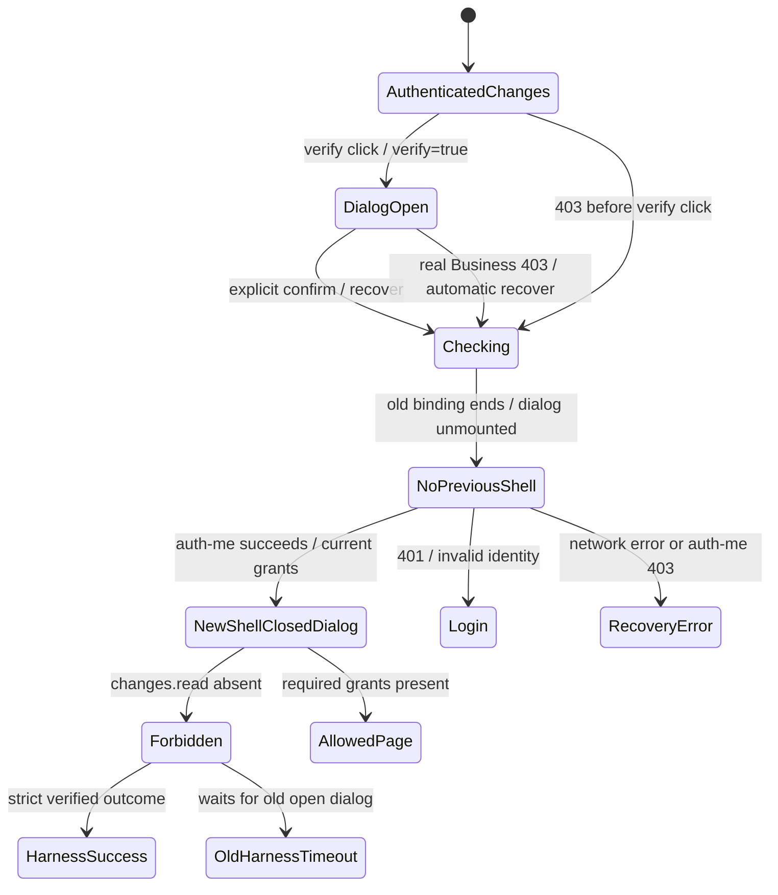

# ChangeFlow Governance — A5-T4 / T4-A

**Goal:** جرد الوظائف القائمة وعقودها، وتحديد نقل تدريجي قابل للمراجعة دون فقد سلوك أوتوسيع صلاحيات.

**Architecture:** React Router Data Mode و AuthRoot و Application Shell المعتمدة؛ Feature-owned APIs/Decoders/Hooks/View Models فوق ApiClient و Workspace Gateway الحاليين. فصل النقل والتحقق والعرض، دون Cache عامة أو State framework جديدة.

**Tech Stack:** React 19 / TypeScript 6 / Vite 8 ، React Router ، i18next/react-i18next ، CSS tokens و Motion القائمة؛ FastAPI/Pydantic/SQLAlchemy/PostgreSQL الحالية. لا Dependency جديدة في T4-A.

**Spec / Authorization:** طلب المالك «A5-T4 — Enterprise Feature Pages Integration & Frontend Architecture»، قسم 12: **Initial Execution — T4-A Only**. تاريخ التحقق 2026-11-02 Asia/Riyadh. التنفيذ الحالي Audit/Contracts/Architecture/Migration Plan/Verification/Documentation فقط. لا T4-B/C/D/E قبل اعتماد منفصل لكل دفعة، ولا Batch B/C/D الأوسع أو Gemini أو Git writes أو Deployment أو Models/Migrations أوتغيير سياسة JWT/Permissions.

**Review Focus:** اختلاف المؤسسة أثناء الطلب، سباق مرشحات داخل الجلسة نفسها، Runtime Validation ، حدود Risk/CAB ، Pagination صحيحة، الحفاظ على جميع وظائف Legacy حتى النقل واختبار البديل أوتقاعد معتمد صراحة.

## 1. Baseline and scope

| Item | Evidence |
|---|---|
| Repository / origin | `bigest11/ChangeFlow-Governance` / `https://github.com/bigest11/ChangeFlow-Governance.git` fetch+push |
| Branch | `feature/phase2-batch-a-tenant-security` |
| HEAD | `48c1e8ef46d60c1ed85ebc7c59ed3dfbcde8fded`، Checkpoint T3 المحفوظة |
| master local/remote عند البدء | `10faab20b1c61b5476165bbc1f5d28a2a85e2652`، لم يتغير |
| Working Tree / staging عند البدء | نظيفتان، لا Modified أو Untracked أو Staged |
| Current changes | وثيقتان فقط؛ لا Application/Test/Dependency/Backend code changes |
| Reviewed | master و T1/T2/T3 ، Router/Shell/Auth/Client/Gateway و App.tsx كله، Routers/Schemas/Permissions/Tenant resource selectors والخدمات اللازمة |

نتائج T1/T2/T3 محفوظة تاريخيًا؛ لا نعيد تفسير موافقة حفظ T3 على أنها تفويض Git لهذه المهمة. لم تُشغّل Setup أو Bootstrap ، ولم تُفتح قاعدة قديمة أوتُقرأ Password Hashes أو.env تشغيلية. ملفات الاختبار المؤقتة والأدلة البصرية خارج المستودع.

### 1.1 Source evidence index

- [Legacy App](../../frontend/src/App.tsx)، [Router](../../frontend/src/app/router.tsx)، [Route policy](../../frontend/src/app/routePolicy.ts)، [Legacy Adapter](../../frontend/src/app/LegacyWorkspaceAdapter.tsx).
- [ApiClient](../../frontend/src/services/api/client.ts)، [ApiSession](../../frontend/src/services/api/session.ts)، [Workspace Gateway](../../frontend/src/features/auth/workspaceGateway.ts)، [Auth Store](../../frontend/src/features/auth/authStore.ts).
- [Permissions](../app/services/permissions.py)، [Tenant Resources](../app/services/tenant_resources.py)؛ راجع أسماءالملفاتالفعليةفيالفهرس أدناه عنداختلافnamespace.
- Backend routers: [Auth](../app/routes/auth.py)، [Foundation](../app/routes/foundation.py)، [Changes](../app/routes/change_management.py)، [Execution](../app/routes/change_execution.py)، [Notifications](../app/routes/notifications.py)، [Invitations](../app/routes/invitations.py). Schemas في`backend/app/schemas/`؛ services للدعواتوالتقييم وسياساتTenant قُرئت معالـrouters.
- [Isolated Runner](../tests/a5_isolated_runner.py)، [Isolation Guard](../tests/a5_isolation.py)، [Auth Browser Harness](../tests/test_a5_t2_browser.py)، [Presentation Harness](../tests/test_a5_t3_browser.py).

## 2. Inventory method and classification

`frontend/src/App.tsx`: **5227 سطرًا، 54 function declaration ، 84 useState ، 8 useEffect و 8 useEffectEvent**. الجرد التالي يغطي الدوال والـ Renderers والأحداث؛ لا يساوي عدد الدوال عدد المنتجات أوالصفحات.

- **S — Implemented and Safe to Extract:** العقد والعزل موجودان؛ قابل للنقل بعد اختبارات الصفحة، وليس ضمان Production readiness.
- **L — Implemented but Security-Limited:** موجود لكن قيد Risk/CAB/D أوعقد عرض مضلل يمنع الترويج له كميزة مؤسسية مؤمنة.
- **M — Backend Contract Missing:** لا Endpoint مسجلة للعملية؛ لا Dummy button ولا API جديدة تلقائيًا.
- **D — Deferred to Batch B/C/D or Advanced Features:** سياسة أووظيفة متقدمة خارج A5-T4 الحالية. قد تكون L/D معًا.

كل صف وظيفة أدناه يرث Tenant Scope و DTO من مجموعة API المرتبطة، وحالات Loading/Error من القسم 7. كل mutation بلا Automatic Retry. أرقام السطور مرجعية لـ HEAD أعلاه.

### 2.1 Function-level coverage

| Functions / line | Current page and behavior | API group / permission / state | Owner → migration target | Class and constraints |
|---|---|---|---|---|
| App354 ؛ notify516 ؛ handleLogout520 ؛ apiFetch525 ؛ readResponse534 | composition ، Toast ، خروج محلي، نقل وتحويل TypeScript | Gateway binding ؛ لا Endpoint جديدة؛ logout محلي وليس Revocation | auth/application → الصفحات و Toast الحالية | S ؛ readResponse cast فقط، لا Runtime Validation للأعمال |
| loadData536 | تحميل 10 موارد متوازية للواجهة القديمة | F1+F2+C1+C4+A2 ؛ بحسب grants ؛ Promise.all يجمع الفشل | كل feature يحمل موارده فقط | S/L ؛ لا تحميل Risk العالمية تلقائيًا في الصفحات الجديدة |
| loadChangeRecordsPage603 ؛ loadChangesForEffect | Dashboard/Changes: search/filter/page | C1 ؛ changes.read ؛ Requester own-only | changes → ChangesPage | S ؛ debounce لا يمنع استجابة query قديمة داخل الجلسة |
| loadNotificationUnreadCount683 ؛ loadNotificationsPage699 ؛ loadCountForEffect ؛ loadNotificationsForEffect | العدد والقائمة والبحث/النوع/unread/page | N1 ؛ notifications.own ؛ current readable resources | notifications → NotificationsPage/Badge | S |
| openNotificationCenter749 ؛ markNotificationAsRead755 ؛ openNotificationItem781 ؛ markAllNotificationsAsRead804 | فتح، تعليم واحد/الكل، رابط للمورد | N1+C1 ؛ notification recipient+readable linked change | notifications → NotificationsPage | S ؛ لا اختلاق read_at من ساعة المتصفح في البديل |
| loadUserManagementData839 ؛ loadManagedUsersPage892 ؛ loadUserAdministrationAuditPage954 ؛ refreshUserManagement1001 ؛ loadUsersForEffect ؛ loadAuditForEffect | users/roles/counts/filters/audit | A2/A3 ؛ users.read/audit.read ؛ same organization | users/audit → UsersPage/UserAudit | S ؛ ثلاث قراءات counts ليست Snapshot ذرية |
| loadWorkspaceData ؛ recoverRouteRecord ؛ prepareRevision | effect ownership ، Deep Link ، تحضير تعديل | مجموعات الصفحة/C1/C2 ؛ route permission+binding | pages/hooks → مالك تحميل واحد لكل Route | S ؛ منع الطلبات المكررة وتغير id أثناء التحميل |
| openChangeDetails1131 | details+history+audit+approvals+implementation | C1+C3+E1 ؛ changes.read ؛ 5 طلبات AbortSignal | changes → ChangeDetailsPage | S/L ؛ القراءة موجودة، لا تعني صلاحية CAB/Risk |
| toDateTimeLocalValue1202 ؛ startRevision1209 ؛ toggleAffectedSystem1560 | تحضير النموذج والأنظمة | C2/F2 ؛ changes.revise ؛ NeedsMoreInformation و Requester نفسه | changes → ChangeEditorPage | L ؛ timezone محلية، لا تغيير wall time عشوائيًا |
| createManagedChange1245 ؛ reviseManagedChange1308 | إنشاء/إعادة إرسال مع Assessment وحفظ Audit | C2 ؛ changes.create/revise | changes → ChangeEditorPage | L ؛ Risk B مفتوحة، Synthetic development فقط حتى الإغلاق |
| submitApproval1380 | قرار Approved/Rejected/NeedsMoreInformation | C3 ؛ changes.approve ؛ PendingApproval | approvals → readonly ApprovalHistory | L/D ؛ لا نقل controls مفعلة قبل C |
| submitImplementationAction1442 ؛ startImplementation1483 ؛ completeImplementation1489 ؛ failImplementation1503 ؛ recordImplementationRollback1514 ؛ completePostImplementationReview1525 | Start/Complete/Fail/Rollback/PIR | E1/E2 ؛ changes.implement ؛ state machine | implementation → readonly ImplementationPage | L/D ؛ لا Actions جديدة قبل C |
| getRiskClass1538 ؛ getDecisionLabel1543 | ألوان وحالة توصية | latest assessment / risk engine | assessments → RiskBadge/AssessmentView | L ؛ تحويل Proceed إلى Authorized to Proceed مضلل؛ البديل provisional فقط |
| createConfigurationItem1577 ؛ createDependency1675 ؛ createHistoricalIncident1729 | Foundation create forms | F3 ؛ foundation.write ؛ local FK validation | systems → catalog forms بعد اعتماد نقلها | S ؛ System update/delete غير موجودتين |
| getSystemName1631 ؛ formatDateTime1636 ؛ formatUtcDateTime1649 | أسماء/تاريخ | lookup/local formatting | shared display adapters | S/L ؛ naive UTC فقط للحقول المثبتة، لا append Z عام |
| createRiskRule1794 ؛ toggleRiskRuleStatus1844 | إنشاء/تفعيل Rule | F4 ؛ risk_rules.write ؛ GLOBAL | risk rules → Batch B | L/D ؛ لا editor مؤسسية جديدة |
| openUserManagement1867 ؛ updateUserEdit1879 ؛ saveManagedUser1899 | user role/activation inline edits | A2 ؛ users.update ؛ self/last-admin guards | users → UsersPage | L ؛ D race/hardening باقية، لا Password reset |
| getVisiblePageNumbers1972 ؛ getUserAuditActionLabel1989 ؛ renderAccessDenied1996 | pagination/audit labels/403 | envelope+known action codes | ui/audit → DS primitives+i18n | S ؛ unknown codes لا تتحول إلى صلاحية/قرار معروف |
| openChangeQueue2008 ؛ renderNotificationButton2033 | queue filters + delayed smooth scroll ؛ badge | C4/N1 ؛ current grants | dashboard/notifications → URLs/navigation | S ؛ timer80ms و smooth legacy يستبدلان بـ Router/reduced-motion |
| renderDashboard2077 | admin counts ، status/risk metrics ، review/delivery queues ، change list | A2/C1/C4/E1/F1 | dashboard+changes → DashboardPage/ChangesPage | S/L ؛ status factual ، risk aggregation غير معتمدة |
| renderNotificationCenter2704 | list/filter/read/open | N1 | notifications → NotificationsPage | S |
| renderNewChange3010 | create/revise form ، planned dates ، affected systems | C2/F2 | changes → ChangeEditorPage | L ؛ لا enums مترجمة في payload |
| renderUserManagement3290 | paged users ، edits ، audit | A2/A3 | users/audit → UsersPage | S/L حسب read/write |
| renderFoundationManagement3749 | systems/dependencies/incidents/departments/rules lists ، 3 create forms+rules | F1–F4 | systems+legacy Foundation | S/L ؛ لا إسقاط forms أثناء نقل catalog |
| renderDetails4544 | summary/assessment/actors ، decisions/implementation ، approvals/history/audit ، window.print | C1/C3/E1/E2 | changes/assessments/audit/implementation | S/L/D ؛ Print محلي وليس report-download API |

الـ 8 useEffectEvent هي loadWorkspaceData/loadChangesForEffect/loadUsersForEffect/loadAuditForEffect/loadCountForEffect/loadNotificationsForEffect/recoverRouteRecord/prepareRevision. لا وظيفة خارج الجدول اكتُشفت داخل App.tsx. عناصر Tables/Filters/Forms/Dialogs كلها جزء من Renderers المذكورة، ولا توجد صفحات Business مستقلة مكتملة بعد.

### 2.2 Feature gaps and safe boundaries

| Feature | Actual evidence | Disposition |
|---|---|---|
| Systems details / direct dependencies / incidents / impact-profile | F2 Backend موجود، غير مستهلك حاليًا في App | S ؛ مرشح T4-B ، one-hop فقط، لا graph متقدمة |
| Department creation | POST موجود، لا form قديمة | S contract ؛ توسعة واجهة تحتاج اعتماد دفعة، ليست وظيفة مفقودة من Legacy |
| System update/delete ، services CRUD ، role designer ، profile write ، projects | لا registered API | M ؛ لا Actions وهمية ولا Backend تلقائية |
| Assessment history/version/provenance/recompute | latest_assessment فقط؛ لا API للميزات المطلوبة | M/D ؛ قراءة أحدث تخزين مع تحذير، Risk B لاحقًا |
| Advanced dependency graph/AI/Gemini/interactive export | لا contract مسجلة في main لهذه الميزات | M/D ؛ files قديمة report_generator/ai_engine ليست دليل API عامة |
| Invitations administration | A3 APIs موجودة؛ T2 public acceptance فقط في الواجهة الحالية | S/L ؛ list/revoke حقيقيان؛ delivery غير مهيأة، لا Sent كاذبة |
| Download PDF/report endpoint | window.print فقط | M لعقد server report ؛ يمكن حفظ Browser Print/Save PDF الحالية دون ادعاء مولّد تقارير |
| CAB quorum/SoD / true session revocation | غير مكتملة، Permission وحدها لا تكفي | D ؛ لا إغلاق بـ UI |

## 3. Route/API/Permission/Tenant contracts

### 3.1 Current and proposed routes

| Current route | Guard / actual content | Migration proposal, NOT implemented |
|---|---|---|
| / و/workspace | redirect identity home / identity.read ، بلا Business fetch | تبقيان؛ لا إخفاء home خلف changes.read |
| /login ؛ /invitations/accept | public T2 ، token fragment للاعتماد ثم إزالة مبكرة | تحفظان حرفيًا؛ /accept-invitation ليست route فعلية |
| /changes | changes.read ؛ legacy Dashboard+list | ChangesPage ؛ Dashboard إلى/dashboard بنفس grant |
| /changes/new ؛ /changes/:id ؛ /changes/:id/revise | changes.create/read/revise ؛ id positive safe integer | نفس الروابط، نفس guards ، صفحة Editor/Details مستقلة |
| /foundation | foundation.write ؛ legacy management | تبقى إلى نقل forms ؛ /systems و/systems/:id foundation.read مستقبلاً |
| /users | users.read ؛ admin+audit القديم | UsersPage ؛ /users/invitations invitations.manage ؛ /users/audit audit.read |
| /notifications | notifications.own | NotificationsPage |
| /forbidden و catch-all | protected403 و 404 | تبقيان، لا تحويل foreign404 إلى كشف Tenant |
| future detail subroutes | غير موجودة حاليًا | /changes/:id/assessment\|history\|audit\|approvals\|implementation للقراءة changes.read ؛ قرار tabs/routes مع دفعتها |

لا إضافة /preferences وهمية؛ اللغة والثيم موجودان في Shell. Nested Root→AuthRoot→AppLayout ؛ Adapter يتحقق من grant قبل lazy App ، ومحتوى Legacy business معزول lang=en/dir=ltr مؤقتًا. المسؤول System Administrator لا يملك changes.read ؛ لا نفتح Dashboard التغييرات له، ويمكن عرض ملخص إدارته داخل Users. لا aliases للـ Legacy Admin/Approver/SystemOwner/Viewer.

### 3.2 Authorization and scope invariant

قاعدة القراءة المشتركة للأدوار الثمانية المعروفة: identity.read ، foundation.read ، notifications.own ، risk_rules.read. الإضافات: Requester changes.read/create/revise ؛ ChangeManager changes.read/approve/implement ؛ CMDBManager foundation.write+changes.read+risk_rules.write ؛ System Administrator users.read/update+audit.read+invitations.manage. الأدوار الأخرى المذكورة لا تحصل على تلك الإضافات؛ unknown role deny. JWT v2 والـ Permission Matrix دون تعديل.

Backend يقرأ العضوية النشطة والدور من Database ، ويتحقق من توافق role.organization_id مع user.organization_id ؛ Tenant context ليس query/header يفرضه Client. Systems تتطلب organization والـ FK المحلية، Dependencies كلا طرفيها، Incidents نظامًا محليًا. Changes مؤسسة محلية وكل actor/system/coordinator محلي؛ Requester يرى طلباته فقط. Notifications recipient+organization+actor+linked readable resource ؛ legacy unclassified غير المكشوفة مستبعدة قبل count/page/read. Admin Audit actor/target محليان. **Risk Rules وحدها GLOBAL** ولا تصير Tenant-scoped بمجرد permission.

### 3.3 Registered endpoints (56 handlers across six routers)

الأقواس{id} أدناه تختصر اسم path parameter الفعلي فقط، ولا تغيّر URLs. Paged contracts: items/total/page/page_size/total_pages ؛ page>=1 و page_size 1..100 ؛ total_pages>=1 حتى empty. قد يرد requested page أكبر من آخر صفحة؛ لا اختلاق items. Foundation lists ليست Server pagination. Error baseline في القسم 7 ، إضافة 400/422 للمدخلات.

| Group | Methods / endpoint suffixes (prefix explicit) | Permission / tenant | Contract, state, notable errors |
|---|---|---|---|
| A1 | POST /auth/register ؛ POST /auth/login ؛ GET /auth/me (3) | register403 دائمًا؛ login public workspace-scoped ؛ me identity.read | login form tenant_slug/email/password ؛ TokenOutput ؛ CurrentUserOutput permissions/workspace_slug ؛ لا Public Signup |
| A2 | GET /auth/admin/roles ؛ GET /auth/admin/users ؛ GET /auth/admin/users/paged ؛ PATCH /auth/admin/users/{id} (4) | users.read أو users.update لل PATCH ؛ current org | RoleOption[]، AdminUser[]/Page ؛ page/search/role_name/is_active ؛ update role_name?/is_active?؛ self-demotion/deactivation+last-admin checks ، raceD باقية |
| A3 | GET /auth/admin/audit-logs ؛ GET /auth/admin/audit-logs/paged (2) | audit.read ؛ actor+target current org | AdminAudit[]/Page ؛ page/page_size/search/action ؛ readonly |
| F1 | GET /foundation/overview (1) | foundation.read | counts org=1/local departments/users/roles/services/systems/deps/incidents ؛ **risk_rules count GLOBAL**، mixed contract |
| F2 | GET /foundation/organizations\|roles\|departments\|users\|services\|systems ؛ GET /foundation/systems/{id}؛ GET /foundation/systems/{id}/dependencies\|incidents\|impact-profile ؛ GET /foundation/incidents ؛ GET /foundation/dependencies (12) | foundation.read ؛ scope أعلاه؛ parent foreign404 | ORM DTO arrays أو single ؛ impact-profile structured names+one-hop arrays+English narrative ؛ لا search/paging server لهذه القوائم |
| F3 | POST /foundation/departments ؛ POST /foundation/systems ؛ POST /foundation/incidents ؛ POST /foundation/dependencies (4) | foundation.write ؛ local foreign keys | 201 DTO ؛ systems org field اختياري compatibility guard ، new UI omits organization_id ؛ duplicate409 ، foreign404 ، invalid400/422 ؛ no self dependency |
| F4 | GET /foundation/risk-rules ؛ POST same ؛ PATCH /foundation/risk-rules/{id} (3) | risk_rules.read/write ؛ **GLOBAL** | RiskRuleOutput[]/single ، create201 ؛ منع إعادة تقديمها كـ Tenant policy قبل B |
| C1 | GET /change-management/requests ؛ GET /change-management/requests/paged ؛ GET /change-management/requests/{id} (3) | changes.read ؛ Requester own ،غيره tenant | ManagedChange[]/Page/single+latest_assessment nullable ؛ filters search/status/risk_level/change_type/requester_id/date range ؛ foreign requester403/date order400 |
| C2 | POST /change-management/requests ؛ PUT /change-management/requests/{id}/revise (2) | changes.create/revise ؛ revision own Requester+NeedsMoreInformation | typed create/revision ، persist assessment/history/audit/notify ؛ PendingApproval ؛ 400/404/422 ؛ RiskB limit |
| C3 | GET /change-management/requests/{id}/history\|audit-logs\|approvals ؛ POST /change-management/requests/{id}/approvals (4) | GET changes.read (change audit ليس global audit.read)؛ POST changes.approve | arrays ؛ POST decision record ؛ PendingApproval فقط 409 ؛ rejected/NMI comments422 ؛ approval_level label لا CAB enforcement |
| C4 | GET /change-management/dashboard/work-queues ؛ GET /change-management/dashboard/overview (2) | changes.read ؛ scoped requests | pending_review/critical_pending/high_pending/awaiting_requester ؛ status counts ؛ risk average/counts من**كل stored assessments** لا latest per change |
| E1 | GET /change-management/dashboard/delivery-queues ؛ GET /change-management/requests/{id}/implementation (2) | changes.read ؛ scoped request | approved_ready/in_progress/pending_pir/failed factual counts ؛ implementation DTO أو null |
| E2 | POST /change-management/requests/{id}/implementation/start\|complete\|fail\|rollback\|post-implementation-review (5) | changes.implement ؛ local resources+state | typed bodies و state checks ؛ sensitive writes مؤجلة C ،لا new enabled actions |
| N1 | GET /notifications/unread-count ؛ GET /notifications/paged ؛ PATCH /notifications/{id}/read ؛ PATCH /notifications/read-all (4) | notifications.own ؛ recipient/current readable changes | count ؛ Page query page/page_size/unread_only/notification_type/search ؛ actual Notification DTO أو updated_count ؛ stable created_at/id sort |
| I1 | POST /auth/invitations ؛ GET same ؛ POST /auth/invitations/{id}/revoke ؛ POST /auth/invitations/{id}/resend ؛ POST /auth/invitations/accept (5) | invitations.manage للأربع؛ accept public | Output بلا raw token ؛ listing limit1..100default 50/offset لا total ؛ revoke pending only409 ، resend pending/expired ، accept consume once ؛ department/role/target local |

مجموع handlers: Auth9+Foundation20+Changes11+Execution7+Notifications4+Invitations5=56 ، root/health في main خارج business. جميع routers مسجلة فعليًا؛ لا استيراد main لتدقيق كود أو اتصال قاعدة.

## 4. Data contracts and business truth

| Contract | Confirmed validation / display boundary |
|---|---|
| Managed Change | extra forbid ؛ title trim3..255 ، description trim>=10 ؛ change_type database/application/network/security/documentation ؛ change_mode Standard/Normal/Emergency ؛ priority Low/Medium/High/Critical ؛ affected_system_ids موجبة وفريدة وغير فارغة؛ downtime0..43200 ؛ rollback_complexity/security_sensitivity Low/Medium/High ؛ justification nullable<=8000 ؛ planned_end>=planned_start ؛ revision comment3..4000 |
| Foundation | System: id/org/local department/service/owner nullable ، name/description/type/environment/criticality/status ؛ create name2..255 و FK موجبة محلية. Dependency طرفان مختلفان موجبان و type2..100 و impact enum. Incident title3..255 ، parent محلي، severity enum و resolved>=occurred. Foundation User DTO مختلفة عن AdminUserOutput |
| Admin | role_name/status/created_at و department/job names ؛ Audit actor/target و old/new role/status و details nullable. لا Password/Token writes. حفظ dirty edits أثناء refetch ، لكن انتهاء الجلسة لا ينتظر confirmation |
| Implementation | start notes nullable<=4000 ؛ complete summary+validation3..8000 ؛ fail summary3..8000 ؛ rollback reason3..8000 ؛ PIR result: Successful / Successful with Issues / Unsuccessful ، summary3..8000 و followup nullable<=8000. لا ترجمة enums في payload |
| Pagination | items/total/page/page_size/total_pages ، IDs/counts آمنة؛ null ليست صفرًا. Unknown enum للقراءة يعرض حالة محايدة بلا Action ؛ الكتابة تقتصر على enum الفعلية |

**State machine الحالية:** PendingApproval→Approved/Rejected/NeedsMoreInformation ؛ NeedsMoreInformation→PendingApproval ؛ Approved→InProgress→Implemented/Failed ؛ Implemented→Closed ؛ Failed→RolledBack ؛ Rejected/RolledBack/Closed terminal. لا generic status PATCH. حالة Approved المخزنة لا تثبت اكتمال CAB Enforcement.

**Risk integrity:** get_rule_score يقرأ أول GLOBAL active match ، و missing rule→0 ؛ لا provenance/availability flag. latest_assessment nullable. لا يعرض غياب Assessment أوخطأ تحميل كصفر/Low. Dashboard risk average تشمل جميع stored assessments وليست latest per change ؛ يلزم label دقيق أوإخفاء metric غير الموثوقة، دون حساب مؤسسي منصفحة paged جزئية. ai_explanation حتمية بالإنجليزية وليست Gemini. صياغة Authorized to Proceed الحالية لا تُنقل كسلطة اعتماد.

**Invitations:** purpose membership/directory_activation و target_user_id محلي موثوق؛ لا global email lookup. Output metadata بلا token ، فلايمكن اختلاق رابطدعوة. Default UnconfiguredInvitationMailer ينتج delivery failure ؛ إنشاء record ليس Sent. العرض يذكر delivery_status الصادقة؛ provider إلى D. Existing acceptance و login الصريح بعده محفوظان.

**Dates:** UTC naive مثبتة لحقول managed change/notification التي تستخدم utc_now ؛ adapter انتقائي لهذه الحقول فقط. Planned wall time لا تتحول بصمت. Intl(ar-SA/en) للعرض، والوقت غير الصالح/المجهول em-dash. English server narratives تحدد لغتها، ولا تترجم بيانات المستخدم أو Identifiers أو Enums.

## 5. Architecture decisions — T4-A implementation result

**إعادة استخدام Shared Data Layer القائمة، دون إضافة abstraction غير مستهلكة في T4-A.** ApiClient+ApiSession+createWorkspaceGateway تؤمن trusted origin و Bearer و session generation و cancel و binding قبل/بعد الطلب. لا صفحة منقولة في هذه الدفعة؛ إضافة Hook عامة بلا consumer لا تثبت الحاجة. لا TanStack/Zustand/Zod ولا Dependency جديدة. Feature decoders التالية تصميم مطلوب لأول نقل، ولم تُنفذ بعد.

| Existing guarantee | Confirmed gap / next requirement |
|---|---|
| Trusted origin ؛ redirect:error ؛ credentials:omit ؛ no-store/no-referrer ؛ منع caller Auth header ؛ timeout يشمل JSON ؛ لا retry | لا absolute URL مشتقة من record ؛ لا تخفيفسياسةالأصل أثناء نقل UI |
| ApiSession generation و Gateway binding ؛ old success/401 لا تؤثر علىجلسةجديدة | داخل binding نفسها، queryA قد ترجع بعد queryB وتكتب فوقها؛ debounce timer cleanup لا يكفي |
| Safe ApiError code/status بلا raw body/cause | readResponse<T> مجرد cast ؛ يلزم Runtime decoder للأعمال |
| Auth decoders موجودة في features/auth/authApi.ts | لا services/api/validators.ts موجودة ولا business decoders حالية |
| Details تمرر AbortSignal وتحجب id غيرالمطابقة | click-initiated completion قد تنقل إلى id قديمة؛ resource key/epoch لازمان |
| AuthRoot unmount عند تغير binding و RouteSurface تعرض DOM الحالية فقط | عدمإضافة cache عامة أو exit snapshot لبيانات Tenant |

**Offline probe:** باستخدام fake fetch فقط، `/foundation/systems?search=service+one` مقبول و fake transportCalls=1 ؛ query تحتوي encoded slash مرفوضة configuration قبل transport. فحص Client يشمل path+query. لا Backend search لل Systems حاليًا؛ عندنقل Change search يجب اختبار هذاالقيد واعتمادحل ضيق دونإضعاف Trusted Origin أو silent replacement للمدخل. لم تتغيرالسياسة.

### 5.1 Target modules — planned, not created

```text
pages/{Dashboard,Systems,SystemDetails,Changes,ChangeDetails,ChangeEditor,
       Notifications,Users,Invitations}Page.tsx
features/{systems,changes,assessments,notifications,users,invitations,audit,implementation}/
    api.ts        # injected binding-bound gateway
    types.ts      # DTO separate from view model
    decode.ts     # unknown -> contract or safe invalid_response
    query.ts      # known URL filters and serializers
    hooks/        # resource lifecycle and mutation state
    components/   # feature presentation and i18n
    *.test.*
features/shared/useSessionResource.ts # only with first proven T4-B consumer
```

إعادةاستخدام Button/TextField/SelectField/RiskBadge/Skeleton/TableFrame/Notice/StateCard و Dialog/Toast الحالية؛ لا Generic Form/Table framework. Router و Shell و AuthProvider و ApiClient و JWT و Permission Matrix حدودثابتة، ولا Storage جديدةلل Token.

### 5.2 Resource / decoder contract for first extraction

1. Resource key = verified session binding + feature + positive id + normalized filters. اللغةوالثيم ليستاسببًا لإعادة fetch. عند تغير key تُزال بيانات السابقة فورًا، يُزاد request epoch وتُلغىالسابقة؛ commit فقط إذا key/epoch/binding ما تزال الحالية حتى لو transport تجاهلت abort. لا old success/toast/navigation.
2. State union: idle/loading/ready/error ؛ empty هي ready items=[]، وليست network failure. Refetch لنفس key يمكنه حفظ بيانات موسومة refresh ؛ key مختلفة لا ترث old data. Mutation state مستقلة تمنع double-submit دون automatic retry.
3. Decoders تتحقق من safe IDs/counts و nullability و array types و envelopes ؛ unknown read enums محايدة بلا Actions ، write enums مغلقة. يمكن تجاهل extra fields ؛ organization_id عند وجودها تطابق current me كدفاع إضافي، ولا تتحول إلى client-authoritative filtering.
4. Validation exceptions تصبح ApiError invalid_response دون record/raw JSON في Logs. Negative cases: HTML/truncated JSON/wrong items/unsafe IDs/null assessment/foreign tenant fields حيثالعقدتحملها.
5. URLSearchParams للمرشحات المعتمدة، page موجبة و reset عند تغير filter ؛ Back/Forward/Refresh يعيد query الصحيحة. Foundation pagination إن أضيفت محلية ومعلنة بعد تحميل scoped list كاملة؛ Invitations تستخدم offset+Load More دون total مختلقة.

## 6. Incremental migration plan and quality gates

### T4-A — current batch

- [x] A1: baseline والحالة النظيفة والتقارير والكود.
- [x] A2: جرد 54 function و 56 handler ، والـ routes والصلاحيات والنطاق والعقود.
- [x] A3: تصنيف S/L/M/D وتوثيق truth boundaries للقراءةوالكتابة.
- [x] A4: اعتماد طبقة النقل والجلسة الحالية، وتصميم decoder/resource مع أول consumer ؛ دون unused runtime code.
- [x] A5: الاختبارات والتوثيق والـ Manifest ؛ الفشل الحالي محفوظ بالقسم 8.
- [ ] اعتماد المالك قبل T4-B ؛ لا تفويض تنفيذها حاليًا.

**Gate A:** شمول الجرد، لا Backend policy أو runtime changes ، وتوثيقنتائج التحقق صراحة. مخرج Architecture جاهز للمراجعة، لكن Browser Regression Gate غير ناجحة؛ لا تجاوز إلى الدفعة التالية باعتبار retry إثبات إصلاح.

### T4-B — Dashboard & Systems ؛ approval required

1. RED لعقود catalog/detail/one-hop و query/id/binding races ، ثم decoder وأول resource hook إذااحتاجها consumer ؛ loading/error/empty حقيقية.
2. /systems و/systems/:id للـ foundation.read: catalog/details/dependencies/incidents/impact profile للقراءة؛ لا update/delete API. ترجمة structured labels معتحديدلغة server narrative.
3. Dashboard للـ changes.read: status/queues فعلية، label/omit للمقاييس Risk غيرالموثوقة. Admin summary داخل Users حيثتسمح grants. لا global risk count كـ Tenant policy.
4. فصلتحميلالصفحات؛ Legacy Foundation forms والـ routes غير المنقولة تبقى. نقل create system/dependency/incident فقط إذاشملهااعتمادالدفعةوبـ F3 validation و local FK tests.

**Gate B:** أولًا حسم فشل Browser المسجل في T4-A. ثم Backend/PostgreSQL synthetic للأدوار و foreign FK/Requester ؛ Runtime invalid payload ؛ stale queryA/B و switchTenant/user ؛ deep links/back/refresh ؛ AR/EN و RTL/LTR و themes ؛ 360/390/768/1366/1440 ؛ Keyboard/axe/reduced motion ؛ Frontend checks+Gitleaks. حل encoded slash يحتاج تصميمًا معتمدًا قبل ادعاء بحث مكتمل. تقرير وتوقف قبل T4-C.

### T4-C — Changes & Assessments ؛ approval required

1. Paged list/filter ثم details/latest assessment ؛ null/missing/unknown risk و Requester ownership و foreign404 و query consistency.
2. Create/revision incremental ضمنحدود Risk B والتطوير الاصطناعي فقطوباعتمادالدفعة؛ الحفاظعلى planned wall time/comment/affected FK.
3. لا new Approval/Implementation controls ولا Authorized to Proceed claim ؛ provisional deterministic assessment واضحة، لا Gemini.

**Gate C:** لا خسارة forms/filters/links ؛ validation و errors آمنة؛ no stale navigation إلى id سابقة؛ auth/tenant/invitation regression ، localization/responsive والـ checks المشتركة. تقرير وتوقف قبل T4-D.

### T4-D — Notifications, Users & Invitations ؛ approval required

1. Counts/list/read one/all/open linked resource مع role-change visibility ؛ actual read_at refetch و 403/404 آمنة.
2. Users read/filters/roles و Audit route. Writes للـ role/activation تظل security-limited بسبب D/last-admin race ؛ لا enabled writes جديدة بلا مراجعة واعتماد محدد، ولا Password reset.
3. Invitations list offset/revoke ؛ create/resend فقط عند اعتماد delivery-limited behavior. لا copy link بلا token ، ولا email Sent كاذبة. Existing public acceptance ثابتة.

**Gate D:** Scope قبل counts/page/read ؛ role change/session generation/pending requests ؛ directory activation محلية؛ expired/revoked/consumed/replay ؛ لا Invitation Token في storage/log/External URL ؛ actual isolated integration والـ checks المشتركة. تقرير وتوقف قبل T4-E.

### T4-E — History, Implementation & Final Extraction ؛ approval required

1. Readonly history/change audit/approval records/implementation/PIR ؛ changes.read تختلف عن global user audit.read. Browser Print الحالية دون إيهام server report.
2. تقليل App/CSS بعد parity matrix: كل function→route→behavior test ، مع negative access/loading/errors/localization/responsive. لا Massive Rewrite.
3. **إزالة Adapter مشروطة بنقل كل وظيفة محتفظ بها واختبارها، أو تقاعد مصرح به صراحة.** Writes الخاصةبـ Risk/CAB/implementation/user administration المؤجلة تمنع حذف Legacy دون قرار؛ لا إسقاط سلوك باسم Final Extraction.

**Gate E:** Function coverage كاملة، regression و security scan و Manifest و bundle comparison ؛ وثيقة وموافقة Development Checkpoint منفصلة. لا Production gate.

## 7. Shared UI/data/error patterns

- Skeleton بأبعاد stable و aria-busy ؛ empty تختلف عن error/forbidden ؛ manual retry. 401 عبر Auth boundary ؛ 403 منع الفعل المحدد؛ 404 generic missing/foreign ؛ 409 conflict مع refresh ؛ 400/422 known localized validation بلا raw server details ؛ network/timeout تعافٍيدوي؛ aborted/session_changed صامتتان دون إحياء بيانات.
- i18n keys لكل labels/validation/errors/ARIA ؛ API enums/IDs دون تغيير؛ user text مع bdi/dir=auto حيث يلزم؛ Intl للأرقام والتاريخ. لا ادعاء ترجمة Business Legacy الإنجليزية قبل نقلها.
- Semantic table/caption/headers و scroll frame ؛ Keyboard/focus/Dialog trap/return focus/Escape ؛ touch44px ؛ risk text+icon لا color وحده؛ mobile forms عمود واحد، ولا horizontal page overflow.
- Obsidian & Sage / Readex Pro / التراخيص والثيمان الحاليان و CSS logical properties ؛ Motion tokens و reduced motion ؛ لا exit DOM snapshot ، وإزالة بيانات الجلسة قبل الحركة. لا Styles موازية أو استبدال Shell.
- Confirmations للـ writes المصرح به فقط، ولا حوار يعرقل logout/session invalidation. Permission-aware UI ليست بديلًا عن Backend checks.

## 8. Verification results — current T4-A

| Check / separate run | Passed | Failed | Skipped / Deselected | Evidence and limits |
|---|---:|---:|---|---|
| Frontend `node scripts/verify.mjs all` | 46 | 0 | 0 skipped ؛ deselected لا ينطبق | unit/contract/security/routing/presentation tests ؛ app/test/node TypeScript ناجحة؛ Production Build98 modules ؛ Lint0 warnings/0 errors |
| Relevant Backend isolated run | 21 | 0 | 0 /0 | 19 PostgreSQL +2 unit ؛ 95.18s ؛ ليست Full Backend Regression |
| Browser joint round1 | 1 pytest | 1 pytest | 0 /0 | Auth metadata4 passed ثم 1 failed في pending-response-tenant-switch ؛ Presentation62 passed/0 failed ؛ 87.63s |
| Auth-only artifact round | 13 browser scenarios | 0 browser scenarios | ليست pytest summary موثوقة فيالسجل المستعاد | `auth/measurements.json` يثبت 13/0 ؛ لا نختلق exit code لمخرجات العملية المفقودة |
| Browser joint round2 | 1 pytest | 1 pytest | 0 /0 | Auth metadata13/0 لكن Node process returncode غيرصفر و assertion عند test_a5_t2_browser.py:107 ؛ Presentation62/0 و pytest pass ؛ 119.57s |
| Owned diagnostic PostgreSQL run | 1 pytest | 0 | 0 /0 | نفس Auth E2E عبر subprocess observer مؤقت خارج كود المشروع؛ runner exit0 ؛ لا يفسر الفشلين السابقين ولا يثبت إصلاحهما |
| Diagnostic harness preparation | لا pytest | لا pytest | لم يبدأ collection | أول observer حاول install guard مرتين وخرج قبل الاختبارات؛ صححت طريقة الاستدعاء في الأمر المؤقت فقط؛ لا تغيير للمشروع |
| Gitleaks final / diff check | 2 files / valid diff | 0 findings | n/a | v8.30.1؛ binary integrity وsynthetic detection/redaction/template verified؛ historical literal matches=0 |

**لا تجمع الجولات المتداخلة.** Browser Regression Gate **غير ناجحة/سبب غير محسوم** رغم نجاح جولة التشخيص. الكود التشغيلي والاختبارات مطابقة لـ HEAD48c1 ؛ لذلك لا يوجد تغيير T4-A runtime يمكن نسب Regression إليه، لكن لا يثبت ذلك غياب عيب قديم أوعدم اتساق harness. لم نسم الفشل Flaky أو Windows issue أو Security leak مؤكدة بلا Evidence. لم نغير Auth/Client/اختبارالأمان لإخفائه. الفشلالأوللايكشفأي assertion داخلال phase ؛ والثانييثبت process-exit mismatch فقط. يحتاجتشخيصًا محددًا قبل Gate T4-B ، دونتجاوزالـ assertion.

### 8.1 Exact scope and isolation evidence

- Frontend: الأمر المذكور أعلاه في`frontend`، دون install أو.env ؛ temporary build directory منظفة بواسطة verifier.
- Backend: `a5_isolated_runner.py` مع PostgreSQL18bin الصريحة؛ `test_a5_identity.py` و`test_a5_isolation_gate.py`، وأربع حالات A4 للـ dependencies/impact-profile و Requester filters و Dashboard isolation و Foundation catalogs ؛ وحالتي Notifications لخفض الدور وثبات query count.
- Browser: `test_a5_t2_browser.py` و`test_a5_t3_browser.py`؛ Microsoft Edge من`C:/Program Files (x86)/Microsoft/Edge/Application/msedge.exe`، Node من`C:/Program Files/nodejs/node.exe`. production Vite build→real HTTP FastAPI→owned PostgreSQL ، لا Mock responses ؛ CDP يعلّق HTTP responses فعليةلاستقصاء session race. لااختبارمتصفحآخرولا Screen Reader يدوي.
- Presentation62 scenarios تشمل Routing/Deep Links/History ، RTL/LTR والثيمين، 360/390/768/1366/1440 ، keyboard/focus و reduced motion و Auth/Invitation boundaries. الاختبارات نفسها من T3 وليست جودة Business pages جديدة؛ صفحات T4-B لم تنفذ. الأدلة البصرية الاصطناعية خارج Git ؛ ليست live data ولادليل Production.
- Runner ينشئ child env من OS allowlist فقط؛ JWT اصطناعيةعشوائية، ENVIRONMENT=test و dotenv discovery/loading معطلتان قبل settings. Audit hook يمنع فتح.env ؛ guard يرفض PG غير مسجلة بهوية مجلد data/port/user/password/dbname الخاصةبالـ cluster المملوكة. وجود ENVIRONMENT=test وحده ليس الحماية.
- parent DATABASE_URL لا تورث؛ placeholder SQLite memory في settings فقط، بينما 19 Backend tests وكل Browser test المصنفة PostgreSQL تستخدم fresh native PostgreSQL clusters مع existing migration fixtures ؛ لا SQLite كبديل لتلك الاختبارات، ولا Migration file/operational schema change.
- Fixtures تكتب Synthetic Users/records داخل قاعدتها فقط؛لا استيراد أوتشغيل Legacy Setup/Bootstrap. Cleanup يقتصر على processes/roots المملوكة؛ لا shutdown لخدمة قديمة. Root existence check موثق عند الإغلاق.

### 8.2 Secret scan evidence and cleanup

Gitleaks v8.30.1 الموجودة سابقًا فقط: SHA-256 للـWindows x64 ZIP مطابق للـChecksums المعتمدة، وexecutable مطابقة لعضوZIP byte-for-byte؛ لم يحدث تنزيل أوتثبيت. اختبارsynthetic كشف القيمة الاصطناعية، معredact=100 وReport Template يكتبRule ID/Line فقط، وstdout/stderr محتجزة بلاعرض. القواعدالافتراضية مفعلة، لاinline ignore أوignore file عامة. فُحصت محتوياتالوثيقتين محليًا، دونإرسال أوعرضSecrets؛0 Findings. قورنت كلماتSetup التاريخية privately معالملفاتالمرشحة:0 literal matches؛ ليسذلكإثباتًا لتقاعدالحسابات.

الفحص scoped للملفينالمتغيرين، وليسإعادةمسحالتاريخ أوالأرشيفات. تقاريرMetadata والأداةخارجالمستودع. جذورالاختباراتالمملوكة fveizk2k/ugmw_r2p/7l9n8oud/wn3yk46w/e72kfqyv غيرموجودةعندالفحصالنهائي؛ لاحذفأوإيقافخدمةأخرى. Artifact root الاصطناعية jib8ft6o بقيتخارجGit للمراجعة، دونSecrets أوraw matches.

### 8.3 Acceptance test plan for future consumers — not executed in T4-A

RED→GREEN إلزامي لـ Feature decoders و request epochs قبل production code: queryA ثم B مع عودة A متأخرة داخل نفس binding ؛ switchuser/tenant قبل response success/401/mutation toast ؛ detailsid يتغير؛ forbiddenrole/demotion ؛ invalidDTO/nullassessment/unsafeIDs ؛ pagination/filterURL ؛ noauto retry للـ writes. Browser actualHTTP/PG لكل صفحة منقولة، والـ viewport/i18n/a11y matrix المذكورة في Gate B. لاادعاء Passed لهذه الاختبارات المستقبلية.

## 9. Security disposition and remaining blockers

- Legacy Setup معطلة واختبارات عزلها محفوظة؛ تقاعد Credentials التاريخية لحسابات Demo **Unresolved**. لا تجربة لكلمات قديمة أوفحص Hashes أو Rotation ؛ لا ادعاء تقاعدها.
- JWT/Database Secrets محلية، ولا تعرض مثبت في Git المفحوص سابقًا؛ Exposure غير محسوم. لا تغيير.env ولا إعادة تصنيف 21 موضعًا دون دليل جديد.
- Risk Rules العالمية و missing rules→0 و provenance إلى B ؛ CAB authority إلى C ؛ Session revocation و last-admin race و mail provider و F2 وبقية Hardening إلى D. استخدام Production أوبيانات مؤسسات حقيقية محظور ضمن هذا الاعتماد.
- فجوات النقل المثبتة: business runtime validation ، سباق query داخل binding ، فشل aggregate fetch وتكرار التحميل، UTC adapter ، صياغة Proceed غير المخولة، و encoded slash في query. وثقت ولم تُعالج بتغيير سياسة أوسلوك خارج T4-A.
- Browser Regression الحالية غير ناجحة؛ فشل pending response في الجولة الأولى وفشل process exit مع metadata ناجحة في الثانية محفوظان بالقسم 8. لا سبب جذري مثبت ولا ادعاء إصلاح؛ يلزم حسمها قبل نقل Business pages.

## 10. Checkpoint manifest / migration progress

| Status | Exact path | Scope |
|---|---|---|
| Modified (1) | backend/docs/development_master_plan.md | baseline/authorization/T4-A result و gate الدفعة التالية، مع حفظ السجل التاريخي |
| New (1) | backend/docs/phase2_a5_t4.md | inventory/contracts/architecture/migration plan/results/security/manifest |

لا Application/Backend/Test/Dependency files متغيرة. لا.env أو Backups أو ZIP أو Build أو node_modules أو Scanner binary/reports أو PG cluster أو Browser artifacts داخل Manifest. لا Temporary files تحتاج Git. Staging فارغة، لا Commit/Push ، HEAD48c1 ثابتة.

**Progress:** T4-A Audit/Architecture مكتملتان؛ T4-B/C/D/E لم تبدأ. **Next Approved Batch: none.** T4-B مرشحة فقط بعد اعتماد المالك الصريح وحسم Browser Regression. لا Production readiness claim.

## 11. Browser Regression Investigation — 2026-11-02

**Goal:** إثبات سبب فشل Auth أثناء تبديل Tenant مع طلب معلّق، وإصلاح السبب المؤكد فقط ضمن Authentication أو Browser Test Infrastructure.

**Architecture / Tech Stack:** نفس Auth contracts و Edge/CDP و Vite و HTTP FastAPI و PostgreSQL المعزولة. لا Dependencies أو JWT/Permissions/Models/Migrations جديدة.

**Spec / Authorization:** طلب المالك «T4-A Browser Regression Investigation». التحقيق والاختبارات والتوثيق مع إصلاح محدد فقط إذا ثبت السبب؛ لا T4-B أو Git writes أوبيانات قديمة أو.env تشغيلية أو Legacy/Bootstrap أو Rotation.

**Review Focus:** طلب معلّق عند تبديل Tenant ؛ document/context أثناء Navigation ؛ CDP pending promises وقت Close ؛ اختلاف process exit عن scenario metadata ؛ ملكية profiles/storage/server/schema وتنظيفها.

### 11.1 Execution plan and outcome

- [x] I1: Baseline والوثيقتان محفوظتان، ومراجعة اختبارات T2/T3 وحواجز العزل قبل التعديل.
- [x] I2: أربع جولات محدودة: Auth منفردة، Presentation منفردة، Auth→Presentation ، Presentation→Auth ؛ actual Backend/PG دون Mock responses.
- [x] I3: جولة مشتركة خامسة مع observer مؤقت يجمع عدادات وتصنيفات ثابتة فقط، دون رسائل Console/URLs/headers/payloads/credential values.
- [x] I4: التمييزبين سبب التطبيق والعزل و Fixture/Server و Process/Environment ؛ النتيجة **Unresolved**. لا patch تخمينية، ولا تعديل Assertions أوإضافة Sleep لإخفاء Race.
- [ ] Root-cause regression RED→GREEN: **لم ينفذ**؛ لم نعد إنتاج المشكلة ولم يثبت سبب يسمح باختبار RED خاصبإصلاح. لاادعاء Fix.
- [x] I5: Regression ذات الصلة و Frontend checks والتوثيق والفحص الأمني؛ النتائج أدناه. توقف لمراجعة المالك.

### 11.2 Reproduction commands and bounded runs

من`backend` استخدم الأمر التالي مع قائمة الاختبارات المبينة في الجدول. لا env file ولا URL لقاعدة قائمة؛ runner يبني process environment اصطناعية ويثبت الحواجز قبل settings.

```powershell
.\venv\Scripts\python.exe -B tests/a5_isolated_runner.py `
  --postgres-bin 'C:\Program Files\PostgreSQL\18\bin' `
  --browser-bin 'C:\Program Files (x86)\Microsoft\Edge\Application\msedge.exe' `
  --node-bin 'C:\Program Files\nodejs\node.exe' `
  tests/test_a5_t2_browser.py tests/test_a5_t3_browser.py
```

| Run | Test arguments / order | pytest Passed | Failed | Skipped / Deselected | Browser evidence | Duration |
|---|---|---:|---:|---|---|---|
| I1 | test_a5_t2_browser.py | 1 | 0 | 0 /0 | Auth13/0 ؛ Node exit0 ؛ stderr0 bytes | 46.27s |
| I2 | test_a5_t3_browser.py | 1 | 0 | 0 /0 | Presentation62/0 ؛ Node exit0 ؛ stderr0 bytes | 65.24s |
| I3 | T2 ثم T3 | 2 | 0 | 0 /0 | Auth13/0 و Presentation62/0 ؛ exit0 لكل Node ولـ runner | 107.84s |
| I4 | T3 ثم T2 | 2 | 0 | 0 /0 | Presentation62/0 ثم Auth13/0 ؛ exit0 لكل Node ولـ runner | 105.38s |
| I5 | T2 ثم T3 مع observer | 2 | 0 | 0 /0 | Auth13/0 و Presentation62/0 ؛ exit0 ؛ تفاصيل الرصد في 11.3 | 72.15s |
| Observer preparation — separate harness attempt | Node preload بمسار Windows قبل تصحيحه إلى file URI | 0 | 2 | 0 /0 | فشل قبل أي A5_BROWSER_METADATA عند assertion line98 ؛ **ليس إعادة إنتاج للفشل الأصلي** | 32.84s |

الجولات I1–I4 استعملت subprocess observer في Python فقط لالتقاط returncode و metadata وعدد stderr bytes وتصنيفات ثابتة؛ Node scripts الأصليةوال Assertions بلا تعديل. I5 أضافت Node preload مؤقتة تراقب WebSocket/CDP و uncaughtExceptionMonitor دون منع الأخطاء أوتغيير exit code أو responses. أولتحميلللـ observer لم يبدأ السيناريوهات؛ صححت طريقة تحميل الأداة المؤقتة إلى`Path.as_uri()`، دونتغيير ملف بالمشروع.

لا تُجمع 13/62 أوأعداد pytest المتداخلة كاختباراتجديدةمستقلة. الفشلانالتاريخيانفيالقسم 8 محفوظان؛ نجاحالجولاتالحالية لايعطيهماسببًا رجعيًا، ولايثبتاستحالةحدوث Race تحتتوقيتآخر.

### 11.3 Safe runtime evidence

| Observation in I5 | Auth | Presentation | Interpretation / limit |
|---|---:|---:|---|
| Node exit code | 0 | 0 | لا process-exit mismatch بهذه الجولة |
| CDP protocol errors | 0 | 0 | لا context/target error مُشاهدة |
| Runtime exception events/evaluation exceptions | 0 | 0 | ضمن نافذة الرصد فقط، ليست إثباتًا عامًا |
| Console error events | 0 | 1 | القيمة/الرسالة لم تُحفظ؛ السبب غير مصنف، ولم يفشل السيناريو |
| Node uncaught exception monitor events | 0 | 0 | لا استثناء غير معالج مسجل |
| Network loadingFailed — cancelled | 11 | 0 | عدادات فقط؛ ليستكل cancel تسريبًا أوعيبًا |
| Network loadingFailed — other | 1 | 3 | Suite تتعمد block URLs لاختبار Network Recovery و Chunk Error ؛ لا request attribution محفوظةللأحداثالفردية |
| executionContextsCleared | 22 | 28 | navigation/reload قائمةبالفعل؛ لا أخطاء CDP مصاحبة |
| Node stderr | 0 bytes | 0 bytes | لاطباعة raw stderr أو Stack/Console values |

Presentation تتضمن فشل تحميل Chunk متعمدًا لاختبار Error Boundary ؛ قد يشرح Console event الوحيدة، **وهذا استدلال من الكود وليس نسبة سبب مثبتة للحدث**. لا يجوز تحويل هذا العداد إلى تفسير لفشل Auth السابق. راصد I5 نفسه قد يؤثر في التوقيت؛ لذلكلاتستخدمالجولةكإثبات لغياب Race.

### 11.4 Isolation and lifecycle review

| Area reviewed | Evidence | Conclusion |
|---|---|---|
| Browser process/context | كل run_browser_flow ينشئ Node و Edge مستقلتين؛ `--user-data-dir=tmp_path/edge`؛ remote debugging port عشوائية؛ لااتصالبـ profile المطور | لامشاركة Browser Context بين T2/T3 في المسار المفحوص |
| Cookies / SessionStorage / globals | profile و preview origin مستقلتان؛ API transport credentials:omit و Bearer ؛ Storage prototype injections داخل document الاختباروتختفيمعإغلاقالمتصفح | لا shared cookie/session storage channel مثبت؛ لم تُقرأ قيم Storage/Token فيالرصد |
| Backend server | local bound socket لكل flow ؛ Uvicorn thread مع lifespan off ؛ should_exit ثم join وتحققإغلاق thread | لا startup Bootstrap ؛ كل server مملوكة ولا مساس بخدمة قديمة |
| PostgreSQL | fresh native cluster لكل جولة؛ function-scoped random schema لكل test ؛ engine identity/search_path موثقانوالـ schema تُزالفي finally | قد تشترك T2/T3 في cluster الجولة؛ **لا schema أو data مشتركة** |
| FastAPI globals / fixtures | app مشتركةداخل Python process ، لكن get_db و mailer overrides تُثبتوتزالفي fixture finally ؛ mailbox و workspace function-scoped | ترتيب T3→T2 و T2→T3 نجحبلا state contamination مُشاهدة |
| Pending request | CDP Fetch يوقف HTTP response فعليةعلى requests/paged ؛ assertion الطلب المعلّق موجودة؛ release بعدهوية Tenant البديلة؛ finally disable/unsubscribe | Assertions لم تخفف؛ لابدل response مزيفة |
| Session generation | AuthStore.logout يرفع operation ؛ ApiSession.setToken يزيد generation وي abort pending ؛ Gateway checks binding قبل/بعد؛ AuthRoot يزيل subtree عندفقدالهوية | لا policy change ؛ الاختباراتالحاليةلـ late200/401 وتبديل المستخدم/Tenant محفوظة |
| Logout/Login UI | assert oldShell disconnected بأول rAF ، عدم Local Change بعد logout/في Tenant الأخرى،ثم عودة الهوية الأولى والبيانات | نجحتفي Auth بالجولات I1/I3/I4/I5 ؛ لا Exit DOM snapshot جديدة |
| Async cleanup/process | Protocol pending Map و WebSocketclose ، Browser.close للـ owned instance ، Vite.close ، Uvicorn join و fixture cleanup ؛ processreturncode ملتقط فعليًا | لااختلاف metadata/exit أو cleanup failure مثبت حاليًا؛ cause القديم غير مستعاد |

قراءة dotenv معطلة باكتشافها وتحميلها؛ Audit hook يرفض.env ؛ PostgreSQL guard يرفض dsn غير مملوكة قبل الاتصال. إعداد ENVIRONMENT=test ليس الحاجز الوحيد. لا legacy setup أو bootstrap ، ولا اختبارات تستدعيهما، ولا اتصال لقاعدة قديمة أوتشغيلية.

حدود الإثبات التاريخي: Protocol تختزل CDP errors إلى رسالة عامة، وrunBrowser catch لا يحتفظ بالـassertion/stack. لذلكmetadata قديمةعندphase فقط لاتحددالفعلالفاشل، و13/0 لا تحدد جهة تغييرprocess exit. لا يمكن إعادة بناء تلك الأدلة من عدمها؛ لا ادعاء أنobserver صححت السبب الأصلي.

### 11.5 Root cause disposition

| Candidate | Disposition | Evidence / limit |
|---|---|---|
| Application Race Condition | غير مثبتة وغير مستبعدة | لم تظهر stale DOM/data في الجولات الحالية؛ الفشل القديم داخل phase عامة ولا substep retained |
| Browser Test Isolation Failure | غير مثبتة | fresh profiles و origins ، والترتيبان نجحا؛ لا shared storage مثبت |
| Fixture / Server Lifecycle | غير مثبتة | schemas و servers مستقلة وتنظيفها انتهى؛ لا فشل setup/teardown حالي |
| Test Runner / Process Exit | العارض التاريخي مؤكد؛ السبب غير محسوم | القسم 8 يسجل 13/0 مع exit غيرصفر؛ الآن كل Node exit0 ، ولا raw stderr تاريخية محتفظ بها |
| Environment-specific Failure | غير مثبتة | Windows/Edge الحاليان نجحا؛ لا cross-platform comparison أو دليل كافٍ لنسبة المشكلة للبيئة |
| **Final: Unresolved** | **Root Cause غير مثبتة** | **No application/harness fix. No RED→GREEN claim.** |

### 11.6 Verification and file manifest

| Verification after investigation | Actual result |
|---|---|
| Frontend `node scripts/verify.mjs all` | exit0؛ Typecheck app/test/node ناجحة؛ Build98 modules؛ Lint0 warnings/0 errors |
| Frontend count confirmation `node scripts/verify.mjs test` | 46 Passed /0 Failed /0 Skipped /0 Cancelled /0 Todo؛ لا تجمع مع تشغيل all المتداخل |
| Relevant Backend | **181 Passed /0 Failed /1 Skipped /0 Deselected،197.05s**؛105 PostgreSQL Passed +76 Unit/Memory Passed؛ runner exit0 |
| Backend scope | test_a2_authentication.py وtest_a3_invitations.py وtest_a5_identity.py وtest_a5_isolation_gate.py داخلisolated runner؛ لاSetup/Bootstrap tests |
| Skip reason | test_postgres_email_comparison_uses_database_collation:333، نسخةSQLite فقط لأن السلوك يتطلبPostgreSQL؛ نسخة PostgreSQL نجحت؛ ليسPG skip أولجوءًا إلىSQLite بديلًا عنها |
| Browser | الجولات الخمس الناجحة بالجدول11.2 منفصلة؛ no fix ولاسببجذريمثبت؛ محاولةobserver preparation الفاشلةمسجلةصراحة |
| Gitleaks8.30.1 / diff | الوثيقتان فقط؛0 Findings و0 historical literal matches؛ binary integrity وsynthetic detection/redaction/template ناجحة؛ git diff --check ناجحة |

تحقق التنظيف النهائي: جذور الجولات السبع المملوكة للمهمة غير موجودة، بما فيها محاولة تهيئةobserver وBackend Regression. لم توقف أوتحذف خدمة أوCluster أخرى. لاraw matches محفوظة؛ تقاريرGitleaks Metadata فقط وخارج المستودع؛ لا.env أوarchive أوbuild أوdependency أوscanner ضمنManifest.

**Runtime/Test code changes=0.** لم تتغيرAssertions، ولم تضفSleep أوprocess.exit(0) أوتجاهلprocess failure. لا اختبارRED→GREEN لأن لا سبب مثبت ولا إصلاح منفذ.

| Status | Path | Current investigation scope |
|---|---|---|
| Modified | backend/docs/development_master_plan.md | latest authorization/actual results/gate status مع حفظ السجل |
| New, preserved from T4-A | backend/docs/phase2_a5_t4.md | التقرير الحالي+قسم التحقيق، دون استبدال الجرد والعقود والخطة |

Observers والـ Metadata المؤقتة خارج المستودع وتزال ضمنroot المملوكة؛ ليست ملفات Checkpoint. لا app/test/dependency/Backend source file متغيرة؛ لا Git stage/commit/push/PR/merge أو master change.

### 11.7 Gate / remaining risk / next action

**T4-A Architecture complete ؛ Browser incident remains Unresolved ؛ الانتقال إلى T4-B يبقى محظورًا في هذه المهمة.** مرور الجولات الحالية دليل Regression إيجابي، وليس إغلاقًا لسبب فشل لم يثبت أويصلح.

الخطوة المقترحة قبل إغلاق البوابة: التقاط metadata آمنة عند أول reproduction فعلية، تشمل substep ثابتة في pending-response ، safe CDP error category ، Node returncode و phase وقت الخروج وموضع cleanup ، دون raw values. المقارنة المطلوبة: هل أخفق assertion oldDOM أو انتظار identity/empty ، أم فشلت process بعد metadata ؟ لا إصلاح Auth أو Infrastructure تخميني، ولا تكرارات مفتوحة دون إشارة جديدة.

Legacy Demo retirementUnresolved ، Risk B/CAB C و Session Revocation/F2/mail delivery/Hardening D باقية؛ لا Production readiness ولا استخدام بيانات مؤسسات حقيقية. **توقف للمراجعة والاعتماد؛ لم تبدأ T4-B.**

## 12. Conditional Gate & Browser Diagnostics — 2026-11-02

**Goal:** رصد محدود داخل Test Infrastructure فقط، مع إبقاء Historical Browser Failure بحالة**Open/Unresolved**. اعتمادالمالك المعماري والتوثيقي مبدئي؛ حفظ Checkpoint وبدء T4-B يحتاجان موافقةصريحة منفصلة.

**Architecture / Tech Stack:** schema مشتركة ذاتقوائمثابتة، Node checkpoint emitter و CDP categorization ، Python validator و actual process exit ؛ نفس Edge/CDP و FastAPI/PostgreSQL المعزولة. لا Dependencies جديدة ولا Frontend/Backend application changes.

**Spec:** طلبالمالك «T4-A Conditional Gate & Browser Diagnostics». لا Auth/JWT/Permission Matrix/Models/Migrations/Credentials changes ؛ لا T4-B أو B/C/D أو Git writes أو Deployment أو.env/DB قديمة أو Legacy/Bootstrap.

**Review Focus:** sensitive-string injection ؛ Assertion مقابل Runner failure ؛ condition/suite/process/cleanup timeout ؛ CDP context loss ؛ cleanup failure بعد scenario success ؛ الفارق بين metadata والـ actual exit code.

### 12.1 Implementation and RED → GREEN evidence

- [x] D1: Node tests بدأت 3 Failed قبلوجودالرصد؛ Python collection error قبلوجود helper. بعدالإضافةثبت RED لتمريرالسجلاتعبر runner ، ولـ mutated error injection و unsafe legacy summary و Windows unsigned exit codes و missing summary و cleanup timeout. كلحالةتحولت GREEN بإصلاحداخل Instrumentation فقط.
- [x] D2: schema+Node emitter+Python validator ، مع checkpoints لسيناريو AuthA05 دونتغيير Assertions أو poll timing. Scenario IDs هي A01..A13 و P01..P62 ؛ لا Caller-provided scenario labels في Logs.
- [x] D3: Node→Python→isolated runner propagation ؛ actualNode exit من subprocess ، والـ runner exit منفصلة؛ lifecycle/timeout/cleanup categories. لا account pixels/DOM snapshots/network traces/raw body أو Headers أو URL محفوظة.
- [ ] D4: Browser Gate **لم تجتز**. سُجلStartup Runner Failure وP02 Test Assertion، ثمCombined1 Passed/1 Failed عندA06/evaluation_error. الجولاتالمنفردةنجحتلاحقًا؛ لا يلغيذلكالفشل. النتائج الكاملة في12.3–12.4.
- [x] D5: التقاريروالـ Manifest وتوصية T4-B محدثة؛ التوقفلمراجعةالمالك، دون Checkpoint أوبدء T4-B.

هذه RED/GREEN تخصميزة Instrumentation ، **وليستإصلاحًا للحادثةالتاريخية** أوتخفيفًا لاختباراتالأمان.

### 12.2 Metadata contract and safe retention

| Field / boundary | Implementation |
|---|---|
| Scenario / Substep | IDs ثابتة بقوائم schema ؛ unknown input يصبح unknown دوننسخالنص. A05=pending-response-tenant-switch ؛ P02=entry-motion-progresses-without-delaying-content |
| Phase | setup/build/preview/browser startup/connect/fixture/scenario/cleanup/exit/process بقيممسموحة فقط |
| Failure kind | test_assertion للـ known static assertions ، runner_failure للأخطاءالتقنية؛ unknown errors لا تسربرسالتها وتبقىمحافظةالتصنيف |
| CDP category | context_destroyed/target_closed/protocol_error/evaluation_error/disconnected ؛ فحصرسالةالبروتوكولداخليًاللتصنيففقط، دونعرضها أو params أو expression |
| Timeout / Cleanup | condition/suite/process/cleanup ؛ browser/vite/fastapi/resources ؛ passed/failed/timeout/unconfirmed. المواردتُنسبللمهمةفقط |
| Process exit | Node exit event ثم actualsubprocess returncode من Python ، لايستبدلادعاء exit0 داخل stdout كودالخروجالحقيقي؛ دعم Windows unsigned32-bit. Missing summary أو hard process timeout تصنف Runner Failure |
| Sanitization | omission بقوائمثابتة، لا partial masking ؛ extraneous fields و URLs/headers/body/tokens/secret-like IDs تُرفض؛ Python تعيد canonical fields فقط؛ لا stdout/stderr خامفي ProcessResult |
| Artifacts | capture مازالتتفحص Fragment و filled password fields وتفشلبنفس Assertions ؛ مسارالرصدلايستدعي Page.captureScreenshot ولايحفظ measurements/DOM/traces. فقط diagnostics.json ذات records canonical إذاطُلب artifacts root |
| Error propagation | غيرصفرأو Timeout أو cleanup failure لاتتحولنجاحًا؛ لا process.exit(0)، ولا ignore assertion ولا Sleep/Retry جديدلإخفاء Race |

auth.mjs مازالتتوقف HTTP response فعليةبعد Backend/PG وتحررهافقطبعدهوية Workspace البديلة. أضيف catch يعيدرميالخطأبعدرصد substep الأصليةقبل finally ؛ لااستبداللـ assertion ولا Mock response.

**A05 substeps التيظهرتفيالتشغيلالناجح:** begin → hold-response → logout-first-frame → logged-out-clean → login-replacement → release-old-response → replacement-empty → replacement-clean → restore-original → release-interception.

Assertions و throw expressions و await pause expressions في Auth/Presentation قورنتبـ HEAD وحُفظت؛ لمتتغير AuthStore أو ApiClient أو JWT/Permission Matrix أو application files. Python حافظتعلى assertions وجودالملخصومجموعةحقولهورمزالخروجوسلامةإيقاف FastAPI ، معمصدر Metadata أشدتحققًا.

### 12.3 Browser verification and observed failures

استُخدمisolated runner معPostgreSQL18 native وEdge وNode وFastAPI فعلية. dotenv محظورة قبلsettings، والاتصالات محصورةبالـclusters/Schemas المملوكة للاختبار. لا.env أوDATABASE_URL أوJWT فعلية موروثة. لاFake HTTP responses؛ CDP يوقفresponse فعلية فيA05 ويحررها بعدهويةWorkspace البديلة.

| Separate run | pytest Passed | Failed | Skipped / Deselected | Actual evidence |
|---|---:|---:|---|---|
| Initial Auth | 0 | 1 | 0 /0 | 31.70s؛0 scenarios؛browser-start / runner_failure / unknown؛Node exit1؛Browser Cleanup Timeout؛Vite/FastAPI/resources cleanup passed |
| Auth with finer startup checkpoints | 1 | 0 | 0 /0 | 48.34s؛13/13 scenarios وA05 كاملة؛0 CDP errors؛Node/runner exit0؛جميعcleanup passed |
| Initial Presentation | 0 | 1 | 0 /0 | 29.56s؛P01 passed ثمP02 failed؛test_assertion / assertion / begin؛0 CDP errors؛Node exit1؛جميعcleanup passed |
| Presentation predicate confirmation | 1 | 0 | 0 /0 | 79.77s؛62/62؛P02: begin→entry-criteria-met؛Node/runner exit0؛جميعcleanup passed |
| Combined final: Auth ثمPresentation | 1 | 1 | 0 /0 | 103.12s؛Auth5 scenarios passed ثمA06 failed؛Presentation62/62؛NodeAuth exit1 وNodePresentation exit0؛runner exit1؛جميعcleanup passed |

لا تجمعنتائجالجولات المتداخلة أوتعدنجاحretry إصلاحًا. Combined أُجلت بعدالفشل الأول، ثمشُغلت مرةنهائية للتحقق المطلوب بعدالرصدالأدق؛ pytest أكملتPresentation ضمننفسالجولة. لمتُشغل جولاتبعدCombined ولمتبدأT4-B.

**DIAG-START-01 — Open:** السبب المباشر المرصود فشلRunner فيbrowser-start قبلأيScenario، ثمعدم انتهاءBrowser ضمننافذةcleanup. التصنيفالأعمقunknown فينسخةالرصدالأولى؛ ليسدليلًا علىAuth regression. أضيفتlaunch/wait-debug-port/read-debug-port وfilesystem/access/address categories فقط، دونزيادةTimeout أوRetry. نجاحStartup لاحقًا لايغلقالمشكلة ولايبرهنأنهاكانتملفًا مفقودًا أوخللWindows.

**DIAG-PRES-02 — Open:** فيP02 رفضتAssertion نتيجةEntry Motion التيتفحصpresence/animation/progress/duration/opacity/form. لمتُحفظالقيمالفردية لتلكالجولة؛ لذلكالشرطالفاشل والسببالأعمقغيرمثبتين. أضيفfirst-failed-predicate checkpoint دونتغييرالـAssertion أوتوقيتها؛الجولةاللاحقةسجلتentry-criteria-met. لايغلقهذاالنجاحالفشل السابق.

**DIAG-AUTH-06 — Open:** Combined اجتازتA05، ثمرصدت**A06=role-change / substep=wait / runner_failure / evaluation_error**. السبب المباشرهووجودexceptionDetails فينتيجةRuntime.evaluate داخلBrowser؛ ليستCDP protocol error وليستTest Assertion مسجلة. النص/stack/expression/result لمتُحفظ، ولذلكسببJavaScript الأعمقوموضعهالدقيقداخلverify()/انتظارالحالةغيرمحسومين. لايمكننسبذلكلـAuthPolicy أوتسريبTenant أوتحديدDOM target مفقود بلاEvidence. يلزمتحقيقمحدد لاحق، دونتجاوزAssertions أوإضافةSleep.

**HIST-AUTH-01 — Open/Unresolved:** فشلpending-response-tenant-switch التاريخي وحالة13/0 معNode exit غيرصفرفيالقسم8 باقياندونحل. نجاحA05 مرتينفيالرصدالحالي ليسClosure Evidence لهما. الفشلA06 الجديدمنفصلحتىيثبتارتباطه.

**Metadata retention:** فُحصتخمسةمجلداتartifacts لهذهالمهمة، بها6 ملفاتdiagnostics.json فقط و834 canonical records؛0 صورأوHTML/DOM/network traces أوraw errors. السجلات8/115/18/317/376 تخصالجولاتعلىالتوالي؛ليستأعدادtests. Artifact الأخيرةتضمAuth وPresentation؛المجلداتخارجGit، ولمتمسمخرجاتT3 القديمة.

### 12.4 Other verification and limits

| Check | Result |
|---|---|
| Frontend final verification | **53 Passed /0 Failed /0 Skipped /0 Cancelled /0 Todo**؛ 46 سابقة+7 Node instrumentation tests. Typecheck app/test/node و Production Build و Lint0 warnings/0 errors ناجحة |
| Python instrumentation unit tests | **8 Passed /0 Failed /0 Skipped** فيالجولةالمركزة؛ ضمن Backend regression التالية، فلا تجمعالأعدادالمتداخلة |
| Relevant Backend/PostgreSQL | **189 Passed /0 Failed /1 Skipped /0 Deselected،288.41s**؛105 PostgreSQL +84 Unit/Memory؛ منها8 tests للرصد،فلاتجمعالأعدادالمتداخلة. Skip نسخةSQLite منcollation:333 فقط؛PG counterpart ناجحة |
| Gitleaks8.30.1 / diff / cleanup | 13 files،0 Findings و0 historical literal matches؛integrity وsynthetic detection/redaction/template ناجحة؛diff check ناجحة؛جميعowned run roots أزيلت بواسطةالـfixtures؛لاخدماتأوقواعدأخرىتوقفت |
| T4-B / Authentication changes | Not started /0 application source changes |

حدودالرصد: finite known assertion messages للتصنيف؛ IDs مرتبطةبترتيب check callbacks الحالي، وتحتاجتحديث schema عندإضافةسيناريو. unknown errors لاتعطي rawstack/رسالة. Node parent hard timeout يسجل cleanup unconfirmed ولاضمانإغلاق Browser بالقوةفيكلظرف؛ يجبالتوقفللتحقيقعندحدوثه. اختبار unit timeout استخدم process اصطناعيةفقط. Inline metadata قدتؤثرفيالتوقيت؛ لايمكننفيذلككسببلفشلحساسللحركة، ولاتغييرللـ policy بسببذلك.

### 12.5 Checkpoint manifest — no staging or Git approval

| Status | Exact file | Purpose |
|---|---|---|
| Modified | backend/docs/development_master_plan.md | أحدثتفويضونتائجوبوابة؛السجلالتاريخيمحفوظ |
| Modified | backend/tests/a5_isolated_runner.py | validated metadata forwarding و fixture teardown records |
| Modified | backend/tests/test_a5_t2_browser.py | actual process exit/timeout و FastAPI cleanup ؛ metadata-only artifacts |
| Modified | frontend/e2e/auth.mjs | A05 checkpoints و preserve failure beforefinally ؛ auth suite ID |
| Modified | frontend/e2e/browser.mjs | lifecycle/CDP/timeout/cleanup/exit instrumentation ؛ no retained pixels/traces |
| Modified | frontend/e2e/presentation.mjs | presentation suite ID وfirst-failed-predicate checkpoint لـP02؛ Assertions دونتغيير |
| Modified | frontend/scripts/verify.mjs | إدراج Node instrumentation tests ضمنالفحصالقائم |
| New, existing T4-A report preserved | backend/docs/phase2_a5_t4.md | التقريروالجردوالتحقيقمحفوظة؛إضافةقسمالرصد |
| New | backend/tests/a5_browser_diagnostics.py | strict canonical validator و safe subprocess result |
| New | backend/tests/test_a5_browser_diagnostics.py |8 isolated subprocess/metadata tests |
| New | frontend/e2e/diagnostic-schema.json | approved finite fields/IDs/assertion classifications |
| New | frontend/e2e/diagnostics.mjs | safe emitter و error categorization |
| New | frontend/tests/browser-diagnostics.test.mjs |7 behavior/security tests |

**7 Modified +6 New =13 files**. لا.env أوSecrets أوBackups أوArtifacts أوDependencies أوScanner Tools أوTest DB/Python caches داخلManifest. Staging فارغة؛ HEAD48c1 والفرع المعتمد وmaster دون تغيير. لاCommit/Push/PR/Deployment.

### 12.6 Conditional gate / read-only T4-B

اعتمادArchitecture والتوثيق مبدئي ومحفوظ. Instrumentation منفذة ومختبرة، لكن **Browser Gate الحاليةBlocked**: DIAG-START-01 وDIAG-PRES-02 وDIAG-AUTH-06 بقيتOpen، وCombined النهائية1 Passed/1 Failed. Historical Browser Failure تبقى**Open/Unresolved**؛ لا يغلقهاالرصد أونجاحإعادةالتشغيل.

T4-B للقراءة فقط ممكنة علىمستوىالعقود والخطة، لكن لا يُوصى ببدئها حاليًا. يلزم تحقيقمحدد فيA06/role-change/evaluation_error، ومراجعةDisposition لفشلStartup وP02، ثمAuth/Presentation/Combined ناجحة علىبنيةالرصدالمعتمدة، وموافقةصريحةمنالمالك علىبدءالدفعة. لاRisk مؤسسيةمعتمدة أوApproval/Implementation writes جديدة؛ B/C/D وF2 وLegacy Demo retirement ومخاطرProduction باقية.

**Instrumentation جاهزة للمراجعة؛ الانتقال إلىT4-B ما زالBlocked.** حفظCheckpoint وبدءT4-B قرارانمنفصلان يحتاجان اعتمادالمالك. توقفبعدالتقرير؛ لاCommit/Push أوتطويرلاحق.

## 13. Targeted Browser Failure Investigation — 2026-11-02

**Goal:** التحقيق في A06 أولًا، ثم P02 و Startup بصورة مستقلة؛ لا T4-B.

**Architecture / Stack:** توسيع Test Diagnostics فقط بأسماء استثناءات وحالات document/context/target/browser من Allowlist ؛ نفس Node/Edge/CDP و FastAPI/PostgreSQL المعزولة. لا raw JavaScript expressions أو stack traces أو DOM snapshots أو URLs/headers/tokens/bodies فيالتقارير.

**Spec / authorization:** طلب المالك «T4-A Targeted Browser Failure Investigation». تحقق baseline48c1 والفرع و origin ، ووجود 7 Modified+6 New عند البداية؛ حُفظت كل التعديلات. Fix فقطبعد Root Cause مثبتة و RED→GREEN ؛ لا JWT/Permission Matrix/Models/Migrations/Legacy/Bootstrap/Git writes/Deployment.

**Review Focus:** موضع Runtime.evaluate الفعلي، selector lifetime أثناء Recovery ، Promise rejection مقابل context invalidation ، motion/locale scheduling ، browser process/debug-port lifetime و cleanup. لا Sleep كحل، ولاحذف Assertion أوتجاهل Exit Code أوتخطيالفشل.

### 13.1 Execution and scope

- [x] Baseline وحفظالعمل؛ ملفات التطبيق والسياسات دون تغيير.
- [x] أضيفت A06 checkpoints: role-update → verify-open → verify-dialog-ready → verify-confirm → verify-forbidden-ready. markers فقط؛العبارات وال Assertions الأصلية محفوظة.
- [x] RED→GREEN لامتداد الرصد:9 Node tests ثم 10 بعد bounded DOM-state sampler ؛ Safe TypeError/name/category و document/default-context/target lifecycle ، دون retaining exceptionDetails أو stack. فشلتاختباراتالميزةالجديدةقبل تنفيذها ثم PASS ؛هذهليست RED→GREEN لإصلاح A06.
- [x] سجل Node child browser state/exit مستقلةعن Node process exit ؛ Runtime lifecycle مفعلةدونتسجيل context IDs أو target IDs أو port numbers.
- [x] Python canonicalizer يقبلالسجلات القديمةبـ unknown defaults للحقول غير المسجلة؛اختبار Backward compatibility جديد. 9 Python instrumentation tests ضمن Regression النهائية.
- [x] أربعجولات تشخيص وإعادةموجهةواحدة عند مؤشر جديد؛لا open/random loop.
- [ ] Root-cause Fix: **لم ينفذ**؛لاسبب مثبتيسمحبإصلاحآمن. الـ changes تخص الرصد والاختبارات والتوثيق فقط.

### 13.2 Bounded reproduction strategy and results

A06 منفردة غير مدعومة بالـ runner الحالي دون تغيير setup ؛ تعتمد على تسجيل الدخول واستعادة الجلسةفي A05. لم أضف filter يحذف خطوات أو Assertions. لذلكبدأت الخطةبـ Auth كاملة.

الجولات استخدمت CLI نفسهافي 11.2 مع PostgreSQL18 و Edge و Node الصريحة،وتغير قائمة ملفات pytest فقط. لا dotenv أوقاعدةقديمة أو mail/provider حقيقي؛ Fixtures تكتب synthetic data في Schemas مملوكة فقط.

| Round | Ordered test files | pytest Passed | Failed | Skipped / Deselected | Browser / exit evidence | Duration |
|---|---|---:|---:|---|---|---|
| T1 | Auth كاملة | 1 | 0 | 0 /0 | Auth13/13 ؛ Node/runner exit0 ؛ A05 كاملة؛ cleanup passed | 45.45s |
| T2 | Presentation كاملة | 1 | 0 | 0 /0 | Presentation62/62 ؛ Node/runner exit0 ؛ cleanup passed | 61.11s |
| T3 | Auth ثم Presentation | 1 | 1 | 0 /0 | Auth5 passed ثم A06 failed ؛ Presentation62/62 ؛ AuthNode exit1 ، PresentationNode exit0 ، runner exit1 | 111.47s |
| T4 | Presentation ثم Auth | 2 | 0 | 0 /0 | Presentation62/62 ثم Auth13/13 ؛ Node/runner exit0 ؛ cleanup passed | 103.68s |
| T5 — الإعادةالموجهةالواحدة | Auth ثم Presentation مع bounded state sampler | 2 | 0 | 0 /0 | Auth13/13 و Presentation62/62 ؛ Node/runner exit0 ؛ cleanup passed | 71.16s |

لا تجمع نتائج الجولات المتداخلة. نجاح T4/T5 ليس إثبات إصلاح T3. T3 فشلتكماهي؛لم تتحول إلى Skipped ولم يتجاهل Exit Code.

### 13.3 A06: exact operation and evidence

**الفشل المعاد إنتاجه:** A06 / role-change / **verify-dialog-ready** / runner_failure / **condition timeout**. لم تصل الخطوات في هذه الجولة إلى verify-confirm أو verify-forbidden-ready. العملية التي ظلت Runtime.evaluate تنفذها هي **اختباروجودزرالتأكيدداخلحوارالتحققالمفتوح**؛رابطالمصدر[verify helper](../../frontend/e2e/auth.mjs). لا raw JS expression محفوظةفيالتقرير.

عندأول failure record وقبله:

| Observation | Actual value |
|---|---|
| Test phase | scenario ؛ A06 |
| Substep | verify-dialog-ready |
| Category / timeout | unknown / condition |
| error_name | none ؛لم تُرجعRuntime.evaluate exceptionDetails فيالمحاولةالفاشلة الحالية |
| document_state | complete |
| context_state | available |
| target_state | attached |
| browser_state | running |
| CDP protocol errors | 0 |
| dom_state | unknown ؛هذهالجولةسبقتإضافة sampler |
| Node exit / Browser child exit عندالتنظيف | 1 /0 |
| Browser/Vite/FastAPI/fixture cleanup | passed |

عزلت أحداث close/destroyed التي جاءت بعد failure أثناء Cleanup باستخدامترتيبالسجلات؛لا تعد سببًا سابقًا للفشل. لا context invalidation أو target detachment مرصودان قبل أول failure ؛لا Browser crash مثبت. Node exit1 يعكسفشل Runner فيالانتظار،وليس خروج Browser غيرصفري.

**علاقتهبـ evaluation_error السابقة:** السجلات القديمةلاتحددأي Runtime.evaluate داخلمرحلة wait فشلت؛لا يمكن إعادة بنائها بأثر رجعي. التشغيلالحاليلم يعد ذلك الاستثناء؛ أعاد مهلة انتظار في عملية محددة. أضيفت Allowlist لأسماء Error/TypeError/ReferenceError/DOMException وغيرها،وتصنيف dom_target_missing و promise_rejection دوننصوصخام،لكنلا حدث حالي يثبت أيًا منهمافي A06.

**Role/Permission sequence review:** test control تغيّر role في PG اصطناعية،ثمتحاولالواجهةإعادةالتحقق. Backend يقرأ grants من Database. فيالكودالقائم، App.apiFetch قد ينادي recover عند 403 ، و AuthStore تنشر checking وتغير generation ، و AuthRoot يزيل Shell أثناءالتحقق. يمكنلهذا المسار تغيير عمر الحوار،لكنه**فرضية مستندة للكود،وليست Root Cause مثبتة لهذه المحاولة**. لا يوجد دليل حالي أن Forbidden كانت قد تحققت أوأن selector اختفت لهذا السبب.

**التشخيصالموجّه:** أضيف sampler بعد فشل check فقط،بميزانية 1s ،يعيد رمزًا واحدًا مثل forbidden/checking/login/dialog-ready/shell/unknown. لا DOM snapshot أو text أو URL. يعيد رمي الخطأ الأصلي،ولا Retry ولا يحول النتيجة إلى نجاح. اختباراتالتسريبوالرفضتغطيه. لم تفشل T5 ،لذلك**لم تجمع DOM-state جديدة لفشل A06 حقيقي**؛لا نخترع قيمة من الـ default. كماأنالعينة بعد الفشل قد تلاحظ حالة أحدث؛هذا حد للدليل.

**Disposition A06:** Unresolved. ثبتأنالمحاولةالحاليةفشلتفيانتظارحوارضمن test runner مع document/context/target متاحة؛لم يثبت السبب الأعمق في الاختبار أوالتطبيق،ولم أغير الحارس أوأضف Sleep/Retry أوأعدل سياسة Auth.

### 13.4 P02 and Startup: separate dispositions

| Finding | Evidence in this task | Root cause disposition |
|---|---|---|
| P02 Entry Motion | نجحت Presentation62/62 في T2 و T3 و T4 و T5 ؛ first-predicate instrumentation موجودة؛لم يتكرر الفشل | **Unresolved / not reproduced**؛لا يجوز اعتبار نجاح retry إصلاحًا،ولاتوجد RED→GREEN لسبب Motion |
| Startup Runner Failure / Cleanup Timeout | جميع Browser launches الحالية نجحت؛ Browser state و child exit و default-context/target events محفوظةكقيممسموحة؛كل cleanup passed | **Unresolved / not reproduced**؛لا دليل يربطها بـ P02 أو A06 ،ولا Port ownership/server readiness failure جديد |
| Historical A05 / metadata13/0+nonzero exit | A05 guards نجحتبكلجولات Auth الحالية؛ old evidence محفوظةبالأقسام 8/11/12 | **Open/Unresolved**؛لا retrospective closure |

راجع التحقيق استقلالية profiles و origins و SessionStorage ،و function-scoped schemas و FastAPI overrides و teardown. لا state contamination مثبتة؛ الترتيبالعكسينجح،لكنه لا يثبت أن الترتيب هو السبب. مواردالاختبارمملوكة؛لااتصالأوإيقافلقاعدة أوخدمة قديمة.

### 13.5 Verification after diagnostic changes

| Check | Actual result |
|---|---|
| Browser Auth / Presentation / both orders / directed repeat | جدول 13.2 ؛ T3 مازالت Failed ؛لاجمع للجولات |
| Frontend tests | **56 Passed /0 Failed /0 Skipped /0 Cancelled /0 Todo**؛ 46 baseline +10 instrumentation tests |
| Typecheck / Production Build / Lint | app/test/node Typecheck ناجحة؛ Production Build ناجحة؛ Lint0 warnings/0 errors |
| Relevant Backend/PostgreSQL | **190 Passed /0 Failed /1 Skipped /0 Deselected ، 292.95s**؛ 105 PostgreSQL +85 Unit/Memory ؛منها 9 instrumentation tests ،فلا تجمعها كمجموعة إضافية |
| Skip reason | نسخة SQLite من test_postgres_email_comparison_uses_database_collation:333 ؛السلوك يتطلب PG ؛نسخة PostgreSQL نجحت؛لا SQLite بديللاختبارات PG |
| Gitleaks8.30.1 / diff / cleanup | 13 files،0 Findings و0 historical literal matches؛binary integrity وsynthetic detection/redaction/template ناجحة؛diff check وUTF-8/AST/JSON/Node syntax/Markdown tables ناجحة؛0 owned test-run roots متبقية |

نطاق Backend: test_a2_authentication.py و test_a3_invitations.py و test_a5_identity.py و test_a5_isolation_gate.py و test_a5_browser_diagnostics.py. لا Legacy أو Bootstrap execution ،ولا Migration file/model أوقاعدةتشغيليةمتغيرة. ال fixtures تستخدم migrations القائمةللقواعدالاصطناعيةفقط.

حدود الامتداد: lifecycle labels هيأحداث CDP ،لا account content ؛ target attached يعنيوصلةالتشخيصمتاحةوليسضمانًا عامًا لكل frame. default context IDs لا تُسجل. old records تطبع unknown للحقولالتيليستبها؛لا تضيف قيمة تاريخية مزيفة. بيانات exceptionDetails تُفحصفيالذاكرةللاسم/التصنيففقط،ولاتُحفظ class description أو stack أو expression. لا Promise rejection مثبتفيالجولةالفاشلةالحالية.

**Artifacts audit:** خمسةمجلداتلهذهالمهمةخارجالمستودع،8 ملفاتdiagnostics.json و2290 canonical metadata records،0 صور/HTML/DOM/network trace files. السجلاتالحاليةوالتاريخيةباقيةمحلية؛لاSecret values فيها،ولاإرساللمحتوىالمشروعإلىخدمةخارجية. كلtest-run root المؤقتةأزيلتبواسطةfixtures المملوكة؛لاخدماتأوClusters أخرىتوقفت.

**حدودException coverage:** التصنيفالحالييعالجexceptionDetails العائدةمنRuntime.evaluate وCDP errors وNode uncaught monitor؛ليسجامعًا عامًا لكلConsole/Page Exception فيالتطبيق. لذلكغيابexceptionDetails فيT3 لايثبتغيابخطأتطبيقيآخر. لاstatement/stack/URL provenance محفوظةلمحاولاتقديمة،ولايمكننسبالسببإلىapp أوtest بمجردevaluation_error.

### 13.6 Files changed and preservation

Manifest الحاليةتبقى**7 Modified +6 New =13 files** بالقسم 12.5 ،دونملفجديدإضافي. مقارنةبحالةبدايةهذهالمهمة،تغيرتداخلها:

- frontend/e2e/diagnostics.mjs و diagnostic-schema.json: allowlisted exception/lifecycle/browser/DOM-state metadata.
- frontend/e2e/browser.mjs: Runtime lifecycle monitoring و typed exceptionDetails و bounded failure-only sampler.
- frontend/e2e/auth.mjs: site-specific verify/role-update checkpoints فقط؛ conditions و Assertions و poll timing محفوظة.
- frontend/tests/browser-diagnostics.test.mjs:3 tests إضافيةللتصنيف/lifecycle/sampling ،معتوسيعاختبار mutated error ؛الإجمالي 10.
- backend/tests/a5_browser_diagnostics.py و test_a5_browser_diagnostics.py: backward-compatible canonical defaults و numeric browser exit و injection/compatibility tests ؛الإجمالي 9. توحيد initial record canonical ordering أصلحفشلاختبارتسلسلالسجلاتأثناءإضافةالحقول؛ليسسبب A06.
- الوثيقتانالمعتمدتان: هذاالقسموأحدثبوابةفي master ؛كلالجردوالتقاريرالتاريخيةمحفوظة.

التعديلاتالسابقةعلى a5_isolated_runner.py و test_a5_t2_browser.py و presentation.mjs و verify.mjs محفوظة؛لا تغييرإضافيلهذهالملفاتفيهذهالمهمة. لا Application source/JWT/Permission Matrix/Models/Migrations/Dependencies changes. لا.env/backups/build/scanner/tools/artifacts/DB أو cache ضمن Checkpoint Manifest. Staging فارغة؛ HEAD/branch/master محفوظة،لا Commit/Push/PR/Merge/Deployment.

### 13.7 Single decision gate and recommendation

**C — Unresolved / Blocked.** سبب A06 غير مثبتو T3 Combined فشلت؛ P02 و Startup لم تعاد إنتاجهماوسبباهما Unresolved. لا Root Cause Fix مؤكدة ولا ادعاء A أو B ،ولا Ready تلقائية. نجاح T4/T5 لا ينقض ذلك.

- **Security/Tenant Isolation:** لا Production/Auth changes ؛ A05 stale-response/first-frame/tenant-data assertions محفوظةوناجحةفيالجولاتالحالية؛ 105 PG tests تشملالهويةوالعضويةوالعزل. لادليلجديدعلىتسريب Tenant أوتوسعة permissions ،لكن A06 النهائيةلمتكتملفي T3 ،ولايُستنتج Production readiness منالنتائج.
- **Development Checkpoint:** لا يوصى باعتماد T4-A كمرحلة اجتازت Browser Gate حاليًا. Architecture المبدئية المعتمدة تبقى محفوظة؛يمكن للمالك مراجعة حفظ حالة التحقيق الحاليةبقرار Git منفصل،دوناعتبارها gate closure.
- **T4-B:** لم تبدأ ولا يوصى ببدئهاحتى Root Cause/Disposition معتمدةللفشلثم Regression متفقعليهاناجحة. أي خطوة تشخيص إضافية بعد الحد المحدد تحتاج مراجعة المالك؛لا open loop.
- **Remaining risks:** HIST-AUTH-01 و DIAG-AUTH-06 و DIAG-PRES-02 و DIAG-START-01 Open ؛ Legacy Demo retirement و Risk B و CAB C و F2/Session Revocation/Hardening D باقية؛لا Credentials فعليةتغيرتأواختُبرت.

**توقف بعد التقرير النهائي؛انتظار موافقة المالك،دون Checkpoint أو T4-B.**

## 14. A06 State Transition & 403 Recovery — 2026-11-02

**Goal:** إثباتأونفي403→Recovery→dialog lifecycle،ومراجعةعقدA06 دونسياسةجديدة؛لاT4-B/Checkpoint.
**Architecture:** opt-in test-build probes فقط (handler/state/AuthStore publish و403 callsite)،MutationObserver بأحداثثابتة،controlled actualHTTP403 باستخدامCDP request interception،control/exposure بقاعدةاصطناعية. ملفاتProduction دونتغيير.
**Spec:** طلبالمالك «A06 State Transition &403 Recovery Investigation». baseline48c1 و7M+6N محفوظة؛أيملفاختباريجديديُفسربالـManifest. لاRaw session/DOM/text/URLs/tokens/stack؛لاassertion weakening أوfixed sleeps.
**Review Focus:** handler→verify state→native modal؛automatic versus explicitRecovery؛role refresh→currentpermission route؛unmount/remount versus missingcontrol؛causality لاcorrelation فقط.

- [x] S1: source/contracts/state diagram؛ safe event-probe RED→GREEN.
- [x] S2: focused control/exposure regression: real request held while role changes،ثمrelease403 بعدopen. Oldverify helper كماهوفيRED؛لاresponse mocks.
- [x] S3: ثبت سباق في Test Harness؛ أصلح انتظار الحوار فقط مع إبقاء النتيجة الأمنية الصارمة وAssertions الأصلية.
- [x] S4: verification والتوثيق مكتملتان بالأرقام والحدود أدناه؛نجاح الجولات الأخيرة لا يغلق Cleanup المستقلة.

### 14.1 Baseline and preservation

التحقق الأولي: repository `bigest11/ChangeFlow-Governance`، origin الرسمي، branch `feature/phase2-batch-a-tenant-security`، HEAD `48c1e8ef46d60c1ed85ebc7c59ed3dfbcde8fded`؛ **7 Modified +6 New** وStaging فارغة. حُفظت كل تعديلات T4-A/Diagnostics ووثائقها. لم تستخدم Reset/Clean/Stash/Checkout أو أي Git write. الحالة النهائية المقصودة **7 Modified +9 New =16 files**؛ الزيادة ثلاثة ملفات اختبار موضحة في 14.8. لم تتغير ملفات التطبيق أو Models/Migrations/JWT/Permission Matrix/Dependencies.

### 14.2 A06 end-to-end and contract

| Step | Actual implementation / required behavior |
|---|---|
| قبل الفتح | `/changes` داخل AppLayout بعد هوية Requester موثقة، وبيانات اصطناعية. fixture تحوّل المستخدم نفسه إلى Viewer في PostgreSQL المملوكة؛ نسخة العميل القديمة قد تبقى حتى `/auth/me` |
| الحدث | `[data-action=verify]` ينادي `setVerify(true)` في AppLayout. الدور لا يشترط إظهار زر تحديث الهوية |
| الحوار | Dialog component موجود تحت Shell حتى وهو مغلق؛ useEffect ينادي native showModal عند `open=true`. فتح الحوار ليس تقديم عملية Business |
| التأكيد | Button `confirm-verify` ابن غير مشروط للحوار؛ لا permission branch تخفيه. selector الاختبار يشترط **dialog[open]**؛ وجود control في حوار مغلق لا يحقق الشرط |
| Manual refresh | التأكيد ينادي setVerify(false) ثم store.recover؛ طلب الهوية فقط، لا كتابة Business |
| HTTP 403 | App.apiFetch ينادي recover فقط عند forbidden مع binding ما زالت الحالية. 403 هنا من Business API؛ لا نخلطه مع 403 من `/auth/me` التي تؤدي إلى AuthStore forbidden state |
| Recovery | AuthStore تنشر checking، وتغير generation/binding وتلغي الطلبات القديمة، ثم تتحقق عبر `/auth/me`. AuthRoot تخفي Outlet/Shell عند checking |
| Unmount/remount | الحوار القديم يزول مع Shell؛ binding الجديدة تعيد تركيب subtree حتى لو لم تُرسم checking كإطار مرئي. AppLayout الجديدة تبدأ verify=false؛ control موجود داخل حوار **مغلق** |
| Identity result | grants الحالية من Backend: Viewer لا تملك changes.read؛ حارس `/changes` يعرض Forbidden ولا يعرض بيانات Changes القديمة |
| 401 / invalid membership | تنتهي الجلسة ويظهر Login ويزال token؛ سيناريو A07 يحتفظ بالتحقق الأصلي من غياب token |
| شرط النجاح القديم | انتظار control داخل حوار مفتوح، ثم الضغط، ثم Forbidden. افترض بقاء الحوار رغم Recovery تلقائية سبقته |
| شرط النجاح الأمني | عند اكتمال التحقق: Shell موثقة +Forbidden لصفحة changes؛ أو Login وغياب token في A07. غياب الزر وحده ليس نجاحًا |

المصادر: [AppLayout](../../frontend/src/layouts/AppLayout.tsx)، [Dialog](../../frontend/src/components/ui/Dialog.tsx)، [AuthRoot](../../frontend/src/features/auth/AuthRoot.tsx)، [AuthStore](../../frontend/src/features/auth/authStore.ts)، [apiFetch](../../frontend/src/App.tsx). العقد المعتمد في [A5-T2، الأقسام الخاصة بدورة الجلسة والعزل](phase2_a5_t2.md): checking تخفي Workspace؛ تبدل binding يعيد تهيئة Shell؛ Backend تتحقق من المنح عند كل طلب؛ تحديث الهوية الصريح يمسح حالة Workspace غير المحفوظة. لا تعهد ببقاء dialog أثناء التحقق ولا حاجة لسياسة جديدة هنا.

**Security interpretation:** سحب grants لا يلزم إبقاء حوار التحقق أو تعطيله؛ هو تحديث هوية وليس موافقة privileged. السلوك الحالي يزيله عند حد الجلسة، ويمنع البيانات القديمة. أي فعل Business بعد سحب الصلاحية يجب أن يرفضه Backend بالمنح الحالية، بغض النظر عن UI. لم نضف سياسة إغلاق عامة لكل Business dialog، ولم نسمح بتنفيذ بعد السحب.



### 14.3 Deterministic, metadata-only diagnostics

Opt-in Vite test-build plugin يضيف probes إلى نسخة الاختبار في الذاكرة فقط؛ لا يكتب `frontend/src`. تفعيله محصور في Browser runner بـ`--trace-a06` أو `--a06-mode`. Normal build لا يحمل plugin. Exact replacement وfour-target coverage يفشلان مغلقًا عند تغير عقد المصدر؛ لا تعديل لدوال الإنتاج أو شروط 403.

يسجل queue محدودة بحد256 من Event IDs ثابتة، عبر Allowlist مشتركة Node/Python: verify-click/handler/state، dialog-mounted/unmounted/opened/closed، confirm-present/without-confirm، business-403، recovery-requested/started/completed، permissions-changed، forbidden-view، selector-mismatch، component-error/page-error، dialog-never-mounted/handler-not-observed. لا DOM snapshot أو JS expression أو text/stack/URL/headers/bodies/session IDs/role IDs/permissions values محفوظة. المقارنة الخاصة لقائمة permissions داخل الذاكرة فقط ولا تُعاد للـrunner. لا صور أو Traces؛ test artifacts تحتوي canonical diagnostics.json فقط.

MutationObserver يميز عقدة الحوار القديمة عن الجديدة، وليس مجرد الحالة النهائية. click capture وprobe داخل handler يميزان وصول الحدث عن تنفيذ React handler؛ effect يميز committed state؛ نقاط AuthStore و403 تثبت ترتيب التعافي. زمن probes قد يؤثر في توقيت السباق؛ لذلك Control وExposure تستخدمان نفس build والـviewport والـfixtures وتختلفان فقط في توقيت تحرير HTTP requests. هذا حد معلن، وليس تطابقًا زمنيًا مع تسجيلات قديمة غير متاحة.

### 14.4 Causal experiment: RED and actual state

متصفح Edge headless فعلي على Windows، frontend build/preview محلي، HTTP FastAPI حقيقية، PostgreSQL18 جديدة مملوكة للاختبار. لا response mocks. CDP يحجز `/change-management/*` في request stage، ثم تتغير role في fixture. نفتح الحوار ونثبت وجود confirm في **كلتا الحالتين** قبل التفريق:

- **Control:** تبقى Business requests محجوزة؛ helper القديمة تؤكد يدويًا؛ `/auth/me` تعيد grants الحالية؛ Forbidden؛ نجاح.
- **Exposure:** تحرر الطلبات بعد إثبات dialog-open؛ Backend ترفضها HTTP403 بالمنح المسحوبة؛ automatic recovery تزيل الحوار وتصل Forbidden؛ helper القديمة تفشل في verify-dialog-ready. نفس الشرط الأمني النهائي محقق.

**RED artifact:** `changeflow-a5-t3-visual-guc25aup` خارج المستودع. Control exit0؛ Exposure exit1 وcondition timeout في verify-dialog-ready، document=complete/context=available/target=attached/dom=forbidden. هذا RED سلوك الاختبار، لا Backend authorization failure.

**Ordered exposure trace:**

`role-updated → verify-click → verify-handler-ran → verify-state-open → dialog-opened → held-request-released → business-403 → recovery-requested → recovery-started → dialog-unmounted → permissions-changed → recovery-completed → verify-state-closed → dialog-mounted → confirm-present → dialog-closed → forbidden-view`.

`held-request-released` علامة إصدار أمر التحرير، وليست إثبات إكمال كل response؛ business-403 بعدها تثبت استلام التطبيق رفض Backend الفعلي. لا confirm-handler-ran في Exposure. Control تتضمن confirm-handler-ran ولا business-403. لم ترصد selector-mismatch أو dialog-without-confirm أو component-error/page-error في التجربة. لم يكن الحدث مفقودًا؛ الحوار فُتح ثم زال، والحوار الجديد مغلق مع control موجودة.

**Expected vs Actual:** الحالة الأمنية المتوقعة هي هوية حالية وForbidden وإزالة بيانات Changes السابقة؛ وهي الحالة الفعلية. الحالة الوسيطة التي افترضها الاختبار، بقاء dialog مفتوح حتى polling التالي، غير مضمونة بالعقد. لذلك ثبت سبب **verify-dialog-ready** في Harness، وعلاقة 403→Recovery→Unmount سببية في الحالة المضبوطة. لا يمكن نسبة كل evaluation_error تاريخية لهذا السبب بأثر رجعي؛ التسجيل القديم لم يحفظ العملية/التسلسل الكافيين.

### 14.5 Minimal fix and RED→GREEN

التعديل في test infrastructure فقط: helper `verifyIdentity` مشتركة بين A06 والتجربة؛ تنتظر strict terminal outcome أوcontrol متاحة. تعيد فحص terminal state والعنصر داخل نفس Runtime.evaluate قبل الضغط، ولا dereference لعنصر زال. تضغط التأكيد مرة واحدة كحد أقصى إذا بقيت الحاجة له، ثم تنتظر النتيجة الأمنية. لا Missing selector success، ولا Retry لإعادة Recovery، ولا poll أسرع/Sleep أطول، ولا تجاهل failure أوExit Code.

بقيت final assertions في A06 Forbidden وA07 Login/token absent وA05 first-frame/old-response/data isolation كما هي. أضيفت اختبارات تثبت automatic completion بعد الفتح، completion قبل trigger، الرفض عند غياب control دون completion، والمسار اليدوي مرة واحدة. **Unit RED:12 Passed/2 Failed؛ GREEN:14 Passed/0 Failed.** Probe privacy/removal test خضع أيضًا RED→GREEN. اختبار Exposure الحقيقي عاد GREEN بعد إصلاح helper؛ لا تغيير Application/Auth/JWT/Matrix.

### 14.6 Verification ledger and independent failures

لا تجمع أعداد الجولات المتداخلة ولا تعتبر إعادة ناجحة إصلاحًا لفشل مختلف.

| Run | Actual result | Meaning |
|---|---|---|
| تجهيز التجربة الأولي | 2 Failed،38.03s | قبل إثبات السببية: Changes nav مخفية في viewport الافتراضية، ثم تعارض artifact directory بين modes. صُحح viewport إلى1366 لكليهما وأسماء artifacts مستقلة؛ helper/Assertions لم تتغير |
| Causal RED، helper القديمة | Control Passed /Exposure Failed | verify-dialog-ready timeout مع forbidden؛ control/403 sequence أعلاه |
| أول محاولة GREEN داخل Sandbox | 1 setup Error،69.23s،pytest exit3 | لم تبدأ تجربة المتصفح؛ قيود ملفات/تشغيل fixture وتنظيف temp path. ليست A06 assertion failure. استُخدمت بعد ذلك صلاحية تشغيل خارج Sandbox مع نفس حواجز العزل |
| أول GREEN خارج Sandbox | 1 Passed /1 Failed،0 Skipped | Exposure نجحت وظيفيًا وexit0؛ Control أكملت إلى Forbidden لكن browser cleanup timeout جعل Node exit1. لم يُخف الفشل؛ Root Cause التنظيف مستقلة وغير مثبتة |
| Final focused Control +Exposure | **2 Passed /0 Failed /0 Skipped /0 Deselected،36.44s** | كل mode1/1؛ actual HTTP403 ordering،permission update،old dialog unmount،لا confirm بعد التعافي في Exposure،ولا بيانات Tenant قديمة؛ Node/runner exit0 وcleanup passed |
| Auth منفردة | **1 Passed؛13/13 scenarios،35.18s** |0 Failed/Skipped/Deselected؛ A05 وA06 وA07 محفوظة؛exit0 وcleanup passed |
| Combined Auth→Presentation | **2 Passed؛13/13 ثم62/62،101.53s** |0 Failed/Skipped/Deselected؛exit0 وcleanup passed؛لا جولة عكسية غير لازمة ولا تكرار مفتوح |
| Frontend | **60 Passed /0 Failed /0 Skipped /0 Cancelled /0 Todo** |46 baseline +14 diagnostics/helper tests؛ app/test/config Typecheck وProduction Build ناجحة؛Lint0 warnings/0 errors |
| Python instrumentation النهائي | **9 Passed،0.73s** |تنقيح transition_id وhistorical default مغطى؛subset متداخل مع Backend،لا يضاف إلى مجموعها |
| Relevant Backend/PostgreSQL | **190 Passed /0 Failed /1 Skipped /0 Deselected،314.99s** |105 PostgreSQL +85 Unit/Memory؛الـ9 instrumentation ضمنها لا تضاف إليها. Skip الوحيدة نسخة SQLite من collation في test_a2_authentication.py:333؛نسخة PostgreSQL ناجحة |
| Gitleaks8.30.1 /diff /Git | **16 files،0 Findings،0 historical literal matches** |binary integrity verified؛synthetic detection/redaction/template passed؛تقارير Rule/Line فقط. diff --check ناجحة؛7M+9N،Staging فارغة،HEAD/branch/master محفوظة |

Artifacts النهائية خارج المستودع: focused `changeflow-a5-t3-visual-pmxlb6zs`؛Auth `changeflow-a5-t3-visual-126564qt`؛Combined `changeflow-a5-t3-visual-yaslhqvs`. الفشل المستقل للتنظيف في `changeflow-a5-t3-visual-ymhw7w69`. لا تعتبر files النهائية بديلًا عن سجل المحاولات السابقة.

Backend subset الفعلية: `test_a2_authentication.py` و`test_a3_invitations.py` و`test_a5_identity.py` و`test_a5_isolation_gate.py` و`test_a5_browser_diagnostics.py`. ليست Full Repository Regression؛لا تشغيل Legacy/Bootstrap. wrapper عرض counts/metadata فقط. إعادة Frontend all بسبب خطأ ترميز Unicode في طباعة ملخص wrapper الأولى؛الأولى exit0 أيضًا،والثانية أنتجت60/0 كاملة. لا جمع بينهما.

### 14.7 Isolation and security boundaries

Runner جديدة تبني بيئة child من allowlist نظامية؛ لا ترث DATABASE_URL/JWT/PG*/provider credentials. dotenv discovery/loading معطلة؛ audit يمنع فتح .env وأخواتها؛ SQLAlchemy/psycopg2 guard ترفض أي cluster غير مسجلة تحت private run root وبـprocess/data/port identity المطابقة،وقبل الاتصال. كل connection متغيرة عبر fixture-owned schema/engine check. إعداد SQLite memory الخاص بالاستيراد/Unit لا يحل محل PostgreSQL integration. جلسات/كلمات مرور/JWT الاختبار مولدة وقتيًا،لم تُطبع. FastAPI loopback وtest controls اصطناعية؛ lifespan off يمنع Startup/Bootstrap. لا اتصال DB قديمة أوMigration files جديدة أوتغيير بيانات حساب حقيقي.

Sandbox attempt تركت control.log داخل مجلد fixture مؤقت في backend بسبب fallback temp؛فُحصت الملكية والمحتويات وحُذف الملف والمجلد الفارغ فقط. مسار run الفارغ لم يعد موجودًا عند المراجعة؛لا حذف recursive أوإيقاف service/cluster أخرى. الملفات المؤقتة العابرة الأخرى أزالتها العملية. هذا تفسير لاختلاف git status أثناء التشغيل،وليست ملفات Checkpoint.

**Final cleanup audit:** صفر عمليات PostgreSQL/Edge مرتبطة بجذور هذه المهمة،وصفر owned run roots متبقية؛Read-Only process audit أعاد أعدادًا فقط دونCommand Lines. سبعة artifact directories حالية خارج المستودع،10 diagnostics.json و1245 canonical records؛0 صور/HTML/network traces/raw DOM. Gitleaks scan directory منفصل خارج checkout؛لا تنزيل أوتثبيت أوإرسال ملفات. نتيجة0 Findings تخص الملفات16 فقط،ولا تنفي المخاطر التاريخية أوتثبت تقاعدDemo.

### 14.8 Current manifest and decision

Manifest الموروثة7 Modified:

1. `backend/docs/development_master_plan.md`
2. `backend/tests/a5_isolated_runner.py`
3. `backend/tests/test_a5_t2_browser.py`
4. `frontend/e2e/auth.mjs`
5. `frontend/e2e/browser.mjs`
6. `frontend/e2e/presentation.mjs`
7. `frontend/scripts/verify.mjs`

New9:

1. `backend/docs/phase2_a5_t4.md`
2. `backend/tests/a5_browser_diagnostics.py`
3. `backend/tests/test_a5_browser_diagnostics.py`
4. `frontend/e2e/diagnostic-schema.json`
5. `frontend/e2e/diagnostics.mjs`
6. `frontend/tests/browser-diagnostics.test.mjs`
7. `frontend/e2e/a06Probe.mjs` — جديد بهذه المهمة،رصد اختباري opt-in فقط.
8. `frontend/e2e/a06Recovery.mjs` — جديد بهذه المهمة،Control/real403 regression.
9. `backend/tests/test_a5_a06_recovery.py` — جديد بهذه المهمة،fixture-backed parametrization.

ضمن الملفات الموجودة: runner يسجل cleanup للمجموعة الجديدة؛test_a5_t2_browser يدعم driver/modes وأسماء artifacts مستقلة؛auth تستخدم helper وتبدأ/تنهي trace فيA06؛schema/diagnostics تحمل fixed events؛اختبارات Node/Python ترفض القيم غير المسموحة. presentation.mjs وverify.mjs وتعديلات diagnostics الأقدم محفوظة؛لم تحتج إصلاحًا وظيفيًا إضافيًا في هذه المهمة. لا `.env`/Backups/ZIP/Build/Dependencies/fonts/Scanner/Images/Traces/Temporary DB ضمن القائمة. لا Staging أوCommit/Push.

**A06 disposition: B — Test Infrastructure Issue Isolated & Fixed** في نطاق verify-dialog-ready؛Control/Exposure RED→GREEN وCombined ناجحة،دون تغيير التطبيق أوإضعاف Assertions. لا Contract Gap لهذا الحوار؛Security وTenant Isolation محفوظتان ضمن الاختبارات المذكورة.

**Overall Browser Gate:** تبقى **C — Unresolved / Blocked** للمراجعة الشاملة؛Browser cleanup timeout أُعيد إنتاجها مستقلة ولم يثبت سببها. P02/Startup والعلامات التاريخية الأخرى تبقى Open/Unresolved؛نجاح Combined الأخيرة لا يغلقها. عدم العثور على تسريب أوفشل grants حالي ليس Production readiness.

**Development Checkpoint:** لا أوصي برفع T4-A كاملة إلى Ready أوحفظ Checkpoint تلقائيًا. إصلاح A06 جاهز للمراجعة محليًا،والقرار الشامل ينتظر disposition صريحة لمهلة التنظيف وبقية historical findings.

**T4-B:** لم تبدأ؛لا أوصي ببدئها تحت البوابة الشاملة الحالية. يمكن للمالك لاحقًا اعتماد نطاق قراءة فقط بقرار منفصل بعد مراجعة الأدلة والمخاطر؛هذه ليست موافقة نيابة عنه. Legacy Demo retirement وF2 وRisk B وCAB C وHardening/Revocation D باقية؛لا Credentials فعلية تغيرت. توقف للمراجعة دون Git writes أوDeployment.


## 15. Browser Cleanup Finalization — 2026-11-02

**Goal:** حسم ما تثبته أدلة Cleanup وStartup وP02، مع إبقاء A06 المثبتة وحدودها؛ لا T4-B أوGit writes.
**Architecture:** رصد موارد بقوائم ثابتة داخل Test Infrastructure فقط، وإصلاح المسار المثبت بعد RED→GREEN. لا تغيير التطبيق أوJWT أوPermission Matrix أوSecurity Assertions أوTimeout budgets.
**Spec:** طلب المالك «T4-A Browser Cleanup Finalization». البداية مطابقة: repository/origin المعتمدان، branch `feature/phase2-batch-a-tenant-security`، HEAD `48c1e8ef46d60c1ed85ebc7c59ed3dfbcde8fded`، و7 Modified+9 New وStaging فارغة.
**Review Focus:** إقرار Browser.close مقابل disconnect؛ pending CDP promises؛ exit مقابل kill request؛ default context مقابل explicit context؛ assertions الناجحة مع cleanup failure؛ Node/Python/FastAPI/PG teardown ordering.

- [x] L1: مراجعة المصادر والأدلة؛ instrumentation RED→GREEN مع عدم تسجيل محتوى حساس.
- [x] L2: الجولات الأربع المحددة، دون Retry تلقائية أوSleep جديد.
- [x] L3: إشارة Startup جديدة بررت إصلاح تنظيفها المثبت وجولة خامسة أخيرة؛ لا جولة سادسة.
- [x] L4: التحقق والتوثيق والقرارات المنفصلة أدناه. لا Checkpoint فعلي أوT4-B أوGit writes.

### 15.1 Lifecycle and isolation review

كل Browser driver ينشئ Edge process وuser-data-dir جديدتين؛ لا اتصال بمتصفح شخصي. لا CDP BrowserContext منفصلة؛ الصفحة في **default context** التابعة لعملية الاختبار المعزولة. لذلك لا Target.disposeBrowserContext لهذا السياق، ونهاية العملية المملوكة تنهي سياقها. Reload ينشئ execution context جديدة داخل نفس العملية، وليس مشاركة بين suites.

التسلسل القائم: build/preview → spawn Edge → DevToolsActivePort → CDP page socket → Page/Runtime enable → scenarios → clear suite deadline → Browser.close request → socket.close → انتظار child exit ضمن نافذة5s → إنهاء child عند المهلة مع Failed → Vite.close → Node actual exit →Python subprocess returncode →FastAPI shutdown/join →schema/engine teardown →native PostgreSQL stop →private root removal →Python runner exit.

Auth وPresentation تستخدمان Node processes/profiles/ports مستقلة وfunction-scoped migrated schemas. في Combined تتشاركان cluster اصطناعية مملوكة داخل pytest process فقط، دون SessionStorage/Cookies أوschema أوMailbox مشتركة. لا state contamination مثبتة. fixtures القائمة تهيئ schema الاختبار الاصطناعية؛ لا قاعدة قائمة أوملف Models/Migrations تغير.

حواجز A5 محفوظة: child environment من allowlist نظامية، مفاتيح الاختبار مولدة وقتيًا، dotenv discovery/loading معطلة، audit يمنع فتح .env، وDB connections ترفض قبل الاتصال أي cluster غير مسجلة تحت run root وبالهوية والمنفذ المطابقين. FastAPI loopback/lifespan off؛ لا Legacy/Bootstrap أوDB قديمة أوSecrets فعلية.

**حدود المصدر:** Browser.close لا تملك deadline مستقلة؛ parent process timeout حد خارجي. kill request ليست دليل انتهاء descendants. لم تُصلح هذه الاحتمالات تخمينيًا. استُخدمت نفس نافذة الانتظار ومعدل polling الموجودين؛ لا Sleep أوRetry جديدة لإخفاء فشل.

### 15.2 Safe instrumentation and RED→GREEN

أضيفت حقول lifecycle_phase/resource_type/ownership_status/completion_state إلى Allowlist المشتركة، مع defaults للسجلات القديمة. تسجل إقرار Browser.close أوdisconnect، وpending CDP promises وتصفيتها، وخروج child طبيعيًا أوبـsignal دون نص signal، وVite close وNode beforeExit وFastAPI join وPG registry cleanup. لا raw errors/paths/PIDs/URLs/Headers/Bodies/DOM/screenshots/traces أوبيانات جلسة.

Node resource test بدأ **14 Passed/1 Failed** ثم **15 Passed/0 Failed** بعد الإضافة. يغطي الحقول المسموحة ورفض marker اصطناعية. Python injection/backward-compatibility tests تغطي الحقول الجديدة ضمن Backend suite. هذا RED→GREEN للرصد، وليس دليل إصلاح سبب Cleanup.

PG resource event تعكس خلو registry بعد pytest teardown؛ ليست بديلًا عن فحص owned roots/processes. Node beforeExit يثبت عدم بقاء عمل يمنع حلقة Node من الخروج حينها، ولا يمثل جردًا كاملًا لكل Windows handle. تقرأ أحداث resource فقط لتفسير completion؛ الحقول المحمولة في أحداث أخرى ليست اكتمالًا جديدًا.

محاولة instrumentation داخل Sandbox توقفت قبل collection: pytest exit3 و0 tests، وwrapper exit1 أثناء temp cleanup، وraw stderr محجوبة. ليست Browser reproduction ولا نتيجة Suite. شُغلت الاختبارات المعتمدة خارج Sandbox مع نفس حواجز العزل؛ لا تغيير ACL أوصلاحيات الجهاز.

### 15.3 Bounded browser matrix

Edge headless وNode/Vite وHTTP FastAPI وPostgreSQL18 native فعلية اصطناعية؛ لا response mocks أوتغيير Assertions. Backend subset كانت تعمل في عملية مستقلة أثناء بعض الجولات؛ الحمل المشترك قد يؤثر في التوقيت ولا يثبت سبب Race. لا تجمع نتائج الجولات المتداخلة ولا تعتبر نجاح L5 إلغاء لفشل L1/L3/L4.

| Run | pytest Passed /Failed | Browser result | Exit and cleanup | Skipped /Deselected |
|---|---|---|---|---|
| L1 Auth | **0 /1،32.78s** |A01–A04 passed؛ A05 failed في replacement-empty /runner_failure /dom_target_missing؛ A06–A13 لم تنفذ، وليست Skipped |Node/runner1؛ Browser exit0؛ CDP promises cleared؛ Vite/FastAPI/PG completed |0 /0 |
| L2 Presentation | **1 /0،47.80s** |62/62؛ P02 entry-criteria-met |Node/runner0؛ cleanup completed |0 /0 |
| L3 Auth→Presentation | **1 /1،59.65s** |Auth13/13؛ Presentation0 scenarios؛ Startup عند read-debug-port /Error /unknown؛ context/target unknown |Auth0؛ Presentation1؛ لاCDP أوBrowser.close request؛ wait timed-out ثم force-stop ثم signaled exit؛ بقية cleanup completed |0 /0 |
| L4 Presentation→Auth | **1 /1،55.95s** |Presentation P01 passed ثمP02 failed عند entry-no-progress /test_assertion؛ Auth13/13 |Presentation1 وAuth0؛ cleanup completed دون مهلة |0 /0 |
| L5 directed after fix | **2 /0،73.68s** |Auth13/13 ثمPresentation62/62؛ الإعادة الوحيدة بسبب L3 وبعد cleanup RED→GREEN |Node/runner0؛ cleanup completed؛ لم تتكرر Startup في هذه الجولة |0 /0 |

Artifacts metadata خارجGit: L1 `changeflow-a5-t3-visual-pari75dp`؛ L2 `changeflow-a5-t3-visual-jb0mttrc`؛ L3 `changeflow-a5-t3-visual-91c919af`؛ L4 `changeflow-a5-t3-visual-t8c5wtqa`؛ L5 `changeflow-a5-t3-visual-p_596qu8`. صفوف pytest المكررة عند Failed لا تعد تشغيلات جديدة؛ المصدر الفريد لكل Node في diagnostics.json. لا عملية خروج غير صفرية أُخفيت.

### 15.4 Proven startup-cleanup defect and minimal fix

**السبب المثبت في L3:** spawn نجحت، ثم فشل read-debug-port قبل إنشاء protocol. cleanup القديمة ترسل Browser.close فقط عند وجود protocol؛ وعند غيابه تنتظر5s خروجًا لم تطلبه، ثم تسجل timeout وتطلب kill. الرصد سجل running →wait pending →timed-out →force-stop requested →signaled exit، دون CDP connection/close request. هذا يثبت تفسير مهلة هذه المحاولة، ولا يفسر كل مهلة تاريخية بعد functional success.

**RED:** استخراج المنطق نفسه إلى `cleanupOwnedBrowser` دون تغيير سلوكه، ثم اختبار Node child حقيقية مملوكة تعلن الجاهزية عبر IPC دون Sleep. بدونCDP ظلت حية حتى مهلة المنطق القديم؛ expected cleanup success أعادfalse. اختبار ثانٍ بـchild تنتهي exit7 أثبت أن المنطق القديم كان يسجل cleanup passed لمجرد exitCode غيرnull. **15 Passed/2 Failed** ضمن المجموعة17، دون Browser round إضافية.

**GREEN:** عند غياب protocol ووجود child مملوكة حية، يُطلب إنهاؤها فورًا، ثم يُنتظر انتهاءها ضمن النافذة القائمة. أصبح الفحص يميز exitCode وsignalCode بدل انتظار exitCode بعد خروج signal. الخروج غير الصفري غير المتوقع يفشل cleanup. إنهاء Startup المطلوب صراحة لا يمحو failed++ الأصلي ولا يجعل Node exit0. بقي graceful CDP path وtimeout failure كما هما. لا process.exit(0) أوتجاهل Assertions أوزيادة مهلة أوpoll rate. **17 Passed/0 Failed**؛ أُغلقت children الاختبار في finally.

**حدود الإصلاح:** سبب خطأ قراءة DevTools port ما زال غير مثبت؛ Error/unknown لا تحدد filesystem/Windows cause. لم تُقرأ raw stack/message ولم تُغير startup أوتُضف إعادة قراءة لتمريرها. L5 لم تختبر Edge startup-failure path ثانية؛ ذلك المسار مغطى باختبار child الحقيقي، بينما L5 تثبت عدم كسر graceful path وCombined. لا ينسب إصلاح Startup إلى مهلة Control السابقة بعد functional completion؛ تلك حالة مستقلة كان CDP فيها متاحًا.

### 15.5 Finding dispositions

| Finding | Evidence / disposition | Remaining requirement |
|---|---|---|
| A06 verify-dialog-ready |الإصلاح السابق معتمد مبدئيًا؛ لا تغيير فيه؛ Auth13/13 في L3/L4/L5؛ عقد الحوار والعزل محفوظان |لا إعادة تحقيق دون دليل جديد؛ لا نسبة كل evaluation_error تاريخية إليه |
| Cleanup without CDP after failed startup |Root cause في L3؛ اختباران RED→GREEN؛ **fixed locally**؛ graceful Combined L5 ناجحة |إصلاح محدود، لا إغلاق لكل historical cleanup |
| Cleanup after functional success |المهلة السابقة بعد Control محفوظة؛ لم تتكرر بنفس المسار هنا؛ **Unresolved** |مراجعة مالك؛ لا فرض سبب Startup عليها ولا تشغيل مفتوح |
| Startup read-debug-port |أعيدت في L3 قبل scenarios؛ Error/unknown، Browser running، لاCDP؛ **Unresolved** |السبب الأعمق غير متاح؛ لا Fix تخمينية |
| P02 |أعيدت في L4 عند **entry-no-progress**؛ Assertion قبل cleanup، وكل cleanup ناجحة؛ **Unresolved** |currentTime لم تتقدم بين عينتي الإطار؛ لا دليل يميز app defect عن timing/harness؛ لاMotion/Assertion changes |
| A05 replacement-empty |L1 dom_target_missing قبل replacement-clean؛ لم تسجل Security Assertion failure؛ **Unresolved** |التصنيف لا يحدد العنصر/السبب؛ لم تُصلح خارج نطاق Cleanup؛ نجاح Auth اللاحق لا يغلقها |

P02 ليست مهلة Cleanup فيL4، وA05 ليست shutdown failure فيL1. الارتباط السببي بين Startup وCleanup مثبت فيL3 تحديدًا لغياب وسيلة CDP للإغلاق؛ أصلح مسار teardown فقط، لا سبب Startup الأصلي.

### 15.6 Verification, security and manifest

| Check | Actual result / scope |
|---|---|
| Final Frontend suite |**63 Passed /0 Failed /0 Skipped /0 Cancelled /0 Todo**؛46 baseline +17 diagnostics/helper tests؛ نتيجة61 السابقة قبل cleanup fix تاريخية ولا تضاف |
| Typecheck /Production Build /Lint |app/test/config Typecheck وBuild ناجحة؛ Lint0 warnings/0 errors |
| Relevant Backend/PostgreSQL |**190 Passed /0 Failed /1 Skipped /0 Deselected،238.11s**؛105 PostgreSQL +85 Unit/Memory؛9 Python diagnostics ضمنها لا تضاف |
| Backend subset |test_a2_authentication.py،test_a3_invitations.py،test_a5_identity.py،test_a5_isolation_gate.py،test_a5_browser_diagnostics.py؛ليست Full Repository suite؛لاLegacy/Bootstrap |
| Skip |نسخةSQLite من collation في test_a2_authentication.py:333؛نسخةPostgreSQL نجحت؛ليست بديلًا عنPG |
| Backend timing |بعد الرصد وقبل آخر JS cleanup fix؛لم تتغير ملفات Python/schema بعد هذه النتيجة؛L5 بعدالإصلاح تتحقق من Browser→HTTP→PG فعليًا |
| Gitleaks8.30.1 |**16 files،0 Findings،0 historical literal matches**؛binary integrity verified؛synthetic detection/redaction/template passed؛Rule/Line metadata فقط،ولاraw values |
| Owned resources audit |0 Edge/PostgreSQL processes مرصودة تطابق run roots المملوكة،و0 run roots متبقية؛Sandbox root أيضًا غير موجودة؛لا إيقاف موارد أخرى |
| Artifact audit |5 directories خارجGit؛8 diagnostics.json و1773 canonical records،0 صور/HTML/network traces/raw DOM |
| Git /diff /syntax |**7 Modified+9 New،Staging فارغة**؛diff --check وUTF-8/AST/JSON/Node syntax ناجحة؛HEAD/branch/master وcached origin/master محفوظة؛لاGit writes |

نتيجة Gitleaks تخص نطاق الملفات16 الحالية،ولا تنفي تعرضًا تاريخيًا أوتثبت تقاعد Demo. تحديث صف النتيجة هذا Metadata فقط؛لاSecret أضيفت إلى الوثائق.

فحص العمليات يطابق owned run paths ولا يدعي جردًا كاملًا لكل Windows handle أوdescendant فقد كل مرجع إلى المسار. تدعم exit events وfixture teardown وغياب run roots اكتمال التنظيف الحالي؛تظل حدود الجرد معلنة. لم يُرفع محتوى لخدمة خارجية، ولم تتغير Secrets أوحسابات حقيقية.

**Manifest النهائية:7 Modified +9 New =16**،بلا إضافة ملف جديد لهذه المهمة. القائمة الكاملة نفسها في14.8؛ لا.env/Backups/ZIP/Build/Dependencies/Scanner/Temporary DB/screenshots/traces ضمنها.

التغييرات الإضافية في هذا التشغيل:

- `frontend/e2e/browser.mjs`: resource lifecycle records وhelper cleanup المثبتة؛لاApplication changes.
- `frontend/e2e/diagnostics.mjs` و`diagnostic-schema.json`: حقول resource ثابتة وتنقيح.
- `frontend/tests/browser-diagnostics.test.mjs`:3 اختبارات إضافية؛17 إجمالًا،منها عمليتا child حقيقيتان مع cleanup.
- `backend/tests/test_a5_t2_browser.py`:تمرير resource records وFastAPI join completion فقط.
- `backend/tests/a5_isolated_runner.py`:PG registry cleanup metadata بعد teardown فقط.
- `backend/tests/test_a5_browser_diagnostics.py`:رفض حقول resource غير المسموحة وhistorical defaults.
- الوثيقتان:النتائج والحدود والقرارات الحالية؛كل الأقسام1–14 والتعديلات السابقة محفوظة.

auth.mjs وpresentation.mjs وverify.mjs وa06Probe/a06Recovery وPython A06 regression وdiagnostic canonical boundary السابقة محفوظة؛لم تحتج تغييرًا وظيفيًا جديدًا هنا. لاJWT/Matrix/App/Models/Migrations/Dependencies changes. لاReset/Clean/Stash/Checkout أوStaging/Commit/Push/PR/Merge/Deployment/master changes.

### 15.7 Final decision — three separate gates

**التصنيف الشامل: C — Unresolved.** إصلاح cleanup محدد مثبت محليًا بـRED→GREEN،لكن Startup وP02 أعيدتا دون سبب نهائي،وA05 ظهرت،ومهلة post-functional السابقة غير مغلقة. نجاح L5 ليس closure لهذه findings. لا A شامل أوB شامل ولاProduction readiness.

| Decision | Recommendation for human review |
|---|---|
| Development Checkpoint |**نعم،أوصي بحفظ حالة التحقيق والتوثيق والاختبارات وإصلاحيA06/Startup-cleanup كـInvestigation Development Checkpoint** بعد موافقة Git صريحة منفصلة،مع تسمية Browser Gate بأنهاC/Open وتوثيق failures. ليس اعتماد T4-A كمرحلة اجتازت الجودة؛لم يُحفظ شيء الآن |
| Browser Quality Gate |**Open /Not passed**؛لاتحول failures إلىSkipped ولا تعتبر L5 إصلاحًا للأسباب الأخرى |
| T4-B Read-Only |**غير مؤهلة للبدء حاليًا؛لم تبدأ.** يلزم disposition واعتماد مستقل من المالك؛حفظ التحقيق لا يفتحها تلقائيًا |

Security Assertions محفوظة؛لم تسجل الجولات فشلًا في first-frame أوold-tenant-data assertion،لكنL1 لم تكملreplacement-clean،ولايجوزالادعاءبتغطيتهافيتلكالمحاولة. Auth13/13 فيL3/L4/L5 تغطي الحدود الصارمة نفسها دون تعديل. لا دليل حالي على تغير Security Policy أوتوسعة grants،ولا إثبات Production readiness من النجاح.

**Next steps:** مراجعة هذا disposition وحفظ Investigation Checkpoint إن اعتمد المالك. إذا أجيز عمل لاحق،يحدد فرضية واحدة بشأن Startup filesystem-read أوP02 animation timeline أوA05 selector/lifecycle،لا جولة Browser جديدة في هذا التشغيل. Legacy Demo retirement وF2 وRisk B وCAB C وHardening/Revocation D باقية. توقف للمراجعة؛لاT4-B أوB/C/D أوGit writes.


## 16. Investigation Development Checkpoint authorization — 2026-11-03

وافق المالك صراحة على Commit واحدة وPush إلى `origin/feature/phase2-batch-a-tenant-security` فقط، بالرسالة `test(a5): document t4 architecture and harden browser diagnostics`. هذا يحفظ التحقيق والتخطيط والاختبارات والإصلاحات المثبتة، ولا يعتمد اكتمال T4-A أوProduction readiness أوالمرحلة التالية. الأقسام السابقة سجلات تاريخية؛ هذا التفويض يستبدل حظر Git فقط لهذا Checkpoint المحدد.

تحقق ما قبل الحفظ: repository/origin مطابقان، HEAD المحلي وRemote HEAD للفرع كلاهما `48c1e8ef46d60c1ed85ebc7c59ed3dfbcde8fded`، وmaster المحلي والبعيد `10faab20b1c61b5476165bbc1f5d28a2a85e2652`. Working Tree7 Modified+9 New وStaging فارغة. Manifest المعتمدة هي الملفات16 في14.8 و15.6؛ لا ملف خارجها، ولاProduction Application/Auth Policy/JWT/Permission Matrix/Models/Migrations changes.

| Checkpoint disposition | Status preserved |
|---|---|
| A06 Test Harness Issue |ثبتت وصُححت؛ لا تغيير للسياسة الأمنية |
| Startup Cleanup Defect without CDP |الخلل المحدد مثبت ومصحح؛ لا يعمم على بقية Cleanup |
| A05 |UNRESOLVED |
| P02 |UNRESOLVED |
| Startup DevTools Port Failure |UNRESOLVED |
| Historical Cleanup Failure after functional success |UNRESOLVED |
| Overall investigation classification |C — UNRESOLVED |
| Browser Quality Gate |**OPEN / NOT PASSED** |
| T4-B |**NOT AUTHORIZED** |

تبقى مخاطر Legacy Demo Credentials وBatch B Risk Isolation وBatch C CAB Enforcement وBatch D/F2/Session Revocation مفتوحة. نجاح آخر جولة ليس Closure لنتيجة قديمة. لا إعادة تشغيل Browser في مهمة حفظ Checkpoint، ولا.env/Secrets/Raw Traces/Sensitive Screenshots/Dumps/Build/Test Artifacts أوScanner Tools ضمن Index.

Gate الحفظ: staging صريحة بأسماء Manifest فقط؛ مطابقة Index وقائمة الملفات، وdiff --cached --check، وفحص Gitleaks محلي على **كامل blobs المفهرسة للملفات16** مع Redaction/Metadata فقط قبل Commit. نتيجة Git الفعلية وSHA وRemote verification تسجل في التقرير النهائي وسجل Git؛ لاSHA ذاتية داخلCommit. لاAmend/Rebase/Merge/ForcePush/PR/Deployment أوتغيير master.

التوصية الهندسية التالية للمراجعة فقط: تحقيق واحد محدد في Startup DevTools port read، بتمييز حالات وجود واكتمال قراءة الملف وأكوادOS المسموحة دون قيم خام، وقبل أيRetry أوتعديل Timeout. لا يبدأ هذا التحقيق ولاT4-B في هذه المهمة.
